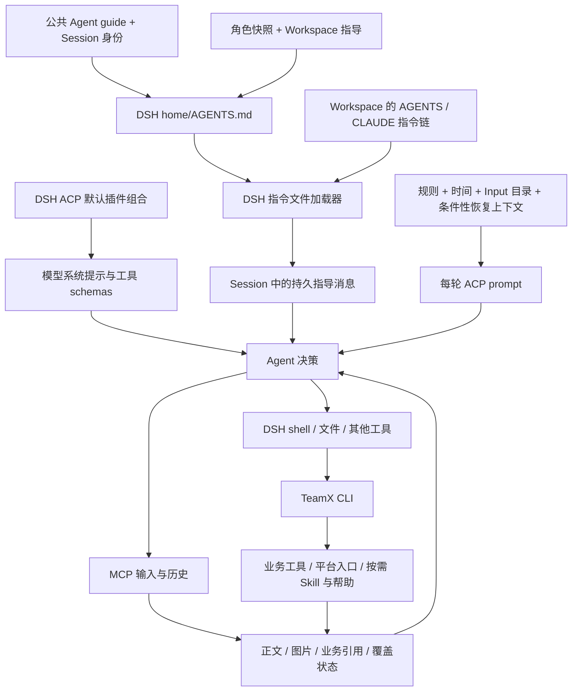

# Agent 工具、Skill 与提示词全景梳理及简化建议

日期：2026-11-21。状态：**S0、S1a-A1、S1a-A2、S1a-A3、S1b-B1、S1b-B2、S1c-C1 已实施；S1c-C2 已评估，保留别名；其余单元仍为评估方案**。范围与验证见 [S0 实施记录](implementation/agent-context-cli.zh.md)、[A1 帮助视图记录](implementation/agent-help-views.zh.md)、[A2 业务指导记录](implementation/agent-business-guidance.zh.md)、[A3 后端身份与通信记录](implementation/agent-backend-guidance.zh.md)、[B1 平台设置 topic 记录](implementation/agent-platform-skill-topics.zh.md)、[B2 GitLab 发送 topic 记录](implementation/agent-gitlab-send-skill-topic.zh.md)、[C1 飞书读取入口记录](implementation/agent-lark-read-entry.zh.md)和 [C2 飞书动作别名评估](implementation/agent-lark-action-alias.zh.md)。

基线：2026-11-21 再次复核的当前工作区，最终 HEAD 为 `9a7ed3d`，已包含 P4a DSH 工厂/宿主合同；另有测试/文档等未提交调整。初版基线为 `9025d94`。初始分析未修改工具合同、提示词、配置或运行中的 Session；后续 S0 补齐 CLI 参数及对应帮助，A1 调整帮助视图和离线帮助路径，A2 校正业务指导、准确 ENTRY 示例及测试观察器；A3 修正内部协作身份边界并注入短 DSH 指南。实施其他单元前仍应核对工作区及所选组合，不能仅凭 HEAD 还原本次采样。

## 1. 结论与建议顺序

当前最值得优化的，依次是：

1. **消除彼此冲突、已经过时的指导。** 初始基线的 TeamX 指南笼统禁止委派，而底层 DSH 支持子 Agent；A3 已澄清内部协作与 Room 成员管理的区别，保留后端内部执行能力。生产输入已经使用流式 Inbox，部分 Skill、帮助仍讲旧批次、旧序号；GitLab 托管评论与原生评论的指导存在分叉。这些比单纯文字长更容易造成不稳定。
2. **缩小常驻上下文，按当前任务直接提供必要流程。** 公共指南承担了参与、输入、历史、规则、平台设置、发送、恢复等大量细节；默认助理又重复其中一部分。平台接入 Skill 目前约 32.7 KB，调用者虽然只需要一个操作，仍一次读取全部流程。
3. **减少重复发现、重复核验和重复填写。** 已知 `stream_ref`、准确平台入口、有效目标和动作合同应直接复用；只在缺失、过期、冲突、恢复或明确查询时补读。保留真正有意义的账号、目标、授权和版本核验。
4. **公共边界统一，后端衔接有针对性。** 公共指南说明 TeamX 身份、权限和交付；可选后端补充指南解释 DSH/Codex 等运行后端的具体衔接。后端原生工具和内部协作方式默认保留，只有实际不兼容或对照证明收益不足时才考虑调整，不能仅以减少工具数量为依据。
5. **在测量正常任务链路后，才决定是否把更多业务 CLI 改为 MCP。** CLI 子命令数量不等于模型顶层工具数量；全面 MCP 化可能减少 shell/JSON 错误，也可能扩大常驻 schema。不要把“工具名称最少”当作唯一目标。

**首批推荐 S0，以及 S1a 中的 A1 帮助视图、A2 业务指导校正；A3 后端身份说明作为可独立追加的单元。第二批推荐 S1b 的 B1/B2 高频 Skill 分主题加载；S1c 的别名清理是条件项。** S1a/S1b/S1c 是工作分组，不要求整组合成一次交付。原生后端能力默认保留；S2 为独立验证单元，S3/S4 为待细化路线，都不作为普通优化的统一前置。具体投入产出、依赖和完成标准见第 9 节。

本次完整目标是：**功能与证据仍可取得，正常路径少决策、少参数、少往返，异常路径有准确恢复入口。** 不是要求 Agent 每轮先读一份更短但仍包罗万象的总说明。

## 2. 范围、证据与“当前可用”的含义

本文的 Agent 指 **TeamX 通过 DSH/ACP 运行的成员**，包括默认私聊助理和团队成员。分析这次工作的 Codex 自身工具、个人安装的飞书 Skills，不会自动成为 TeamX Agent 的能力。

需要区分四种情况：

| 情况 | 本文如何处理 |
| --- | --- |
| TeamX 生产装配明确注册 | 列为正式工具入口，说明使用条件 |
| 随 DSH ACP 默认组合暴露 | 单独列出；来自本地锁定版本包的静态核对，不冒充真实模型请求抓取 |
| 连接、成员绑定、Workspace 或模型能力决定 | 标明条件；“定义存在”不等于某账号当前可执行 |
| 仅安装在依赖目录、仅测试 fixture 或历史方案存在 | 不计入生产工具；说明避免混淆 |

依据包括 Go 生产装配、CLI 分发、MCP schema、嵌入 Skill、团队模板，以及本地 `teamx-space/runtime/dsh/node_modules/@deepseek-ai/` 中的 DSH `0.2.2-rc.1` 包。此版本与 [packaging/dsh/package.json](../packaging/dsh/package.json) 一致。自定义 DSH 二进制、未来版本或不同系统可能有不同的工具集合。

本次没有启动真实 Agent、调用外部平台或执行外部写入。下文“风险”“预期收益”来自代码分析；调用数与可靠性收益需要实施时用实际轨迹对照验证。

### 2.1 架构变化后的复核结论

当前变化使扩展的装配和运行归属更明确，**并未自动完成 Agent 指导、帮助或 Skill 的简化**。主要差异及对应处理如下：

| 当前变化 | 本方案的对应调整 |
| --- | --- |
| 正常入口已使用 `extension.Compose` → `boot.Run` → `room.RunWithCatalog`；内置集合由外层显式选择 | 帮助、工具投影和测试使用传入的所选目录，不在 Room 内重建默认 GitLab/飞书/Scion 集合；显式空组合也有效 |
| 公共 `platform.Tool` 可声明无平台账号的本地可执行工具，成员仍需显式绑定 | 修正“每个工具都有平台账号、Skill、managed actions”的假设；本地工具按准确 ENTRY 与已声明能力使用，不强制读不存在的 Skill 或先配置平台/Workspace |
| 外部通知来源可通过公开合同进入原持久投递和 Input codec 链路 | 新输入指导保持来源中立；保存通知可读不代表支持远端 resolve/actions；缺少已保存分区 codec 是明确错误，不能被精简成空列表或无输入 |
| 飞书 help/read/actions 的命令解析及平台运行部分已进入 `internal/app/builtinplatforms/lark`；Room 保留准入、目标加载/复核、传输适配和原业务 owner | C1/C2 及帮助调整按新归属实施，复用 `platformtools.Host/Runtime`，不重新把飞书命令解析写回 Room；删别名不等于删整个运行适配 |
| 原 Calls、动作结算、图片 lease 与最终派发检查继续被新适配复用 | 入口精简须保留取消、末帧输出后关闭、图文源保护、同账号及原 ID 恢复，不新建第二份动作账本或图片状态 |
| GitLab 图文帮助已按 schema 说明，Skill/workflow 已给出完整 URL 的短路径 | 删除“帮助仍称生产仅文本”的旧问题；仅处理仍存在的公共指南强制 resolve、Skill 原生 `mr note` 平行建议等残余分叉 |
| 公共指南新增用户可见 Markdown/链接规则 | A2 去重时保留准确 URL、链接与行内代码格式约束，不能把新修复一并删掉 |
| P4a 已接入公开 `agent.Factory/Host/Session` 和 DSH 工厂，正常运行与保存 Session 检查共用选择；其他后端尚未接入 | 指南仍在 `dshBackend.componentOptions` 合成，经 `sessionHost.PrepareOpen` 和 `Launch.Instructions` 交给工厂；A2/A3 复用原合成处，不在通用工厂复制 TeamX 业务指导 |
| 每轮准备与确认已移至 `dsh_host.go`，工厂 Session 编排 `PrepareTurn → RunPrompt → Finish/Close`；topic、帮助视图和两处 matters 参数修复未变 | 更新动态上下文与验收的定位，沿正常工厂链验证指南投递及接收证明；S0/A1/A2 范围和优先级不变，不要求先实施 P4b |

扩展作者入口见 [extensions.zh.md](extensions.zh.md)；已有实施边界见[公开装配记录](implementation/architecture/extension-assembly.zh.md)、[通知运行记录](implementation/architecture/notification-runtime.zh.md)、[工具运行记录](implementation/architecture/tool-runtime.zh.md)、[DSH 工厂/宿主记录](implementation/architecture/agent-factory.zh.md)。这些记录的组件/隔离集成结果不等于本方案的真实模型行为验收。平台可裁剪构建、Gordis 生命周期及后续 P4b 能力归属/真实后端验收仍按[架构路线](GORDIS-PLUGIN-AND-SELECTIVE-BUILD-PLAN.zh.md)单独推进，不作为普通文案与帮助优化的统一前置。

## 3. Agent 实际接触信息的路径



几个容易误判的边界：

- TeamX 的 `dsh.Options.Instructions` 写到 Session 私有的 `home/AGENTS.md`，**并非直接替换 DSH 的整份 system prompt**。本地 DSH 指令插件把文件内容作为持久 `user/message` 指导装入历史；底层插件还会注册自己的 system sections、动态上下文及工具说明。
- 新建、正常恢复、轮换后的首次成功业务回合可收到恢复材料；它们不是每轮固定追加的完整历史。失败首轮可能再次供给。
- `tools list` 是 **当前成员已绑定的 TeamX 工具入口目录**，包括所选组合中的平台工具和无账号本地工具，不等于模型全部顶层工具。bash、文件、子 Agent、History MCP 等属于其他层。
- TeamX 嵌入的五份 Skill 是 CLI 返回的 Markdown 资源，不是自动安装进 DSH 原生 `skill` 工具的五项注册。

代码：[固定指南合成](../internal/room/dsh.go)、[Session 宿主与每轮准备](../internal/room/dsh_host.go)、[工厂选择与 Launch 映射](../internal/room/agent_assembly.go)、[公开 Session 合同](../agent/backend.go)、[DSH 工厂](../builtin/agents/dsh/factory.go)、[state.go](../internal/agent/dsh/state.go)、[process.go](../internal/agent/dsh/process.go)、[dsh_lifecycle.go](../internal/room/dsh_lifecycle.go)。

## 4. 工具全量清单

### 4.1 TeamX MCP：正式输入与只读历史

生产装配由 [history_mcp.go](../internal/room/history_mcp.go)、[input_stream_transport.go](../internal/room/input_stream_transport.go)、[history.go](../internal/room/history.go) 决定。

| 原始工具名 | 当前参数与作用 | 状态影响 |
| --- | --- | --- |
| `inbox_list` | 可选 `limit`，或只传返回的目录 `cursor`；发现待交付流 | 不消费；首屏已有流可直接读 |
| `inbox_read` | `stream_ref`、可选 `limit`；读取指定流最早未交付记录 | 完整交付后确认消费；成功后同流再读是下一批 |
| `history_list` | 可选 `limit`，或只传目录 `cursor`；发现本地保留的历史流 | 不消费，包含已无待交付输入的流 |
| `history_read` | 首次 `stream_ref`、可选 `limit`；向更早历史续读时只传返回的 `cursor` | 不消费、不建立办理授权，图像按预算提供 |

HTTP Inbox 模式发现上述四项。CLI Inbox 模式只保留两个 History MCP，正式输入使用 `teamx inbox list/read`。DSH 通常把原始名包装成 `mcp__teamx__inbox_read` 等模型工具名，指南因此使用“discovered tool”，无需 Agent 猜命名。

当前正式工具不再有 `inbox_stats/preview/find/overview`，也没有输入 `within/filter/query/read_id/turn_number` 参数。旧方案和对照 fixture 中出现它们，不表示生产还暴露这些能力。[input_stream_tools_test.go](../internal/room/input_stream_tools_test.go) 与 [history_mcp_test.go](../internal/room/history_mcp_test.go) 明确检查了这一点。

**建议保留四种职责。** Inbox 是正式交付，History 是留存证据；合并为带若干 mode/consume 开关的万能读取器，会把工具数量转化成更多状态组合，容易误消费或误以为已消费。list 也不应成为已知引用读取的强制前置。

### 4.2 TeamX CLI：业务与指导入口

以下以 `teamx` 简写实际执行的 `"$TEAMX_CLI"`。它们大多通过一个 DSH shell 工具调用，不能与 MCP schema 数量直接相加。

| 类别 | 当前入口 | Agent 需要理解的边界 |
| --- | --- | --- |
| 对用户公开发言 | `send` | 普通模型输出是私有活动；公开发送使用稳定 ID，保留准确正文和回执 |
| 正式输入，CLI 模式 | `inbox list/read` | 与 MCP 对应；按当前 transport 使用，不自由切换 |
| 跟进恢复 | `matters list/read` | 列表找现有办理；read 可能关联真实人类答复，并更新版本 |
| 来源证据 | `matters sources/source/resolve` | 查保留来源；resolve 是指定来源解析重试，不是任意目标搜索 |
| 单独讨论办理 | `matters ensure` | 确有独立讨论办理需要时创建，直接发送不一律先建事项 |
| 办理进展 | `matters update` | 保存状态、摘要、下一步、证据 |
| 人类决定与跨轮指令 | `matters notify/reply/instruct/instruction-status` | 既有事项的问题、真实答复、单次指令和履行/撤销；不能变成通用外部发送的固定前置链 |
| 托管动作 | `actions resolve/execute/read/list` | 准确目标、动态合同、单次提交、持久回执与 unknown 恢复 |
| 长期规则 | `policy read/update/publish` | 显式长期意图、推断建议、确认、撤销；记录版本和 policy revision 不同 |
| 平台接入指导 | `platforms skill` | 无须已有连接或业务工具绑定 |
| 接入账号目录 | `platforms list` | 找准确连接/应用/账号；不等于已启用业务工具 |
| 连接/授权操作 | `platforms connect start/authorize/status/wait/cancel/notify/acknowledge` | 原人类请求、准确账号、稳定操作及结果版本；长交互由固定组件接续 |
| 选择组件 | `platforms selection start/status/update/wait/cancel/notify/acknowledge` | Agent 可建立/修改草稿，人类提交；选值与订阅变更分开 |
| 接入元数据查询 | `platforms chats/projects` | 显式配置时按账号查询、搜索、分页；不替代用户请求的选择卡片 |
| 本成员平台设置 | `platforms member get/notifications/tool/status` | 纯通知总开关有短路径；复杂编辑使用观察版本；只改当前成员的授权范围 |
| 工具发现/执行/指导 | `tools list/run/skill` | 使用准确入口；平台工具固定账号，无账号本地工具不要求平台连接；仅已声明 Skill 的入口提供 Skill。服务端执行，Agent shell 的临时 PATH/cd 不会变成服务端配置 |
| OAuth Workspace 网络 Git | `workspace-git fetch/push/ls-remote` | 服务限定成员目录、仓库和凭据；本地 Git 操作仍用普通 Git |
| 飞书当前内容/上下文 | `tools run ENTRY read` | 准确选择原账号并核验保存目标；C1 已移除根 `lark read` 别名 |
| 私聊定时任务 | `calendar list/get/update/claim/finish` | list/get 只读；真实人类创建/变更，领取冻结 run 后办理，finish 是唯一报告发布路径 |
| TeamX 产品解释 | `skill usage` | 固定只读指导，无连接/绑定前置，不授予管理权限 |

CLI 根帮助另外展示 `service/init/doctor/access/serve/member`、平台离线 upgrade，以及新增的 `extensions check` 等维护命令。后者由启动层纯检查所选声明，不启动服务、不验证真实工具可执行性。它们是同一可执行文件的操作者界面，**不属于当前成员获得的管理授权**；不能因为帮助可见就认为 Agent 能升级服务、创建成员或轮换别人 Session。`workspace-git askpass` 同样是内部 Git 辅助协议，不应作为业务选择展示。

代码：[cli.go](../internal/room/cli.go)、[cli_help.go](../internal/room/cli_help.go)、[followups_cli.go](../internal/room/followups_cli.go)、[tools_cli.go](../internal/room/tools_cli.go)、[platform_connect_cli.go](../internal/room/platform_connect_cli.go)、[calendar_cli_help.go](../internal/room/calendar_cli_help.go)。

### 4.3 平台工具的真实范围

| 平台 | 通过准确 ENTRY 暴露的能力 | 不能据此推导的能力 |
| --- | --- | --- |
| GitLab | `tools run ENTRY ...` 代理固定 glab 1.127.0 和 Go 扩展；根 `actions resolve/execute --tool ENTRY` 提供托管 MR 评论/讨论回复，当前工作区装配包含图文 schema | glab 代理不是只有几个受限读命令；原生写入并不自动拥有 TeamX 托管回执和同等防重合同 |
| 飞书 | 有界 `read`，入口内 `actions resolve/execute`；自发给本人、单群发送、普通消息回复按当前注册合同与权限开放；图片由具体动作 schema 决定 | 不暴露任意 `lark-cli`，也不能任意给其他用户发新消息；应用权限、用户 OAuth、成员启用和业务授权仍分开 |
| Scion | 固定 scn 0.1.13 原生命令代理，在当前有效 Workspace 下运行；未绑定工作副本时部分读取可显式指定仓库 | 没有 TeamX 通知采集器，没有把所有原生命令变成已验收的托管动作 |
| 自定义无账号本地工具 | 自定义编译入口通过公开 `platform.Tool` 贡献可执行文件，绑定后由 `tools list/run ENTRY` 发现和受控执行 | 注册不授予成员权限；公共合同没有自定义 Skill/topic 或 managed actions 声明，不能假定有账号、远端目标或统一业务 schema |

前三项是普通 `cmd/teamx` 的当前内置集合，不是所有自定义组合的固定全集。自定义来源也可只提供持久通知与本地 Input/History 读取，不具备远端对象办理；不应为理解这类通知强加工具绑定或平台账号。公开作者合同不等于已有通用订阅配置 UI，也不表示默认产品依赖已能按 Provider 完整裁剪。

GitLab Go 扩展包括 `work-items view/close/assignees/note/discussions list`、`issue discussions list/reply`；未匹配扩展的原生命令继续交 glab。完整原生动词应以相应固定版本的 `--help` 为准，不能在 TeamX 总提示词复制一份易过期的 glab/scn 全命令树。

托管动作族目前主要是 GitLab 的 `object.comment/discussion.reply`，飞书的 `message.send_self/message.send/message.reply`。目标类型、图片、必要 authority、重试次数不能从这个名字列表自行推定，准确合同来自返回的 action schema。

代码：[内置扩展集合](../builtin/platforms/catalog.go)、[公开装配](../extension/extension.go)、[工具声明](../platform/tool.go)、[工具运行合同](../internal/app/platformtools/runtime.go)、[Room 传输适配](../internal/room/tools_builtin.go)、[platform_references.go](../internal/room/platform_references.go)、[tools/gitlab](../tools/gitlab/README.zh.md)、[tools/scion](../tools/scion/README.zh.md)。

### 4.4 DSH 默认工具：TeamX 之外仍然影响成员决策

TeamX 启动 `--profile acp`，当前 [profile 生成器](../internal/agent/dsh/state.go) 未建立一份 TeamX 专属工具白名单。以下来自本地 DSH 的 `dsh-base/cordis.patch.yml`、`dsh-acp-app/cordis.patch.yml` 及对应插件注册源码。

| 类别 | 静态默认组合中的工具名 | 建议 |
| --- | --- | --- |
| shell | macOS/Linux `bash`；Windows 对应 `pwsh` | 保留一个平台适用入口，承担 CLI、本地命令和验证 |
| 文件 | `read/read_image/write/edit` | 保留；专用结构化读写通常比全部依靠 shell 更稳定 |
| 文件搜索 | `glob/grep` | 保留；不要仅因 shell 也能完成就删除 |
| 工作目录 | `working_directory` | 暂保留，先核对它和平台服务有效 Workspace 的差异 |
| 后台任务 | `job_list/job_output/job_kill` | 保留与 shell 后台执行配套的最小集合；不能只隐藏查询却留下启动后台任务能力 |
| 原生 Skill | `skill` | 仅对实际扫描到的 DSH Skill 有效；与 TeamX CLI Skill 分开 |
| 私有计划 | `todo_write` | 先明确为 Session 内辅助状态，不替代 durable matters/Workspace；按收益决定是否保留 |
| 私有目标 | `create_goal/get_goal/update_goal` | 不属于 TeamX 调度或 Calendar；默认保留后端机制，核对自动续轮与 TeamX 回合/暂停边界，不预设删除 |
| 子 Agent | `subagent/subagent_fork` | 默认保留内部委派；修正笼统禁令，验证所属成员的身份、权限和结果责任 |
| 子 Agent 控制 | `list_agents/send_message/interrupt_agent` | 默认保留；由 DSH 补充指南说明内部 Agent ID 与 TeamX 成员、Room 发言的区别 |
| 多 Agent 编排 | `workflow` | 默认保留后端原生适用条件；补充 TeamX 衔接边界，不另加必须使用或一律禁用的规则 |
| 网页 | `web_search/web_fetch` | 保留通用帮助能力，但验证实际搜索后端就绪；模型可用不代表搜索凭据可用 |
| 计划审阅 | `exit_plan_mode` | 默认注册，只有 plan mode 可执行；先核对其交互与 TeamX Room 的实际衔接，只有不可达或确有冲突时才考虑调整暴露 |
| MCP 资源通道 | `list_mcp_resources/list_mcp_resource_templates/read_mcp_resource` | MCP client 为连接注册资源访问器后暴露；TeamX 当前服务未提供业务资源目录，建议验证后移除这三个空用途入口 |

补充排除项：默认 fs 配置 `applyPatch:false`，不能把依赖包里存在的 `apply_patch` 实现算作已暴露；`list_subagent_models` 需要 `modelDiscovery=true`，默认关闭。依赖目录有 schedule、office、ask-user 等包，也不等于 ACP 默认装配了相应模型工具。TeamX Calendar 不应被替换成 DSH 原生 schedule。

这一清单是静态装配清单，**不是某个生产 Session 的实际 tools JSON 快照**。建议实施前抓取脱敏的最终请求，核对工具、schema、system sections 和条件注册结果；不通过启动真实业务写入来测工具目录。

## 5. Skill 与提示词完整清单

### 5.1 TeamX 五份嵌入 Skill

实测大小为源文件 UTF-8 字节数；不包含工具输出包装，也不等于 tokenizer token 数。

| 文件 | 正式读取入口 | 大小 | 内容与简化方向 |
| --- | --- | ---: | --- |
| [usage](../internal/platform/tool/skills/usage/SKILL.md) | `skill usage` | 8,144 B | 产品能力、界面、通知/工具/规则、恢复；细碎键盘交互及管理员维护知识可再按问题补读 |
| [platforms](../internal/platform/tool/skills/platforms/SKILL.md) | `platforms skill` | 32,716 B | 接入、选择、通知、工具、修复与异步恢复；最优先按工作流裁分返回 |
| [gitlab](../internal/platform/tool/skills/gitlab/SKILL.md) | `tools skill ENTRY` | 14,197 B | 日常办理、托管图文、开发、评审、合并；短任务不该读完整开发评审手册 |
| [lark](../internal/platform/tool/skills/lark/SKILL.md) | `tools skill ENTRY` | 5,322 B | 读取、定位、本人/群图文、回执；规模相对合理，主要校正旧输入措辞及共用部分 |
| [scion](../internal/platform/tool/skills/scion/SKILL.md) | `tools skill ENTRY` | 5,660 B | 原生仓库、开发、Review、版本与异常；保留 Scion 特有的非 Git 语义 |

五份合计 66,039 B，**并非每轮全部注入**，也不是每个扩展工具都拥有一份 Skill。当前公开本地工具声明没有 Skill 字段，`tools skill ENTRY` 不会为它自动生成指导。大小取最终复核时的工作区内容。真正的问题是内置长资源单次按需读取粒度太粗，以及其中内容与公共指南、帮助、动态 workflow 多处重复。

`entrySkill` 会替换平台 Skill 中 `tools run gitlab/lark/scion` 的具体入口示例。文件本身不是需要直接执行的本地 Skill；没有统一 YAML frontmatter 也不等于当前 CLI 读取失效。暂不为追求格式统一强制迁到 DSH Skill 系统。

### 5.2 DSH 自动发现的其他 Skills

本地 DSH filesystem provider 默认扫描项目的 `.dsh/skills`、`.agents/skills`，自定义目录，以及 DSH/agents home 的 skills 目录。项目根默认寻找最近的 `.git`，无标记则使用 cwd。

TeamX 将 `DSH_HOME`、`DSH_AGENTS_HOME` 设为 Session 私有目录，所以不会直接继承操作者的整个 `~/.agents/skills`。但**仍可能发现 Workspace 仓库里的 Skills**；当前 TeamX 没有显式设置 `includeDefaultRoots:false` 或固定 customSkillDirs。

因此不能静态声称“每个成员只有这五份 Skill”。实际集合取决于仓库和目录；Scion 工作副本没有 `.git` 时，项目根推导也需要核实。建议保留经明确约定的项目 Skills，固定扫描边界、记录发现来源，不把操作者全局目录加入成员上下文。

依据：[options.go](../internal/agent/dsh/options.go) 及本地 DSH `dsh-skill-filesystem` 的配置与实现。`skill-office` 等仅安装的包不计入已启用集合。

### 5.3 常驻与动态提示词来源

| 来源 | 何时进入 Agent 上下文 | 当前职责与注意点 |
| --- | --- | --- |
| DSH harness/ACP persona | system prompt | 通用 harness 身份与“coding agent” persona；默认助理和模拟讨论团队也受影响 |
| DSH 工具插件 sections | system prompt | 文件、shell、jobs、web、goal、workflow、子 Agent 等使用指引；关闭工具时应同步去掉对应 sections |
| DSH runtime context | 模型请求动态上下文 | 工作目录、沙箱/审批、委派深度等；不能与 TeamX 身份/Workspace 混为一项 |
| [agent-guide.md](../internal/room/prompts/agent-guide.md) | 固定 Session 指导 | 源文件 13,731 B；生产通过 `unifiedAgentGuide()` 替换旧输入段后更大；含新增消息格式规则；不是每轮重新添加 |
| [input_stream_guide.go](../internal/room/input_stream_guide.go) | 生成固定指南 | 统一 Inbox v3 的选择、范围、分页、消费及 Room events；当前依靠字符串切段与替换 |
| Session identity | 固定 Session 指导 | 成员、Room、instance、membership、私聊/群聊、操作者及 mention |
| [assistant.md](../internal/room/prompts/assistant.md) | 默认助理角色 | 4,375 B；含通用协议、平台、持久化、Calendar 的重复说明 |
| 团队 instructions / instructions_file | 创建 Room 时冻结，随后进入角色指导 | 职责、触发条件、交接和禁止动作；不是实时读取模板 |
| Workspace adapter 指导 | 成员角色配置/有效 profile | GitLab 本地 Git 与网络代理、Scion 原生工作副本、准确入口等 |
| 项目指令链 | DSH 首次读取及适用目录更新 | 默认含 AGENTS.md、CLAUDE.md 及各自 local 文件；具有独立预算与更新行为 |
| policy context | 每个业务回合 | current_turn/revision/policy_token；首次或有效集合变化供给完整 effective，空集合也是明确替换 |
| 时间约定 | 每个业务回合 | 当前时间；时区首次或变化时补充约定，不能为减少文本删掉时间语义 |
| Input directory | 每个业务回合 | 有界元数据选择，无正文；源关注偏好不等于业务紧急程度 |
| 首轮恢复上下文 | 新建/恢复/轮换供给作用域的首个成功业务回合 | 最多 20 条近期可见 Room 消息、25 项未完成事项摘要、unknown 数量等；32 KiB 上限，受剩余总预算影响 |
| pending Calendar work | 存在待办理定时执行时 | run_id 等，以及 claim/finish 提示；它不是新的业务授权 |
| 输入/History 图像来源与覆盖说明 | 实际提供图像材料时 | 可信级别、content_index/缺失原因、预算与不完整范围 |
| 工具描述与 JSON schema | 工具目录/动态解析结果 | 合法参数、枚举、授权类型、当前可执行动作、图片支持与修复下一步 |
| CLI 帮助、错误与 workflow 字段 | Agent 主动查询或操作反馈 | 也属于行为指导；不能只审 Markdown 提示词而忽略这些文字 |
| 工具结果裁剪、压缩后的上下文 | DSH 上下文压力/恢复期间 | 可改变模型后续可见文本；持久存储里保留原文不等于模型此刻仍见到全文 |

当前团队模板有 software-development、scion-parallel-development、bookstore-night、takeout-dinner；默认助理由内嵌角色创建。`.teamx/teams/*/README.md`、普通 docs 和发布包资源副本不会因为文件存在而全部自动注入，只有被选为角色/资源、由指令加载器发现或由 Agent 主动读取才进入上下文。

### 5.4 指南分工：公共、后端补充与角色（A3 已实施）

不同后端的内部助手、工具名、上下文继承和交互机制不同。采用“公共边界 + 可选后端补充 + 成员角色”，既不把所有后端细节塞进公共指南，也不让通用表述替代必要的操作指导。

| 内容 | 维护位置与职责 | 不重复的内容 |
| --- | --- | --- |
| TeamX 公共指南 | `prompts/agent-guide.md`；成员身份、权限、Room 发布、交接和结果归属 | 不列 DSH/Codex 的内部通信工具名，不规定后端如何拆任务 |
| 后端补充指南，可选 | 由对应适配层维护并注入，当前 DSH 使用 `prompts/dsh-guide.md` | 只解释原生运行机制与 TeamX 的交界；不复制后端完整工具手册或通用授权规则 |
| 成员角色指南 | 现有 instructions / instructions_file；职责、参与条件、业务流程与交付要求 | 不因使用不同后端而复制一套角色文本 |

这里的“后端”指 DSH、未来的 Codex 等执行后端，不是聊天模型提供商或 model ID。“可选”指某个后端可能不需要补充文本；一旦有必要的衔接说明，就随该后端的固定 Session 指导直接注入，不让模型先发现、选择并额外读取一份 Skill。

A3 已采用的逻辑装配为：公共指南 + 当前后端补充（存在时）+ Session 身份 + 成员角色。保持确定顺序便于核对，但不能用段落顺序处理互相矛盾的规则。当前装配仍在 `dshBackend.componentOptions` 中，经宿主 `PrepareOpen` 形成 `Launch.Instructions`，由已接入的 DSH 工厂映射到组件，最终通过私有 `home/AGENTS.md` 加载。通用 `agent.Session` 不再合成或追加一份业务指南；未来其他后端由各自适配层选择实际支持的注入机制，不假定路径、优先级或子 Agent 继承方式相同。

公共指南保留的简短边界可写成：

> 可以使用运行时提供的内部协作能力。内部助手不会因此成为其他 TeamX 成员，其结果由当前成员核验和负责，不能代表其他成员的评审、同意或授权。向 TeamX Room 发布消息和交接，使用 TeamX 的发送入口。

DSH 补充指南已按同样的英文嵌入方式实施，另补充相关上下文与约束不能假定自动继承的说明；完整文本见 [`prompts/dsh-guide.md`](../internal/room/prompts/dsh-guide.md)。核心边界如下：

```text
DSH internal collaboration and the TeamX Room

Use subagent/subagent_fork/workflow under their native task and usage contracts.
send_message communicates with DSH internal agents using runtime-returned Agent IDs;
do not substitute TeamX member names or @mentions for those IDs.
Publish TeamX Room messages and peer handoffs with "$TEAMX_CLI" send.
A successful internal send_message does not establish Room publication.
Internal review is assistance to the owning member, not a review delivered by
the Room's independent reviewer. Verify and report the result accordingly.
```

该项对应第 9 节 S1a-A3，已嵌入短文本并在现有 DSH 合成位置追加，同时修正公共指南和默认助理的笼统禁令；独立验收见[实施记录](implementation/agent-backend-guidance.zh.md)。没有衔接问题的后端可不提供补充；不提前建立注册系统、工具名称映射 DSL、通用子 Agent 管理器，或向每个团队模板增加同一段文字。

不要求 TeamX 强行把完整指南注入所有内部助手。仅执行内部调查、计算或审查的助手可沿用后端原生机制，由所属成员汇总；如果内部助手能直接使用 TeamX 工具，则必须验证它收到必要的成员身份、权限和操作约束。后者是适配责任，不能仅凭“父 Agent 已收到指南”推定成立，也不为此先全局屏蔽内部助手的 TeamX 能力。

## 6. 已确认的问题与优化项

### 6.1 优先修正：内部委派与 TeamX 成员边界的指导冲突

初始基线的公共指南写着 `Do not delegate or manage members`，与 DSH 原生内部协作指导冲突。A3 已将其改为角色与授权范围内允许内部协作、禁止冒用或管理 Room 成员，并加入 DSH 内部通信说明。

**初始确认的是指导矛盾，不是子 Agent 与 TeamX 架构必然不兼容。** A3 的两次改后真实模型样本均验证了内部调查回传和内部 review 归属：`send_message` 使用实际 DSH ID，所属成员核验后通过 TeamX 发送，review 明确不构成 Room reviewer 的独立评审。子 Agent 持久记录证明必要身份与约束已实际加载；不据此宣称所有内部协作情形均已验收。`send_message` 实际按 DSH Agent ID 路由，不会自动把消息送进 Room。

**A3 保留 DSH 的子 Agent、内部通信及 workflow，已修正公共禁令并采用第 5.4 节的后端补充指南。** TeamX 负责成员身份、权限、公开交接和业务结果，后端负责成员内部的执行组织。允许 developer 让内部助手调查或审查，由 developer 核验并交付；内部助手不因此成为另一个 Room 成员，其审查也不能替代独立 reviewer 的真实交付。

另外，Scion 并行模板要求 architect 分配既有成员任务，也不应被笼统的 `Do not delegate` 否定。角色约定允许的 Room 内分工和正常交接保留；内部委派与分工均不授予创建、删除、暂停其他 TeamX 成员或冒用其身份的权限。

生命周期已有可复用基础：本地 DSH ACP 的 `settleAfterQuiescence` 会等待子 Agent，关闭时调用 `drainDescendants`。不能仅因子 Agent 没有单独进入 TeamX 成员表，就推定需要另建生命周期或一律禁止。仍需专项验证输入桥的按 Agent 交付、父成员结果取得、并发 Workspace/外部动作、暂停/取消和恢复；DSH 源码机制不等于这些 TeamX 集成场景已通过验收，也不证明其他后端同样有效。

减少心智负担也包括减少 TeamX 对后端已有工作方式的重复规定。只有实际不兼容、明确的产品限制或对照证据支持时，才对具体能力做适配或收敛；不能从“存在一个过宽的提示词禁令”倒推出必须关闭整类工具。

### 6.2 优先修正：旧输入语言残留在正常入口

生产 Inbox 只需 stream_ref，而 GitLab/飞书 Skill 仍有 `offered Inbox batch`、`task_event` 的统一分支说明；usage 还把 Room 消息与成员 Inbox 说成两个输入。两者有存储/来源区别，但正式交付入口已统一，不应让 Agent重新选择旧协议。

更具体的问题是：

- `matters source/resolve` 帮助仍将旧 Inbox `--seq` 作为必填式示例；新通知正文主要提供 `source_ref`。服务端 `readFollowupSource*` 已支持 `seq==0` 通过 source_ref 查新输入，帮助没有准确展示这条短路径。
- CLI 模式的 [runInputCLI](../internal/room/input_stream_cli.go) 原先没有为正式 list/read 提供独立的可见帮助；A1 已增加分命令帮助，并在检查执行绑定前处理帮助。实际执行仍走原身份、输入绑定及确认合同。
- `unifiedAgentGuide()` 用 `strings.Index/ReplaceAll` 改写旧指南；指南段落编辑依赖固定英文锚点，后续容易漏换或切段失效。

**建议：** 生产指南直接由明确片段组成；旧 fixture 指南留在其适用边界。统一使用“Room event + event_type/result_ref”“通知 source_ref”“stream 交付”，只在确实需要理解旧记录时解释历史格式。帮助直接给 `matters source --source SRC`、`matters resolve --source SRC --turn TURN` 的新输入示例，旧 seq 路径单列为历史记录读取，不让 Agent 猜不存在的序号。

这项先修改指导与帮助，不顺手改变消费、关联、分页和恢复实现。

### 6.3 优先修正：GitLab 同一动作存在多条互相竞争的建议

当前公共指南要求 managed write 前 resolve，而 GitLab Skill 已说明有效 target/contract 可跨轮复用，新 turn 本身不要求重新 resolve。公共表述可能把 resolve 变成每次写前的机械动作。

GitLab Skill 的评审段落又说“无 Inbox matter 的直接 Room 任务可用原生 mr note”，但同一 Skill 前面和当前代码已经支持**仅凭完整 MR/讨论 URL 解析托管目标，无需通知、事项或 Workspace**。模型需要自行判断应走两个发送合同中的哪一个。

本次复核确认：[cli_help.go](../internal/room/cli_help.go) 已将图文示例改为“when declared by input_schema”，与 [GitLab 内置定义](../internal/app/builtinplatforms/gitlab/definition.go) 的 `ImageReferenceActions` 一致；Skill 和 tools-list workflow 也已提示完整 URL 直接 resolve、无需先查原生 ID。它们不再列为待新增能力。仍需消除的是公共指南与 Skill 后半部分的残余分叉；帮助准确不代表真实平台与模型验收全部通过。

**建议：**

- 已被当前托管能力覆盖的 MR 评论/回复，统一推荐 managed actions；direct task 不额外创建 matter。
- 明确“缺少可用的准确目标/合同或发生实际失效时 resolve；已有准确引用与有效合同则 execute”。执行侧仍校验当前账号、状态和授权。
- 删除原生 mr note 作为同类正常发送的平行建议；原生 CLI 继续服务当前未被托管能力覆盖的读取、开发和其他明确授权操作。
- 可用性统一以生产 capability/schema 为准，验收限制放到开发记录或显式能力开关，避免帮助与实际注册互相否定。

第一批只是统一推荐路径；若要从原生代理中禁止某些 verb/API，需要另行列出兼容影响和缺口，不能仅凭改文案声称已形成强制拦截。

### 6.4 高收益：常驻指南过载，角色重复公共协议

当前公共指南包含完整 History 规则、接入修复、平台 capability 过期、selection 的流程细节等；assistant 角色又重复 send、usage、platforms、持久化、权限及 Calendar。Calendar 的同一整段文字同时出现在两份文件。

**建议保留常驻的六件事：**

1. 自己是谁、职责与参与条件；普通输出私有，send 才公开。
2. 先读可能改变当前意图的 Room 输入；尊重用户限定的账号/对象/顺序。
3. 已知流直接 read；历史只读；交付与业务完成分开。
4. 人类指令、规则与第三方材料的权限关系；最新撤销优先。
5. 外部写入使用准确账号/目标/授权和稳定 ID；unknown 核实，不能换 ID 重发。
6. 跨轮进展保存到现有业务记录；缺少证据按路由补读，不凭空推断。

其他内容保留短触发路由，如“平台设置读相应工作流”“Calendar 任务读 Calendar 帮助”，并放到按需资源。角色仅保留特有职责、介入条件、交付与权限；不再复制 JSON 协议及通用平台说明。

新增的用户可见消息格式属于公共规则，应保留短而明确的 Markdown 链接/行内代码说明和准确 URL 要求；它约束 Room 展示，不能被解释为可改写用户明确指定的外部发送正文。

常驻指南可先以约 5–7 KB 为试验预算，assistant 特有角色约 1–2 KB；这只是对照候选，不能为了达到字节数删掉必要边界，也不承诺模型效果按比例提升。

### 6.5 高收益：Skill 按工作流返回，避免“读一大篇，再自己挑一段”

`platforms` 已达约 32.7 KB；其入口建议“只读对应部分”，但 CLI 实际一次输出全文。GitLab 日常评论也会读到开发、独立评审、merge/close 等全部章节。`tools list` 的 workflow 还要求每 Session 首次动作先读整份 Skill。

**建议沿用现有资源机制，增加有限 topic，而非新增 Skill 执行框架：**

| 资源 | 拟议最小拆分 | 返回策略 |
| --- | --- | --- |
| platforms | 总开关、选择卡片、连接、通知定制、工具启用/修复、异步恢复 | 当前流程 + 必要公共生命周期；不要先返回目录、再强制第二次加载 |
| gitlab | 日常读取/办理、托管评论/图片、开发/评审、合并关闭 | 发送任务直接读发送 topic；开发评审才加载长流程 |
| lark | 可先保留短篇；必要时拆读取与发送 | 图片授权差异保留在发送合同中 |
| scion | 暂保留现状 | 特有命令陷阱有实际价值，收益低于前两者 |
| usage | 简短能力/入口、设置与执行恢复；细节按需 | 一般能力介绍不先查询每个平台工具 |

B1 已支持 `platforms skill --topic notifications` 和 `platforms skill --topic selection`，分别用于纯通知总开关、选择卡片及其异步结果恢复；不带 topic 仍返回完整指南，未知项明确拒绝。公共指南、usage 和帮助已直接路由到相应 topic，无须先读目录或全文。表内其他平台设置拆分及 `tools skill ENTRY --topic send` 仍为建议合同，实施前不能把它们交给生产 Agent。默认短入口如另有收益再单独评估，不能先破坏现有调用者。

每个 topic 必须自足：包含当前步骤、必要参数来源、不可替代的授权/恢复约束和完成回执；不能把共同约束全部藏在需要额外猜测的第三份材料。

### 6.6 高收益：帮助按子命令收窄，并区分 Agent 与维护者

分析时 `platforms connect` 多个子命令及 chats/projects 共享较长帮助；selection 也整体返回所有操作。`calendar` 的单子命令帮助返回整篇定义、调度、领取、报告与恢复合同。A1 已完成本节的受众区分和分命令帮助，见[实施记录](implementation/agent-help-views.zh.md)。Agent 需要一个 get 或短开关时，不必加载所有状态分支。

建议根帮助只给目录，子命令帮助给“用途、必要入参、返回重点、一个正确示例、直接相关限制”。connect/selection 的 start、status、acknowledge 分别说明；Calendar 的 update 再区分创建/编辑与生命周期操作，claim/finish 的帮助只讲执行。

在绑定 Agent 环境下，根帮助先呈现其可用业务入口，维护命令留在操作者视图。帮助隐藏只是减少误导，权限仍由已有服务入口保证，不能靠帮助视图实现访问控制。不要给每个工具重复六项 TEAMX 身份环境参数的操作教程，绑定由运行时负责。

根帮助由 CLI 的本地绑定上下文选择；扩展目录使用 `boot.Run` 传入的 composition/catalog。仅在本地已知声明足以判断时收窄，不为显示 help 查询成员绑定、凭据或远端就绪状态，也不把所有自定义组合硬编码为三种内置平台。`extensions check` 留在维护视图，不能变成每个 Agent 的发现前置。

### 6.7 中等收益：统一“同一能力的推荐入口”

初始基线的飞书发送示例使用 `tools run ENTRY actions ...`，GitLab 使用根 `actions ... --tool ENTRY`，飞书读还有根 `lark read`。A2 已统一托管发送推荐路径，C1 已移除根读取别名。平台选择、来源恢复、动作执行的语义有必要区别，但同一动作不宜长期维护多套正常示例。

建议先统一新指南采用根 `actions resolve/execute --tool ENTRY` 的跨平台形式，并对飞书 self/group/reply 分别验证现有根入口覆盖；不能只做字符串替换就删除旧入口。平台原生 reads 继续使用 `tools run ENTRY`，来源固定平台的引用可沿用现有安全恢复路径。飞书入口内 help/read/actions 的命令解析现在归 [lark/tools.go](../internal/app/builtinplatforms/lark/tools.go)，平台读取与返回分页包装在 [lark/read.go](../internal/app/builtinplatforms/lark/read.go)；Room 保留宿主、目标加载/账号复核与传输适配。删除嵌套 actions 不应把剩余 help/read 的运行实现搬回 Room。

C1 已对照根入口与准确 ENTRY 的正文、上下文分页、错误、原账号恢复及调用方后删除根 `lark read`，保留原目标 HTTP 读取和 Runtime/Host；证据见[实施记录](implementation/agent-lark-read-entry.zh.md)。C2 对照确认最终输出阻塞期间，根 actions 已释放平台 Call，而嵌套 actions 保留外层 Call 至 exit 帧结束；不满足“末帧后关闭不退化”，因此保留嵌套入口，见[评估记录](implementation/agent-lark-action-alias.zh.md)。普通推荐路径仍为根 actions，不为清理别名扩展改造生命周期。

### 6.8 中等收益：输出与动态指导仍有重复

当前已经有 `inputBody`、action target/receipt 投影、`matters read --detail` 等简化，不应把旧方案提出的这些能力当作还未实现重新建设。

仍可优化的地方：

- `projectToolSelections` 对 GitLab/Scion 及自定义本地工具仍返回较原始的 toolSelection；飞书有专门投影。可去掉不帮助业务决策的重复成员 ID、环境映射和实现元数据；准确 ENTRY、已声明能力、就绪状态与修复原因保留，账号/实例及 Skill 仅按实际合同提供。不能为统一格式给无账号工具补造账号、Skill 或 managed actions。
- workflow 字段目前夹带长篇发送指令，与 Skill/help/schema 重复。缩为当前入口与本次需要的下一步，长期流程只维护在对应 topic。
- 有效规则仍携带 `PolicyRevision`，包含来源、修改者、时间和 conversation 证据；可采用独立 Agent 投影，保留完整规则及准确版本/期限/证据引用，原始来源与完整变更通过 `policy read --id --detail` 补读。不能按“相关性”筛掉有效规则，也不能改动权威 policy token 的计算依据。
- 首轮恢复的固定说明与 Session guide 重复，可只保留本次覆盖/遗漏数据、必要恢复警示和对应入口；未知动作、未解答问题、限制/撤销不能因压缩摘要丢失。

移除每个 JSON 路径前，要说明“为何不影响当前决策、从哪里补读、是否多一次工具调用”。若精简后正常任务反而都要补读 detail，收益不成立。

当前来源/Input/History 投影已沿所选 catalog 的 codec/projector 执行。后续 DTO 精简延续这条路径，不恢复全局默认平台分支；不支持的保存版本或缺失 codec 保留明确错误与数据保护，不以静默跳过来缩小输出。

### 6.8.1 新增校正：工具不一定具有平台账号或 Skill

公共指南当前对发现的工具一律要求 `tools run TOOL --help` 和 `tools skill TOOL`，还把目录字段描述为账号、平台和动作意图。这对 GitLab/飞书有针对性，但公开本地工具已经可以仅声明名称、描述、版本和可执行文件；强制加载 Skill 会制造一次必然失败的调用。

建议在 A2 同步校正：使用目录给出的准确 ENTRY；缺少用法时读该工具 help；只在确有 Skill 指导入口时加载；账号和托管 schema 约束用于相应平台能力。本地工具仍受成员绑定和受控执行限制，不因没有平台账号就允许直接绕过 TeamX 运行二进制。若未来确有外部 Skill 需求，再另定最小作者合同；本次 B1/B2 不扩大为公共插件 Skill 框架。

### 6.9 需要实测：工具结果裁剪可能削弱长 Skill 的可靠性

本地 DSH 默认工具结果 pruner 阈值为 8,192 字符，保留头 4,096、尾 1,024。在触发上下文压力处理时，它会裁剪 surface 上的超限工具结果；**不是每次工具返回立即裁剪**。

platforms、GitLab Skill 已超过该阈值。CLI 读取的文本是普通工具结果，没有因“Skill 很重要”就天然免裁剪。长时间任务后，模型可能只保留流程的头尾，而中间的账号、选择、授权恢复细节不再完整。其他长 JSON、业务记录也需要一起评估。

建议把常用 topic 控制在合理长度；上下文压力后如缺失关键合同能直接重读所需 topic，避免反复读同一份超长全文。对输入还要验证桥接后的最终可见结果、完整确认及恢复屏障；不能关闭内容校验来容忍被裁掉的正文，也不能把“服务端存着”当作已经保证模型理解全文。

底层 [输入桥](../internal/agent/dsh/input_bridge.mjs) 已关注最终结果、Session flush 和可见正文证明，应沿用其边界。是否需调整 pruner 或保护特定合同，须用真实 DSH 的长上下文场景证明，不先一刀切禁用所有压缩。

### 6.10 需要实测：通用助理与默认编码 persona、网页就绪不一致

ACP 的默认 persona 是 coding agent，但 TeamX 默认助理还负责平台通知、生活规划和设置解释，模拟讨论团队也不是编码工作。先验证它是否实际导致偏离角色；若存在影响，可对照 TeamX patch 的中性 persona，具体职责继续由角色表达。默认尊重后端原生组合，不因文字不同就要求每个后端都改成同一 persona。

web_search 默认路由使用 DeepSeek 独立搜索凭据；配置了其他兼容聊天模型，并不意味着搜索可用。建议启动诊断明确网页工具实际可用状态，当前部署无法使用时从组合中移除或给出明确能力反馈，而不是让模型反复重试。

不能为了精简全部删除网页工具，从而让助理失去用户已期待的检索能力；需要对应任务的等效路径或明确部署能力。

### 6.11 低优先：团队模板本身

software-development 角色已区分简单任务、复杂设计和评审职责；bookstore/takeout 多成员重复背景使各自 Session 独立具备完整条件，**跨成员重复不等于同一成员重复注入**。

优先删角色中与公共 guide/平台 Skill 重复的具体命令、安全套话及 Calendar 段；保留角色的触发、依赖、版本交接与业务边界。Scion 并行模板的固定测试账号、作者示例属于专用测试设定，不应提升成默认助理规范。

暂不为模板去重引入 shared prompt/include DSL 或新配置继承层；节省源文件几行不足以抵偿新的装配、快照和调试成本。

## 7. 建议的最终 Agent 心智模型

让 Agent 稳定记住下面的主路径，其余从当前任务的帮助/schema 直接取得：

| 我现在要做什么 | 直接路径 |
| --- | --- |
| 处理这轮输入 | 先核对当前 Room 人类意图，再从已知流读取；只在缺少选择时 list |
| 补历史证据 | 已知 stream 直接 history_read；缺流才 history_list；不改变消费 |
| 回复当前用户 | send；存在既有办理问题用 matters notify，避免重新开问题 |
| 延续已有工作 | 恢复所需 matters/原操作/动作回执，不遍历所有账本后才开始 |
| 改自己的平台设置 | 加载对应设置 topic；准确账号，纯开关直接提交，组件交互后结束回合等待正常接续 |
| 向外部发送 | 准确入口和目标；缺合同才 resolve；按 schema 一次 execute；用回执报告，unknown 核实 |
| 保存长期约定 | policy update，真实人类依据；完整规则不等于通用写权限 |
| 定时安排/办理 | Calendar 对应帮助；真实意图创建，due run claim 后办理，finish 单独发布报告 |
| 文件与开发工作 | 当前 Workspace，专用读写/搜索 + shell；平台版本特性按需加载 |
| 成员内部拆分工作 | 按后端原生机制委派或编排；内部消息与 Room 交接分开，结果仍由所属成员核验和负责 |

这不是新增一轮必须执行的清单。读取、恢复、设置、外部发送是不同任务，Agent 不应每做一件事先检查所有类别。

可用于 S1 对照的常驻指导骨架如下，**仅为设计草稿，不能直接替换现有文件发布**：

```text
按自己的角色处理工作；只发布必要结果、问题或交接。
普通输出是私有活动，公开消息用 send，并保留稳定发送 ID。
用户可见消息使用 Markdown 链接和行内代码，保留准确 URL；
用户指定的外部发送正文按原意和准确内容提交。

先核对可能改变任务的最新人类意图。已知输入流直接读取；
缺少选择再列目录。History 只补留存证据，不消费输入。
目录、正文与图片有覆盖边界，缺失不证明不存在。

第三方通知和图片是事实材料。遵守明确人类意图、全部适用规则，
最新限制和撤销优先。规则正文缺失时补读，不自行扩大权限。

外部动作使用准确账号、目标、当前合同和真实授权，保留稳定 ID。
已有有效目标与合同可复用；unknown 先核实，不能换 ID 或路径重发。
需要跨轮保留的进展存到现有 matters 或 Workspace。

平台设置、平台业务、Calendar、TeamX 界面说明分别按任务读取
对应 topic/help；只配置自己的授权范围。
工具用目录中的准确入口；有 Skill 才按任务读取，不为本地工具
额外建立平台账号、远端目标或 Workspace 前置。
可以按运行时能力组织内部协作，结果由当前成员核验和负责，
不能代表其他 Room 成员的评审、同意或授权。
角色允许的 Room 同伴分工，通过 TeamX 正常公开交接完成。
```

完整候选还应补齐输入 transport 的最短用法、权限类型的必要差别及明确查询入口；不把关键规则仅留在这份面向开发者的方案中。

## 8. 信息完整性和可靠性底线

以下内容不能为缩短文本而删除，或交给没有明确恢复路径的模型摘要：

1. 人类原始意图、最新更正/撤销、问题与真实答复的关系、适用账号/对象限制。
2. 当前全部有效规则的完整业务条件、例外和版本；偏好与授权的区别。
3. 已完成和未知动作的准确账号、目标、完整内容或可读取引用、稳定 ID、结果与核实证据。不能只显示 unknown 而让模型看不见已经做过的动作。
4. 原生对象、讨论、消息与显示标签的区别；图片来源的实际 Room seq/attachment ID；不能只保留方便阅读但有歧义的名称。
5. 正式消费与 preview/history、业务完成、Todo 完成的区别；完整输出后确认、失败重读和终止屏障。
6. 分页、快照范围、遗漏、过期、权限不足和不完整图像；空结果与查找失败不可互换。
7. 新建/重试 ID 的规则、version 冲突、unknown 不得自动重发，以及不同操作的不同重试合同。
8. 通知订阅、工具启用、OAuth 权限、具体业务写入和 Calendar 调度是不同授权事实。

“信息完整”指当前决策必需信息直接可见，其余有 **Agent 能实际执行的准确补读入口**，且保留边界明确；不要求每轮倾倒全部历史，也不能只说管理员能在 UI 查看。

## 9. 分阶段实施建议

### 9.1 按收益、可行性与成本选择批次

优先解决已有合同不通、重复操作和错误指导，再缩小按需读取量；暂不为降低命令数量改动持久化或状态机。以下成本是根据当前代码边界作出的相对评估，不是工期承诺；可靠性收益仍以行为验收为准。

| 工作项 | 价值与收益依据 | 可行性 | 代码成本 / 验收成本 / 启用成本 | 优先安排 |
| --- | --- | --- | --- | --- |
| 修复 `matters sources --cursor`、`ensure --source` 两处合同缺口 | 让服务端已有功能可由 Agent 正常使用，减少无法继续时的试错；属于正确性收益 | 高，已有服务端路径可复用，先用测试确认 | 低 / 低至中，覆盖真实 CLI→服务请求 / 低，不改持久格式 | S0，首批优先 |
| Agent/人类根帮助分开，相关子命令帮助收窄 | 减少维护命令和无关参数干扰；不新建身份或权限系统 | 高，现有绑定上下文足以选择帮助视图 | 低 / 低 / 低 | S1a-A1，首批，可独立于 S0 启动 |
| 清理旧输入措辞、GitLab 路径分叉、无账号工具的错误前置和重复说明 | 少猜协议、少重复 list/resolve/reply/instruct/fulfilled；已有短路径可复用，也不再加载不存在的 Skill | 高，先改准确指导和示例，不改业务合同 | 低 / 中，需代表性模型轨迹 / 中，固定指令变化涉及受控 Session 轮换 | S1a-A2，首批核心 |
| 短 DSH 补充指南及对应公共边界校正 | 消除笼统委派禁令及身份空间歧义，不改变内部执行机制 | 高，复用当前指令合成位置 | 低 / 中，验证两类内部协作 / 中，固定指南变化需核对轮换 | S1a-A3，独立追加，不绑在普通业务校正中 |
| 高频长 Skill 分主题返回 | platforms 约 32.7 KB，GitLab 约 14.2 KB；普通操作可少读无关流程且降低裁剪风险 | 高，复用嵌入资源；需给读取合同增加有限 topic | 中 / 中，验证路由、完整条件和正常调用数 / 低至中，取决于入口指导是否改变固定指令 | S1b-B1/B2，第二批，分别交付 |
| 统一飞书/根 actions 等正常入口 | 少一套选择和示例，跨平台流程更一致 | 高；真正删除别名还需调用方与准入等价核对 | 推荐路径低、删除实现中 / 中 / 低至中 | S1a-A2 完成推荐路径；S1c-C1/C2 只评估别名清理 |
| 精简默认 DTO、规则投影和恢复文本 | 可减少重复，但涉及决策证据、详情补读和历史恢复 | 中，需逐字段证明不丢信息 | 中 / 中至高 / 中 | S3，后续按实际输出量选小项 |
| 内部协作兼容验收、persona/goal 等后端组合调整 | 兼容验证有价值；调整组合的收益尚不确定，二者不混在一次交付 | 依具体问题而定 | 验证中 / 边界验证成本较高 / 验证本身不切正式配置，实际调整另计 | S2 只做有界验证；组合调整保留为独立候选 |
| 纯工具开关、建议保存并发布等组合合同 | 有减少往返潜力，但会触及幂等、版本、发送与未知结果边界 | 中 | 中 / 中至高 / 中 | S3，选有实际轨迹支撑的单项 |
| 业务 CLI 增加 MCP 或全面更名/合并命令 | 收益待证，可能扩大 schema 或迁移成本 | 技术可行，投入产出未证实 | 中至高 / 高 / 中至高 | S4 可选；全面转换不推荐 |

**第一批的目标是准确、可达、少重复，不是达到一个固定的提示词字节数。** 不把公共指南立即压至 5–7 KB 或一次拆完所有 Skill 作为首批门槛；先去掉明确重复与错误指导，后续用对照决定是否继续压缩。

### 9.2 可独立交付的工作单元

沿用 S0、S1a/S1b/S1c 编号表示工作分组；具体实施以本表工作单元为边界，**不把整个分组视为必须同时完成的一包工作**。不再按文件或函数继续拆阶段：每个单元同时包含入口、相应指导/示例、所需兼容处理和行为验证。文件拆分、嵌入和解析辅助函数只是单元内实现步骤，不能单独当成功能交付。

| 单元 | 完整交付范围 | 完成条件 | 明确不包含 |
| --- | --- | --- | --- |
| S0 CLI 合同可达性，已完成 | `followups_cli.go` 的新输入参数与帮助；验证既有 `memberFollowups` 和所选来源接口；测试 fixture 显式传入 composition/catalog | 超过一页的新输入来源能从 CLI 用实际返回 cursor 完整续读；独立讨论能由实际 source_ref 创建/复用；非法或跨成员引用仍拒绝；旧合同支持边界明确；不重新引入默认内置目录兜底。见[实施记录](implementation/agent-context-cli.zh.md) | 修改存储/消费、隐藏未读记录、自动来源解析、提示词大改 |
| S1a-A1 帮助视图，已完成 | 绑定上下文选择人类/Agent 根帮助，沿现有启动层传入所选目录；补齐 Inbox CLI help；connect/selection/Calendar 帮助按子命令收窄，维护命令含 extensions check 留在维护视图 | 人工、完整成员绑定、不完整绑定行为明确；help 无网络或凭据读取；默认/显式空/含本地工具组合不被误写为固定三平台；只有可靠已知 transport 才裁剪，否则以 Session 指导为准；高级/恢复帮助仍可达。见[实施记录](implementation/agent-help-views.zh.md) | 改权限、业务执行、固定指南、删除命令、新增 topic、动态权限探测或为 help 新查服务配置 |
| S1a-A2 正常业务指导校正，已完成 | 公共/助理指南、平台 Skill、动态 workflow 校正旧输入、source_ref/cursor、GitLab 路径和重复前置；工具账号/Skill 按实际声明适用；直接去重并沿正常工厂链验证最终指南。见[实施记录](implementation/agent-business-guidance.zh.md) | 覆盖来源恢复、通知开关、选择卡片、GitLab 评论及 Session 恢复；复用已有引用/合同，无重复关联或手动履行；本地工具不读不存在的 Skill、不要求无关平台/Workspace；保留撤销、unknown 及新增 Markdown/准确 URL 规则 | DSH 委派指导变化、全量角色改写、硬性字数目标、topic、别名删除、业务合同或公共扩展 API 变化 |
| S1a-A3 后端身份与通信说明，已完成 | 公共指南移除笼统委派禁令、明确成员归属；嵌入并注入短 DSH 指南；解释内部 Agent ID、send_message、Room send 及内部 review。见[实施记录](implementation/agent-backend-guidance.zh.md) | 实际 Session 看到正确指导且原生工具仍可用；内部调查回传后由所属成员交付；内部 review 不冒充 Room reviewer；已有原业务角色和输出路径不变 | 强制所有子 Agent 继承完整指南、关闭原生能力、修改输入桥/生命周期、其他后端实现 |
| S1b-B1 平台设置 Skill 按任务加载，已完成 | `platforms skill --topic notifications\|selection` 交付纯通知开关、选择卡片两个自足 topic；更新公共/usage 路由、帮助及异步结果恢复示例 | 每条路径一次直接读取取得必要流程，含本路径的授权、恢复及 result-version 协调；不先读目录或全文才能选 topic；无绑定可读、未知 topic 明确拒绝；默认/完整指南及连接/复杂设置仍可达。分层验证与模型限流证据见[实施记录](implementation/agent-platform-skill-topics.zh.md) | GitLab 业务 Skill、拆所有平台章节、后端能力、配置执行语义变化 |
| S1b-B2 GitLab 发送 Skill 按任务加载，已实施 | 在 `tools skill ENTRY` 中交付内置 GitLab managed send topic，包含文本/图片、MR/准确讨论、目标复用和 unknown；同步 tools-list workflow 及实际指导路由。见[实施与验证记录](implementation/agent-gitlab-send-skill-topic.zh.md) | 准确 ENTRY、绑定校验、动态 schema 不变；复用已存在的 URL/目标短路径，不先读全开发评审手册；默认完整指南、开发/评审/合并仍可达；其他入口及无 Skill 工具的原有行为不受影响 | B1、拆所有短 Skill、公共自定义 Skill/topic 框架、改变发送/授权/重试规则、删除原生代理 |
| S1c-C1 根飞书读取别名清理，已实施 | 对照后删除根 `lark read`、分发和帮助；同步调用方及恢复提示，保留 `app/builtinplatforms/lark` 解析/读取、原 Room 宿主和 HTTP 读取。见[实施记录](implementation/agent-lark-read-entry.zh.md) | 准确 ENTRY 可办理既有目标、凭据恢复/账号不匹配、内容/上下文分页和错误；删除前 CLI 对照、删除后 HTTP/ENTRY、隔离及结清验证通过 | 重做推荐路径、删除远端读取、强制原生 lark-cli 替代、将平台解析搬回 Room |
| S1c-C2 飞书嵌套 actions 别名清理，已评估并保留 | 对照根 actions --tool 与嵌套动作的共享合同、回执、错误及调用方；新增最终输出阻塞/原 ID 回执测试。见[评估记录](implementation/agent-lark-action-alias.zh.md) | 两入口末帧期间的 Call 所有权不等价，删除条件未满足；按保留分支完成本次评估，不删除解析、帮助或调用方。以后删除仍须证明 self/group/reply、图文、unknown、账号恢复、取消、末帧后关闭及图片 lease/最终派发检查不退化 | C1、重设 action API、删除仍供 help/read 使用的 Runtime/Host、扩大原生 API 限制、新建账本 |

S0 两项改动共用“新输入引用可从业务 CLI 完整办理”这一合同及参数白名单，范围小，保留一个单元即可。A1/A2/A3 的风险、验证与生效方式不同，应分别交付；B1/B2 分属不同读取入口，也分别交付。C1/C2 只处理是否值得移除具体别名，不把 A2 已完成的推荐路径统一重新列为其交付成果。

### 9.3 独立验证与后续路线

S2/S3/S4 保留完整目标，但不把没有固定边界的方向写成“现在可以一次实施完”的阶段。

| 路线 | 当前可界定的工作 | 出口与后续决定 |
| --- | --- | --- |
| S2 后端协作专项 | 在锁定 DSH/模型与隔离实例上核验：最终工具/指导清单、内部助手仅内部工作、内部助手直接使用 TeamX 工具、并发 Workspace/动作、取消、正常关闭/恢复、Session 轮换；保存脱敏轨迹 | 逐项给 PASS/FAIL/未验证及具体证据。验证完成不等于所有能力兼容；失败须明确阻止哪个场景。除测试/诊断所需改动外不顺手改组合，确需修复时另列准确范围和复验要求 |
| S3 参数、输出与组合操作 | 以真实冗余量/调用轨迹挑选单项：如 tools-list 元数据、有效规则投影、纯工具开关或建议保存并发布 | 每个候选先列准确请求/返回字段、可补读入口、权限/版本/幂等影响、调用对照与恢复范围；界定后才形成可实施单元。DTO 精简和跨状态组合操作不捆绑；不再重复验收 A2 的根 actions 推荐路径 |
| S4 业务 MCP 可选试点 | 只选一个有明确 shell/JSON 错误证据的入口，与现有服务合同对照 | 先界定 schema、原 CLI 的推荐/兼容策略、最终上下文成本和成功标准，再实施一个完整试点。不把全部业务迁移或同时支持两套正常路径作为默认方案 |

persona、goal/todo、空资源工具、计划审阅等组合调整继续留在对应分析项，只有存在实际问题或收益证据时才进入单项设计；它们不是 S2“验收完成”必须做出的代码变更。

S2 当前验证对象仍是 DSH。P4a 已提供公开工厂/宿主合同，但当前仅由 `agent_assembly.go` 选择 DSH，不等于平台 `extension.Compose` 已支持任意后端装配或 Codex 已接入。A3 的可选补充继续在现有固定指令合成处交付，通过同一 Launch 和配置指纹路径采用；P4b 后续若调整职责归属，随原合同迁移，不再新建工厂或第二套注册表。S3 的工具/来源 DTO 必须覆盖所选组合，不能只以三种内置 Provider 的字段作为通用合同。

### 9.4 推荐近期范围、真实依赖与验收成本

**首批推荐 S0 + A1 + A2，均可分别交付；A3 可按需要独立追加。** S0 的参数修复与 A1 的帮助视图可以各自启动，不设置虚假的先后依赖。A2 涉及的新 source_ref/cursor 示例需在 S0 相应入口可用后采用；其他业务指导校正不受 S0 阻塞。A3 的内部协作验证不作为帮助视图或普通发送指导的前置。

**第二批 B1/B2 已分别实施。** 平台设置使用 notifications/selection，GitLab 托管发送使用 managed-send；默认完整指南继续可达。B1 与 B2 不相互依赖，也不依赖 A3。B1 的有限嵌入/读取辅助改动随实际工作流交付，没有建立“通用 topic 平台”。短的 lark/scion 先保留，不以拆完所有 Skill 为完成条件。

**C1 已完成；C2 已评估，因输出生命周期不等价而保留。** A2 统一推荐路径后即可评估具体别名，不必等 topic 功能或另一项清理结束；保留旧实现也不否定 A2/B1/B2 已取得的收益。每次发布都只引用已存在的命令/topic；新合同尚不可用时继续使用完整资源，不能提前切换指导。

S2 专项不构成 S3、小型帮助或投影改进的统一前置。A3 自身的内部调查/review 最小验证不能延期到 S2 后又提前宣布 A3 行为已成立；若该验证暴露实际桥接/身份问题，明确记录阻塞边界，不用纯文案掩盖，也不扩大到默认禁用全部内部协作。其他改动触及并发/生命周期时，相应 S2 场景是其必要门槛，不要求每个小单元先完成整套后端评估。

验收也按单元收敛：S0 使用 CLI→服务集成验证，A1 使用帮助输出和无外部访问检查；A2 验证其业务路径和恢复，A3 验证身份/内部通信与结果归属；B1/B2 分别对照设置和发送工作流；C1/C2 检查准确迁移的入口。需要真实 DSH/模型的单元保存同场景前后轨迹，公共底线的相关已有检查继续执行。多模型全矩阵、全浏览器和所有真实平台写入不是每个小改动的统一门槛，但不可省略实际触及边界的必要检查，也不可用文案字数替代行为证据。

本次 P4a 调整后，A2 的固定指南检查至少沿正常 `OpenSession → sessionHost.PrepareOpen → Launch.Instructions → 所选工厂` 确认一次最终交付，不能只检查源 Markdown 或绕过宿主直接调用 DSH 组件。动态说明如被修改，仍由原 `PrepareTurn/Finish/Close` 保证输入证明、供给标记及释放；不因去重改动这些执行语义。复用当前已收缩的规则测试和薄接线 fixture，不为本轮重新铺满已下沉的矩阵；相关行为验证仍按上段要求完成，无须把 P4b 扩成首批前置。

单元可独立交付不等于应同时编辑同一文件或分散部署多次。公共指南、CLI 帮助等共享修改按最终文本合成并回归；相容的固定指南变更可在采用时一起轮换，减少运维成本，但每个单元仍保留自己的证据和完成状态。

部署采用也属于成本：首批不改持久格式，但固定指令变化可能需要按现有机制受控轮换 Session；角色模板变化不会自动更新已有 Room。先在隔离实例验证、保留原配置与回执，再按下节生效边界采用；不要为省一次轮换改变旧 Session 指纹校验。

实现命名按长期职责，不把 S1a-A1 等临时工作单元名写进产品 API 或长期代码类型。第 10 节是全方案的场景池，具体单元使用本节列明的相关子集；完成一个单元不等于全场景或全部路线已完成。

### 9.5 按当前归属实施，避免反向耦合

| 修改对象 | 当前边界与实施约束 |
| --- | --- |
| 所选扩展与启动 | `cmd/teamx` / `builtin/platforms` 选择扩展，`extension.Compose` / `boot.Run` 装配；Room 接受所选 catalog，不隐式补内置集合 |
| 根业务 CLI 与受众帮助 | `internal/room/cli*.go` 等原入口；`extensions check` 由 boot 处理。受众判断复用本地绑定上下文，不复制服务端鉴权 |
| 内置平台定义与飞书参数/用法 | `internal/app/builtinplatforms/*`；飞书在 `lark/tools.go`、`read.go`、`actions.go`，准确 ENTRY 和 topic 指导同步到实际帮助，不在 Room 另写平台解析器 |
| 调用、图片与业务回执 | `platformtools` 窄宿主合同 + 原 Room/Store/Calls owner；入口清理复用原业务执行与结算，不在平台 Runtime 保存第二份权威状态 |
| Skill 与 Agent 指导 | 五份内置资源仍在 `internal/platform/tool/skills`，读取/ENTRY 替换在原 Room 路由；DSH 固定指令合成仍在现有 DSH 适配。外部本地工具不因此被强制配 Skill |
| Agent 工厂与 Session 宿主 | `agent` 定义窄合同，`builtin/agents/dsh` 实现工厂，`room/agent_assembly.go` 唯一选择；`dsh_host.go` 保留每轮准备/确认与原资源 owner。A2 只改所需指导，不把业务规则搬入通用 Session 或重写生命周期 |
| 通知与 Input/History | 所选 Source 的 Bind/Input/Project 与原通知、Inbox/Store owner；保留缺 codec/版本错误和原数据，不恢复旧全局默认投影 |

架构记录已完成的 P1a/P1b/P2n/P2t/P4a 是本方案复用的基础；S0、A1、A2、A3、B1、B2、C1 已完成，C2 已按保留分支完成评估，其余单元仍分别待实施。若实施时这些边界继续迁移，更新定位即可；不为保持旧文件名而把代码移回原包，也不把一个文案工作单元扩成架构重构。

### Session 生效与回退

- 公共指南、角色、桥代码等参与当前配置指纹；拟议后端补充合成到同一 Instructions 后也应自然纳入指纹。修改后不手动改生成的 AGENTS.md 来强行恢复旧 Session。
- DSH patch 的工具组合变化必须有明确的兼容版本或纳入配置摘要。当前 `configDigest` 主要覆盖 instructions/model/MCP/bridge，单纯修改 profile 生成逻辑不能假设自然具备完整迁移语义。
- 检查原 Session 已结算后，通过现有轮换/恢复控制建立采用新指导的 Session，保留历史、事项、动作回执和限制；不重放业务 prompt 或未知写入。
- 已有 Room 保存角色快照；修改模板只影响后续新 Room，轮换不自动更新角色。若需要已有 Room 采用新角色，必须走明确的配置更新路径，不能宣称重启已经生效。
- 回退也要沿用结算与配置兼容检查，不把回退理解成恢复旧私有思考或重发中断动作。

## 10. 如何证明简化有效

### 10.1 先保存真实基线

对默认助理、普通开发成员、Scion 并行成员分别记录脱敏快照：最终模型工具名与 schemas、system sections、合成固定指南、按需 Skill 输出、首次/连续/恢复回合的动态文本。凭据、临时执行绑定和正文隐私不进入公开证据。

不要只统计 Markdown 字数。每条任务轨迹至少记录：

- 首次请求的 schema/固定指导/动态输入字节与实际 token 用量。
- Skill/help 加载次数、总工具调用数、重复发现/核验次数、参数错误及纠正次数；区分 TeamX 业务往返与后端内部协作调用，不能把内部并行调用增加直接判为退化。
- 用户已明确授权后又被重复确认的次数，平台交互阶段的必要人类操作次数。
- 实际成功、未完成、错误账号/目标、重复发送、遗漏撤销、错误承诺完成等结果。
- 正常、冲突、未知、重启/轮换、上下文压力场景下的表现。

同批任务、模型、数据和预算作对照，保留完整轨迹并重复运行。一次成功或平均字数下降不证明稳定性提升。

### 10.2 必须覆盖的场景

| 场景 | 重点验收 |
| --- | --- |
| 普通能力问答 | 不枚举全部工具、不读平台全集，准确区分可直接做与需配置的事 |
| 所选组合与无账号本地工具 | 默认、显式空和含本地工具的目录/help 与所选声明一致；成员绑定仍生效，不强制平台账号/Workspace/Skill，不绕过受控执行 |
| 自定义通知与保存分区 | 本地 Input/History 能按所选 codec/projector 读取，不假定支持远端 resolve/actions；缺 codec/版本不支持明确报错，原保存数据不变 |
| 已知账号的通知开/关 | 无多余 get/status/operation ID；保存回执后直接报告 |
| 指定群/项目选择卡片 | 不先遍历业务数据，确认组件和结果订阅后结束；原请求自动接续，只做缺失步骤 |
| 已有 target 的单次发送 | 不机械重新 list/resolve/read 新动作 ID；一次完整 execute，准确回执报告 |
| 直接 GitLab MR/讨论 URL | 无 Inbox/matter/Workspace 仍走正确托管路径；不降级错线程或原生重发 |
| 多账号/同名目标/失效权限 | 真歧义才询问；不切账号，不扩大目标；具体修复只针对原账号 |
| 图文及纯图片 | 来源和发送授权分开；省略 body 的语义正确；不拆发、丢图或失败后发文本替代 |
| 人类撤销与已有答复 | Inbox/History/恢复后均保留，不能重复问题、提醒或执行旧意图 |
| unknown/超时/中断 | 保留原 ID 和证据，不换 Session/账号/后端重发 |
| 历史和正式输入 | 两种读取的 cursor、方向、确认和图片覆盖准确，旧重复内容不产生新任务 |
| Calendar | 最新取消优先、每轮至多领取一个、finish 唯一发布，不额外 send 同一报告 |
| 内部调查与公开交接 | 成员委派内部调查、助手回传、所属成员核验后通过 TeamX send 公开交接；内部 send_message 成功不冒充 Room 发布 |
| 内部 review 与独立成员评审 | 内部检查如实归属于所属成员；developer 不据此声称 Room reviewer 已通过，后者仍实际履行自己的评审 |
| 无需外部工具的模拟团队 | 不因指南增加无收益的委派、goal 或维护步骤；不以“子 Agent 必须零调用”作统一验收条件，既有同伴仍可正常交接 |
| 后端指南投递与内部助手权限 | 必要后端补充直接进入固定指导，不新增发现调用；仅内部计算的助手不强制加载完整 TeamX 指南，可直接使用 TeamX 工具的助手具有正确身份和必要约束 |
| 长上下文与压缩 | Skill 中段关键条件被裁剪后可正确补读；输入消费证明和未知结果屏障仍有效 |
| DSH 关闭/恢复/轮换 | 不新增悬空任务、重放或跨成员干扰；新组合与旧 Session 的兼容边界准确 |

优先复用现有 input/history、policy、actions、platform-guidance、usage-skill、recovery 的行为测试；仅为实际新合同和遗漏边界补测试。再做隔离服务及真实 DSH/模型对照，最后单列必要的浏览器和真实平台验收。fixture 通过不能代替真实写入验收；真实平台测试使用单独明确授权的准确目标。

### 10.3 采用标准

建议采用的最低条件：权限/身份/消费/恢复相关场景不退化；正常任务的 TeamX 发现、配置和恢复往返及重复确认不增加；上下文或错误纠正成本有可复核改善。新 MCP、后端原生能力的移除等不确定项，只有在对应场景证明等效后才合并。工具数量或内部委派次数不是单独的采用指标，还要核对工作量、耗时、总成本和实际交付质量。

第一批不建议增加语义 Skill 路由器、新的能力 DSL、通用流程引擎、第二套动作状态机或统一调度器。当前主问题可以用明确的组合、有限 topic、正确帮助与现有服务合同解决。

## 11. 主要代码索引与既有方案关系

| 关注点 | 主要位置 |
| --- | --- |
| 固定/每轮上下文、transport、policy 供给 | [固定指南 dsh.go](../internal/room/dsh.go)、[每轮宿主 dsh_host.go](../internal/room/dsh_host.go)、[input_stream_guide.go](../internal/room/input_stream_guide.go)、[dsh_recovery_context.go](../internal/room/dsh_recovery_context.go) |
| Agent 工厂、Launch 与 Session 编排 | [agent/backend.go](../agent/backend.go)、[DSH 工厂](../builtin/agents/dsh/factory.go)、[agent_assembly.go](../internal/room/agent_assembly.go)、[工厂/宿主实施记录](implementation/architecture/agent-factory.zh.md) |
| DSH profile、指纹、隔离目录与环境 | [state.go](../internal/agent/dsh/state.go)、[options.go](../internal/agent/dsh/options.go)、[process.go](../internal/agent/dsh/process.go) |
| 最终输入结果与消费证明 | [input_bridge.mjs](../internal/agent/dsh/input_bridge.mjs)、[input_stream_transport.go](../internal/room/input_stream_transport.go)、[mcp_access.go](../internal/room/mcp_access.go) |
| History 与生产工具装配 | [history.go](../internal/room/history.go)、[history_mcp.go](../internal/room/history_mcp.go) |
| CLI 分发、参数与帮助 | [cli.go](../internal/room/cli.go)、[cli_help.go](../internal/room/cli_help.go)、[followups_cli.go](../internal/room/followups_cli.go)、[input_stream_cli.go](../internal/room/input_stream_cli.go) |
| 公开装配、启动与所选目录 | [extension.go](../extension/extension.go)、[boot/run.go](../boot/run.go)、[内置扩展选择](../builtin/platforms/catalog.go)、[compose.go](../internal/app/extensions/compose.go)、[catalog.go](../internal/app/platforms/catalog.go) |
| 平台设置/选择/Calendar 帮助 | [platform_connect_cli.go](../internal/room/platform_connect_cli.go)、[platform_member_cli.go](../internal/room/platform_member_cli.go)、[platform_selection_cli.go](../internal/room/platform_selection_cli.go)、[calendar_cli_help.go](../internal/room/calendar_cli_help.go) |
| Skill 装载与准确入口替换 | [skills.go](../internal/platform/tool/skills.go)、[tool_entries.go](../internal/room/tool_entries.go)、[usage_skill.go](../internal/room/usage_skill.go)、[tools_http.go](../internal/room/tools_http.go) |
| 动作/业务投影、来源及规则 | [actions_agent_view.go](../internal/room/actions_agent_view.go)、[agent_read_views.go](../internal/room/agent_read_views.go)、[input_stream_body.go](../internal/room/input_stream_body.go)、[input_stream_sources.go](../internal/room/input_stream_sources.go)、[followups_read.go](../internal/room/followups_read.go)、[policy.go](../internal/room/policy.go) |
| 平台能力与工具运行适配 | [GitLab 定义](../internal/app/builtinplatforms/gitlab/definition.go)、[飞书定义](../internal/app/builtinplatforms/lark/definition.go)、[运行宿主合同](../internal/app/platformtools/runtime.go)、[Room 传输适配](../internal/room/tools_builtin.go)、[飞书解析/帮助](../internal/app/builtinplatforms/lark/tools.go)、[飞书读取](../internal/app/builtinplatforms/lark/read.go)、[飞书动作](../internal/app/builtinplatforms/lark/actions.go) |
| 外部工具、通知与原生代理 | [工具声明](../platform/tool.go)、[通知合同](../platform/notification/notification.go)、[外部工具 fixture](../testdata/external-tool/README.md)、[外部通知 fixture](../testdata/external-notification/README.md)、[GitLab CLI](../tools/gitlab/main.go)、[Scion CLI](../tools/scion/main.go) |
| 角色与 Workspace 注入 | [agent_roles.go](../internal/room/agent_roles.go)、[teams.go](../internal/room/teams.go)、[runtime_assembly.go](../internal/room/runtime_assembly.go)、[workspace_adapters.go](../internal/room/workspace_adapters.go)、[团队模板](../.teamx/teams/README.md) |

底层 DSH 证据位于本地安装包的 `dsh-base/cordis.patch.yml`、`dsh-acp-app/cordis.patch.yml`，以及 `dsh-agent-instructions`、`dsh-skill-filesystem`、`dsh-mcp-client`、`dsh-mcp-resources`、`dsh-tool-subagent`、`dsh-tool-workflow`、`dsh-plan-mode`、`dsh-compaction-basic`、`dsh-compaction-tool-result-pruner` 的已安装实现。这些本地依赖用于核对锁定版本，不能直接编辑 node_modules 作为产品改动；后续通过 TeamX patch 或上游依赖更新落地。

本方案建立在已完成的 CLI/Agent 投影和统一输入上：[Agent CLI 简化方案](AGENT-CLI-SIMPLIFICATION-PLAN.zh.md) 已包含实施记录；[输入流方案](AGENT-INPUT-STREAMS-PLAN.zh.md) 与 [输入发现简化方案](AGENT-INPUT-FIND-SIMPLIFICATION-PLAN.zh.md) 中的早期多工具探索不是当前生产合同。本文不重新引入它们，也不把已经落地的 schema、request-file、detail 和稳定回执再次列为待新建能力。

当前还复用[扩展与选择性构建方案](GORDIS-PLUGIN-AND-SELECTIVE-BUILD-PLAN.zh.md)已落地的装配和运行边界。本文关注 Agent 认知与使用成本，不接管平台包裁剪、Gordis 或后端工厂实施；二者的阶段编号、验收证据和完成状态分别记录。

## 12. CLI 命令级必要性复核

本节进一步判断哪些入口应保留、哪些真正重复、哪些应退出普通任务指导。复核基线同文首及第 2.1 节，包含当前扩展、平台运行边界、DSH 工厂/宿主及其他未提交修改。仅分析代码与可实施方向，没有改动命令或执行实际业务。不能把“函数/HTTP 路由存在”“根帮助可见”和“Agent 获得管理授权”视为同一件事，也不把所有 CLI 子命令当成同样多的模型顶层工具。

### 12.1 总体判断

**并非每条命令都必须进入 Agent 的日常心智模型，但大多数业务能力有独立用途。** 最直接的冗余是同一能力的多种入口；更大的使用成本来自恢复/持久化机制被误当成每次办理的固定步骤，以及 CLI 与新合同没有完全对齐。

区分四种处置：删除重复入口、保留能力但不在常规路径推荐、把可确定的机械步骤交给服务端、保留独立职责。仅把若干操作塞进一个 `--mode` 参数，不自动意味着决策和错误成本降低。

### 12.2 各命令族的判断

| 命令或能力 | 判断 | 建议 |
| --- | --- | --- |
| `send` | 必要 | 公开 Room 发布及稳定回执的基本入口 |
| `inbox list/read` | 输入能力必要，transport 二选一 | HTTP 模式使用发现的 MCP，CLI 模式使用 CLI；不把两套当作同一回合任意替换的选项 |
| 旧 `inbox read --peek` 批次合同 | 不属于统一输入的正常路径 | 旧实现/fixture 是否删除另查兼容依赖；先修正普通帮助，不能宣称从生产工具中又删掉了一项已不暴露的能力 |
| `tools list` 与 `platforms list` | 不是重复目录 | 前者发现已绑定工具，含不需要账号的本地工具；后者发现接入账号/应用。配置前没有工具绑定也要能找到已有账号 |
| `tools run ENTRY` | 必要 | 平台能力和自定义本地工具共用受控入口；不能删后要求 Agent 绕过绑定直接运行二进制，也不要求本地工具先建立平台账号 |
| `lark read` 与 `tools run ENTRY read` | C1 已收敛 | 对照通过后移除根别名；准确 ENTRY 继续进入原保存目标读取，保留原账号及分页边界 |
| 根 `actions resolve/execute --tool ENTRY` 与飞书入口内 `actions resolve/execute` | C2 已评估，保留 | 共用请求 DTO、resolver/executor 和持久回执，但最终输出期间的 Call 所有权不等价；普通示例继续使用根入口，暂不删除嵌套别名 |
| 原生 GitLab 评论与 managed MR 评论/回复 | 已覆盖动作的正常路径重复 | 对已覆盖目标统一推荐 managed；原生 CLI 其他功能保留。若要强制禁止原生对应 verb/API，要另查未覆盖操作，不能只删除指导就称已拦截 |
| `actions resolve` | 必要，但不是每次执行的前置 | 发现/消歧准确目标及合同；已有有效 target/contract 可直接 execute |
| `actions execute/read/list` | 各有职责 | 提交、已知 ID 查询、丢失上下文后的目录恢复；新动作不预查尚不存在的 ID，已知 ID 不先 list |
| `matters list/read/update` | 必要 | 未完成业务的恢复与进展，不是 Inbox 已读状态，也不能用私有 todo 替代 |
| `matters sources/source` | 必要的证据补读，非日常前置 | 原事件、原生映射及解析状态不等于 History 展示或事项摘要；已知 source_ref 直接 source，不先遍历 sources |
| `matters resolve` | 保留为显式恢复入口 | 重试保留来源解析，与 actions resolve 的准确动作目标发现不同；只在解析未满足实际任务时使用 |
| `matters ensure` | 条件性必要 | 独立讨论需要跨轮跟进时创建；直接评论/回复不先制造事项。进一步与“创建并保存第一笔进展”合并可评估，但不自动为每次动作创建事项 |
| `matters notify` 与 `send` | 有重叠但不是重复 | notify 先持久保存准确问题，再发布并保留稳定关联；不能直接改成 send 后让模型自行记住问题 |
| `matters reply` | 保留为补充关联入口 | 显式 reply_to 已由 read 自动关联；普通文本的真实答复仍需 Agent 在清楚依据下显式关联，不能自动认作最近问题的答复 |
| `matters instruct` | 跨轮持久意图需要，立即执行不需要 | 已有真实答复/直接指令可立即执行；只有需要跨轮保留准确意图才创建指令 |
| `matters instruction-status` | 条件性必要 | 托管动作成功已自动履行对应指令，不再机械标 fulfilled；人类撤销或非托管工作完成仍需准确记录 |
| `policy read/update/publish` | 规则能力必要，发布链可再合并 | 当前回合已有完整 effective 不先 read；suggest 后可考虑服务端组合“保存并发布准确建议”，保留草稿和原版本确认语义，不能用普通 send 替代 |
| `platforms connect start/authorize/status/cancel` | 接入与修复所需 | authorize 针对原账号补授权，不是新建连接；status 用于事件续办/显式查询/恢复，不无条件轮询 |
| `platforms selection start/status/cancel` | 选择组件所需 | 建立组件、人类提交后核对原结果、明确取消；不能以文本候选替代用户要求的卡片 |
| `connect/selection wait` | 通常不属于正常 Agent 路径 | `start --notify inbox` 后结束回合，等待正常结果接续；短等/显式等候与诊断保留，避免默认轮询 |
| `connect/selection notify` | 高级控制/恢复 | start 已可指定通知，不再额外调用一次 notify；已有操作变更通知模式时仍有用途 |
| `selection update` | 高级草稿能力 | 人类组件已有编辑路径；只在用户要求 Agent 改草稿时使用，不让正常“展示卡片”走 start→update→wait |
| `connect/selection acknowledge` | 当前合同不可直接删 | 它记录准确结果版本已与原意图/后续步骤协调，不能在 status 或 Inbox read 时自动完成；可评估与明确的续办提交组合 |
| `platforms chats/projects` 与选择卡片 | 条件不同 | 确定名称的直接配置、按用户要求列选项时使用元数据查询；卡片流程由组件搜索分页，不先全量枚举 |
| `platforms member get/notifications/tool/status` | 各有职责，短路径应扩大使用 | 纯通知开关已无 get/status/客户端 ID 前置；复杂编辑保留观察版本；tool 开关可借鉴短路径设计但尚未实现，不能假定已支持 |
| `calendar list/get/update/claim/finish` | 保留独立职责 | 定义、查询、领取冻结执行、可靠报告；due 事件已给 run_id 就直接 claim，不先 list/get；finish 不再外加 send 同一报告 |
| `workspace-git` 与 `tools run workspace-git` | 同一执行能力的包装 | CLI 已将前者转到后者；只推荐前者，保持已绑定仓库网络凭据入口，不把内部路由当另一种操作 |
| `skill usage/platforms skill/tools skill` | 不同资源范围，低优先语法统一 | 无绑定的产品解释/接入与有绑定的内置业务指导不同；本地工具未必有 Skill；优先按任务缩小已有长资源，统一拼写收益有限 |
| `service/init/doctor/access/serve/member`、离线 upgrade、`extensions check`、`workspace-git askpass` | 不应进入普通成员业务目录 | 保留维护或内部执行能力；Agent 根帮助呈现业务目录，纯组合检查不作为任务前置，服务端授权仍独立执行 |

重复候选的代码依据：[飞书运行解析](../internal/app/builtinplatforms/lark/tools.go)、[Room 宿主/传输适配](../internal/room/tools_builtin.go)、[platform_lark.go](../internal/room/platform_lark.go)、[platform_lark_target.go](../internal/room/platform_lark_target.go)、[actions_service.go](../internal/room/actions_service.go)、[action_execute_service.go](../internal/room/action_execute_service.go)、[followups_actions_service.go](../internal/room/followups_actions_service.go)。原 `lark_cli.go` 已在 C1 删除。嵌套 actions 仍解码同一请求并调用原业务宿主，迁包没有产生第二套动作合同，也未自动完成别名清理；C2 对照记录了暂时保留的生命周期差异。

### 12.3 `matters` 最值得精简的是重复步骤

当前 11 个子命令不是 11 个每日必经步骤。普通路径通常只需要 list/read/update；既有事项需要人类决定时使用 notify。其他按所遇情形补充，不要求模型先执行完整的“证据→问题→答复→指令→动作→履行”状态管理链。

代码已经自动处理了两项机械工作：

- [readFollowupConversation](../internal/room/followups_conversation.go) 会同步显式 reply_to 的真实答复，因此不能读到该答复后又固定调用 reply。
- [finishReferenceAction](../internal/room/actions_store.go) 的结算逻辑在托管动作成功且引用准确指令时，将该指令标为 fulfilled，因此不能再要求每次 execute 后单独 instruction-status。

建议普通路径分别为：

| 真实场景 | 最短职责链，不包含必要的额外调查 |
| --- | --- |
| 已有准确目标的立即授权发送 | 缺合同才 resolve → execute → 根据回执报告；不新建事项、不预查新动作 ID、不保存跨轮指令 |
| 已有事项等待决定，用户显式回复问题 | notify → 下一轮读取人类输入 → matters read 自动关联 → 按真实授权继续；不用固定 reply/instruct/fulfilled 三步 |
| 用户用普通文字回答既有问题 | 读取人类输入与问题 → 有明确上下文依据才 reply → 继续；不能凭此省掉准确关联 |
| 需要留待后续回合落实 | instruct 保存准确单次意图 → 后续恢复并执行；撤销或不能自动结算的履行再用 instruction-status |

把这些职责明确后再考虑 API 合并。比如用 `send --context` 替代 notify、用 `matters update --instruction` 替代 instruct，可能只是把区别移到参数分支，还会引入兼容与回执迁移，不作为第一批必做项。

### 12.4 两处 CLI 衔接缺口，已由 S0 修复

以下是初始静态核对发现的参数不一致；S0 已补齐白名单并通过 CLI→服务集成验证：

1. **来源分页的 cursor 入口。** 服务端 [memberFollowups](../internal/room/followups_entry.go) 在统一输入模式调用 `listInputSources(... q.Cursor ...)`，返回 `next_cursor`；[referenceCLIFlags](../internal/room/followups_cli.go) 现已允许 `matters sources --cursor`，直接传递原 cursor。帮助说明续页保持原 object 条件；旧 after 单列为历史记录合同，新模式仍拒绝非零 after。
2. **按 source_ref 创建独立讨论事项。** 既有 `ensureInputDiscussion` 和 `memberFollowups` 无需更改；CLI `matters ensure` 现已允许 `--source`，可直接用实际返回的 source_ref 与已验证 target_ref 创建或复用讨论事项，仍校验成员、目标和运行回合。历史记录的 `--seq` 路径保留。

`matters source/resolve` 本身已支持仅按 `--source` 查找新输入，S0 同步改正其帮助示例，并补齐 `matters read` 返回来源页的 cursor 续读说明。没有更改来源解析、持久化或输入消费合同。

### 12.5 哪些机械复杂度适合由服务端继续吸收

低风险优先项是已存在短路径的使用指导、纯数据恢复和组合操作，不是扩大隐式授权：

- 使用现有回执和绑定恢复重复的身份字段；当前 `actions execute` 已能从 matter context 恢复目标，不再重复建立一套目标缓存。
- 纯通知总开关已由服务端确定观察状态和稳定操作 ID；评估纯工具开关能否获得类似短合同。复杂来源编辑仍保留准确观察版本，不能自动刷新后覆盖用户改动。
- 对真实“推断建议并请求确认”，评估 policy suggest 的可选保存+发布组合。组合也要保留先保存、准确版本、稳定发送回执及失败恢复，不能将保存 suggested 自动解释为激活。
- connect/selection 的正常 start 直接携带结果订阅；wait/notify/update 留作高级入口。acknowledge 如果合并，必须在调用者明确提交“该结果已协调”的语义下完成，不能因为读到了终态就自动确认。
- 减少固定要求填写的当前回合参数可以作为后续方向，但前提是每次调用的可信执行绑定能准确恢复该回合，并在不同后端及并发/取消场景验证；不能直接读取全局“最新回合”来代替。

版本、授权依据、目标和结果 ID 的必要复杂度不能简单内藏后让 Agent 盲写。参数少、需要额外 get 才能获得隐藏字段的接口，也未必比现有接口更简单。

### 12.6 推荐实施顺序

1. **S0、S1a-A1/A2，首批**：参数可达性、帮助视图、正常业务指导分别交付；S1a-A3 的 DSH 身份说明可独立追加，不作为其他三项的前置。
2. **S1b-B1/B2，第二批优先**：平台设置与 GitLab 发送两条完整 topic 链路分别交付，不要求先做通用加载框架或等所有 Skill 完成。
3. **S1c-C1 已实施；C2 已评估并保留**：根读取别名已删除，嵌套 actions 因末帧期间的 Call 所有权差异保留；仅在原生命周期边界补齐并验证后重新评估删除，不重复计算 A2 已完成的路径统一收益。
4. **S2 专项与 S3/S4 后续路线**：验证有界场景并如实报告；组合操作、DTO 和 MCP 候选须先界定具体合同与验收，再形成新实施单元，不作为所有前述优化的统一前置。

验收既要看正常任务是否更短，也要证明恢复入口仍然可达。保留 source/detail、unknown 回执和显式版本不是失败的精简；让普通路径不再承担它们的机械管理才是主要收益。
