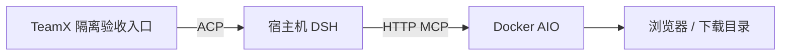
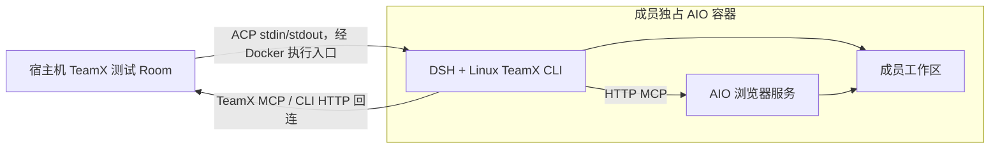

# Agent Sandbox 集成分析与实施方案

状态：S1 已实施并通过受控验收；S2–S4 尚未实施。方案更新：2026-11-22；上游资料基线：2026-11-20。

本文分析如何让 TeamX Agent（首先是当前 DSH）使用 [agent-infra/sandbox](https://github.com/agent-infra/sandbox) 的浏览器、文件、命令和代码执行能力。S1 已在独立 Docker 环境通过真实本地 DSH／模型验收，详见 [S1 实施报告](implementation/agent-sandbox/s1.zh.md)；现有成员及生产配置没有切换。

## 1. 建议与预期收益

**优先实施两个验证阶段：S1 启动 Docker AIO，让本地 DSH 通过 MCP 验证浏览器操作；S1 效果通过后，S2 将 DSH 放入 AIO，验证 TeamX 通过 ACP 管理容器内 DSH。正式路线根据这两个阶段的证据选择。**

TeamX 已经具备 ACP HTTP MCP 注入，Sandbox 也提供 HTTP MCP。S1 先复用现有机制直连，观察模型能否可靠操作浏览器；S2 保留 ACP 和 Room 调度，在执行控制边界适配容器、路径及 CLI 回连。前两个阶段均使用隔离测试环境，不以建设正式 Sandbox MCP 适配层为前置条件。

基础 ACP 接通难度较低；包含执行结清、重启恢复和故障阻断的完整 S2 应按中到高难度评估。当前 Room 与后端生命周期已有可复用边界，**具备开始 S2 的架构条件，推荐推进固定单成员容器验证**；容器内工具沙箱、回连与故障闭环仍需实测。自动创建环境、多成员运维及跨平台部署属于后续范围。

优先解决三个当前有实际价值的场景：

1. Agent 浏览网页、提取资料、下载文件；浏览器下载的文件可直接交给同一沙箱内的程序处理。
2. 对用户明确交付的文件执行 Python／Node 分析、格式转换，返回可下载结果。
3. 在独立 Linux 环境运行临时脚本、依赖和验证命令，减少对 TeamX 宿主机工具链的依赖。

需要区分两个目标：

| 目标 | 本方案覆盖程度 |
| --- | --- |
| Agent **新增可使用的远程环境能力** | S1 验证本地 DSH 使用 AIO 浏览器及下载文件 |
| Agent 的 **DSH、本地工具与浏览器在同一容器中执行** | S2 验证容器化及 TeamX 管理闭环；隔离效果仍取决于挂载、网络与凭据边界 |

S1 中 DSH 的 Bash、文件工具和 TeamX CLI 仍在宿主机执行，MCP 不会自动接管它们。S2 将这些执行移入容器，但 TeamX 服务及业务授权仍由宿主侧负责；不将整套 TeamX 服务搬入 AIO。

## 2. 核对基线与证据限制

### 2.1 版本基线

| 对象 | 本次核对内容 |
| --- | --- |
| TeamX | 2026-11-22 复核工作区；HEAD `bf92e0a92eb2a6a361233628a7d8bbd9f01e0a79`，含已有未提交改动 |
| TeamX 打包 DSH | `packaging/dependencies.lock.json` 锁定 `0.2.2-rc.1`，来源提交 `66491b05e3f05ad35bcdd4f6cd7ed26041d9e3db`；同时静态检查了本地 `teamx-space` 中相应 MCP／ACP 发布包 |
| DSH 开发源码 | 相邻 `deepseek-harness` 工作区 HEAD `5badb15009ae1756c3afe0ae0cef1faafc290ccc`，仅辅助理解，不视为发布包等价物 |
| Sandbox | 上游仓库提交 `7f1afaf8d82bd30531a19caeb1a24dfebbc97d8c` 的 README、SDK、部署及能力文档 |

以下“已有”指代码或官方文档中可见。**S1 已证明固定镜像与本地 DSH 的受控浏览器协同；容器内 DSH 与真实 TeamX Room 的管理闭环尚未验证。** S1 的结论包含任务间隔 65 秒、禁止外连和 `seccomp=unconfined` 等配置条件；外网浏览未通过验证，详见实施报告。上游提交及 DSH 开发源码沿用原资料快照，不表示重新验证了上游最新版本。实施时重新记录 TeamX 实际提交，固定镜像 digest、DSH 版本／摘要和模型配置，针对实际产物验证。

### 2.2 上游存在两条产品路线

- **AIO Sandbox 容器**：集成浏览器、桌面／VNC、文件、Shell、代码运行环境等；适合本次验证完整工作流。[上游 README](https://github.com/agent-infra/sandbox/blob/7f1afaf8d82bd30531a19caeb1a24dfebbc97d8c/README.md)
- **独立 `aiod` daemon**：给现有容器／VM 增加操作 API，可探测浏览器、解释器等可选后端。隔离、资源配额和环境生命周期由外部平台承担；不能把裸机安装 daemon 当作创建了安全沙箱。[daemon 说明](https://github.com/agent-infra/sandbox/blob/7f1afaf8d82bd30531a19caeb1a24dfebbc97d8c/website/docs/en/daemon/start/introduction.mdx)

本次推荐先选 AIO 容器，不同时适配两条路线。上游 README 用 `1.11.0` 举例，但该标签只是候选起点，不是本方案已验收的版本。

有三处差异应作为 S1 的核验项：

1. README 描述 `SANDBOX_API_KEY`；AIO 认证文档主要描述 `JWT_PUBLIC_KEY`；daemon 文档使用 `AIO_API_KEY`。须确认实际镜像接受的方式、保护的端点及 WebSocket 认证，不能混用变量。[AIO 认证文档](https://github.com/agent-infra/sandbox/blob/7f1afaf8d82bd30531a19caeb1a24dfebbc97d8c/website/docs/en/guide/basic/authentication.md)
2. AIO MCP 文档示例包含 `browser_navigate`、`file_read` 等；daemon 文档列出 `sandbox_execute_bash`、`sandbox_file_operations` 等另一组工具。**以实际 MCP `tools/list` 及 Schema 为准**，不按示例硬编码名称。[AIO MCP 文档](https://github.com/agent-infra/sandbox/blob/7f1afaf8d82bd30531a19caeb1a24dfebbc97d8c/website/docs/en/guide/basic/mcp.md)、[daemon MCP 文档](https://github.com/agent-infra/sandbox/blob/7f1afaf8d82bd30531a19caeb1a24dfebbc97d8c/website/docs/en/daemon/examples/mcp.mdx)
3. 此提交的公开目录主要提供 SDK、示例和文档，不能据此完成镜像内部执行器与隔离实现的源码审计；镜像行为仍需实测。

## 3. 与当前 TeamX／DSH 的接点

| 代码位置 | 已有行为与集成含义 |
| --- | --- |
| [agent/backend.go](../agent/backend.go)、[internal/room/backend_lifecycle.go](../internal/room/backend_lifecycle.go) | 已有 Factory／Host／Component 及关闭、恢复、轮换合同；可保留 Room 调度与输入 owner，但 Launch 仍只有一套路径，不表示已支持多种执行位置 |
| [internal/agent/dsh/mcp.go](../internal/agent/dsh/mcp.go) | 支持多个 HTTP MCP 声明和请求头；校验 URL、名称及 Header；无需重新开发 MCP 传输 |
| [internal/agent/dsh/session.go](../internal/agent/dsh/session.go) | 检查 `mcpCapabilities.http`，在新建／恢复 Session 时传入 `mcpServers` |
| [internal/agent/dsh/state.go](../internal/agent/dsh/state.go) | MCP 地址、命名空间和 Header 名称参与恢复指纹，临时凭据值排除；能力变更不能直接塞进旧 Session |
| [internal/room/dsh.go](../internal/room/dsh.go)、[internal/room/dsh_host.go](../internal/room/dsh_host.go) | `componentOptions` 与 Host 准备阶段都会构造 TeamX MCP 配置；通过 Room 注入 Sandbox 时需统一扩展，保留原有读取／历史工具，避免新配置被覆盖 |
| [internal/agent/dsh/process.go](../internal/agent/dsh/process.go) | 当前直接启动本地进程，并用宿主机 PID／进程树证明结清；S2 需适配容器内执行观察与停止，不能把 Docker 客户端退出等同于 DSH／工具退出 |
| [internal/agent/dsh/options.go](../internal/agent/dsh/options.go)、[internal/agent/dsh/identity.go](../internal/agent/dsh/identity.go) | 当前使用宿主路径、环境变量和本地可执行文件摘要；S2 需明确容器路径、环境传递和容器内 DSH 身份，不能仅记录 Docker 客户端摘要 |
| [internal/room/model_session.go](../internal/room/model_session.go)、[internal/agent/dsh/probe.go](../internal/agent/dsh/probe.go) | 模型 Session 冻结运行时身份，探针也使用本地目录；容器运行时的识别与验证必须经过实际容器适配，不能借用宿主 DSH 的验证回执 |
| [internal/room/access_settings.go](../internal/room/access_settings.go)、[internal/room/server_access.go](../internal/room/server_access.go) | 内部地址会规范为回环地址，令牌检查前还校验来源／Host；只把地址替换成 `host.docker.internal` 不足以保证 CLI／MCP 可回连 |
| [internal/room/workspace_files_http.go](../internal/room/workspace_files_http.go) | 当前从宿主目录打开工作区文件；S2 可复用共享目录交付，远程环境需另做受控文件导入／导出 |
| [internal/room/mcp_access.go](../internal/room/mcp_access.go) | 有 Room、Membership、服务实例和 Session 代际绑定的鉴权模式，可参考其身份约束；Sandbox 应使用独立凭据与生命周期 |
| [internal/room/mcp_turn.go](../internal/room/mcp_turn.go)、[internal/room/dsh_lifecycle.go](../internal/room/dsh_lifecycle.go) | 已有回合准入与 Session 轮换结清；需要把远程执行纳入结清条件 |
| [internal/agent/dsh/input_bridge.mjs](../internal/agent/dsh/input_bridge.mjs) | 对 TeamX 输入 MCP 做调用关联和持久消费确认；Sandbox 不应进入这套输入消费协议 |
| [internal/room/config.go](../internal/room/config.go) | 严格解码配置，当前没有本文提出的 Sandbox 配置；不能只在 TOML 加几个字段就生效 |

DSH 的 MCP 桥接会发现工具并注册为 `mcp__<serverName>__<rawName>`，已经有工具调用超时和取消 signal，也有 MCP 图片结果投影。它们是可复用基础，但仍有两个边界：

- `workspace-write` 约束本地执行器，并不自动约束远程 MCP 服务里的路径、命令和网络行为。
- 工具返回截图不等于模型看到了截图；还取决于实际发布包、模型的 `input_modalities`、图片准入及模型服务。纯文本模型应优先使用页面文本／DOM 路线，不宣称具备视觉操作能力。

### 3.1 本地、容器与远程接入的可行性边界

| 场景 | 当前判断与所需补齐 |
| --- | --- |
| 本地 DSH | 已有执行、取消、正常恢复与轮换基础；S2 保留回归 |
| 固定 Docker 内 DSH | 架构可支持；需补执行控制、双侧路径、容器运行身份、回连与文件交付 |
| 自管远程主机／容器内 DSH | 可沿相同执行控制边界延伸；增加远程管理通道、失联对账和文件导入／导出，后续独立验收 |
| 任意第三方 ACP Agent 服务 | 不能只凭 ACP 兼容就承诺同等管理语义；需分别核验输入持久证明、取消、恢复、工具能力及可观察／可停止范围 |

截至 2026-11-22 核对的 [ACP v1 传输说明](https://agentclientprotocol.com/protocol/v1/transports)，标准传输为 stdio，远程 Streamable HTTP 仍在制定中。Docker 可先承载 stdio，未来自管远程环境可评估受控隧道；自定义传输仍须保留 ACP 生命周期与消息约束。S2 不以远程 HTTP 网关、协议升级或新增 Agent 后端为前置条件。

## 4. 方案比较

| 方案 | 做法 | 难度／取舍 | 判断 |
| --- | --- | --- | --- |
| A. DSH 直接连接 Sandbox MCP | 在现有 `MCPServers` 中追加 Sandbox 地址和认证头 | 基础接入低到中；需实测模型操作效果；不提供完整远程执行管理 | **S1 采用** |
| B. TeamX 薄适配层 + MCP | 本地 DSH 连 TeamX 的独立 Sandbox MCP 入口；适配层连接绑定环境，选择工具并管理执行 | 中等；远程结清与重启对账为中到高；适合保留宿主 DSH 的正式接入 | 后续候选，S1／S2 不要求建设 |
| C. CLI／Skill 包装 REST | Agent 用本地命令调用 Sandbox REST／SDK | 文本和文件处理方便；图片原生返回、工具发现、取消和错误处理需另做，Agent 还需学习命令 | 可作诊断／特定流程补充 |
| D. DSH 整体进入 Sandbox | 在 AIO 内启动 DSH，TeamX 继续通过 ACP 管理 | 接通低到中，完整 S2 中到高；主要适配执行控制、路径、凭据、CLI 回连及恢复 | **S2 采用；通过后作为正式路线候选** |

两条正式候选路线按相同标准比较取消、恢复、文件交付与运维成本。B 同样需要管理远程任务；D 则有同一工作区和整容器停止兜底的优势，不能以 B 的基础接入和 D 的完整部署成本比较。

SDK 是调用 API 的实现选项，不是新的 Agent 协议。浏览器优先复用 MCP；产物上传下载、任务查询／终止等管理动作需要时再使用小型 HTTP 客户端或核对后的 Go SDK，不必引入 Python 服务。

## 5. 两阶段架构与责任分配

### 5.1 S1：本地 DSH 直连 AIO



S1 可先复用 `internal/agent/dsh` 的真实验收入口，不强制接入完整 Room。使用独立 DSH 状态和 Workspace，追加 AIO MCP 声明；不覆盖已有 TeamX MCP。S1 证明浏览器能力，完整 TeamX Room 闭环在 S2 验证。

### 5.2 S2：容器内 DSH，TeamX 保持 ACP 管理



在 S1 已验证的镜像基础上构建派生镜像，加入固定版本的 Linux DSH、依赖及 Linux TeamX CLI；不直接复制 macOS 可执行文件。固定容器先由部署方启动，TeamX 可以通过 `docker exec -i <container> dsh --profile acp` 承载 ACP，保持 stdin/stdout 为协议流，不分配 TTY，诊断输出写 stderr。实际启动还需传递工作目录、专用状态路径和经过筛选的环境变量，不能只替换 `BinaryPath`。参考 [Docker exec](https://docs.docker.com/reference/cli/docker/container/exec/)。

容器内 DSH 可通过容器回环地址连接 AIO MCP；回连宿主 TeamX 则使用部署时明确配置的可达地址。ACP 本身无需新增 HTTP 网关。TeamX 的 Room、调度、输入消费确认和授权仍保留现有归属。

### 5.3 保持边界清楚

- **TeamX**：管理 ACP Session、回合和代际、成员身份、执行结清与错误反馈；S2 增加固定容器的执行控制及路径映射。
- **DSH**：继续负责模型循环、工具选择和 ACP 协议；只接收通用 MCP 声明，不加入 Docker 或 Sandbox 厂商逻辑。
- **Sandbox**：执行工具，提供远程文件、浏览器和任务状态。
- **部署方**：首版启动并维护固定环境，设置容器资源／网络边界；后续才考虑 TeamX 自动创建环境。

S2 在现有后端执行控制边界增加容器实现，保留本地执行路径；不把 Docker 逻辑散入 Room 业务调度，也不为单一验证建设通用插件平台。测试配置必须显式选择容器，未配置成员仍走原路径。

宿主真实路径继续用于工作区权限与 `WorkspaceRootID` 核验，容器路径用于 ACP `cwd`、工具和插件。二者显式映射，避免为让容器启动而绕过现有工作区身份校验。

### 5.4 后续可选的 MCP 适配层

若最终选择 B，可用 `internal/sandbox/` 放连接、能力描述及远程执行适配，Room 层负责身份与调度绑定。适配层只发布选定工具，尽量保留 S1 验证过的上游 Schema 和结果块；命令／代码需要时包装执行、查询、停止工具。该层不是 S2 容器化的前置依赖。

Sandbox 使用独立 HTTP MCP 路由，例如拟议的 `/agent-tools/sandbox/mcp`，与输入 `/mcp` 分开。复用 HTTP 服务和鉴权基础即可，不复用 Inbox 消费确认、重试或已读规则。

### 5.5 环境按成员独占，状态跨普通回合保留

推荐绑定键为 `(RoomID, RoomInstance, MembershipID)`，远程执行再绑定 Session 代际和回合。不要按可重复的 Agent 显示名分配环境。

S1／S2 由部署方准备独占测试环境，S2 通过验收配置绑定单成员；正式成员选择入口后置到 S3。同一环境不得同时绑定其他成员／Room。每 Room 一个共享浏览器会产生标签页、Cookie 和工作文件冲突，暂不采用。独立目录或不同终端 session ID 也不能替代环境隔离。

浏览器与工作文件可跨普通回合保留。自动轮换 DSH Session 时，先结清旧执行，再将同一环境交给新代际；不因私有上下文轮换就删除工作文件。环境重建要产生新实例标识，显式提示浏览器状态或临时文件可能丢失。

持久绑定至少记录：所属成员、逻辑环境 ID、实际实例／代次、固定镜像 digest、已接受的能力契约、工作目录和状态。凭据只记录引用。

### 5.6 后续 B 路线配置与 Session 兼容

下列仅是 **B 路线的拟议配置形状，当前不支持，也不是 S1／S2 的必做入口**。两个验证阶段可采用显式验收配置；S2 需另记录容器、镜像、挂载与路径映射，不能用此 `base_url` 配置代替。正式字段需与现有配置模型对齐：

```toml
[sandbox.environments.aio_dev_01]
base_url = "http://127.0.0.1:18080"
credential_env = "TEAMX_AIO_DEV_01_KEY"
instance_id = "operator-provisioned-instance-01"
workspace = "/home/gem/workspace"

# 在成员配置或 Room 创建请求中引用该环境：
# sandbox_environment = "aio_dev_01"
```

配置中不允许模型自行提交目标 endpoint、环境所有者或凭据；模型也不需要每次传 Room／Membership 参数。适配层依据框架签发的凭据和运行中的回合确定身份。

DSH 连接适配层时仍使用标准 ACP 声明：

```json
{
  "type": "http",
  "name": "sandbox",
  "url": "http://127.0.0.1:8088/agent-tools/sandbox/mcp",
  "headers": [{"name": "Authorization", "value": "Bearer <短期成员凭据>"}]
}
```

原有 `teamx` MCP 与新增 `sandbox` MCP 同时存在。Sandbox 上游密钥由适配层持有，不写入角色提示、工作文件、公开诊断或模型参数。短期凭据沿用当前 MCP 凭据值不进入指纹的原则。

**稳定的适配层 URL 不能掩盖上游能力变化。** Room 绑定还应比较环境实例、镜像及工具契约摘要；上游工具变化不自动全量暴露。新增能力、换环境或变更工具集合，需要结清后重建／轮换 Session。凭据值更新可在重新挂载连接时刷新，不应为了密钥更新改变角色身份。

首版建议新 Room 或显式为成员启用；已有未绑定成员不产生新依赖。绑定了 Sandbox 的成员在环境不可用时应得到明确阻断原因，不能静默改用宿主机执行相同任务。

### 5.7 S2 的执行控制适配与代码归属

Agent 后端（DSH、未来 Codex）与执行位置（本地、Docker、未来远程）是两个维度。S2 在 DSH 执行组件下提炼实际调用所需的窄边界，提供本地与 Docker 两种实现，避免复制多套后端生命周期；不预建远程插件注册框架。

| 调整位置 | S2 必须形成的行为 |
| --- | --- |
| `agent.Launch`、`agent_assembly.go`、DSH Options | 显式传递执行环境绑定，区分宿主路径与执行侧路径；固定容器的验收配置也必须经过真实装配入口 |
| DSH `process.go`、`session.go` | 通过执行控制完成启动、观察、停止、等待及退出结果核验；Session 依据实际执行结清，不依据 Docker 客户端 PID 放行 |
| DSH `identity.go`、`state.go` 与模型验证 | 识别容器内 Node／DSH 版本、产物摘要、镜像与目标架构；冻结映射和环境身份，重启后按同一事实检查 |
| `dsh_host.go`、DSH profile／输入桥接 | 在 Prompt 前发布本轮动态绑定，容器插件读取最新文件；保留工具调用关联、结果持久化与正式消费证明 |
| Room MCP 配置及回连装配 | 统一组装 TeamX 与 AIO MCP，不覆盖原读取／历史能力；CLI、MCP 声明和动态输入绑定使用一致的 Agent 可达地址 |

`InspectRuntime`、模型探针、`CheckResumeConfig` 与执行启动必须使用同一环境绑定，不能一部分检查宿主、一部分启动容器。当前 ACP connection 直接使用 `*os.File`，可继续承载 Docker CLI 管道；未来若接网络流，需要保留写入期限、关闭中断和部分写入的不确定性处理，不能仅替换成无约束读写接口。

## 6. 必须设计好的行为

### 6.1 本地与远程文件

S1 中，DSH 的宿主 Workspace 与 AIO 工作区是两个文件系统，模型应明确区分本地路径和远程路径。S2 中，将 DSH Workspace、浏览器下载目录及代码处理目录配置为同一成员工作区，实测下载文件能被 DSH 本地工具直接处理；不要仅因同在一个容器就假设目录、用户权限相同。[文件接口](https://github.com/agent-infra/sandbox/blob/7f1afaf8d82bd30531a19caeb1a24dfebbc97d8c/website/docs/en/guide/basic/file.mdx)

S2 仅挂载／持久化测试成员所需的工作区与专用 DSH 运行状态，不挂载整个 TeamX 数据目录、宿主用户目录或整个项目。明确分离 DSH 历史等运行数据与 TeamX 控制记录，不能把现有代际目录整体读写挂载后，允许 Agent 覆盖宿主结清证据。TeamX 应用侧身份、锁和结清记录仍由宿主控制，不能把容器内 Agent 可修改的状态单独当作停止证明。配置、`input_bridge.mjs` 和每回合更新的 `input-execution.json` 必须在容器内可见；动态绑定采用专用目录映射，核验原子替换／删除可见，避免单文件挂载继续指向旧文件。配置／插件／绑定按需只读，DSH 历史与工作区独立可写；实测容器用户的 UID／目录权限。

S1 验证下载文件的位置和内容；S2 进一步证明“浏览器下载 → DSH 本地工具处理 → 测试 Room 交付可打开结果”。测试产物通过已有附件／工作区入口交付，容器路径不能直接当作用户下载链接。后续正式接入应完善以下导入／导出流程：

1. 将本任务选定附件／输入文件上传到成员远程工作目录；保存源与目标的对应关系。
2. Agent 在远程环境处理，输出到指定产物目录。
3. TeamX 按成员权限下载选定产物，限制文件大小、类型和路径，校验内容摘要，导入持久存储。
4. 向 Room 返回现有下载入口／附件引用；不要把容器绝对路径当作用户能打开的链接。

优先复用现有附件存储与访问边界，实施时核对当前附件改动的完成情况。远程下载路径是外部输入；拒绝目录逃逸和越界符号链接，不通过任意 URL 下载器替代成员绑定。

后续如需对大仓库工作，可另评估独立 clone 或专用目录挂载。双向自动同步、冲突合并和已有成员源码工作区迁移不属于 S1／S2。

自管远程环境优先沿用上述输入导入／产物回收边界，不要求宿主能直接浏览整个远程文件系统。Docker bind mount 使用 daemon 所在机器的路径，切换到远程 Docker context 不会自动共享 TeamX 本机目录。[Docker 挂载说明](https://docs.docker.com/engine/storage/bind-mounts/)

### 6.2 远程执行、取消与轮换

执行结清是两条路线共同的重点。当前后端通过宿主进程树结清本地工具；S1 的 AIO 工作、S2 的容器内工作均不能沿用这份停止证明。上游 Bash 文档明确区分“等待超时后仍在运行”和硬执行期限，并提供输出查询、终止等接口。[Bash Pipe](https://github.com/agent-infra/sandbox/blob/7f1afaf8d82bd30531a19caeb1a24dfebbc97d8c/website/docs/en/guide/basic/bash.md)

**S1** 仅在可丢弃的专用环境内验证浏览器和下载，不要求先建设完整任务账本；测试设总期限，结束后停止／清理环境并核验，无停止证据则记为未结清，不继续复用。命令仅用于受控探测，不据此开放日常远程执行。

**S2** 必须把容器执行纳入现有 Session 生命周期：

- 宿主保存成员、Session 代际、容器实例 ID、镜像与执行身份，防止同一环境被第二个成员或服务并发接管；不只按可复用容器名识别。
- 启动前持久保存环境绑定与启动操作标识，通过受控标签／执行记录定位实际运行；覆盖“执行已启动、返回 ID 尚未保存就崩溃”的窗口。现有 `opening.json` 本身不足以定位容器执行；重启先核验旧环境，无法定位时保持阻断。
- 正常取消先走 ACP `session/cancel`，等待原请求终态，再核验相关本地工具和 AIO 任务停止。DSH 仍活着、ACP 已结束或 Docker 客户端退出，均不足以证明工具已停止。
- AIO 浏览器由服务进程执行，不一定属于 DSH 后代；观察域应区分浏览器基础服务与活动任务。Docker exec 实例状态只能补充根执行信息，不能替代所有工具／AIO 任务的停止证明。[Docker exec 查询](https://docs.docker.com/reference/api/engine/version/v1.57/operations/ExecInspect/)
- 观察失败、超时或失联时保持阻断；必要时通过 Docker 管理面停止成员独占容器并核验所有相关执行停止。正常结束的浏览器基础服务可以保留，正在执行的回合任务必须结清。
- 整容器停止可以作为验证阶段兜底，但会中断浏览器服务并可能丢失页面状态。持久卷保留的文件不代表浏览器状态恢复；重启后更新运行实例信息并核验旧执行归属，明确记录状态损失。
- 恢复前核验旧执行已停止、持久状态及配置匹配。固定 DSH／镜像身份，不以宿主 Docker 二进制摘要代替容器内 DSH 身份。正常关闭后可恢复原 Session；异常结果沿用当前暂停／重置边界，不自动重放任务。
- 若整容器停止导致 DSH 强制退出，只能形成物理结清／重置依据，不能写成原 Session 正常关闭。若先完成 DSH 正常关闭再停止 AIO，需独立保留其正常退出证据与持久状态。停机证明还须约束自动重启／外部重新启动，实例重启或重建后重新核验归属，旧回执不能授权新实例。
- 轮换先停止旧回合、结清工具并关闭旧 DSH，再建立新代际；工作文件保留，旧代际凭据失效，旧 DSH／工具不能继续调用 TeamX。容器重建时保留文件并显式处理浏览器状态损失。

后续若采用 B 路线或开放可跨连接管理的远程执行，还需持久化任务意图与对账：

- 发起前保存调用意图，记录成员、环境实例、代际和回合；收到结果后关联远程 `command_id`／`session_id`（名称按实际版本适配）。远程执行标识由适配层核验归属。
- HTTP 超时、取消 signal、ACP `end_turn`、DSH 进程退出，都不直接证明远程工作停止。工具调用失败也可能发生在远端已受理之后。
- 正常回合结束前完成远程结清。首版不支持跨回合后台任务；模型遗漏停止时由适配层负责清理。长期服务另作显式能力设计。
- 核验停止接口是否覆盖子进程、脱离终端的进程及代码解释器任务。只看到 Shell 父进程结束不算结清；缺少可靠证明时使用专属执行器／容器停止作为兜底，不能只依赖任务 ID 或硬超时字段。
- 取消／暂停／轮换时，先停止新调用，再终止并查询本回合任务。只有确认结束才交接给新代际。
- 服务重启时先对账未结清意图。若无法定位受理的任务，须通过专属环境的执行器重置／停机证明结清，或保持阻断等待部署方处理；不能认为“没有返回任务 ID”就未执行。
- 不确定结果不自动重放有副作用调用；浏览器提交或远程写入可能已生效，需先查状态。

S1 记录上游任务归属和停止能力；S2 可以使用成员独占容器停止作为兜底，不强制先实现 B 路线的全部任务账本。若既不能核验相关任务停止，也不能证明专属环境停机，则 S2 取消／恢复验收不通过。模型提示“记得停止任务”不足以替代这些机制。

未来自管远程执行同样需要独立管理通道；ACP 重连不表示旧回合已停止。撤销 TeamX 凭据只能阻止后续 TeamX 调用，不能停止远程 Shell 或撤回已发出的外部请求。第三方服务若不提供可观察、可停止的执行范围，不能承诺与托管后端相同的结清保证。

### 6.3 浏览器、截图与人工接管

优先使用实际工具集提供的页面文本／DOM 能力；截图和坐标操作作为视觉模型可用时的补充。CDP 是浏览器控制协议，VNC 是人工查看／接管入口，二者都不是会自动执行任务的 Agent。[浏览器说明](https://github.com/agent-infra/sandbox/blob/7f1afaf8d82bd30531a19caeb1a24dfebbc97d8c/website/docs/en/guide/basic/browser.mdx)

S1 验证截图是否作为 MCP `image` 内容进入模型，或只是 URL／文件路径；需要转换时仅增加受控的结果转换，遵守既有图片预算，不为此建设整套适配层。业务关键文字同时保留文本证据，截图失败明确反馈。文本／DOM 操作和视觉操作分别记录结论；纯文本模型不能记为视觉验收通过。

首轮验收使用无登录环境和受控页面。真实账号登录、验证码与敏感表单提交是后续独立场景；不能因为用户已授权平台 API，就推定已授权复用浏览器登录态执行任意页面操作。

人工接管先使用受保护的外部 VNC 入口；后续嵌入 TeamX 时再处理短期访问凭据、WebSocket、并发控制和操作交接。不要把长期 API Key 拼入公共链接。

### 6.4 权限与部署边界

MCP 工具可执行 Shell／代码时，单纯过滤工具名称或屏蔽几个命令字符串不能保证只读，也不能阻止程序自行访问网络。浏览器“点击”同样可能提交数据。可控性来自独立环境、最少凭据、明确授权和部署网络限制的组合。

S1／S2 采用专用测试容器、最少任务凭据、明确 CPU／内存／磁盘与执行期限。宿主 TeamX／验收程序持有容器管理能力，Agent 不持有 Docker socket。不挂载宿主敏感目录；仅按需允许回连 TeamX 的指定服务入口，不将管理凭据传给 DSH，其余宿主服务、内部网络和云元数据访问按部署边界限制。S2 显式传递经过筛选的环境变量，不依赖 Docker 自动继承宿主环境，也不把密钥放入命令参数、镜像层或证据文件。

上游启动示例使用 `seccomp=unconfined`，应在选定环境确认其必要性及可接受边界；不能沿用 README 的安全描述就认定能承载不可信多租户任务。面向此类场景时，再独立评估更强容器运行时或 VM 隔离。

本机绑定回环地址；远程部署使用私网和受保护入口。TeamX 在另一容器中时，`127.0.0.1` 指向自身，必须按实际网络拓扑配置。上游返回的 CDP 地址也要核验可达性和认证，不能直接把容器内地址交给用户。[部署说明](https://github.com/agent-infra/sandbox/blob/7f1afaf8d82bd30531a19caeb1a24dfebbc97d8c/website/docs/en/guide/start/cloud-deployment.mdx)

### 6.5 S2 优先探测的环境条件

以下条件尚未由 S1 证明，应在投入完整 Room 适配前验证：

1. **Linux 命令工具沙箱**：静态核对的 DSH `0.2.2-rc.1` 发布包在 Linux 探测 bwrap／Landlock，不可用时拒绝执行。派生镜像须实测工作区读写、越界写入拒绝、CLI 调用及长任务取消；S1 的 macOS DSH 与 Chromium 通过不能代替该证据。记录内核、原生依赖与所需容器安全配置，不默认改为无限制执行。
2. **回连来源与地址一致性**：当前 `internalAccessEndpoint` 生成宿主回环地址，`requestOrigin` 在令牌校验前检查来源／Host。准备显式 Agent 回连地址及专用转发或符合现有访问规则的入口；仅更换 hostname 或放宽监听不足以通过。CLI、TeamX MCP 和 `input-execution.json` 必须一致，重启恢复保持稳定地址，不放宽恢复指纹。
3. **模型网络出口**：S1 的 DSH 在宿主访问模型，AIO 网络禁止直接外连。S2 中模型请求也进入容器，须单列允许的模型服务、DNS／代理、证书及 TeamX 回连；不能照搬 S1 网络后把模型不可达误判成 ACP 不兼容。

## 7. 实施阶段与验收

**近期实施顺序为 S1 → 评估浏览器效果 → S2；S3／S4 保留为后续范围。** S1 不以正式适配层或生产 Room 配置为前置条件；S2 必须走真实 TeamX 测试 Room，不能只用独立 ACP 脚本代替。每一阶段独立报告通过、失败及未验证项。

下表工作量为一名熟悉 TeamX 的工程师的早期粗估，包含实现与对应验收；不含镜像拉取故障、上游修复和真实账号配置等待。S2 的 4–7 人日仍非承诺，应在 §6.5 环境探针通过、执行控制与状态映射方案明确后重新估算。

| 阶段 | 交付与边界 | 验收重点 | 估算 |
| --- | --- | --- | --- |
| **S1：本地 DSH + Docker AIO 浏览器验证** | 固定 AIO 镜像，使用隔离本地 DSH Session，通过 ACP 注入直连 MCP；交付可复跑验收入口和效果报告 | 真实模型完成导航、内容提取、交互及下载；区分截图生成与模型视觉；记录稳定性、耗时、工具成本和清理证据 | 1–3 人日 |
| **S2：AIO 内 DSH + TeamX ACP 验证** | 固定派生镜像、单成员测试 Room；增加必要的容器执行控制、路径／状态映射和 Linux CLI 回连；保留本地后端 | 真实 Room 输入与发言、同工作区处理及交付、取消、正常恢复、轮换、断线与异常退出阻断／清理 | 4–7 人日 |
| **S3：选定路线的正式接入** | 根据 S1／S2 选择容器内 DSH，或本地 DSH + MCP 适配层；补齐正式成员配置、权限、持久绑定和产物交付 | 两成员不串环境，未配置成员正常工作，故障对账、代际兼容与真实文件交付 | 路线确定后估算 |
| **S4：部署与使用体验完善** | 按需创建／释放环境、配额和回收策略、状态页、受保护的人工接管入口 | 目标平台启动、重建、清理及资源占用，用户能判断环境归属与阻断原因 | 5–10 人日，可后置 |

### 7.1 S1：先判断浏览器是否值得接入

实施内容：

1. 确认 Docker daemon 可用、磁盘和内存满足测试需求，记录宿主／镜像 CPU 架构；ARM 原生镜像不可用时，若采用模拟运行，单列其性能限制。仅在测试所需入口暴露 AIO，并固定实际 digest、认证方式和工具清单。
2. 使用现有固定版本本地 DSH 和显式选定的真实模型，建立全新 Workspace／状态目录，通过 ACP 注入 AIO HTTP MCP。保存 `tools/list`、Schema 和工具暴露范围；沿用已验证工具，不按示例名称猜测。首轮不开放无关工具。
3. 准备受控测试页面，包含动态内容、链接、输入框、可验证提交结果和固定下载文件。页面预期值由验收程序保存，不提前写入模型提示；页面断言与截图、文件摘要独立核对。
4. 执行下表任务，记录工具调用轨迹、实际结果、单任务耗时及 token／调用次数；模型无 usage 数据时标明不可得，不估造成本。
5. 验证失败页面或超时能明确反馈，测试结束停止相关执行并清理专用环境。若保留环境供 S2 使用，必须先证明测试执行结清，且记录保留项与清理方式。

| 任务 | 必需证据 |
| --- | --- |
| 导航和内容提取 | 模型通过浏览器读取动态页面值并准确汇报，独立断言与页面实际值一致 |
| 点击、输入和跳转 | 工具实际完成交互，页面或测试服务记录正确输入及最终状态；不以模型口述成功判定 |
| 截图 | 保存真实截图并核对页面；视觉模型另证明 MCP 图片进入模型且模型能回答画面问题，文本模型标记视觉未验证 |
| 下载文件 | 文件确实落在 AIO 工作区，名称／大小／摘要正确；本地 DSH 不把远程路径当成本地文件读取 |

**进入 S2 的条件**：核心导航、交互和下载任务在相同配置下各重复 3 次，3 次均完成并有独立证据；失败／超时能明确报告，环境能可靠清理。截图生成须成功，模型视觉能力单列：文本／DOM 路线通过可继续 S2，但不得宣称视觉操作已通过。补充一个无登录公共网页作为实际效果样本，外网站点不可用时单独记录，不能替代受控验证或掩盖受控失败。

S1 报告给出继续／暂缓 S2 的明确建议。若工具 Schema 不兼容、基本交互不稳定、模型无法有效使用结果或环境无法清理，先修复／收敛范围，不以容器化代替浏览器能力问题的解决。S1 不交付正式成员配置、完整任务账本、自动创建环境或生产切换。

### 7.2 S2：验证容器内 DSH 的 TeamX 管理闭环

前提为 S1 达到上述条件。保持同一浏览器任务、模型和 DSH 版本作为对照，只改变 DSH 运行位置；无法保持一致的项单独列出。

按以下四个批次推进，**全部属于 S2，最后的故障闭环是必需验收，不是后续可选项**：

| 顺序 | 实施与批次出口 |
| --- | --- |
| 1. 容器运行探针 | 从 S1 镜像构建可复现派生镜像，固定 Linux DSH、依赖和 Linux TeamX CLI，记录基础／派生镜像 digest、架构、容器内产物身份；通过 §6.5 的工具沙箱、模型出口与 TeamX 回连探针，并核验双侧路径、UID／权限及动态绑定可见性 |
| 2. 执行控制与恢复证据 | 按 §5.7 接通本地／Docker 两种执行实现，保存启动前环境绑定和执行身份；分开宿主控制记录与 DSH 持久数据，覆盖观察、停止、退出结果、恢复兼容检查及孤儿执行定位 |
| 3. 真实 Room 正常闭环 | 建立独立测试服务／数据目录和单成员 Room，显式选择固定容器；通过真实装配与 ACP 路径验证输入持久证明、正式发言、S1 浏览器对照和文件处理／用户交付 |
| 4. 故障闭环 | 通过下表的取消、正常重启、轮换、断线及异常退出用例；验证无法观察时阻断、已结清与可恢复的区别，以及旧凭据失效和不确定结果不重放 |

不修改既有生产 Room。保留当前本地 DSH 的相关组件／集成回归；涉及执行控制、身份、恢复或路径变更的测试按行为命名，真实 Docker／模型验收显式启用，不进入普通默认测试。

| 用例 | 通过条件 |
| --- | --- |
| Room 输入与正式发言 | 连续回合均读取最新动态绑定，工具结果持久证明及消费确认有效，旧回合绑定不可复用；调用 TeamX CLI 在正确 Room 发言，核对服务端记录 |
| 浏览器效果对照 | 重跑 S1 核心任务各 3 次并全部通过；记录耗时和调用差异，解释工具／模型配置差异 |
| 同一工作区及交付 | 浏览器下载文件可被容器内 DSH 本地工具处理，输出内容／摘要正确；测试 Room 提供用户可下载打开的结果 |
| 取消与关闭 | 对可观察的受控长任务取消，原 ACP 请求结清，相关 DSH 工具及 AIO 执行停止；正常关闭后无遗留执行，超时允许整容器停止兜底并记录状态损失 |
| 正常重启恢复 | 正常关闭测试 TeamX 服务，保持回连地址并恢复相同 DSH Session；核对 SessionID、持久文件及实际运行身份，无重复读取确认或重复发言；运行身份／映射不匹配时拒绝恢复 |
| Session 轮换 | 旧 DSH／工具已停止、旧凭据无效，新代际可继续工作且文件保留；浏览器是否保留按实际清理方式报告 |
| ACP 断线和 TeamX 异常退出 | 分别注入故障，覆盖启动已受理但执行 ID 尚未保存的窗口；旧执行未核验停止前阻断新代际，重启后能定位并停止旧执行，无不确定操作自动重放 |
| 管理面失联与环境实例变化 | Docker 不可观察时保持未结清，恢复可达后先对账；同名容器被替换或实例重新启动时，旧结清回执不能授权接管新实例 |

**S2 通过条件**：上述必需用例均有真实 TeamX + Docker + DSH／模型证据，相关组件／集成回归通过。本地 ACP 探针成功、容器可启动或单次模型回答都不足以判定 S2 通过。若正常浏览器回合成功但取消／恢复仍不成立，应报告“基础接通，生命周期未通过”。

S2 的交付为派生镜像构建文件、必要的后端适配与回归覆盖、可复跑验收入口和证据报告。它验证单成员固定容器路线，不意味着已具备多成员日常部署、自动资源管理或现有 Room 迁移能力。

### 7.3 两阶段结束后的路线决策

- **S1 和 S2 均通过**：优先评估容器内 DSH 作为正式路线，以同一工作区和执行隔离为主要收益；S3 完善成员绑定、配置和交付。
- **S1 通过，S2 未通过**：保留浏览器能力结论，报告容器执行控制／恢复的具体阻碍；按投入产出决定继续修复，或采用本地 DSH + MCP 适配层，不自动把验证原型切到生产。
- **S1 未通过**：暂缓 S2，先解决模型、工具或镜像的实际效果问题。

### 7.4 证据与复跑材料

每阶段提交一份可阅读报告及机器可读摘要，建议归档到 `docs/implementation/agent-sandbox/`；原始日志、截图和下载文件放独立证据目录，避免提交凭据和个人浏览数据。记录启动／运行／清理方法、实际版本、架构、模型配置、用例结果、成功率、耗时、资源峰值、工具数量／Schema 占用、阻断项和清理结论；S2 增加镜像构建方法与 S1 对照结果。

| 层次 | 要证明的行为 |
| --- | --- |
| 组件／受控集成 | S1 的 MCP 声明与结果处理；S2 的路径、环境、容器身份、停止／恢复控制与故障阻断 |
| S1 真实 AIO + 本地 DSH | 模型实际使用浏览器完成受控任务，独立核对结果、截图、下载及清理 |
| S2 真实 TeamX + 容器内 DSH | 真实测试 Room 的读取／发言、浏览器对照、文件交付、取消、恢复、轮换及故障用例 |
| 后续正式环境验收 | 两成员隔离、正式配置／存储权限、资源运维及目标部署环境的长期稳定性 |

组件测试不替代真实镜像／模型证据，真实隔离测试也不等于既有生产服务已经切换。S1 的成功不能代替 S2 的生命周期验证。

## 8. 难度、投入与暂缓范围

| 工作项 | 难度 | 主要原因 |
| --- | --- | --- |
| ACP 注入第二个 MCP | 低 | 通用声明与能力校验已经存在，需修正 Room 的单一配置组装 |
| S1 工具发现、浏览器与文本／截图验证 | 低到中 | 实际 Schema、模型图片能力和工具数量需验证；不能照抄文档工具名 |
| S2 ACP 连接容器内 DSH | 低到中 | 可复用 stdin/stdout 协议，需镜像、运行身份及启动环境适配 |
| S2 路径、CLI 回连与状态持久化 | 中 | 宿主路径不直接等于容器路径，动态输入绑定与恢复身份必须一致 |
| S2 容器执行结清、恢复与轮换 | 中到高 | 需替换宿主 PID 观察假设；成员独占容器可提供停止兜底，但仍需状态与故障验证 |
| 后续 B 路线远程任务取消与重启对账 | 中到高 | 本地结清同样无法覆盖远端，需要任务归属、持久对账和清理兜底 |
| 正式成员绑定、凭据及产物交付 | 中 | 配置、代际、存储与用户访问权限形成完整闭环 |
| 自动创建环境、多平台部署与浏览器接管 | 中到高 | 引入资源运维、打包差异和 WebSocket 会话，后置到正式接入之后 |

S1 测量镜像大小／拉取时间、冷启动、空闲内存及浏览器峰值；S2 对照加入 DSH 后的镜像、启动、内存与代码执行成本，并据此估算每成员独占环境的总开销。上游快速开始要求至少 2 GB 可用内存，其 Compose 示例配置 4 CPU、8 GB 上限及 2 GB 共享内存；这些是原资料基线中的示例，不是已测出的每成员实际需求。[快速开始](https://github.com/agent-infra/sandbox/blob/7f1afaf8d82bd30531a19caeb1a24dfebbc97d8c/website/docs/en/guide/start/quick-start.mdx)、[Compose](https://github.com/agent-infra/sandbox/blob/7f1afaf8d82bd30531a19caeb1a24dfebbc97d8c/docker-compose.yaml)

S1／S2 暂不实施：正式多成员配置与 UI、自动创建／回收环境、多个 Sandbox 厂商、Kubernetes 资源池、全平台自动安装、独立 daemon 路线、宿主本地工具逐项远程替换、已有 Room／工作区迁移、仓库双向同步、跨回合后台任务、真实账号自动登录和无人值守敏感页面操作。DSH 移入 AIO 本身属于 S2，不在暂缓范围。

如果主要需求只是访问几个 API 或处理简单文本，现有业务工具通常更省成本；Sandbox 的收益更集中在**浏览器、下载文件和代码处理需要共享环境**的任务。S1 先确认浏览器操作效果，S2 再确认统一执行环境与 TeamX 管理语义；后续投入由两阶段真实证据决定。
