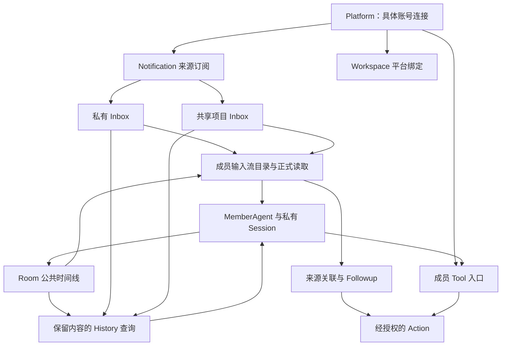
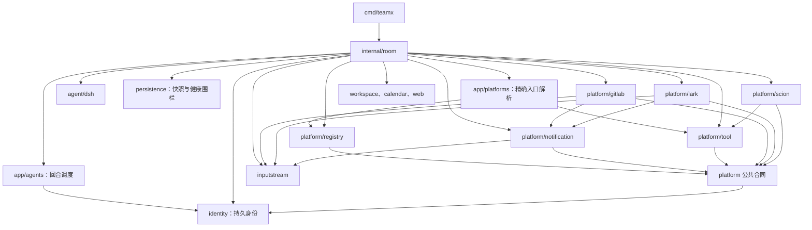
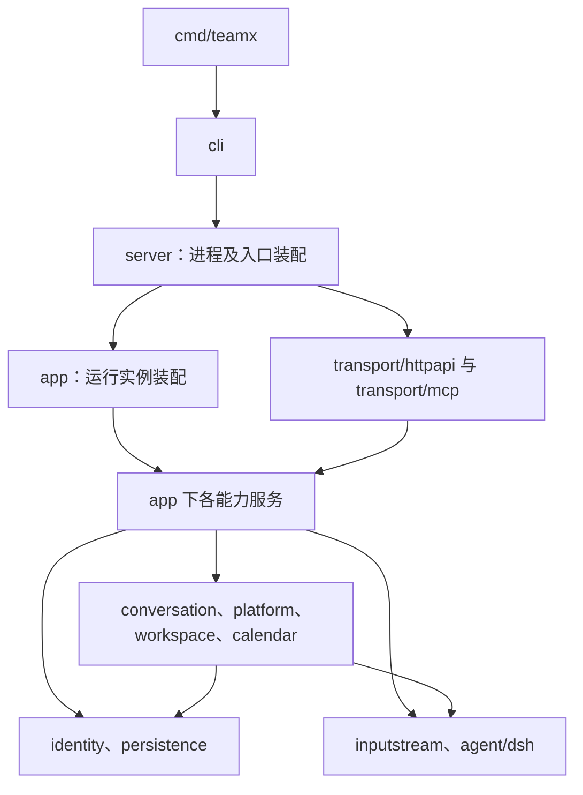

# TeamX 核心概念、模块边界分析与第一阶段重构方案

首次分析日期：2026-11-19。首次采样基准：当时工作区，HEAD 为 `a6560c7`（`fix: simplify calendar event presentation and agent context`）。History 完成后的状态与 R2 范围已另行刷新，下文明确区分当前能力与首次验证记录。

最初分析仅记录现有实现，不修改运行代码；后续已实施单元以各自记录和下述状态为准，其余建议不视为已实施。最初分析时 History 尚在开发中；现已根据完成后的源码和 H1–H4 记录刷新第 5 节与后续重构范围，删除“正常入口尚未注册”等过时判断。目录规模和首次测试结果保留为最初采样，不代表当前固定提交快照，也不宣称重新完成全部架构审计。

补充说明：第 10、11 节是基于上述分析新增的目标结构与分阶段实施建议。R0 的基线与边界清单已完成，见[基线记录](implementation/architecture/baseline.zh.md)；R3a 精确入口解析也已完成，见[实施记录](implementation/architecture/platform-entries.zh.md)。R1a 快照 writer 与健康围栏已完成，见[实施记录](implementation/architecture/persistence-writer.zh.md)。R5a 调度器也已完成，见[实施记录](implementation/architecture/turn-scheduler.zh.md)。R3b 静态能力装配已完成，见[实施记录](implementation/architecture/platform-assembly.zh.md)。R6a.1 在途调用登记与结清已完成，见[实施记录](implementation/architecture/platform-calls.zh.md)。R5b.1 后端依赖收敛已完成，见[实施记录](implementation/architecture/backend-lifecycle.zh.md)。R6a.2 的飞书内置 help／read／actions 调用族已随 [P2t](implementation/architecture/tool-runtime.zh.md)完成，其余调用族仍未实施。R1b、R2、R4、R5b.2、R6b、R7–R8 尚未实施。History 功能与正常代码入口已完成；R2 是尚未实施的结构重构，不能将两者混淆。后续实施使用 R0 的当前基线，不按早期中间状态覆盖或退回现有能力。

## 实施定位：第一阶段与后续方案

推荐采用两个独立方案、顺序实施。本文保留现状分析和 R0–R8，作为优先实施的**第一阶段：模块边界与职责重构**；[第二阶段：Gordis 进程内扩展与按需编译](GORDIS-PLUGIN-AND-SELECTIVE-BUILD-PLAN.zh.md)承接必要的公开扩展合同、静态选择的进程内装配与构建交付。第二阶段沿用现有本地文件存储，仅准备多 Agent／ACP 边界；Codex 接入另行实施。当前完成第一阶段 R0 的基线采集与依赖约束、R3a 的无 I/O 精确入口解析，以及 R1a 的快照 writer／健康围栏；R5a 已将非持久调度 owner 迁入 `app/agents`，共享持久身份归入 `identity`。R3b 已将已有平台描述和工厂汇入 `app/platforms`，普通消费者使用同一已校验目录。R6a.1 已将所有已有调用族的登记表、取消信号、完成回执与等待接入同一 `app/platforms.Calls` 实例，准入和绑定变更仍在原 manager 门槛内。推荐首批的两个模块之后，调度器和平台静态装配也已实际接入；R5b.1 已在原包接通后端执行、关闭结清、轮换、恢复和模型应用合同；成员状态机及持久业务 owner 尚未迁移，第二阶段仍为方案。

两阶段的变化性质不同：第一阶段在现有功能、协议和数据上形成可靠包边界；第二阶段增加实现选择、插件生命周期和扩展交付能力。合在一次实施中会同时改变代码归属、资源所有权、运行配置与编译依赖，使问题定位和回退变复杂。分开交付可以先获得模块化收益，再以稳定合同验证扩展能力。

| 事项 | 第一阶段交付 | 第二阶段交付 |
| --- | --- | --- |
| 领域与应用 | 明确 owner、命令／查询、服务及入口归属 | 在既有边界上接入插件服务，领域 Actor 继续维护原状态权威 |
| 平台扩展 | 汇集已有可选能力描述，工厂／适配器显式注入 | 公开必要工厂与合同，以已有实现及最小外部扩展验证可选装配；Gmail 等产品功能另选任务 |
| Agent 后端 | 收敛现有 DSH 的执行、恢复与结清合同，成员状态机独立 | 准备后端工厂与 ACP 能力边界，继续仅运行 DSH；Codex 接入另案 |
| 存储 | 抽文件持久设施，隔离领域操作与具体保存适配 | 继续使用现有 JSON 快照／JSONL 正文，不新增存储 Provider、数据库或迁移任务 |
| 装配与构建 | 显式选择现有默认实现；普通构建与默认行为保持 | Gordis 的受限启动／关闭装配、扩展选择、生成入口及按需编译；不做动态热替换或 RPC |

第一阶段不引入 Gordis 依赖、公共插件 SDK、Profile、RPC、数据库或新 Provider，也不以第二实现完成作为验收条件。后续接口的公开化与可选实现包拆分由第二阶段完成；当前只为真实调用建立必要合同，不预建空目录或模拟完整插件系统。具体交接要求见第 10.5 节。

**2026-11-20 后续实施建议：** R0、R3a、R1a、R5a、R3b、R6a.1、R5b.1 已完成，近期优先目标调整为平台通知／工具的扩展入口与 DSH 工厂边界，不再默认连续实施全部剩余 R 单元。第二阶段 P0 已完成，见[分支交接记录](implementation/architecture/plugin-handoff.zh.md)：平台可进入 P1a，DSH 跨包前须先收敛记录中的宿主操作；其他后续单元仍未实施。后续按[推荐单元与顺序](GORDIS-PLUGIN-AND-SELECTIVE-BUILD-PLAN.zh.md#91-当前最推荐的实施顺序)分别实施。缺少合同的部分先限定为具体 R6a.2／R6b 或其他 R 准备单元，接通并验收后再继续，不能凭 P0 记录宣称已具备全部插件化前置。

**2026-11-21 复核：** P0 保留已完成，下一项仍为 **P1a → P1b → P2n → P2t**，不增加新阶段或要求先补全剩余 R。当前 Room 附件、飞书／GitLab 正式图文、Agent 动作帮助／回执及测试夹具已更新，须作为后续实施的行为基线；P1a 保留新能力，P1b 区分独立工具与平台贡献，P2n 保留来源与回流分类，P2t 覆盖原图保护及完整动作结清。具体增补与本次验证见[第二阶段第 9.0 节](GORDIS-PLUGIN-AND-SELECTIVE-BUILD-PLAN.zh.md#90-2026-11-21-源码复核保留顺序补充当前行为基线)。历史 P0 采样及源码哈希不覆盖，后续各单元在自己的实施单记录开工差异。

## 1. 总体判断

**核心业务概念已经分开，底层能力也有真实的包边界；应用编排层的代码组织尚未同样充分地模块化。**

具体而言：

- Platform、Notification、Tool 是三个可以独立存在、按需组合的能力维度。代码没有强制每个平台同时实现通知和工具。
- Room、Inbox、History 分别表达公共协作时间线、待处理输入及保留内容的回看。统一输入接口没有把它们的存储权威、读取进度和生命周期混成一个对象。
- Agent 的成员身份、调度执行和 DSH 私有 Session 可以区分。Session 轮换不等于删除 Room 或重置平台输入消费。
- 通知采集进度、目标持久收件、Agent 输入消费、业务办结、外部动作结果有各自的证据和状态。
- `internal/platform/*`、`internal/inputstream`、`internal/agent/dsh` 的依赖总体向下，平台适配器不反向导入 Room；已有依赖边界测试保护这一点。
- 但 `internal/room` 是一个包含 250 个非测试、非生成 Go 文件、约 6.27 万行代码的单一包。它同时实现 Room 领域、Agent 调度、输入 owner、平台授权与配置、业务跟进、模型管理、应用服务和多个传输入口。许多边界只能靠文件分组、回调和约定维护。

所以，对“现有结构是否很好地符合这些核心功能的解耦”的回答是：**在概念、状态权威和底层包依赖上符合得较好；在应用层目录、类型归属和编译期职责隔离上仍有明显不足。** 主要改进方向是让已有边界在应用层落成代码边界，无需重新发明核心概念。

## 2. 核心概念与关联

### 2.1 概念职责表

| 概念 | 回答的问题 | 当前主要类型／模块 | 与其他概念的关系 |
| --- | --- | --- | --- |
| Provider | 接入哪种外部系统？ | `platform.TypeDefinition`；`gitlab`、`lark`、`scion` 适配器 | 同一种 Provider 可以有多个账号连接 |
| Platform | 具体使用哪个账号连接？ | `platform.Platform`、`registry.Record`、`registry.Manager` | 服务级连接，供通知、工具和 Workspace 按需引用 |
| Notification | 从哪个来源采集什么内容，并投递到哪里？ | `notification.Source/State/Manager/Item/Route` | 由平台适配器采集，投到成员私有 Inbox 或共享项目 Inbox |
| Tool | 某成员通过哪个入口使用什么外部能力？ | `tool.Definition/Binding/Process` | 成员授权和账号绑定决定入口，执行方式可以是子进程或内置分发 |
| Room | 哪些成员在同一公共上下文中协作？ | `Room`、`RoomSnapshot`、`RoomMessage` | 保存公共时间线、成员、原生读取进度和交互事件 |
| Inbox | 输入正文属于谁，由谁独立消费？ | `inputstream.Inbox`、`MemberInputActor`、`InboxActor` | 私有 Inbox 当前映射到成员；共享 Inbox 正文只存一次、消费按成员分开 |
| Input stream | 成员本次选择处理哪一组输入？ | `inputstream.Group/Catalog/StreamSummary`、`inputSession` | 统一发现与正式读取 Room、私有通知和共享通知，保留各自原生权威 |
| History | 当前还能回看哪些已保存内容？ | `Repository.History/RetainedStreams`、Room 原生历史、`historyQueries` | 读取保留内容，不以待消费状态为筛选依据，也不推进消费 |
| Agent／Member | 谁在这个 Room 中执行任务？ | `MemberIdentity`、`MemberState`、`MemberAgent` | 成员有独立输入、策略、调度状态和私有 Session |
| Session | 这次模型执行使用什么私有上下文？ | `Backend/Session`、`dshBackend/dshSession`、`dsh.Session` | 承载模型执行和私有历史，其代际与 Room 的持久身份分开 |
| Followup／Policy／Action | 输入对应的事情如何继续、依据什么授权、外部操作结果是什么？ | `followupEvent/Unit`、策略类型、动作类型 | 读取输入可以建立业务关联；消费本身不能代表办结或授权 |

源码入口：[Platform](../internal/platform/platform.go)、[平台类型目录](../internal/platform/catalog.go)、[通知合同](../internal/platform/notification/source.go)、[Tool 合同](../internal/platform/tool/process.go)、[Room 状态](../internal/room/state.go)、[输入能力合同](../internal/inputstream/capabilities.go)。

这里有两个需要保留的区别：

1. **Provider 和 Platform 不是同一粒度。** `gitlab` 是实现类型，一个具体 `platform_id` 才代表某个服务级账号连接。不能凭 Provider 名称猜账号。
2. **Agent-facing tool 和 `platform/tool` 不是同一集合。** `inbox_read` 是通过 MCP 提供给 Agent 的工具，但不因此属于平台工具绑定；`platform/tool` 主要管理外部能力入口、成员绑定、执行依赖和 Skill 资源。

### 2.2 业务关联图

以下箭头表达使用和交付关系，不代表 Go import：



共享项目 Inbox 当前产品实现限定为 GitLab Events。图中的 History 包含已有保留查询和已完成的 Agent History 功能；`history_list/history_read` 已纳入正常执行的 MCP 工具集，HTTP／CLI Inbox 模式均可使用，见第 5 节。

### 2.3 身份边界

| 身份／引用 | 含义与寿命 | 不应替代的身份 |
| --- | --- | --- |
| `RoomID + RoomInstance` | 持久 Room 身份，区别同名重建的实例 | 临时服务启动身份 |
| `AgentID + MembershipID`，连同 Room 身份 | 成员及其本次加入关系；输入、策略和执行据此隔离 | 展示名称、平台账号 |
| `ServiceEpoch` | 当前服务运行实例 | 持久 Room 身份 |
| Session generation + turn | 当前执行代际与回合 | 成员身份、平台凭据版本 |
| `PlatformID + Generation` | 具体连接及其身份代际 | Provider 名、平台 URL |
| Subscription、`DeliveryID` | 来源订阅与幂等收件证据 | 远端对象 ID、业务办结状态 |
| `Location{Partition, Seq}` | 某份本地正文的位置 | 跨分区的全局序号 |
| `stream_ref` | 成员可见逻辑流的稳定引用 | 某一页、某次执行权限 |
| `source_ref`、object／target／unit ref | 来源证据、业务对象、操作目标和跟进单元 | 可互换的通用对象 ID |
| Shared Grant | 某成员一次共享接收授权 | 永久成员身份；重新加入不能继承旧 Grant |

这些区别已经落在类型、哈希组成、存储验证和权限检查中，而不只是文档术语。例如 `inputstream.Member` 不保存 `AgentID`，但应用层 `MemberIdentity` 校验完整成员；共享流引用另绑定 Inbox、成员及 Grant。相关代码：[身份定义](../internal/identity/identity.go)、[输入合同](../internal/inputstream/contract.go)、[共享合同](../internal/inputstream/shared_contract.go)、[来源引用](../internal/room/input_stream_sources.go)。

## 3. 实际目录与包依赖

### 3.1 当前目录映射

```text
cmd/teamx/main.go                  进程入口；调用 room.Run
internal/
  app/agents/                     Room 回合授予、排队、释放与退出结清（R5a）
  app/platforms/                  精确入口解析（R3a）；静态描述与装配（R3b）；在途登记与结清（R6a.1）
  identity/                       共享持久 Room／Member 身份与不匹配错误（R5a）
  platform/                       公共平台、账号、引用、动作能力合同
    registry/                     连接与凭据记录、版本、验证及 OAuth 状态
    notification/                 订阅 owner、采集调度、待投递、来源确认与释放
    tool/                         工具定义、成员绑定、进程执行与 Skill 资源
    attachment/                   图片格式、尺寸与基础验证
    gitlab/                       GitLab 原生采集、读取、动作、引用和输入编码
    lark/                         飞书原生采集、读取、动作、引用和输入编码
    scion/                        Scion 身份、授权与仓库能力适配
  persistence/                    有界快照、目录同步、提交健康围栏与 I/O 结清（R1a）
  inputstream/                    本地正文、目录、消费、执行协调、共享和回收内核
  agent/dsh/                      DSH 进程、ACP Session、私有状态和输入桥接
  workspace/                      仓库能力合同，以及 Git／Scion 适配器
  calendar/                       日历与定时任务的数据模型及规则计算
  web/                            静态资源嵌入与提供；assets 下含前端模块
  room/                           Room 领域 + 应用编排 + 传输 + 多项管理功能
  inputstreamtest/                 隔离实验／对照 fixture
    frozen/                       冻结的旧查询合同，供对照测试使用
  testutil/                       测试辅助
tools/
  gitlab/                         独立外部工具进程
  scion/                          独立外部工具进程
```

`internal/agent` 本身没有 Go 源码包，当前具体后端位于 `internal/agent/dsh`；R5a 调度器已在 `internal/app/agents`，`Backend/Session` 合同和成员状态机仍在 `internal/room`。因此不能从目录名称推断“Agent 模块已经整体抽离”。

`internal/inputstreamtest` 与其 `frozen` 子包包含普通 `.go` 文件，但当前不在 `cmd/teamx` 的生产依赖链中；Room 测试会使用它们。阅读时应区分实验合同和当前生产合同，不能用 fixture 中的搜索／筛选 API 描述正常 Agent 能力。

### 3.2 实际依赖方向

本次使用 `go list` 核对生产 imports，以下仅画内部依赖的主要边：



由此可以确认：

- `platform` 根包不导入具体适配器，也不导入其子包。
- `registry/tool/notification` 不导入 GitLab、Lark、Scion 实现，也不导入 Room。
- GitLab、Lark 适配器之间没有相互导入；两者均不依赖平台 Tool 进程层。
- Scion 适配器确实依赖 `platform/tool` 的部分能力，不宜将所有 provider 描述成与 Tool 层完全无依赖。
- `inputstream`、`agent/dsh`、`calendar` 没有 TeamX 内部包依赖。前两者的生产 Go imports 均为标准库；`agent/dsh` 另有嵌入的 JavaScript 桥接逻辑。
- `room` 汇集了上述能力，没有其他生产包反向导入它。依赖图没有形成包级循环。

需要谨慎解读：**依赖有向无环说明方向受控，不证明最大那个包内部也有模块隔离。** 同包不同文件仍可直接访问私有字段和方法。

### 3.3 代码规模

统计当前文件树中各包的全部 `.go` 文件，生产列排除 `_test.go` 与 `.gen.go`；包括不同操作系统的实现和未提交文件，行数含注释、空行。测试列是文件数，不是测试用例数。

| 包 | 非测试／非生成文件数 | 行数 | 测试文件数 |
| --- | ---: | ---: | ---: |
| `internal/room` | 250 | 62,745 | 430 |
| `internal/inputstream` | 21 | 5,191 | 11 |
| `internal/platform` | 9 | 641 | 4 |
| `internal/platform/registry` | 10 | 1,791 | 6 |
| `internal/platform/notification` | 14 | 2,164 | 8 |
| `internal/platform/tool` | 7 | 330 | 5 |
| `internal/platform/gitlab` | 30 | 4,973 | 22 |
| `internal/platform/lark` | 34 | 6,238 | 56 |
| `internal/platform/scion` | 4 | 649 | 4 |
| `internal/agent/dsh` | 14 | 3,028 | 18 |

规模本身不代表设计错误。值得关注的是：Room 包中仅 `platform_*.go` 就有 49 个文件、14,376 行；大量服务级平台业务已经与 Room 领域共享同一个 Go 私有命名空间。文件前缀帮助导航，但并不构成访问约束。

## 4. Platform、Notification、Tool 的解耦情况

### 4.1 Platform 是服务级账号连接，不是全能平台对象

`platform.Platform` 保存连接标识、Provider、地址、凭据版本、验证状态及 CLI profile 引用；服务根的 `registry.Manager` 管理连接记录。Room 配置只引用连接，不把连接对象和凭据整体冻结进 Room 快照。

当前静态声明集中在 [app/platforms/builtins.go](../internal/app/platforms/builtins.go)，运行资源与账号核验由 [platform.go](../internal/room/platform.go) 的 `connectionProvider` 和 `initPlatform` 绑定。[platform/catalog.go](../internal/platform/catalog.go) 的 `TypeDefinition` 允许工具类型或通知通道缺省；其 `Catalog` 由同一已校验装配描述产生并注入 registry。Scion 当前有平台工具、没有通知来源，就是一个实际例子。

这部分边界较好：账号身份与凭据属于连接管理；通知和工具使用连接，但不会分别制造一份独立账号事实。`Secret` 的默认格式化／JSON 脱敏和 `AccessContext` 等显式访问证据也有助于避免把凭据当普通业务 DTO 流转。

### 4.2 Notification 负责采集与可靠投递

[notification/source.go](../internal/platform/notification/source.go) 给出了几个清晰的合同：

- `Source`：来源身份、状态解码以及 Runner 构造。
- `State`：由 provider 解释的版本化进度、待投递内容及确认转换。
- `StepHost`：读取固定范围和版本、提交候选、时钟及预算。
- `Host`：由装配层提供准入、持久化、目标交付及维护回调。

通知公共层存储 provider 状态，但不通过无校验 map 拼凑 GitLab 和飞书的游标。具体类型如 `gitlab.EventsState/TodosState`、飞书来源状态由各适配器校验。

每个 Room 的来源写入由 `NotificationActor` 串行拥有；远端查询和目标交付不占用该持久变更槽。`Manager.Deliver` 收到目标的持久回执后，基于最新来源状态保存 `Acknowledge`。两次提交独立，目标幂等回执负责承接确认丢失后的重投。

因此，Notification 并不承担 Agent 调度、业务事项办结或模型 Session。来源暂时无法收件时保留待投递项，也不需要凭 Agent 是否启用来决定其业务完成状态。

当前 [route.go](../internal/platform/notification/route.go) 的合法目标只有成员 `inbox` 与 `shared_inbox`；旧 Room 通知目标由 `RetiredRoom()` 标识。**不能再用历史实现中的“平台通知直接写 Room”概括当前正常采集链路。** Room 仍可通过独立 integration／交互事件入口接收带来源的消息，这与通知订阅目标是不同合同。

### 4.3 Tool 把“能力存在”“成员可用”“执行方式”分开

[tool/process.go](../internal/platform/tool/process.go) 的 `Definition` 描述实现类型及依赖，[tool/binding.go](../internal/platform/tool/binding.go) 的 `Binding` 描述成员及连接选择，并另存动作授权和能力证据。

应用层 [tool_entries.go](../internal/room/tool_entries.go) 再把公共工具入口映射到精确连接。公共 run／skill 不直接接受 provider 别名作为平台账号选择，避免同 Provider 多账号下的歧义。工具可用性还单独核验服务端可执行文件及依赖。

工具执行方式没有被固定为一种机制：

- GitLab／Scion 可以运行独立工具进程，`tools/gitlab`、`tools/scion` 不依赖 TeamX 内部包。
- 飞书使用受限的内置分发，入口在 [tools_builtin.go](../internal/room/tools_builtin.go)，不会通透执行任意 `lark-cli` 命令。
- GitLab 的内置 HTTP 读取／动作能力不依赖外部 glab 是否安装。这与普通 CLI 工具可用性是两个维度。
- Tool Skill 是静态、只读工作流资源，不是权限来源，也不是另一套业务执行引擎。

这里的耦合主要出现在应用层：选入口、核验成员、读取绑定、检查动作证据、解析账号和跟踪在途调用均由 `roomManager` 编排。这些联系有业务必要性，但不必永久与 Room 时间线领域同包。

### 4.4 小结：可选能力独立，静态描述集中装配

连接、通知来源、输入 codec、引用和工具仍是可选能力，不要求实现巨型 Provider 接口。R3b 已将已有声明和工厂汇入 [app/platforms/builtins.go](../internal/app/platforms/builtins.go)，校验声明与实现的一致性。公共 `platform.Catalog` 保存值快照并注入 registry；工具目录、通知来源、codec 与引用描述从同一来源装配。

账号核验、通知准入、配置和动作执行仍在外层绑定 Room 生命周期；R6a.1 只迁出了共用在途登记与结清，其余流程由 R6 后续单元迁移。当前没有新增外部扩展或可裁剪构建。具体入口和验证见[静态装配记录](implementation/architecture/platform-assembly.zh.md)。

## 5. Room、Inbox、Input stream、History 的边界

### 5.1 Room 保留公共正文与原生进度的权威

[Room](../internal/room/room.go) 主要保存已提交 `RoomSnapshot`、成员目标、未确认读页和通知提示。消息追加先构造候选，受控任务持久化成功后才安装状态、回复并发布观察信号。

正文位于 `room-input/records/` 的原生日志，发布范围由 `room.json` 决定；`MemberState.ReadThrough` 和 `ReadProofs` 仍由 Room Actor 提交。[room_input_log.go](../internal/room/room_input_log.go) 复用 `inputstream` 的段格式校验及 I/O 原语，但保留 Room 消息编码、连续序号和发布根。

这是一种合理复用：共享存储算法，并没有把 Room 变成第二份平台 Inbox。`ConfirmInput` 通过 Room Actor 保存原生游标与同页证明，成员输入协调器随后结清页面；应答丢失时按原证明补结清。

### 5.2 Inbox 已区分正文归属与消费成员

[inputstream/capabilities.go](../internal/inputstream/capabilities.go) 明确定义 `Inbox` 与 `Member`，并暴露四组能力：

| 能力 | 负责内容 |
| --- | --- |
| `BodyStorage` | 幂等追加、正文快照、正文读取及 pin |
| `MemberConsumption` | 成员按流确认、跳过、排除与释放证据 |
| `ExecutionStorage` | 回合、调用、正式页、准备结果、交接及结清 |
| `ReclamationStorage` | 有界候选、回收规划及提交 |

这些接口目前经常由同一个 `Repository` 实现。因此它们是**调用职责的隔离面**，尚不是四个完全独立的存储组件。对私有 Inbox，这样共享实现成本较低；不能因为四个接口存在就断言内部状态毫无耦合。

当前两种 owner 分工是：

- `MemberInputActor`：同一成员私有正文、消费及执行协调的串行入口；对共享正文只拥有该成员的消费状态。
- `InboxActor`：共享项目正文、Grant、冻结接收集合及持久页保护的串行入口。

共享 Inbox 只存一份正文，成员的消费进度保存在各自 `agents/<membership>/shared-input/project.json`。A 已读不代表 B 已读，后加入者也不会因当前能访问 Inbox 就自动拥有原记录。

当前共享产品入口在 [shared_inbox.go](../internal/room/shared_inbox.go) 的 `receiveSharedInbox` 中明确限制为 GitLab Events，`publish`、目录及正文上下文中也有对应 GitLab 特化。底层共享能力较通用，**产品层尚不是任意 Provider 都能直接启用的通用共享 Inbox**。

### 5.3 Input stream 统一交互，不统一所有状态

当前正常 Agent 入口由 [input_stream_transport.go](../internal/room/input_stream_transport.go) 注册：

- `inbox_list`：发现可正式读取的保存流，不消费。
- `inbox_read`：选择一条流，正式交付最早的待处理项。

应用层 `inputSession` 绑定成员、Session generation 和 turn；Agent 不需要提供内部身份、分区或确认凭证。`stream_ref` 选择的是逻辑流，平台分区是存储组织，二者不等价。

Room、私有通知和共享通知共用正式读取协调协议，但确认仍各归原 owner。读取 A、B、A 不会用一个全局平台游标越过 B。

重要的是，“只读发现”仍可能使用目录曝光和发现预算；这与“不推进正文消费”相容。不能把接口的只读标注意解为实现绝对没有任何辅助状态变化。

### 5.4 History 有三类代码，需要分别理解

| 层次 | 当前代码 | 作用与接入状态 |
| --- | --- | --- |
| 保留内容的底层查询 | `inputstream/history.go` | `History`、`RetainedStreams`、`RetainedProjection`；从已发布索引读取保留位置／元数据，不依赖 Agent 消费检查点 |
| 用户查看 Inbox 历史 | `room/input_stream_history.go` | 管理／Web 使用的私有及共享历史预览、状态和前后分页；现有 `previewInbox/inspectInbox` 已接入 |
| Agent 主动历史回看 | `room/history.go`、`history_materials.go`、`history_mcp.go` 与恢复适配 | 已完成保留流发现、固定快照、正文／图片分页、预算、授权与输出生命周期；正常执行默认提供两个 History MCP 工具 |

已完成的 Agent History 保持以下边界：

- 读取已保留的正文和元数据，不另外保存一份历史正文。
- 不要求该条输入仍待消费，不使用正式页的 reserve／prepare／associate／confirm 链路。
- 不推进 Room 游标、平台消费、跟进状态，也不因回看建立业务关联。
- 共享历史重新核验有效 Grant 和原冻结接收集合；持有旧引用不能替代权限。
- cursor 是一次固定快照的续页入口，寿命短于稳定 `stream_ref`。
- Room 清空、分区回收、正文损坏或授权失效不能被解释为空历史。

不过，`historyQueries` 当前直接挂在 `platformInputStorage` 上，服务方法是 `inputSession.historyCall`，读取时复用输入执行租约和生命周期检查。**语义上独立，代码归属和运行资源上仍与正式输入服务相连。** 这种联系并非自动错误，但后续应明确 History 只共享身份、保留读取及短时保护，不共享正式消费状态机。

当前 [mcp_access.go](../internal/room/mcp_access.go) 的 `inputMCPFor` 统一通过 [history_mcp.go](../internal/room/history_mcp.go) 装配正常工具集：HTTP Inbox 模式提供 `inbox_list/inbox_read/history_list/history_read` 四工具；CLI Inbox 模式通过 MCP 提供两个 History 工具，正式收件继续使用 Inbox CLI。`history_materials.go` 复用原材料设施，按历史页范围核验成员账号并实际供给 MCP image；guide 与恢复预览已接入。旧 `teamx read` 已删除，没有新增 History CLI。

完成记录见 [History 功能方案](AGENT-HISTORY-PLAN.zh.md)、[H2 图文实现](implementation/agent-history-h2.zh.md)、[H3 集成验收](implementation/agent-history-h3.zh.md)和[H4 正常入口](implementation/agent-history-h4.zh.md)。这些记录区分真实 DSH／ACP、fixture 图文与真实平台材料；H4 还记录了当前日常服务及旧 Session 未部署切换。本次只核对源码和记录，不把默认代码路径已完成推断为每个现有运行 Session 都已采用，也不要求部署切换作为结构重构的前置。

### 5.5 “通知”与“已读”都有多种含义

| 名称／状态 | 实际含义 | 权威 |
| --- | --- | --- |
| 平台 Notification | 保存了外部来源内容，等待／完成目标收件 | 来源 `NotificationActor` |
| `UnreadChanged` | Room 提示成员重新观察未读输入 | Room → MemberAgent 的控制消息 |
| SSE update | 告知浏览器哪些投影发生变化 | UI update hub |
| Human read／mention seen | 用户打开或看过哪些公共消息／提及 | `humanReadStore` |
| Agent 正式消费 | 正式结果已经进入匹配的持久 Session 记录，可以推进检查点 | 各输入 owner + 精确回执协议 |
| Followup 完成 | 业务事项的处理状态 | 跟进业务记录 |
| 外部 Todo 完成／动作成功 | 远端操作结果 | 平台响应与动作持久记录 |

例如 [room/notification.go](../internal/room/notification.go) 实际维护 Room 的唤醒提示，不是平台采集模块；[human_read.go](../internal/room/human_read.go) 另有独立提交及故障状态，不用 Agent 游标代替用户已读。概念实现已分开，但当前文件名和大包布局增加了读者辨识成本。

## 6. Agent、调度与 DSH 后端

### 6.1 Agent 并未全部归属 `internal/agent`

当前 Agent 相关职责至少有五层：

| 层 | 主要类型／文件 | 职责 |
| --- | --- | --- |
| 角色与展示身份 | `agent_roles.go`、`agent_names.go`、`MemberIdentity` | 角色模板、名称及成员关系 |
| 回合调度 | `app/agents.TurnScheduler` | serial／parallel 排队、精确授予／释放、成员退出结清与停止授予 |
| 成员运行 | `room.MemberAgent`、`AgentSnapshot` | 启停意图、输入就绪、回合预算、失败、轮换和恢复 |
| Room 到后端的适配 | `Backend/Session`、`dshBackend/dshSession` | 注入 Room 工具、策略、输入目录、材料与恢复上下文 |
| DSH 具体组件 | `internal/agent/dsh` | 子进程、ACP、模型配置、私有 Session 状态、进程清理与恢复 |

`MemberAgent` 拥有 `agent.json`，后端适配保存 `session.json` 的目录引用，DSH 组件拥有其私有状态和 ACP SessionID。这一状态划分清楚。

R5a 已将回合调度迁入 `app/agents`；成员状态机和后端业务适配仍在 Room 包，`internal/agent/dsh` 表达的是具体模型运行组件。因此“Agent 模块”目前是跨若干文件的逻辑领域，而不是一个完整独立的 Go 包。

### 6.2 后端隔离有效，但尚不是完全可替换的运行时框架

[session.go](../internal/room/session.go) 的 `Backend.OpenSession` 和 `Session.Run/Close` 是窄接口，DSH 组件不反向依赖 Room，这有助于局部测试和进程生命周期隔离。

R5b.1 已在原包接通实际生命周期合同：`ownedSession.close()` 使用关闭能力，成员与轮换／恢复／模型应用不再识别具体 DSH 类型，结清与故障语义由适配解释；检查点、输入代际和活动投影继续使用原 owner，见[实施记录](implementation/architecture/backend-lifecycle.zh.md)。仍有明确的 DSH 特化：

- `RunnerConfig.valid()` 当前只接受 `dsh`。
- `dsh.go/dsh_lifecycle.go` 解释 DSH 私有文件、进程、恢复和结清事实。
- 模型配置、验证与快照仍描述当前 DSH provider；服务配置／装配仍供应具体 launcher 和 profile。
- DSH 包嵌入 `teamx-input-bridge` JavaScript；桥接代码理解 `inbox_read`、正文摘要、TeamX 请求头及回执方法。

因此更准确的评价是：**DSH 进程／协议组件与 Room 业务没有 Go 反向依赖；应用运行时有意支持 DSH，并包含专门的集成协议。** 不能把“imports 干净”扩大为“换一个后端无需修改应用层”。第一阶段收敛这些依赖，第二阶段只准备后端／ACP 边界；实际第二后端及其能力验收由后续 Codex 接入任务完成，不在当前重构中引入通用多后端框架。

## 7. 关键链路与状态权威

### 7.1 平台通知 → 可靠收件

```text
Provider Runner 查询外部平台
  → 通过 StepHost 提交 provider 进度与带冻结 Route 的 pending Item
  → NotificationActor 持久发布来源状态
  → Host.Deliver 调用应用层目标路由
  → MemberInputActor 或 InboxActor 幂等持久保存正文及回执
  → 返回目标成功回执
  → NotificationActor 基于最新 State 保存来源确认
```

依据：[来源合同](../internal/platform/notification/source.go)、[投递实现](../internal/platform/notification/delivery.go)、[目标收件](../internal/room/inbox_service.go)、[私有存储](../internal/room/input_stream_storage.go)、[共享收件](../internal/room/shared_inbox.go)。

这是一组跨 owner 的顺序提交与恢复协议，不是跨文件事务。相同 `DeliveryID` 必须重放原回执，同 ID 不同摘要报冲突；“已放入 mailbox”不足以代表持久收件成功。

### 7.2 输入就绪 → Agent 正式消费

```text
Room 唤醒提示／输入 owner 的已提交投影
  → MemberAgent 判断输入就绪与执行门槛
  → 调度器授予回合，打开／复用 DSH Session
  → Agent 从目录选择 stream_ref，调用 inbox_read
  → 固定页范围、准备业务投影／关联／材料、保存可重供结果
  → 记录 handoff，向 MCP／CLI 输出
  → DSH 框架持久保存最终工具结果并提交匹配摘要的收到证明
  → 原生 owner 确认消费，同页证明支持丢失应答后的结清
```

依据：[正式交付](../internal/room/input_stream_delivery.go)、[页面协调](../internal/room/input_stream_reader.go)、[回执核验](../internal/room/input_stream_receipt.go)、[框架桥接](../internal/agent/dsh/input_bridge.mjs)。

**HTTP flush 或 stdout 写完只完成输出交接，当前统一路径等待持久 Session 最终结果证明。** 消费也不代表模型已经正确理解或业务已经完成。旧 Inbox 实现的“完整输出后确认”不能用来替代当前这层更强的回执条件。

### 7.3 外部动作

```text
明确的操作目标与输入
  + 成员／连接／执行身份
  + 业务授权或已注册能力要求的授权证据
  → 应用层核验与持久意图
  → Provider Action 适配器
  → 动作结果与回执持久记录
```

输入正文、历史正文、Skill 内容和偏好都不能自行变成执行授权。来源采集账号也不能自动替代成员的真实操作账号。相关入口：[Agent 动作合同](../internal/room/agent_contract.go)、[执行服务](../internal/room/action_execute_service.go)、[引用能力装配](../internal/room/platform_references.go)。

### 7.4 持久数据的唯一写入权威

| 数据 | 当前 owner／权威 | 主要持久位置 |
| --- | --- | --- |
| 服务级连接与凭据关联 | `registry.Manager`，经应用层同步及 Store 写入 | 服务根 `platform-connections.json` 及凭据存储 |
| Room 成员、时间线发布范围、原生游标与证明 | Room Actor | `room.json`、`room-input/records/` |
| 来源订阅、采集进度、pending 与确认 | 每 Room 的 NotificationActor | `notifications/` |
| 私有 Inbox 正文与平台消费 | MemberInputActor | `inboxes/<membership>/<provider>/` |
| 共享正文、Grant 和页保护 | InboxActor | `shared-inboxes/project/` |
| 某成员的共享消费 | 该成员的 MemberInputActor | `agents/<membership>/shared-input/project.json` |
| 输入执行协调、正式页及结果 | MemberInputActor | `input-state.json`、`input-results/` |
| Agent 调度和回合记录 | MemberAgent | `agent.json` |
| 私有 Session 引用／后端上下文 | DSH 适配器／DSH 组件 | `session.json` 及其引用目录 |
| 跟进、来源关联、策略和动作结果 | 各业务模块，经 Store 的局部同步边界 | 成员 `followups/`、策略及动作记录 |
| 用户已读与提及 | humanReadStore | `human-read.json` |
| History 查询缓存与预算 | execution 内 `historyQueries` | 内存，无第二份正文归档；撤销传输时丢弃结果但不补回额度 |

更完整的存储发布与恢复合同见现有[存储架构](storage-architecture.zh.md)。共享 Store 的目录锁、原子写入和未知提交围栏是有意的基础设施联系；**单写入者并不表示所有文件形成一个事务，也不表示所有故障都完全隔离。**

## 8. 目录、文件、结构体是否体现了模块化边界

### 8.1 已经做得好的部分

1. **平台公共合同和具体实现分包。** `platform`、`registry`、`notification`、`tool` 与 provider 分工清楚，有实际 import 约束。
2. **原生语义归 provider。** 通知状态、原生 ID、分组 codec、读取和动作适配不进入公共输入存储算法；`StoredRecord.Payload` 由 codec 解释。
3. **数据权威与发布有明确 owner。** Room、来源、私有消费、共享正文和 Session 没有轮流改同一个业务游标。
4. **模型输出使用显式 DTO。** `inputBody/inputRoomBody/inputNotificationBody` 等投影避免给存储结构添 JSON 字段就直接泄露给模型。
5. **输入和业务状态分开。** Followup 通过 `source_ref` 等证据连接输入，不重写来源正文；业务办理状态不由消费游标推断。
6. **静态前端资源已经独立。** `internal/web` 不依赖 Room；后端 Room 仍负责鉴权与数据接口。本次没有深入评审全部前端模块的内部边界。
7. **日历和 Workspace 有可复用内核。** `internal/calendar` 负责模型与计算，`internal/workspace` 提供仓库合同，应用层再实现 owner 和配置编排。

### 8.2 最主要的问题：`internal/room` 已超出 Room 领域范围

从文件内容和核心结构体都能看到这一点：

| 结构体 | 当前合理职责 | 同时承载的跨域职责／联系 |
| --- | --- | --- |
| `Room` | 时间线、成员、原生读页与确认、提交发布 | 相对聚焦；通过输入证明类型复用共同内核 |
| `MemberAgent` | 成员回合和运行状态机 | 直接持有 Store、Room 地址、输入／Inbox 回调、模型门槛、恢复与轮换状态 |
| `roomManager` | 多 Room 目录和生命周期装配 | 平台连接、OAuth flight／lease、飞书客户端、通知 adapter、工具绑定、引用动作、Workspace、模型控制等 |
| `service` | 单 Room 的运行上下文 | 输入、日历、鉴权、材料、平台访问回调、MCP、UI 更新、模型及成员管理 |
| `Store` | 目录所有权与原子持久化设施 | 成员输入 owner 注册、共享输入 handle、活跃 DSH／旧 Inbox、MCP 操作、动作运行标记、通知 capability 解析等 |
| `platformInputStorage` | 私有正文和成员消费引擎 | service／Store 指针、目录缓存、准入缓存、owner、执行代际、History 缓存与 handoff 保护 |
| `inputSession` | 一次输入执行的应用协调 | 正式页、Room／共享读取、业务投影、材料及已接入正常 MCP 的 History 查询服务 |

`roomManager/service` 作为装配层依赖多模块，本身是合理的。问题在于：它们和 Room 领域、底层 Store 包装、HTTP DTO、CLI 解析同包，任何新增管理功能都能直接访问这套私有状态。

实际影响包括：

- 阅读一个平台绑定流程，常要在 manager、Store、来源 owner、成员身份和 HTTP DTO 之间跳转。
- 修改服务级平台功能仍会影响 Room 大包的编译和测试组织。
- 文件搬迁不能直接形成边界：许多方法定义在 `Store` 或 `roomManager` 上，需先分离职责和注入窄合同。
- 锁顺序、生命周期以及回调中是否允许 I/O 依靠注释和测试维护；同包调用无法由 import 限制阻止越界。

这是结构性维护风险，并非本次已发现某个确定的并发故障。

### 8.3 文件粒度与命名的评价

文件已大量按主题拆开，优于把所有逻辑堆在一个文件；但主题前缀尚未形成模块目录。例如：

- `platform_*.go`：既有纯装配，也有平台 onboarding、OAuth、配置交互、查询和 HTTP 处理。
- `input_stream_*.go`：横跨存储、读取、生命周期、CLI／HTTP、MCP、材料和业务投影。
- `inbox.go` 是旧 `AgentInbox` owner，`shared_inbox.go` 是新共享正文 owner，`member_input.go` 是当前私有输入 owner；同类名称跨越不同演进路径。
- `notification.go` 是 Room 唤醒，`platform_notifications.go` 是平台来源装配，`ui_update_notifications.go` 是界面投影更新。
- `history.go`、`input_stream_history.go` 分别面向 Agent 查询和用户预览，调用入口和缓存合同不同。

建议围绕实际职责调整归属和名称；不建议把所有出现 `notification` 或 `history` 的文件按字面归到同一包。应保留“来源采集、成员唤醒、用户提醒”以及“保留查询、正式消费、私有 Session 历史”的区别。

### 8.4 旧路径与当前路径共存

[inbox_service.go](../internal/room/inbox_service.go) 等位置保留 `unifiedInputs` 分支：统一模式走 `platformInputStorage/MemberInputActor`，另一分支仍走旧 `AgentInbox`；`mcpInboxSession` 也同时含旧页缓存与新 `inputSession` 适配。

正常受管 Server 会启用输入格式升级和统一路径，但显式单 Room 入口及测试仍可使用其他配置。它们有实际条件分支，不能称为纯粹不可达死代码。

同时维护两套收件、页缓存、确认和恢复语义，增加了阅读和验证成本。后续应先核实所有受支持入口，再决定保留为明确的兼容适配层，还是在相应入口退役后删除。仅凭“看起来重复”直接删掉旧 owner 会丢失支持范围依据。

### 8.5 公共内核也存在聚合，但程度可控

`inputstream.Repository` 同时实现正文、消费、执行及回收；`storage.go` 961 行、`consumption.go` 1,148 行，还包含共享扩展。这意味着它并非几个完全独立的实现。

不过，这些功能共享发布根、页证明、容量、pin 和恢复不变量，当前聚合有实质原因。它不导入 Room/provider，也不执行平台请求；从收益看，优先拆应用层大包比先把该 Repository 拆成许多互相协调的小包更明确。

另一个轻微的命名归属问题是 `platform.RoomIdentity` 同时被 Room alias 使用。这样避免了公共平台能力反向依赖 Room，但 Room 身份的定义位置带有平台色彩。若未来提取独立 Room 领域，可以顺便评估共享身份合同的自然归属；当前没有必要只为移动这个小结构体增加通用 `common` 包。

## 9. 建议的演进方向

以下按维护收益排序，是基于现状的建议，不是本次实施内容。

### 9.1 优先让应用装配与领域代码分开

建议采用如下职责映射；第 10 节进一步给出推荐的目标包名与依赖约束，第 11 节给出逐步落地顺序：

| 建议边界 | 当前主要候选代码 | 对外只需提供的能力 |
| --- | --- | --- |
| 应用装配／多 Room 管理 | `roomManager`、`service`、runtime assembly、平台能力注册 | 创建、加载、关闭运行实例，注入依赖 |
| Room 领域 | `Room`、公共状态、消息可见性、原生读取确认、事件发布 | 明确的 Room 命令与查询 |
| Agent 运行协调 | `MemberAgent`、调度器、轮换／恢复、Session 生命周期 | 输入就绪、执行授予、运行状态和后端接口 |
| 输入应用服务 | 私有／共享 owner、`inputSession`、正式读取、业务投影 | 收件、发现、正式交付、持久证明结清 |
| 平台应用服务 | 连接授权、成员绑定、来源配置、引用与动作准入 | 精确账号解析、工具／通知配置、受管平台调用 |
| 传输适配 | HTTP handlers、CLI parsing、MCP schemas／handlers | 鉴权、解码、调用应用服务、编码结果 |
| 持久基础设施 | 原子 writer、目录锁、未知提交围栏 | 窄持久化接口和生命周期结清 |

不要求一次建立七个包。更稳妥的顺序是：先选择一个较完整、少交叉字段访问的能力，明确输入输出与 owner，再移动代码；剩余依赖仍由装配层连接。避免只把文件挪入子目录，最后又让子包回调一个几乎包含整个 `roomManager` 的大接口。

### 9.2 收敛核心结构体的跨域字段

重点观察 `roomManager`、`service`、`Store`，而不是继续扩大 `Room` 的职责。

- 把平台 OAuth／账号验证的运行状态交给平台应用服务，装配层持有服务句柄。
- 把每次业务都直接读取 Store 内部 map 的方式，逐步变成明确 owner 的已提交查询与命令。
- Store 提供统一的持久设施及健康围栏，但领域记录的加载、路径和状态校验由对应模块拥有。
- History 的内存查询缓存可作为输入应用服务中的独立组件，复用执行身份和保留读取合同，避免反向进入正式消费状态机。

这些变化应保持已有持久格式和身份不变量。目录重组本身不需要顺便改数据模型。

### 9.3 统一维护能力装配的位置

可在应用装配层按 Provider 汇集可选连接、来源、codec、引用和动作工厂；继续使用显式静态注册即可。

目标是让“给现有 Provider 增加一个通道”和“增加全新 Provider”需要检查哪些入口一目了然，而不是要求每个 Provider 实现全部能力。特别要保持：采集不依赖平台 Tool 是否启用，保存正文读取不要求远端在线，远端图片／动作则仍核验真实账号与能力。

### 9.4 将已有边界保护延伸到新增模块

现有 [TestCapabilityImportBoundaries](../internal/platform/boundaries_test.go) 已检查平台及独立工具的生产传递依赖，价值很高。它尚未直接规定未来 Agent 运行、History、输入应用层和传输层之间的依赖。

建议在确实分包后增加相应 import 约束；对于业务语义继续保留现有有意义的测试，例如：

- History 不推进消费、不新建业务关联、不绕过共享 Grant。
- 来源目标持久收件成功后才确认，确认丢失不重复追加。
- 输入最终结果缺失、被替换或截断时不确认消费。
- Session 轮换保留正文与成员检查点，旧执行失去交付权限。
- 共享正文独立于各成员消费；撤权、同页证明、重开和回收顺序不变。

不需要用大量仅断言文件名或内部实现顺序的测试替代这些行为合同。

### 9.5 应继续保持的设计选择

- 按能力组合，不要求巨型 Provider 接口或动态插件框架。
- Room 保持唯一公共正文及原生游标权威。
- Inbox 正文归属与消费成员分别建模。
- History 作为已有内容的查询视图，不新增历史正文仓库。
- Followup、Policy、Action 与输入消费分别维护事实。
- 权限与账号由服务端核验，opaque ref 和展示标签本身不授予权限。
- 已受理持久操作在关闭前结清，超时不能提前释放 owner 或目录锁。

## 10. 推荐的目标目录与模块划分

### 10.1 总体结构

目标采用三种清楚的角色：已有能力内核、围绕业务能力的应用服务、负责入口和装配的最外层。领域、服务、传输分别拥有自己的状态与 DTO，不为每个模块再机械增加一套 `domain/service/repository` 目录。

下面是演进完成后的推荐落点；新目录只在有完整职责迁入时创建。它不是一次性搬迁清单，也不要求初期创建所有目录。

```text
cmd/teamx/main.go                 进程入口、错误退出
internal/
  cli/                           命令解析、帮助、HTTP 客户端调用和启动命令
  server/                        HTTP 服务启动、鉴权挂接、路由与工具集装配
  transport/
    httpapi/                     HTTP wire DTO、处理器、错误／流式输出编码
    mcp/                         MCP schema、调用适配、最终响应与交接处理

  app/                           Application、RoomRuntime、创建／加载／关闭及依赖装配
    platforms/                   服务级连接流程、成员绑定、调用准入及平台操作编排
    inbox/                       私有／共享正文 owner、Grant、成员消费与维护
    inputs/                      输入目录、正式页、结果重供和消费证明协调
    history/                     保留查询、快照分页、执行内缓存和查询预算
    agents/                      MemberAgent、调度、Session 轮换和恢复
    followups/                   来源关联、跟进、策略依据与受管动作业务记录
    models/                      模型目录、凭据引用、验证及应用流程
    workspaces/                  Workspace 路径、绑定、准备及应用流程
    calendars/                   Calendar owner、定时调度和 Room 交付适配
    access/                      操作者／执行访问绑定、撤销与验证

  conversation/                  Room Actor、公共时间线、成员、原生确认及用户阅读旁路
  identity/                      跨领域确有需要的 Room／Member 持久身份
  persistence/                   原子快照、目录锁、提交健康围栏与结清
  inputstream/                   保留现有正文／消费／执行／回收内核
  agent/dsh/                     保留 DSH 进程、ACP、私有 Session 与框架桥接
  platform/                      保留公共平台合同与现有子包
    registry/
    notification/
    tool/
    attachment/
    gitlab/
    lark/
    scion/
  workspace/                     保留仓库能力合同及 Git／Scion 适配
  calendar/                      保留日历模型、规则与计算
  web/                           保留静态资源与前端模块
  inputstreamtest/                保留隔离 fixture 与冻结对照合同
  testutil/
tools/gitlab/                    保留独立工具进程
tools/scion/
```

这里使用 `conversation` 承接 Room 领域，是为了能从现有 `internal/room` 中逐项抽出，而不必先整体搬迁 250 个文件。它仍然实现 `Room`，不新增第二种会话业务概念，也不修改产品中的 Room 名称、CLI／HTTP 路径或磁盘布局。过渡期 `internal/room` 留下装配和薄转发，最终在职责迁完后删除。无需再把 `conversation` 改名回来制造第二轮搬迁。

`identity` 只放共享的持久身份和必要校验：RoomID、RoomInstance、AgentID、MembershipID。平台账号身份仍归 `platform`，Session generation／turn 归执行模块，ServiceEpoch 归运行／访问模块；不建立通用 `common/types` 包。真正出现跨包共享需要时再迁移这些已有类型，并用短期 alias 保持调用和 JSON 兼容。

### 10.2 关键模块的内部组织与对外边界

以下文件名表达长期职责，实施时可以按实际规模合并；不把阶段编号写进生产类型、文件或测试名。

| 目标模块 | 建议组织／主要类型 | 对外提供什么 | 留在其他模块的内容 |
| --- | --- | --- | --- |
| `conversation` | `room.go`、`state.go`、`messages.go`、`reads.go`、`events.go`、`human_read.go`、`storage.go`；`Room` | 发消息、成员变更、可见历史、原生读页与确认；领域快照加载保存，独立的用户阅读记录 | 平台连接、Agent 调度、HTTP、MCP 和模型配置 |
| `app/inbox` | `private.go`、`shared.go`、`member_owner.go`、`storage.go`、`maintenance.go` | 收件、已提交视图、成员消费、Grant、固定页／正文保护及生命周期 | Agent 正式结果的 Session 收到证明、业务办结 |
| `app/inputs` | `directory.go`、`read.go`、`receipt.go`、`execution.go`、`materials.go`；执行级服务 | 发现流、准备正式页、结果重供、验证证明并协调原 owner 结清 | Room 和共享正文的第二份存储、远端业务决策 |
| `app/history` | `query.go`、`snapshot.go`、`budget.go`、`view.go` | 已授权保留内容的查询与分页、非消费式材料读取、execution 预算及输出保护协调 | 正式消费、Followup 创建、远端补采；MCP SDK 类型 |
| `app/agents` | `member.go`、`scheduler.go`、`session.go`、`rotation.go`、`recovery.go` | 成员运行命令、输入就绪、回合授予、后端生命周期与结清状态 | 平台授权、通知采集、直接改 Inbox 正文 |
| `app/platforms` | `capabilities.go`、`entries.go`、`bindings.go`、`calls.go`、`connections.go`，按 provider 分文件组织流程 | 精确账号／工具入口解析、成员授权、调用生命周期、订阅配置及 provider 分发 | HTTP writer、Room／Agent 的可变内部字段、原生 provider 游标算法 |
| `app/followups` | `sources.go`、`followups.go`、`policy.go`、`actions.go`、`storage.go` | 来源关联、业务进度与授权依据、动作意图及结果；通过窄执行合同调用平台 | 输入消费权威、平台凭据存储、独立重写来源正文 |
| `persistence` | `writer.go`、`health.go`、`lock_*.go`、`directory.go`、`read.go` | 有界读写、原子发布、同步、删除、同健康域故障上报／未知提交围栏和在途写入结清 | Room 路径规则、成员 owner 注册、模型／动作状态 |
| `app` 根包 | `application.go`、`room_runtime.go`、`assembly.go`、`shutdown.go` | 装配服务、管理运行实例与配置操作进度、按顺序关闭 | 每项业务的算法、wire DTO、平台特有的 mutable map |

`app/models/workspaces/calendars/access` 沿用相同原则：只抽离各自的实际应用流程，继续使用现有能力内核。Followup、Policy、Action 初期放在一个明确的业务模块中，保留独立记录与规则；不为目录对称再拆成三个互相调用的包。

### 10.3 依赖方向



图中按层聚合了允许的方向，并不要求每个领域都依赖全部内核，也不要求纯模型依赖持久层。CLI 的远端命令可以直接使用客户端／wire 适配，启动命令才调用 Server；业务应用服务不依赖 CLI。

必须坚持的具体规则：

1. `app` 根包负责装配子包；子包不能 import `app` 根包或接受整个 `Application/RoomRuntime`。Go 不允许通过文件夹层级绕过循环依赖。
2. 应用服务不 import `server`、`transport`、`cli`，也不接受 `http.ResponseWriter` 或 MCP SDK 结果。传输层不拥有正文、Grant、消费检查点或动作意图。
3. 已有底层包继续不依赖应用服务。`conversation` 可以复用 `inputstream` 的段与页证明原语，不能依赖 `app/inputs` 或 `app/inbox`。
4. 服务间允许有明确、单向的具体依赖，例如 `inputs` 使用 `inbox` 的公开能力。反向回调通过使用方定义的窄合同装配；不建立所有服务互相可见的 service locator。
5. `history` 使用只读的保留内容合同及材料授权合同，不依赖 `inputs` 的 reserve／handoff／confirm 状态机。该合同只允许读快照、核验授权、取得／释放保护和读取选定材料；不暴露消费方法。
6. `agents` 通过输入就绪、执行绑定、检查点和后端合同工作；`inbox` 不调用 Agent 内部状态。由装配层连接唤醒与执行门槛。
7. 平台准入与业务动作记录之间通过明确的“核验／执行／保存结果”合同连接。拆包不拆开原本需要共同结清的一次操作，也不让两个服务互相持锁调用。

跨模块 DTO 按所属事实定义。例如持久身份归 `identity`，通知正文归 provider codec，正式交付页归 `inputs`，历史分页归 `history`，wire envelope 归传输层。只有字段与语义相同且确实需要共享的类型才共用，不能为了省转换让 HTTP 大请求结构成为业务服务参数。

正文／消费的 owner 与应用协调服务也要分清：`input-state.json`、正式结果和成员消费仍由同一个 MemberInputActor 串行提交。`app/inputs` 负责协调流程，通过该 owner 的命令接口使用四组存储能力，不直接取出 Repository 后并发写入，也不因拆包增加第二个执行 Actor。History 的同一 execution 查询实例同样供各已接入传输复用，不能按 MCP／CLI 分别新建缓存和预算。

### 10.4 过渡期如何接回现有系统

每抽出一个模块，都以“新模块 + 当前调用点接入 + 原职责删除 + 对应验证”为完整交付。现有 `room` 包可暂时实现新服务的窄适配器，并持有新服务句柄；新模块不能反向导入旧 `room` 包。

例如 History 抽离后的关系是：

```text
现有 inputSession／MCP 入口
  → history 查询服务
  → RetainedReader／材料读取合同
  → 现有 Store、Room／Inbox 已提交视图的适配器
```

适配器核对当前执行、共享 Grant 和 pin 范围；History 只保存自己的有界查询状态。正式输入继续走原消费链路。以后迁移 owner 时更换适配器实现，History 查询服务不再跟着 owner 搬迁。

薄转发和 alias 只能转交原能力，不保留第二份缓存、writer、owner 或业务决策；对应旧调用点迁完就删除。不得以双写、双跑 Actor 或给新服务复制 Store 内部 map 的方式降低迁移难度。

### 10.5 与第二阶段的交接边界

目标目录表达第一阶段的职责归属，不承诺各根包已经是可替换的公开内核。`conversation` 可以先内聚 Actor 与文件适配，`inputstream` 可以继续使用现有 Repository；两阶段均不要求存储插件化，未来有真实替换需求时再另行设计。`app/platforms` 与 `platform` 分别承担应用流程和平台能力，`app/agents` 与 `agent/dsh` 分别承担成员运行和具体后端，不能仅靠目录单复数理解分工。

| 第一阶段落点 | 本阶段必须留下的实际边界 | 第二阶段接续工作 |
| --- | --- | --- |
| R3b 平台装配 | 单一的已有能力描述来源；描述／工厂与运行绑定分开；普通消费者使用注入的能力，不再各维护一份 provider 清单 | 公开 `Extension`／注册描述，拆出独立可选实现包及配置／展示适配 |
| R5b 成员运行 | DSH 类型识别、私有状态解释和特殊结清集中于后端适配；通用成员状态机通过合同使用，不在各处新增 DSH 断言 | 准备现有 DSH 工厂与 ACP 能力边界；Codex 也按 ACP 接入，但实际实现与验收另案 |
| R1／R4／R8 存储 | 领域命令与保存适配的调用边界明确，文件路径与 I/O 不扩散到输入协调、History 或通用成员算法；现有 Repository 与发布协议仍保留 | 复用原文件存储和健康域；不要求提取公共存储合同、消除具体 Repository 或支持第二实现 |
| `app`／入口装配 | 具体实现选择集中在外层，应用服务接收需要的工厂／句柄；当前默认装配可以继续包含全部现有实现 | 公共启动入口、Gordis 装配与生成构建入口；按需消除非所选实现的传递依赖 |
| 身份／错误／DTO | 按所属事实定义，外部错误投影和持久编码保持；已共享类型只有一份权威定义 | 将外部实现确需的合同和值类型公开，保持兼容并删除过渡 alias |

R3b 可使用应用装配侧的一个普通静态汇集包或装配文件，不要求现在建立 Gordis `Key` 或通用服务目录。Provider 专用应用流程暂按 R6 迁移；其配置与展示适配应有明确入口，第二阶段再按选择边界拆包。此时目录移动或公开接口调整可能仍有少量后续工作，避免的是再次重做状态机和权限协议，而非承诺以后不再移动任何文件。

第一阶段交付记录同时列出：仍固定识别 DSH 的适配、仍依赖具体 Repository 的方法、Provider 专用配置／展示入口，以及缺少 codec 时的现有打开行为。具体 Repository 的保留只是现状记录，不是第二阶段必须消除的缺陷。保持这些已知限制，不以“为插件化准备”为由改变现有数据恢复或隐藏失败。

全量第一阶段完成与第二阶段各分支进入条件分别判定。当前优先推进第二阶段的限定切片，由 P0 逐项核对调用、恢复、撤权和关闭链：未迁移的 owner 可以继续通过已验证的命令／查询合同提供能力，单纯目录未迁不构成阻断；仍需直接修改其内部字段或重新设计证明协议时，则先完成相应 R 准备单元。P0 必须记录每个暂缓项的原 owner、适配及验证证据，不能仅凭“与插件无关”略过。整体目标目录尚未完成，第一阶段首批完成也不等于具备完整插件化前置。

## 11. 分阶段实施建议

### 11.1 拆分原则与阶段总览

复核结论：按能力逐步迁出的方向合理，但原 R1、R3 混合了可分开交付的职责，R4、R5b、R6、R7、R8 的部分条目仍是工作包，不能视作同样大小的一次实施。下面区分可直接开展的单元与需要进一步限定的工作线。

此前推荐的首批 **R0 → R3a → R1a**、其后的 **R5a 调度器**、**R3b 静态装配**，以及追加的 **R6a.1／R5b.1** 均已完成。当前下一步推荐按第 11.1.1 节交接，不再将已完成顺序作为待办。**R2 History 结构抽离** 继续按实际维护需要选择；H1–H4 功能前置已满足，剩余条件是材料／执行窄适配能成立，R5a 不是 R2 的硬前置。R 编号用于标识职责，不代表全局串行顺序。

“独立开展”是指在列明的前置条件满足后，一个阶段可以单独实现、测试、合入和停止，不依赖尚未合入的后续代码。它不表示所有阶段可以同时修改相同文件。

| 阶段／验收单元 | 产出 | 前置条件 | 范围与风险 |
| --- | --- | --- | --- |
| R0 基线与边界清单 | 入口／owner／持久化基线，依赖约束与既有行为对照 | 无 | 小；先记录当前真实状态 |
| R1a 快照 writer 与健康围栏 | `persistence` 的读写／删除与结清，原 Store 使用同一健康域 | R0 | 中；writer 与健康围栏一起迁移 |
| R1b 目录锁原语 | 目录锁、释放与重开适配 | R1a | 中；独立交付，不是后续全部模块的前置 |
| R2 已完成 History 的结构抽离 | `app/history`，当前正常入口改为薄适配 | R0 + 材料／执行窄适配可成立；H1–H4 功能前置已满足 | 中到高；不重新实现图片、恢复或工具启用 |
| R3a 精确入口解析 | `app/platforms` 的无 I/O 解析与错误结果 | R0 | 小到中；首批推荐 |
| R3b 静态能力装配 | 可选能力描述、工厂与注册完整性检查 | R3a | 中；不与入口解析捆绑交付 |
| R4 输入工作线 | 私有／共享 owner 及正式协调逐项归位 | R1a；具体单元见 11.7 | 高；含准备与迁移两个层次，不是一轮搬迁 |
| R5a 调度器 | 授予、释放、排队、退出结清及所需身份 | R0；不强制等待 R4 | 中；不包含后端、恢复或轮换抽象 |
| R5b 成员生命周期工作包 | 先收敛现有后端／存储依赖，再迁 MemberAgent；R5b.1 已完成 | R5a；具体单元见 11.8 | 高；状态机完整性优先于再切碎 |
| R6 平台流程工作线 | 在途调用、操作调用族及连接／订阅流程 | R3a；具体单元见 11.9 | 高；注册整合 R3b 不是全部流程的硬前置 |
| R7 周边业务工作线 | Followup、Models、Workspace、Calendar、Access 按操作迁出 | R1a 或可复用的现有窄持久适配 | 不能把一个整业务域默认算成一次实施 |
| R8 领域与入口工作线 | `conversation`、根装配、HTTP／MCP／CLI 分批归位 | 当前切片依赖已稳定即可 | 不必等待整个 R7，最后才移除旧包 |

R4、R5、R6 是三条有局部前置条件的工作线，不是相互强制等待的长串。它们在旧 `room` 包的装配点容易发生文件冲突，同一时间优先迁移一条；并行开发需先隔离调用点和共同合同。

首批以外的阶段实行进入条件：先列出该单元的所有可变字段、唯一 owner、调用点、锁和关闭责任。涉及其他 owner 时只改变调用适配；若必须同时转移第二个 owner、重做持久证明协议或新建一套材料／授权服务，就应重新拆分该单元，不能靠扩大“窄接口”名义带入整套依赖。

### 11.1.1 当前推荐、条件性补齐与暂缓项

本表用于选择下一项实施；R0–R8 的完整职责清单保留，不将暂缓项删除或标为完成。后续详细范围与验收只维护在第二阶段第 9 节，避免两份文档各有一套顺序。

| 分类 | 单元 | 当前安排 |
| --- | --- | --- |
| 下一项 | P0 基线与分支交接 | 核对当前源码及已完成记录，分别判断平台与 Agent 切片的真实进入条件；不修改运行配置 |
| 优先实施 | P1a → P1b → P2n → P2t | 分离公共合同与内置工厂、打通外部工具装配，再迁飞书通知运行绑定和一个完整内置工具调用族 |
| Agent 推荐分支 | P4a → P4b | 收敛 DSH 工厂与跨包生命周期合同，再验证能力、恢复、轮换和输入持久证明；不新增第二后端 |
| 按阻碍补齐 | 选定的 R6a.2／R6b 操作 | P2t 承接飞书内置工具调用族的 R6a.2；P2n／P2r 只承接所选通知／配置操作的必要 R6b 合同。不能据此把整条 R6 标为完成，也不重复实施已完成的合同 |
| 平台完整闭环 | P2r → P3 → P5a → P5b | 清理所选 Provider 的其余依赖，再接 Gordis 服务生命周期、选择性构建及资源／数据能力校验；每项独立验收 |
| 条件性补齐 | R5b.2 或具体 R4 单元 | 只有所选工厂仍依赖整个 service／Store，或输入生命周期合同无法成立时，才先收敛对应依赖；不自动展开完整 owner 迁移 |
| 暂缓 | R1b、R2、完整 R4、其余 R6、全量 R7／R8 | 由实际维护需求或 P0 的具体阻断触发。历史读取、存储和业务 owner 的原行为继续保留 |

完成推荐切片只能报告相应扩展入口、服务生命周期或构建组合已验，不能报告第一阶段目标目录全量完成。第二阶段 P0 还需刷新当前测试结果：以最新源码和实施记录为准，不能继续沿用早期 Calendar／vet 失败作为当前固定结论，也不能用专项通过替代未通过的全仓检查。

### 11.2 所有阶段共用的约束与验收

**稳定边界：** 重构保持外部协议、工具名称／Schema、默认行为、持久路径与格式、DeliveryID、稳定引用、成员及 Grant 身份、序号、消费检查点和授权要求。History 以已完成的 H1–H4 合同为基线：保留正常默认 MCP 注册、图文、续页、恢复与预算，不恢复已删除的旧 `teamx read`，不新增 History CLI。未来产品扩展另行交付。

**状态迁移方式：** 只改变代码归属，不在线迁移数据、不启动第二套 owner、不复制写入。原 Store 的目录锁和跨域未知提交围栏继续生效；用户已读等已有独立故障域也继续独立。

**每阶段必需的交付：**

1. 新模块实际承接一段完整职责，所有对应正常入口均已接入；相关文档／使用指引和装配清单同步更新。
2. 删除这段职责的旧实现，或仅保留已标明调用者和移除条件的薄适配；没有永远无人调用的新包。
3. 包依赖符合第 10.3 节；正常程序不依赖 fixture／frozen 实验实现。
4. 运行受影响模块测试、现有跨模块集成测试和对应故障／恢复测试。移动 Actor 时重新生成绑定并检查生成结果；修改路径时更新实际引用这些路径的打包／CI 清单。
5. 对 owner、锁、取消、回执、撤权或关闭有影响时运行相关 race／超时测试；保留改动前后行为对照。每个独立合入单元运行仓库要求的构建和回归检查，失败时区分基线问题与新增回归。
6. 记录该阶段已验证的边界与仍留在旧包的职责。全套测试通过不能替代特定恢复不变量的核验。

**粒度判据：** 一次交付围绕一套无状态决策，或一个可变状态 owner 的职责闭包。源码跨多个文件、同时改到测试和传输适配并不自动过大；反过来，只把文件切得很小却保留半套确认／关闭流程也不安全。不按固定天数、文件数或代码行数承诺阶段大小。

**最小充分合同：** 第一次实际分包时就处理所需的身份、错误与值类型，不能假定等到 R5a 才能共享 MemberIdentity。确有共享语义的类型放入既定归属模块，旧包用 alias／错误转发过渡；只属于新服务的查询 DTO 在服务内定义。既不全仓预迁类型，也不把旧 `room` 类型原样塞进新包接口造成反向依赖。

准备单元可以先在原包收敛依赖，但必须让真实调用走这套边界，并移除对应的直接字段访问；不能只写接口和 mock 后宣称完成。转移 owner 的单元则必须包含其启动、使用、恢复、退休和关闭；这些生命周期不能分给后续补齐。

**按操作迁移的含义：** 只迁一个操作的编排时，共享可变状态继续归现有唯一 owner，新旧入口都经其命令／已提交查询合同访问。需要转移该 owner 时，再以其完整生命周期为单元接管所有访问；不能按操作各建一份可变配置缓存、flight、lease 或写入者。只读查询／投影可以先迁，但读取范围和授权仍使用原权威。

**实施单的最小内容：** 开工时将当前单元写清以下五项，附在该阶段的实施记录中即可，不另建全仓接口设计工程：

| 项目 | 必须明确的内容 |
| --- | --- |
| 范围 | 具体单元、操作／provider／调用族及全部受影响入口；不能只写“实施 R6／R7” |
| 状态归属 | 本次是纯逻辑迁移、编排迁移还是 owner 迁移；可变字段、持久记录及迁移前后唯一 owner |
| 跨模块合同 | 实际命令／查询、值类型和错误归属；必要的单向依赖、锁顺序、租约与关闭责任 |
| 接入与清理 | 正常调用点如何切换、哪些旧访问会删除、薄适配的剩余调用者及移除条件 |
| 验证与停止点 | 对照基线、对应行为／故障／恢复验证，以及本单元完成后仍留在旧包的职责 |

合同围绕实际操作定义；若新包仍需通过大量回调读取旧 manager 的内部字段，应先完成原包依赖收敛。准备与迁移可分别合入，后者的进入条件必须由前者的实际接入结果证明。

**回退方式：** 默认只回退本阶段代码提交，继续使用原有数据。依赖后续阶段已经合入时，需连同依赖一起回退或做前向修复；不承诺任意旧版本都能单独运行。任何实现一旦需要格式升级、运行数据回写或改变功能合同，就超出本方案的结构重构边界，应拆成另一项变更。

只搬纯解析／查询逻辑时无需重复真实外部写入。涉及 DSH 桥接、流式输出、远端撤权等集成行为的切片，还需要与其实际风险相称的真实后端／浏览器验收；外部写入是否执行沿用该任务的明确授权边界，不把本重构方案当作授权。

### 11.3 R0：固定实施基线

**状态：已完成。** 当前源码基线为 `633a0f2`，入口、owner、持久路径、关闭顺序、History 合同、调用点／测试索引及已知失败见[实施记录与可复现证据](implementation/architecture/baseline.zh.md)。该结果不表示 R1–R8 或日常服务／Session 采用已完成。

**目标：** 避免把并行开发中的中间实现、旧 fixture 和正常生产入口混为一体。

- 记录本阶段开始时的提交／相关 diff、正常受管及显式单 Room 入口、工具注册集合、持久路径、状态 owner 和关闭顺序。
- 固定已完成的 History H1–H4 合同及证据，记录正常 HTTP／CLI Inbox 的 MCP 工具集、材料与恢复行为。区分代码默认入口与现有运行服务版本，不重做功能阶段，也不为固定基线擅自重启服务或刷新 Session。
- 列出将迁移职责的全部调用点和现有测试，执行基线验证；先采用现有依赖边界测试，确有缺口时补充行为或 import 约束。

**完成标志：** 基线可复现，未解决失败有记录；每个后续切片能找到对应入口和证据。不创建一批空服务或为所有文件加接口。

### 11.4 R1：分别抽出 writer 与目录锁

**候选代码：** `storage_writer.go`、`storage.go` 中纯快照读写／目录同步部分、`storage_lock_*.go` 中目录锁原语。Room 数据校验、路径、输入 owner 管理仍留在原模块。

**R1a——快照 writer 与健康围栏。状态：已完成。** 新包、薄适配、原健康域与目录锁衔接、验证结果见[实施记录](implementation/architecture/persistence-writer.zh.md)。以下内容作为同一交付：

- 建立 `persistence.Writer` 及明确的健康／关闭能力，迁移同路径串行写入、有界读取、原子替换／删除、目录同步与故障注入测试。
- Store 改为持有该对象并委托，不再直接操作其 mutex／计数器；需要的健康查询与结清能力用小接口表达。
- 对原来属于同一 Store 健康域的调用复用同一对象。对原本独立的 human-read／配置 writer 保持实例边界，不因抽包全局合并或逐文件拆散。
- 错误在过渡期保持 `errors.Is` 身份和既有 API 投影，不同时改错误协议。

**健康与关闭合同：** 实施前逐项核对现有调用点，不能仅凭快照文件的读写接口认定 R1a 完成：

| 能力 | 必须保留的语义 |
| --- | --- |
| 写入准入与健康查询 | 同路径排队者取得写入槽后再次核验关闭／未知提交围栏；保留原来的读写准入差异，不把未知提交一律改成拒绝读取 |
| 外部未知提交上报 | 私有／共享输入的 `inputstream.ErrCommitUnknown`，以及旧 Inbox 多文件提交／回收等已有 `markUncertain()` 路径，继续冻结同一 Store 健康域；原 owner 负责识别，上报后不另建 writer 或独立健康标记 |
| 关闭与结清 | 先封闭上层操作准入，Store 等待已受理的上层操作结清后，再关闭 writer 准入并等待其在途 I/O；超时或取消不代表结清完成 |
| 目录所有权衔接 | 当前 `healthMu` 同时保护目录锁状态，拆包后需在 Store 中明确该状态的同步方式，并通过 writer 关闭／等待合同衔接；结清前不释放目录锁，也不向 Store 暴露新 writer 的 mutex／计数器 |

正文日志、Repository 和旧 Inbox 的提交算法仍归原 owner；本阶段只接通其已有故障上报和关闭衔接。现有 I/O 故障注入点按职责保留，不能为了隐藏字段而把领域文件操作一并搬进通用 writer。未知提交围栏不等于取消所有已准入操作或建立跨文件事务，既有在途操作的处理语义保持不变。

**验收重点：** rename 后目录同步失败、删除结果未知、排队写入遇围栏、关闭时在途写入、目录锁释放与重开；额外核验非快照输入故障能围栏同域的其他写入、通知确认不绕过共享围栏，以及原本独立的用户阅读／配置故障域不被合并。原 Store 不能因替换 writer 提前允许写入或释放锁。

R1a 的目录锁仍由原 Store 拥有，只用原锁验证其与 writer 关闭的衔接；不同时迁锁的所有者。writer 的写入准入、未知提交围栏、同路径串行与在途写入结清不能再拆开，否则容易出现新 writer 绕过旧健康域。

**R1b——目录锁原语。** R1a 稳定后，单独迁移锁创建、持有和释放原语及相关平台实现。现有 Store／bundle 仍拥有各自锁句柄和生命周期，不把所有目录变成一个全局锁管理器；磁盘空间查询等其他系统调用无需一并迁移。验证同目录排他、子进程描述符处理、关闭未结清不释放及重开。依赖持久保存的后续模块通常只需 R1a，不应被 R1b 阻塞。

**独立价值：** 多个模块可以使用同一可靠设施，后续抽服务无需再导入 Room 来保存快照。本阶段不抽整个 Store，不重写正文日志算法。

### 11.5 R2：对已完成的 History 做结构抽离

**状态：** H1–H4 功能实现及正常代码入口已完成，R2 分包尚未实施。不能因为功能完成而把 R2 标为完成，也不再把补齐功能列入 R2。

**候选代码：** `history.go` 中查询缓存、保留流、快照／cursor、分页和预算，以及 `history_materials.go`、`history_mcp.go`、执行撤销／回合关闭／恢复指引的对应调用点。Room 保留索引、平台 codec、材料下载和 MCP framing 继续归原职责，不按 `history` 文件前缀全部搬入新包。

**进入条件：** 固定已完成实现的基线；确认正文读取、图片范围核验、材料下载和执行租约能由现有实现提供窄适配。功能完成条件已满足，剩余判断是结构边界能否成立。如果还需要重做通用材料系统、MCP framing 或消费 owner，先收敛适配，不把这些内容全部并入 R2。它的风险仍高于纯分页查询抽离。

**实施范围：**

- 把查询状态归入 `app/history` 的 execution 级服务，由实际执行 owner 创建和关闭，不再把查询缓存作为私有输入存储引擎字段。
- 使用只读保留合同适配 Room、私有和共享记录；授权检查、pin 释放、已发布范围以及材料核验必须随合同完整迁移，不能用一次性 `allowed bool` 替代重供时复核。
- 将 MCP 工具定义与 SDK 结果留在传输适配中；查询服务返回自身的页、告警与材料描述。已有入口、直接查询测试及回合结束清理统一使用同一服务。
- 初期可由旧 `room` 包实现 Store／执行／材料的适配器，不等待 Inbox owner 抽离。

本阶段保留现有材料下载／核验实现及传输装配位置，只改它们调用查询服务的方式。新服务的缓存、正文／图片预算和回合清理一起迁移；不能先迁文字预算、让图片预算在旧引擎中另起一份。也不要求提前建立最终 `transport/mcp` 包。

**开工前需明确的四组合同：** 当前 `historyPage` 含 `mcp.ImageContent`，`attachmentRange` 直接绑定 `inputSession`，查询互斥与输出保护还跨越服务／传输调用。不能只迁分页方法而保留这些隐式依赖；具体接口名由实施确定，但职责归属如下：

| 合同 | 状态／实现归属与边界 |
| --- | --- |
| execution 查询实例 | `app/history` 拥有查询、cursor、重放结果及图文预算；原执行 owner 唯一创建／复用并负责最终关闭，传输重连不能另建额度 |
| 保留读取与授权 | Room／Inbox 适配器提供已发布快照、可见性、选定记录读取、pin 和输出准入；不暴露整个 Store／Repository，也不让查询服务直接改 Grant 或消费状态 |
| 材料读取 | 原材料适配器使用选定记录的范围及执行身份调用既有下载器，并保留账号、材料范围和最终证据复核；查询服务保存与 MCP SDK 无关的有界图片值／描述，统一计入查询预算 |
| 输出与释放 | 传输适配把查询结果转换为 MCP 文本／图片内容，保持原内容顺序、`content_index`、错误和字节预算语义；准备结果同时交付可幂等释放的输出租约，传输负责在输出完成／失败时释放 |

执行与保留适配仍提供现有同成员读租约；查询服务独立成包不代表改成可绕开 owner 的并发读取。保留保护和必要租约覆盖结果实际输出，不能在准备函数返回或 JSON 转换完成时提前释放。最终授权／材料复核与有界输出 handoff 必须继续和撤权串行，图片下载不占用该 handoff；不能把“检查一次授权”和“稍后输出”拆成无同步的两步。此处输出租约是现有准备结果所带 `release` 责任的显式合同，只表示保护与在途责任，不产生正式消费回执，也不要求新增租约管理器。

传输凭证撤销时先阻止新调用、取消并等待已受理输出，再丢弃该 execution 的 cursor／像素缓存，保留已用额度；回合结束或执行 owner 最终关闭时才清理整个查询实例。准备失败、下载取消、输出失败和正常完成均沿既有路径释放租约／pin。若上述合同尚不能由原实现提供，先在原包完成真实适配收敛并验收，再迁查询服务；不扩成材料系统或传输协议重写。

**验收重点：** 查询前后消费／来源关联不变；页重放、回合关闭、预算、共享撤权与重新加入、清空／回收失效、损坏正文、材料范围和 pin 的释放；等待图片时其他成员仍能追加、消费和回收，输出与撤权继续按原 handoff 排序。执行凭证撤销后丢弃 cursor／像素而不补回已用额度，重连不能刷新预算；回合结束才清理整个 execution 查询状态。固定现有同成员读租约的串行语义，不趁抽离改变并发策略。

正常工具集按 HTTP／CLI Inbox 模式分别保持四工具／两个 History 工具，旧 CLI 继续拒绝。H1–H4 既有功能测试按代码归属迁移，必要的正常服务装配、图文、恢复及真实 DSH 代表验收作为改前改后对照；无需重走四个功能开发阶段，也不顺带切换当前日常服务。

**独立价值：** History 获得不依赖正式消费方法的编译期边界，后续输入重构不再携带查询缓存和分页逻辑。

### 11.6 R3：先抽入口解析，再整合静态能力装配

**候选代码：** `platform_notification_capabilities.go`、`tool_entries.go` 中快照解析部分，以及连接／来源／引用能力的静态注册描述。

**R3a——精确入口解析。状态：已完成。** 新模块、旧准入适配、按需读取与错误顺序、验证及剩余职责见[实施记录](implementation/architecture/platform-entries.zh.md)。本单元范围：

- 抽出根据已验证的成员绑定、连接记录与明确入口进行匹配的逻辑，返回确定的入口／连接结果或结构化错误。
- 进程可用性、远端能力核验和动作授权仍分别使用当前机制；纯解析不接管在途调用、OAuth flight、订阅配置操作或执行权限。
- 当前工具列表／执行入口实际调用新解析器，移除旧重复分支；不保留新旧两套 registry 分别维护。

快照读取和成员／绑定核验仍由原准入适配器在既有门槛内完成，再将所需绑定、连接和工具定义传给纯解析器。保留原有按需读取、公共精确入口与私有适配调用的差别，以及错误映射／顺序；不能因提前加载所有连接而让原本无需平台读取的调用新增失败，也不能把快照加载移出同步边界后直接使用失效证据执行。

**R3a 验收重点：** 同 Provider 多账号、精确入口、generation 不匹配、缺失／退休绑定及歧义；不为了覆盖能力装配组合而同步改全部注册点。

**R3b——静态能力装配。状态：已完成。** 当前唯一描述来源、工厂／运行绑定、普通消费者接入与验证见[实施记录](implementation/architecture/platform-assembly.zh.md)。本单元范围：独立迁移可选能力描述和 provider 工厂；带 Room 生命周期的回调仍由外层绑定，新包不接受整个 manager。对应列表、来源、codec 和引用能力实际从同一装配描述取值，检查声明与注册一致。成员权限、运行可用性和具体执行不进入静态目录。R3a 完成后可以停留，不需要先统一所有注册 map 才获得入口解析的价值。

能力描述由显式静态工厂产生，不启动任务、不读取运行凭据；外层再绑定账号核验、配置操作和资源。原 `platform.Types()`、工具目录及通知／引用注册的声明已汇入同一来源，公共 `platform.Catalog` 只保留注入的类型快照，公共合同不再自行维护第二份固定 Provider 列表；`registry` 等消费者经构造参数取得同一已校验目录快照，不反向导入装配包，也不靠全局 `init()` 注册。第一阶段仅覆盖已有能力与正常入口，新增外部扩展、通用配置 UI 和可裁剪构建由第二阶段完成。

R3b 验证仅有通知或仅有工具的 provider、声明／实现缺失与重复标识、无输入 codec 的来源能力边界，以及静态描述不授予成员权限。新来源未声明可选 codec 与已有磁盘分区缺少 codec 是两种情况：后者保留原错误和数据保护，不能为了验证“降级”跳过已保存正文。

**独立价值：** 新增平台能力的位置变得可发现，最容易混淆的账号选择逻辑独立可测，且不触及远端动作或 owner 状态机。

### 11.7 R4：分别迁移 Inbox owner 与正式输入协调

R4a／R4b 原先虽然按私有与共享拆开，仍然包含 Store、业务回调、维护与生命周期多类依赖。应再区分“原包收敛真实边界”与“转移 owner”，不在搬迁时同时发明新的调用协议。

| 可独立交付的单元 | 范围与完成标志 | 前置 |
| --- | --- | --- |
| R4a.1 私有 owner 依赖收敛 | 在原包把成员校验、已提交来源／业务证据、持久保存、变化信号收敛为实际使用的窄合同；相应方法不再任意读取 `service/Store` 字段；原 owner、map 和锁的位置不动 | R1a |
| R4a.2 私有 owner 迁移 | 合同已稳定后迁移私有成员 owner 这一类实现及其唯一注册／退休／关闭责任，统一输入成员的旧调用点改用同一服务句柄 | R4a.1 |
| R4b.1 共享交互合同 | 原包中以类型化命令／结果表达 Grant、固定页、handoff 授权、释放证据与保护；现有私有／共享调用实际接入 | R4a.2 |
| R4b.2 共享 owner 迁移 | 一起迁移共享根、Grant、保护和维护的唯一写入者；成员消费 owner 不动 | R4b.1 |
| R4c.1 输入目录服务 | 抽目录投影、分页、曝光与发现预算协调，现有 `inbox_list` 和回合目录实际使用；正式页链路暂留原实现 | R4a.2；共享读取可用原适配 |
| R4c.2 正式页服务 | 迁移正式页准备、结果、重供、证明核验与结清协调，保留一套 execution 状态 | R4c.1、R4b.2 |

准备单元的合同必须能表达已有的业务操作；不能把 `func(*Store) error`、`func(*Repository) error` 或原来的任意 `run` 闭包直接导出为跨包 API，否则只是把原私有命名空间换成远程控制接口。Actor 内部仍可使用受控任务闭包，不要求重写其任务模型。

**R4a——私有输入 owner。** 将 `platformInputStorage`、`MemberInputActor`、Store 内的成员 owner 预留／复用／退休流程迁入 `app/inbox`。正文、消费和执行存储接口仍使用现有 `inputstream.Repository`；Followup、来源准入与发布通知暂经窄适配连接。原 Store 只持有服务句柄及关闭委托，不再保留同一 owner 的第二份 map。验收完整身份隔离、幂等收件、满载、未知提交、重开、观察投影及 Stop/Wait 后才释放所有权。

**R4b——共享正文 owner。** 迁移 `InboxActor`、共享根视图、Grant、冻结接收集合、持久页保护及维护；成员共享消费继续归 R4a 的成员 owner。接收者与正文 owner 的跨模块操作使用已有持久证明，保留 joining／active／closing／closed 顺序。验收撤权与 handoff 竞争、同页重试、成员重加、恢复、源／成员释放三态及回收。共享 GitLab Events 的产品限制保持不变。

**R4c——正式输入协调。** 把 `inputSession` 的正式目录、页准备、业务投影、结果重供和证明核验迁入 `app/inputs`。MCP 与 CLI 通过薄适配使用同一 execution／call／page 状态，Room 仍通过其原生 Confirm 提交，私有／共享输入分别向 R4a／R4b 请求操作。DSH 桥接的协议与摘要匹配保持不变；Schema 与 SDK 输出留在传输层。验收 A→B→A 选流、固定上界、输出被替换／截断、Session flush 失败、图片证明、确认丢失、回合终止与轮换后重供。

上述原 R4a／R4b／R4c 描述的是各工作包的最终职责，实际按表中单元交付。R4a.1 完成即可停止；R4a.2 或 R4b.2 完成后也不要求立即完成正式页迁移。转移 owner 时必须同步迁移相应生命周期；不能先移正文追加，把删除／重开／关闭留给后续“补齐”。

目录与正式读取可以分开，是因为前者不推进正式页与消费；但目录的发现预算／曝光也必须继续写到原 owner，不能为“小阶段”省略。正式读取中的 reserve、prepare、handoff、框架证明和原生确认则必须保留一套协调链路，不再按协议步骤分包交付。图片渲染和业务解析可经既有适配使用，不在 R4c.2 顺带重做共享材料服务。

### 11.8 R5：先迁调度器，再收敛和迁移成员生命周期

**R5a——仅调度器。状态：已完成。** 新 owner、身份归属、正常入口接入、生成绑定、验证及剩余职责见[实施记录](implementation/architecture/turn-scheduler.zh.md)。 迁移授予／释放回合、排队、成员退出结清，以及执行它们需要的身份、调度模式和消息类型。成员运行状态、Backend／Session、输入就绪判断、模型门槛、检查点和恢复／轮换全部保持原实现。复用此前已确定的共享身份归属；若此处首次需要共享，再按最小范围提取，不全仓同时重命名身份。

当前 `spawnScheduledMember` 会识别具体 `*MemberAgent`；该成员创建／绑定适配留在旧装配侧，使用迁出后的调度消息和地址。新调度器不为保留这个 helper 而导入旧 `room`，也不把成员状态机提前带入 R5a。服务冻结门槛、容量与模式校验随必要合同保留。

验证 serial／parallel 排队、失败授予重试、取消、成员退出和 shutdown 后不再授予。原 `MemberAgent` 使用新调度器，因此不是只为未来准备的空合同。

**R5b——MemberAgent 与 Session 生命周期。** 迁移 `MemberAgent`、回合检查点、轮换和恢复；先使用旧输入服务适配器也能实施，不强制依赖 R4 完成。DSH 业务适配放在 Agent 服务一侧，继续使用已有 `agent/dsh` 组件；把特殊 close／settlement 能力放进明确的后端生命周期合同，保留 cleanup pending 的真实含义，不以固定超时假定成功。

R5b 细分为两个独立交付：**R5b.1** 在原包收敛后端、检查点、输入和模型的实际依赖，消除 `ownedSession`、轮换与恢复逻辑对具体 DSH 类型的分散识别，保留原行为和结清结果；**R5b.2** 在这些合同稳定后迁移完整成员状态机及适配，旧装配改用新服务。前者通过实际运行／轮换／恢复入口验收，不只增加一组未来接口。 **状态：R5b.1 已完成；R5b.2 尚未实施。** 合同、全部入口接入、持久兼容、真实 DSH 手动／自动轮换与恢复，以及全仓验证限制见[实施记录](implementation/architecture/backend-lifecycle.zh.md)。

这些合同只需明确表达现有 DSH 的执行、关闭和恢复能力，不要求同时泛化为支持第二种后端的框架。

后端选择、配置核验、私有状态读取、活动投影和恢复探测中的 DSH 分支应在实施清单中有明确适配归属；保持当前只允许 DSH 的外部配置和持久字段不变。成员运行迁出后，新增观测或管理功能通过这些合同调用，不继续向领域模型或通用调度器扩散具体后端类型。第二阶段只准备后端／ACP 扩展边界，实际 Codex 接入及其能力差异由后续单独方案验收。

轮换、恢复、取消和正常运行共享同一个成员状态机，不能为了降低文件数先迁正常运行、把轮换／恢复留为直接改其内部字段的旧实现。若 R5b.2 仍需同步重做模型应用、输入消费或 DSH 协议，说明准备尚未完成，应先收敛依赖，不扩充搬迁范围。

验证未完成回合、故障暂停、自动／手动轮换、旧代际撤销、已受理工具结清、检查点失败和 Store 所有权保留；相关真实 DSH 退出／恢复验收在这一单元进行。调度语义、预算、模型策略和默认启停行为不随迁移改变。

### 11.9 R6：拆平台流程，先结清调用再迁连接配置

**R6a——调用准入与结清。** 在 R3a 基础上迁移绑定核验、账号快照、调用登记、取消和等待。通知附件、工具 run、原生读取和受管动作依次接入同一生命周期设施；每个调用族作为完整小切片迁移，不建立各自独立的授权缓存。

**R6a.2 进展：** 飞书内置 help／read／actions 调用族已随 [P2t](implementation/architecture/tool-runtime.zh.md)接通应用运行边界，继续复用 R6a.1 Calls 与原准入／动作／附件 owner；其余调用族及整个 R6 尚未完成。

**R6a.1 在途调用登记与结清。状态：已完成。** 唯一登记 owner、全部现有调用族接入、锁顺序和验证见[实施记录](implementation/architecture/platform-calls.zh.md)。本单元范围为：只迁登记表、取消信号、完成回执及等待，所有已有调用族复用同一实例；原准入和绑定变更仍在旧 manager 的门槛内运行。新登记组件持锁时不回调 manager。再交付 **R6a.2 某一个调用族的准入编排**，之后逐族迁入；每批保留该族从核验到结果结清的完整生命周期，不用一次搬走工具、附件、原生读取和动作四套入口。

拆分时保留准入、最终证据复核与绑定变更之间的既有同步关系。锁的封装随状态所有权一起迁移，取消只发信号，等待仍在准入锁之外。不能把原来一次受控操作改为“无锁先检查、稍后任意执行”。验证多账号、成员移除、绑定变更、凭据轮换、在途附件／动作、超时和关闭；不顺带优化锁粒度。

**R6b——连接与来源配置。** 按“一个 provider 的一个完整操作”拆批迁移，例如连接核验、某类授权操作、成员订阅变更或来源恢复。每批覆盖发起、持久进度、成功／失败、应答丢失、恢复、取消及相关展示入口。OAuth token lease、通知配置版本和 operation receipt 均由真实 owner 管理；不把其可变 map 留在根装配再复制给新服务。

建议先选现有连接核验操作验证服务边界，再迁一类成员订阅配置，OAuth 授权／刷新等有更多恢复状态的操作随后单独实施。实施单必须写明 provider、操作和相关调用入口，例如“GitLab 连接核验”；“迁移 R6b”本身是整条工作线，不能据此把所有授权与配置当作一个小阶段。

**进入条件：** 按第 11.2 节区分编排与 owner 迁移。先列出该操作与其他操作共享的连接记录、OAuth flight／token lease、配置版本、忙碌标记和 operation receipt。若只迁编排，这些状态可暂留原 owner，但新旧操作都须经同一命令／查询合同，禁止复制 map 或直接跨包改字段；合同尚未收敛时先在原包接通。若迁 owner，则所有相关读写、撤销、恢复和关闭一起切换，不能把授权、刷新、撤销拆成各自管理同一 lease 的实现。

验收连接撤销、凭据代际、订阅冻结目标、配置丢失应答及来源 pending 恢复。已有来源引擎继续在 `platform/notification`；本阶段迁的是应用配置与生命周期，不改 provider 查询算法，也不合并 GitLab 和飞书原生状态。

### 11.10 R7：按业务能力迁出周边服务

本阶段是业务工作线集合，原来每行的范围仍偏大。下表明确首个推荐切片及后续分批方向；每一小批都实际接入口并验收，不要求等整行完成才合入。

每批适用 R6b 相同的进入条件：列出与剩余操作共享的记录、凭据、运行标记和配置／恢复进度，标明是迁查询、编排还是 owner。查询和编排先迁时仍经原 owner；迁 owner 时将相关访问与完整生命周期一起切换。合同不足时先收敛依赖，不为完成某个操作把共享状态分成两份。

| 工作线 | 首个推荐切片 → 后续方向 | 关键前置／验收 |
| --- | --- | --- |
| 来源关联与 Followup | 选一种已提交记录的查询／投影 → 一种跟进或策略更新操作 → 动作业务记录；不一次迁四类状态 | R1a 或原持久适配；动作调用使用 R6 或旧适配；核验消费不等于办结、授权版本、目标及 uncertain 动作不重试 |
| Models | 模型目录查询／投影 → 单项验证操作 → 单项模型应用与恢复；凭据仍由同一 owner 管理 | R1a 或原持久适配；运行状态使用 R5 或旧适配；核验密钥隔离、丢失应答和运行中应用 |
| Workspaces | 路径与绑定的实际校验入口 → 一类仓库的完整准备／配置操作 → 其他仓库适配 | R3a；平台与持久能力可使用旧适配；核验目录保护、部分失败、账号及执行结清 |
| Calendars | 先在原包收敛交付和持久依赖 → 完整迁移一个 Calendar owner；调度服务可在合同稳定后另迁 | R1a 或原持久适配；核验排程、幂等交付、关闭及恢复；owner 的持久状态机不拆半 |
| Access | 先收敛执行绑定的实际调用 → 一起迁移发放／使用／撤销／结清这一完整权限生命周期 | 已有入口适配稳定；核验旧 token 失效、访问范围及在途调用结清；不把发放和撤销分给两个实现 |

Followup 涉及多条业务链，必要时先迁只读查询／投影，再迁一个完整更新操作；每次清楚记录仍由旧实现负责的操作。新旧编排可以调用同一 owner 的不同命令，不能由两套 owner 分别修改同一业务记录。Access 的服务级凭据与请求鉴权过滤器分开：前者属于应用服务，后者属于 Server／传输适配。

### 11.11 R8：完成 Room 领域和入口装配的归位

R8 是收口工作线，不是最后一次集中搬家。只要求当前切片用到的合同成熟，不等待全部 R7；已独立服务的 handler 可以提前随服务迁移。具体可执行单元如下：

| 单元 | 范围 | 完成条件 |
| --- | --- | --- |
| R8a.1 Room 依赖收敛 | 原包收敛原生发布、输入保留保护和成员通知适配 | 真实 Room 读写／清空／确认使用该边界，没有引入新 writer |
| R8a.2 Room 领域迁移 | 完整 Room Actor、原生状态／日志适配及读证明 | 成员、发布、恢复与保护都仍归同一权威；不带走 Agent／平台管理 |
| R8b 用户阅读旁路 | 独立迁用户已读／提及及持久适配 | 原故障域、操作者身份和读取语义不变 |
| R8c 运行装配 | 每次选择启动／加载、创建、关闭或删除中的一个完整运行操作 | 对应运行实例的进入、失败、取消、结清和回执有可验证落点 |
| R8d 传输入口 | 每次选择一个已有服务的 HTTP／MCP／CLI 调用族 | 解析、鉴权挂接、错误／结果编码和正常调用点一起迁入 |
| R8e 过渡清理 | 在全部调用者迁完后删除旧转发／alias | 生产依赖不再需要旧包，所有保留入口仍受支持 |

R8a.2 不以“只迁正常消息”为进一步分割点；原生发布根、读证明、清空与重开必须形成完整闭包。R8c 则不捆绑全部运行操作，一个操作完成可独立停留。下列说明列出各工作包需持续保留的行为：

R8c 的进入条件还包括：运行实例目录、忙碌标记与操作进度已有同一权威的读写合同。新旧装配均使用该权威，不能按“启动已迁、删除未迁”分别建立两份 runtime map 或直接改同一 map。此条件不满足时先在原包收敛目录访问，再迁某个运行操作。

1. **提取 `conversation`。** 迁移 Room Actor、状态、可见性、原生读页／证明、事件及其持久适配。输入保护通过窄保留合同连接，不回调整个 Store。可在 R4／R5 已提供足够合同后提前实施；验收单公共正文、成员身份、定向事件、追加／清空／确认／重开，以及确认成功后协调器丢失应答的补结清。用户已读／提及作为单独小切片迁入同一领域，继续由独立 sidecar 保存，核验其故障不冻结 Room 业务写入；不能并入 Agent 游标或访问授权状态。
2. **按运行操作迁移 `app` 装配。** 依次接管启动加载、创建／配置操作、关闭／删除等完整操作。根包只持有子服务和运行实例目录；明确来源、输入 owner、成员 Session、HTTP 与目录锁的结清顺序。不能直接把旧 manager 连同平台可变状态整体换目录并宣称完成。
3. **按接口族迁移传输。** 先迁已经有独立应用服务的 HTTP／MCP／CLI handler；每批同时迁相应解析、错误投影、帮助／Schema 和调用点。只读管理查询可以先做，正式输入／动作流式接口后做。HTTP framing、框架持久证明和 SDK hook 分工保留，不能在迁 handler 时把 flush 重新当作消费确认。
4. **清除过渡层。** 所有正常和保留兼容入口都已迁移、生产 imports 不再需要旧包后，删除 `internal/room` 转发。旧输入路径须先作入口与支持范围审计；仍受支持时作为明确的兼容适配保留，不能仅为删目录而删除功能。

最终构建、打包、自动生成、使用文档和正常启动均指向新目录；fixture 和实现记录仍与产品入口分开。这里只迁入口的归属，不同时重命名 CLI 命令、HTTP 路由、工具或产品概念。

### 11.12 阶段完成与整体完成的判定

- **首批完成：** R0、R3a、R1a 已有基线、两个实际使用的模块边界和通过的相关验证，可安全停留；不以 R1b、R2、R3b 或 R5a 尚未完成判定首批失败。Room 大包仍存在，应明确报告。
- **某条分支完成：** 例如 R4 全部完成，只表示输入 owner 与正式协调归位，不代表 Agent、平台生命周期或整体目录已完成。
- **目标架构完成：** 第 10 节每项已有职责均有明确 owner 和落点，业务模块没有反向依赖入口，根装配没有再次聚合原本的业务状态，过渡 alias／重复实现已清理，所有保留入口能在原数据上运行。
- **第二阶段交接完成：** 第 10.5 节的已接入合同和剩余固定依赖有记录；没有把尚未实现的公开 SDK、第二后端、替代存储或选择性构建计入第一阶段成果，也不因它们未实现而否定本阶段完成。

本方案不把“删了多少文件”“Room 包缩小多少行”作为单独验收标准。真正的进展是：一项能力可以在自己的模块里理解、测试和修改，跨模块联系通过必要且清晰的合同表达，同时保留已有的行为与恢复保证。

## 12. 验证记录与结论边界

第 12.1、12.2 节保留首次分析时的验证记录，第 12.3 节记录 History 完成后的状态复核与专项测试。R0 的当前验证和失败证据见[独立实施记录](implementation/architecture/baseline.zh.md)；R3a 的迁移和本轮验证另见[精确入口解析记录](implementation/architecture/platform-entries.zh.md)；R1a 的迁移与健康／关闭验证见[快照 writer 记录](implementation/architecture/persistence-writer.zh.md)；R3b 的装配与验证见[静态装配记录](implementation/architecture/platform-assembly.zh.md)；R6a.1 的登记与结清见[在途调用记录](implementation/architecture/platform-calls.zh.md)。R5b.1 的后端依赖收敛见[生命周期记录](implementation/architecture/backend-lifecycle.zh.md)。R6a.2 仅飞书内置调用族随 [P2t](implementation/architecture/tool-runtime.zh.md)完成；其他调用族及 R1b、R2、R4、R5b.2、R6b、R7–R8 仍未实施。这些验证不表示完整目标目录或全部业务职责迁移已经实现。

### 12.1 首次分析已执行的验证

1. 检查 HEAD、工作区状态、主要目录、核心类型及当前入口分支；未读取运行实例凭据，未修改运行代码或数据。
2. 使用 `go list` 检查 `cmd/...`、`internal/...`、`tools/...` 的实际生产包依赖；上述依赖结论与当前 darwin/arm64 构建选择一致。
3. 执行以下包的测试，全部通过：

```sh
go test ./internal/platform ./internal/inputstream \
  ./internal/platform/notification ./internal/platform/tool \
  ./internal/platform/registry -count=1
```

其中包含平台生产传递依赖边界检查、正文存储／消费／共享／回收、通知 owner 和工具绑定等测试。

4. 执行 Room 定向测试，全部通过：

```sh
go test ./internal/room -run '^(TestInputStorageUsesStaticSourceAssembly|TestThirdNativeSourceAndAdditionalChannelUseSameStorage|TestPlatformInputLocalDeliveryAndMemberIsolation|TestPlatformNativeQueryBoundariesAndSameRecord|TestInputToolsMinimalContract|TestInputMCPWaitsForFrameworkReceipt|TestUnifiedRoomTimelineNativeLogAndPagination|TestUnifiedEventsAudienceHintsDedupAndNativeProofRecovery|TestSharedInboxHandoffRevocationAndReceiptRecovery|TestHistory.*)$' -count=1
```

首次分析交付前针对当时更新的 History 文件再次执行 `go test ./internal/room -run '^TestHistory' -count=1`。当时 12 个顶层测试覆盖无权威写入、已消费／跳过／待处理内容、分页身份、共享撤权与重新加入、预算、清空与重启、损坏内容、回收失效、pin 生命周期、Schema 与当时未注册的只读工具定义、空目录及来源范围退化。这里的数量和未注册状态是早期验证快照，不代表 H1–H4 完成后的实现。

5. 执行框架桥接测试，5 项全部通过：

```sh
node --test internal/agent/dsh/input_bridge_test.mjs
```

这些测试核验 Session 持久化失败不发确认、被替换／截断的工具输出不形成匹配证明，以及原生图片结果的确认条件。

### 12.2 首次分析的验证边界

首次架构分析没有运行完整 Room 回归、真实平台采集、真实模型／DSH 端到端或浏览器验收。当时的测试结果证明相应本地合同和组件行为，不证明整个生产实例运行健康。此后 History 的正常工具入口与真实后端证据以 H1–H4 记录为准，不能继续用早期“未注册”结论描述当前代码。

结构性风险来自源码职责和依赖关系的分析；本文没有据此宣称已经存在数据串扰、权限绕过或并发损坏。现有状态分离和相关测试反而说明，许多复杂联系已经通过明确协议受到约束。

### 12.3 History 完成后的状态复核

本次复核读取了当前 `history.go`、`history_materials.go`、`history_mcp.go`、`mcp_access.go`、Agent／恢复 guide，以及 H1–H4 方案与验收记录，确认正常默认入口、图文、恢复指引和旧 CLI 退出均已落在源码中。

另实际运行并通过 8 项 integration 配置下的定向测试，覆盖正常工具定义、HTTP／CLI 模式发现与不消费、图片位置／预算、撤销及关闭等待、Agent guide／恢复预览、原下载器与成员账号核验、旧 Room read 命令退出：

```sh
go test -tags=integration ./internal/room -run '^(TestHistorySchemasAndProductionReadOnlyDefinitions|TestHistoryMCPModesSchemasAndNoConsumption|TestHistoryMCPImagePositionsDedupAndIndependentBudget|TestHistoryMCPRevokeAndCloseWaitForOutput|TestHistoryGuidanceAndBackendModes|TestHistoryRecoveryPreviewAndFormalDelivery|TestHistoryMaterialsUseExistingDownloaderAndMemberAccount|TestRemovedRoomReadCommand)$' -count=1 -timeout=2m
```

H3／H4 的真实模型、真实平台材料与正常服务路径结果来自已有记录，本次没有重新调用真实模型或平台，也没有重启当前服务、轮换 Session 或执行外部业务写入。H4 记录中的日常服务切换事项保留为独立采用边界，不扩入 R2 重构。

## 13. 最终评价

| 维度 | 判断 |
| --- | --- |
| 核心概念是否混淆 | 总体清晰；同名“通知／历史／工具”需要结合上下文理解 |
| 状态权威是否分离 | 较好，owner、持久位置与证明链路明确 |
| 平台与运行时是否解耦 | 底层较好，公共能力不反向依赖 Room |
| Room 与 Inbox 是否被统一接口混为一体 | 没有，原生正文和确认仍归各自 owner |
| History 与正式消费是否分开 | 功能、图文与正常默认 MCP 入口已完成，消费语义独立；查询状态与权限／生命周期适配仍附着输入服务，R2 结构抽离未实施 |
| Agent 是否完整独立成模块 | 部分；DSH 组件和回合调度独立，成员状态机与后端业务适配仍在 Room 包 |
| 文件分组是否足够 | 能帮助导航，但同包私有访问没有编译期隔离 |
| 应用编排是否聚合过多 | 是，集中在 `roomManager/service/Store` 及 Room 大包 |
| 是否应推倒现有架构 | 无此必要；应把已有职责边界逐步落实为应用服务和包边界 |

当前最值得投入的工作，是缩小 `internal/room` 的含义，让“Room 领域”“Agent 运行”“输入应用服务”“平台应用服务”“传输与装配”各有自然归属。已有的身份、状态 owner、持久证明和按能力组合方式应继续作为边界依据。
