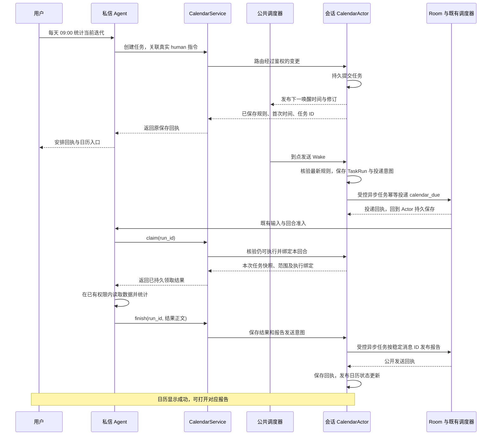

# 会话日历与 Agent 定时任务方案

状态：**C1 一次性任务闭环、C1.5 Agent 工具合同、C2 重复与工作日、C3 日历体验与管理、C4 组合验收与发布收尾均已实施**。C1 范围及真实 DSH／浏览器证据见[交付记录](implementation/calendar/once.zh.md)。C1.5 合同与真实 DSH 复验见[交付记录](implementation/calendar/agent-contract.zh.md)。C2 规则、离线年度数据及恢复证据见[交付记录](implementation/calendar/recurrence.zh.md)。C3 周视图、管理、历史与桌面／手机视口证据见[交付记录](implementation/calendar/experience.zh.md)。C4 会话隔离、暂停恢复、离线周期、受管服务重建和页面组合证据见[首版交付记录](implementation/calendar/release.zh.md)。以下保留完整首版设计；仓库交付完成不表示已发布版本或部署，后续能力边界保持不变。

后续入口优化：Calendar 已移除 MCP 注册，Agent 通过现有 `teamx calendar` 和按需 `--help` 调用，见[交付记录](implementation/calendar/cli.zh.md)。下文 `calendar_list/get/update/claim/finish` 的业务含义沿用，调用入口以 CLI 为准；初始 MCP 列表仅保留两个 Inbox 工具。

首个交付范围是私信 Agent：用户通过聊天安排任务，在当前私信的日历中查看和管理，时间到达后由该 Agent 自动处理，结果回到同一私信。后续将同一能力扩展到团队房间。

## 1. 产品定位与首版边界

建议把日历定义为**当前会话的时间安排与执行记录**，定时任务是第一种日历条目。日历页面展示安排，公共调度器负责时间唤醒，会话 CalendarActor 负责到期判断、持久化和可靠投递，现有 Agent 运行时负责执行。各层使用同一份任务定义和执行记录，避免界面有安排、后台却没有任务，或后台执行而日历不可见。

日历属于会话。私信中的唯一 Agent 是任务执行者，不把任务挂到可重用的 Agent 角色模板或某个 DSH Session 上；同名 Agent、不同私信的日历互相隔离。未来团队房间使用房间日历，并为每个任务指定一个实际成员。

部署上采用**每个 TeamX 服务进程一个 CalendarService 和公共调度循环，每个使用日历的会话一个 CalendarActor**。公共能力复用，会话状态独立；CalendarService 是进程内模块，不是每个 Agent 单独部署的服务。Actor 的划分依据是日历状态归属和并发变更边界。

核心改动限于三处：接入既有回合的就绪／上下文与终态通知；从现有跟进提醒中提取可复用的持久公开消息回执；将 CalendarActor 纳入服务生命周期。周期、工作日、漏跑、继续次数和运行状态归日历模块，不把 MemberAgent 扩成另一套日历调度器。首版保留可靠闭环，不建设通用工作流、独立消费协议或新的 Session 恢复机制。

| 首版必须交付 | 后续独立扩展 |
| --- | --- |
| 私信中的自然语言创建、查询、修改、暂停、恢复、取消 | 团队房间、多成员协作任务 |
| 一次性、每天、每周指定星期的固定时刻任务 | 每月、间隔分钟、复杂 RRULE、农历与条件触发 |
| 每天／周一至周五／中国大陆法定工作日，明确节假日及补班 | 更多地区、企业工作日历、个人请假 |
| 日／周时间轴、独立的任务列表、任务详情与执行记录 | 月视图、跨会话总览、拖拽调整、多个日历订阅 |
| 后台到点执行、同私信结果、离线恢复、暂停与异常反馈 | 普通会议／占时事件、提前提醒、飞书日历同步、ICS 导入导出 |

首版只承诺 TeamX 服务运行期间的自动执行。关闭浏览器不影响执行；退出服务、电脑关机或休眠期间无法准时执行。服务恢复后的行为由明确的补跑规则决定。系统服务部署可复用现有安装方式，不新增另一套常驻进程。

## 2. 主场景与对话行为

### 2.1 从聊天建立安排

用户：

> 每天早上 9:00 帮我统计下当前迭代的进展。

已明确项目、可读取数据源时，Agent 创建任务并返回真实保存回执：

> 已安排：每天 09:00（Asia/Shanghai，含周末和节假日），统计项目 A 当前迭代的进展，并发到这里。首次执行：11 月 20 日 09:00。[查看日历]

这里的“每天”按每天执行理解，不擅自改成工作日。用户可以接着说“只在工作日”“周末不做”“改成 9 点半”“先停一下”。修改成功后展示生效规则和下一次执行时间。

如果“当前迭代”没有可靠的项目范围，先保存为 `needs_info` 草稿，询问必要的信息，例如“统计哪个项目的迭代？”。草稿可在日历的待完善区域查看，但不生成可执行安排，不宣称已经安排成功。若用户原意只是讨论如何安排，则仅提出建议，不创建草稿或任务。

Agent 不应为每次明确的定时请求再增加一次通用确认。只有时间、对象或权限存在关键歧义时才澄清；已有连接和明确的任务上下文直接复用。

### 2.2 固定什么，运行时再解析什么

保存稳定的业务范围，如平台连接 ID、实例、项目的已核实标识、迭代选择方式、统计口径，以及用户原文。不要仅保存一句依赖旧 Session 记忆的提示词。

“当前迭代”通常表示每次运行时重新查找该项目当时的当前迭代，不能在创建时永久绑定今天的迭代。若用户明确说“迭代 X”，则保存指定迭代。多个当前迭代、资料不可读或权限变化时报告阻塞，不自行换项目、换账号或把空结果写成完成率 0%。

结果至少包含：项目和迭代、数据来源、统计截至时间、已完成／进行中／阻塞事项，以及覆盖不足。数据可来自已有平台工具或 Workspace；单纯的日历功能不承担一套新的项目统计适配器。已有通知不是完整项目数据，不能仅凭 Inbox 没有新消息推断迭代没有进展。

### 2.3 自动处理与结果呈现

09:00 到达时产生一次执行记录；Agent 忙时显示“等待 Agent”，实际开始后显示“执行中”。Agent 完成统计后，将一份带任务／执行关联的报告发布到当前私信，日历条目可打开该次结果。

日历安排成功、到点投递成功、Agent 开始执行、结果发布成功是四个不同事实。UI 和 Agent 回复都应准确区分。后台普通模型输出不能代替公开发送回执。

## 3. 日历交互

### 3.1 入口与布局

在私信会话标题下增加「聊天／日历」切换，保持左侧会话列表和当前私信身份。详情菜单可提供同一个日历入口，但不要求用户先打开 Agent 详情才能找到日历。

桌面日历默认周时间轴，提供「今天」、前后日期范围和指定日期导航。「日／周」只在日历视图选择时间范围，均使用时间轴网格。两枚图标切换「日历／任务列表」；任务列表按 task_id 每个任务一行，显示标题、规则、下一次执行时刻和任务状态，独立于日历日期范围，可筛选未结束、暂停、待完善、已结束或已取消任务。原按日期分组的执行条目列表及折叠任务管理入口合并为这一独立列表。切回日历恢复日期、范围和滚动位置。月视图仍为后续扩展。用绿色沿用 TeamX 视觉语言；借鉴截图的时间网格和日期导航，不照搬飞书导航、蓝色主题及会议室功能。打开时间轴时滚动到当前时间或当天首个任务附近，避免总从凌晨展示大片空白。

固定时刻的任务显示为时间点条目。可用最小高度保证点击，但不虚构“09:00–10:00”的占用时长，也不将这类条目计入会议忙闲。多个同刻任务排列或折叠为数量入口，保持标题和状态可读。

手机默认任务列表；切换日历后默认单日时间轴。手机与桌面统一使用网格自带的日期表头，通过“今天”、前后切换和日期选择器导航，不额外显示一周日期条。视口变化保留用户已经选择的视图和日期范围。详情用全屏页或现有抽屉，返回后保留视图、日期、滚动和当前私信。桌面与手机都保留聊天草稿。

### 3.2 展示与操作

今天的日期使用绿色圆形标记；日期弹窗统一使用圆形日期标记：未选中的今天使用绿色描边，所选日期使用绿色实心底色和白字；不为当前周逐日添加浅底色。普通周末通过文字弱化表达，不额外占据一行；节假日和补班显示「休／补」及完整文字提示，工作日历缺失单独说明，不能用“周末”颜色直接断言“不工作”。弹窗底部使用「今天」跳转。条目显示任务标题、时刻、重复标识和执行状态；未来条目是“计划”，历史条目以真实执行记录为准。

任务详情包含：完整任务说明、业务范围、规则及固定时区、工作日历来源和覆盖期、首次／下次执行时间、漏跑策略、任务启停状态、最近结果、失败原因与执行历史。

首版提供「编辑后续安排」「暂停／恢复」「取消任务」「跳过这一次」。不支持任意单次改时间；用户可以跳过原安排，再建一次性任务。取消为保留历史的软取消。

从日历创建与从聊天创建使用同一服务。表单提供任务说明、时间、重复、日期筛选和必要范围；信息不足保存为待完善。打开日历、预览日期或点击条目均不启用 Agent，不改变任务。

过去的运行可跳转对应私信报告；聊天中的任务回执可跳转对应安排。保存及状态更新通过现有 UI 更新通道立即刷新，不等待 Agent 再读一次输入。不能仅靠改变气泡文本表示后台已启用。

## 4. 时间、重复与工作日语义

### 4.1 规则使用结构化字段

不把 cron 字符串作为用户或 Agent 的主要合同，也不让模型自己枚举未来日期。首版规则为以下受限集合：

| 字段 | 语义 |
| --- | --- |
| `frequency` | `once`、`daily`、`weekly` |
| `start_date`、`local_time` | 固定时区下的开始日期与时分，分钟精度 |
| `weekdays` | weekly 使用 ISO 星期 1–7，至少一项 |
| `time_zone` | 创建时解析并保存的 IANA 时区，默认取当前系统设置 |
| `day_filter` | `all_days`、`weekdays`、`business_days` |
| `work_calendar` | business_days 必填，首版仅 `CN` |
| `end_date` | 可选，包含该本地日期；无结束日期则持续 |
| `excluded_dates` | 用户明确跳过的单次本地日期 |

每天和每周先产生候选日期，再应用日期筛选；筛掉的日期直接跳过，不自动顺延到下一个工作日。一次性任务默认 `all_days`，落在节假日仍执行；若用户明确要求一次性的日期筛选且该日被排除，创建时提示修改，不能保存一个永远不执行的活动任务。

| 用户说法 | 保存语义 |
| --- | --- |
| 每天 9 点 | daily + all_days |
| 每周一到周五 9 点／不含周末 | daily + weekdays；法定假日若落在周一到周五仍执行 |
| 每个工作日 9 点 | daily + business_days + CN；创建回执明确“含调休补班” |
| 每周一 9 点，节假日跳过 | weekly + `[1]` + business_days + CN |

“工作日”按中国大陆口径的默认需在回执中显式说明；用户上下文指向其他地区时澄清，不能仅凭时区认定适用国家。公司放假／值班差异需要后续企业工作日历支持，首版不冒充覆盖。

### 4.2 时区、首次时间与夏令时

复用系统时区用于默认输入和页面显示，但任务规则保存独立的 `time_zone` 快照。修改系统时区仅改变日历显示，不移动已有任务的执行时刻；任务详情同时显示规则时区和当前显示时区。要改变执行时区，必须编辑任务规则并返回新的下一次执行时间。

创建和编辑在服务提交时重新计算首次时间：默认取提交时刻之后的首个有效候选，已经过去的今天 09:00 不隐式补跑。解析自然语言时使用现有 Agent 时间上下文；服务按明确时区独立校验，不能信任模型算出的 UTC。

重复规则按本地日历推进，不能用 UTC 时间简单加 24 小时。对于有夏令时的时区：不存在的重复本地时刻跳过该次；重复出现的本地时刻取第一次，只执行一次。一次性输入若不存在或存在两种解释，返回具体时间歧义，由用户选择有效时间／偏移。该取舍参考 [RFC 5545 的日期时间与重复规则](https://www.rfc-editor.org/rfc/rfc5545.html#section-3.3.10)；首版不声称支持完整 iCalendar。

实际到期、截止时间和记录时间保存 UTC；保留本地日期、规则时区用于解释。墙钟回拨由执行身份去重防止重复；向前跳变按漏跑策略处理。

### 4.3 节假日与补班数据

中国大陆法定工作日不能等价为周一至周五。例如官方 2026 年安排同时规定节假日和周末补班，见[国务院办公厅通知的政府网站转载](https://www.shache.gov.cn/scx/c118335/202511/5048185cc52b402eaf7115296e881827.shtml)。这里引用用于说明数据需求，不将该年度视为永久有效数据。

首版使用随版本发布、可离线读取的年度数据文件，保存地区、覆盖日期、版本、官方来源链接、发布日期，以及逐日休息／补班覆盖。完整覆盖年度内，先查明确覆盖，再按星期计算普通工作日；覆盖外返回 `unknown`。数据经开发者从官方通知核对后发布，不在每次运行时抓网页，也不让模型生成放假表。首版需要更新可发新版，暂不建设在线订阅或管理后台。

启动时校验文件结构、覆盖期、重复及矛盾日期。UI 提示即将到达数据覆盖边界；日历查询返回覆盖不完整标记。`business_days` 遇到未知日期不执行并展示“工作日历尚未覆盖”，不能悄悄按周一到周五执行，也不能假装假日已跳过。数据补齐后按原漏跑期限处理，过期则记录漏跑。

`all_days`、`weekdays` 不依赖工作日历的正确性，缺少年度数据只影响节假日标注，不阻止执行。已开始／结束的执行保留原数据版本；更新数据只影响尚未开始的候选和未来预览。

## 5. 数据模型与存储

### 5.1 三个对象即可

| 对象 | 关键内容 |
| --- | --- |
| Calendar | 完整 RoomIdentity、文件版本、修订、任务集合、执行记录、评估水位和待投递记录；私信每会话一个 |
| ScheduledTask | `task_id`、资源版本 `version`、`definition_version`、标题、任务说明、规则、业务范围、执行 MemberIdentity、状态、授权来源、创建／修改时间 |
| TaskRun | `run_id`、资源版本 `version`、任务及定义快照、名义本地日期、到期 UTC、工作日历版本、状态／原因、执行尝试、领取与最近供给的 generation／turn、继续次数及下次核对时间、结果正文与发送回执 |

首版任务类型固定 `scheduled_task`，无需引入任意 handler 注册、工作流 DSL 或可执行脚本字段。任务说明和范围属于业务合同，调度器不解析“统计”含义。未来普通日程可作为另一种条目加入日历，只有明确的可执行类型才产生 Agent 工作。

主场景保存“进展日报”的说明、已核实项目范围、`iteration.mode=current`、每天 09:00 的规则与漏跑策略；完整请求示例见第 7.1 节。身份、版本和来源证据由服务校验并补全。

`scope` 可以保存已核实的平台引用或 Workspace 范围，首版不强制所有任务都是项目统计；Room 适配层校验引用归属，Agent 负责把具体任务所需范围补齐。Calendar 仅保存有界、可序列化的任务上下文，校验结构和大小，不随每种统计业务增加解析器。`iteration.mode=current` 是本案例的业务描述，不由 Calendar 调度器调用 GitLab 解析。

任务状态为 `needs_info`、`active`、`paused`、`cancelled`、`completed`；一次性任务成功或有效期结束后完成，周期任务的单次失败不等于整条任务取消。`blocked_reason` 描述缺少配置等当前阻塞，不必再建立一套重复的任务启停状态。

执行记录必须冻结任务说明、范围和规则版本，使历史不被后续编辑改写。创建来源至少保留真实 human 消息身份、序号、必要原文及操作者，不只存可能被清空的消息链接；表单创建记录真实操作者和已提交字段。

### 5.2 身份与版本

所有持久对象绑定完整 `room_id + room_instance`，执行者绑定 `agent_id + membership_id`；请求继续遵循现有服务 epoch 和调用者鉴权。持久身份不绑定进程 epoch 或 Session generation；具体尝试才绑定本轮 generation／turn。

`run_id` 由任务 ID、定义版本和候选本地时刻确定，首次物化后 UTC 等字段冻结。评估水位与单次记录同次提交；重复扫描、事件重发或服务重启复用同一 run。编辑创建新定义版本，原版本只评估到提交边界；新规则只从提交时刻之后生效，不能重新枚举已经执行过的过去时刻。

任务资源的 `version` 在创建、编辑、启停或单次排除变化时递增；`definition_version` 只在任务说明、范围、规则或执行者变化时递增。TaskRun 的 `version` 独立随本次执行变化。后台产生新 run、更新回执不改变任务资源版本，避免用户编辑与执行进度无关地冲突。

用户变更携带稳定 `operation_id` 和目标资源的 `expected_version`，具体合同见第 7 节。相同操作 ID 和正文返回原操作结果，同 ID 异正文冲突；资源版本过期返回当前值，不能自动刷新后覆盖。claim／finish 按 run 与已认证执行绑定幂等，不另要求模型生成操作 ID。另一次真实重复请求若与已有活动任务相似，Agent 提示／复用已有任务；服务不以标题相同自动认定为同一任务。

### 5.3 首版存储方式

复用现有文件存储及可靠替换原语，在 `<room>/calendar/state.json` 保存上述权威状态。**只有该会话的 CalendarActor 可以组织此文件的写入**；持久化 worker 只能保存 Actor 冻结的候选状态，不能自行修改业务状态。Room Store、浏览器、CLI、DSH 均经 CalendarService 路由至该 Actor。由现有服务的独占目录锁保证单实例运行，同一日历的本地提交串行，不同日历可以独立处理文件 I/O。

首版默认每私信最多 100 个未取消任务，单日历状态上限 16 MiB；执行明细保留最近 90 天，最多 5,000 条，达到上限时先压缩已结清旧记录。未结清执行、未知结果及待发送回执不得清理，无法安全腾出空间则明确容量阻塞。已推进的评估水位和保留的任务／取消墓碑保证清理历史后不会重新产生旧执行；被清理明细在 UI 明确为超出保留期。到期键、未结清回执及创建幂等映射随对应任务保留，不用随意过期缓存代替持久去重。

任务文件不存在表示该会话尚未使用日历，不批量重写旧 Room 快照。文件损坏、身份不符或未知提交必须阻止该日历继续写入并暴露错误；不能把异常文件当空日历重新创建。新能力不要求转换现有消息、Inbox 或长期规则。

## 6. 到点投递与 Agent 执行

### 6.1 服务、调度器与 Actor 的职责

| 组件 | 数量与身份 | 负责什么 |
| --- | --- | --- |
| CalendarService | 每个服务进程一个 | 统一 API／工具入口、身份校验、唯一 Actor 地址管理、工作日历与规则能力装配、服务启停协调 |
| 公共调度循环 | 每个服务进程一个 | 根据各 Actor 发布的下一唤醒时间等待并发送 Wake，合并重复通知、限制单批唤醒数量、处理时钟变化；索引可重建 |
| CalendarActor | 每个使用日历的完整 RoomIdentity 一个 | 独占任务与 run 状态，串行处理变更、到期判断、claim／finish、投递意图、回执、失败重试及生命周期围栏 |
| Room／MemberAgent | 复用现有实例 | 接受定向事件，按现有门禁调度 Agent 执行；日历不另建 DSH 执行链路 |

CalendarActor 与任务执行者是两种职责：一个团队房间未来可有多个 Agent，但仍只有一个 CalendarActor。ScheduledTask 和 TaskRun 是 Actor 内的数据对象，不为每个任务、每次执行或每个 Agent 再创建 CalendarActor。无日历文件且未使用功能的会话无需创建 Actor。

Actor 自然对应本场景的状态边界：创建、修改、取消、到期、领取和完成都会竞争同一份日历状态，需要共同排序；不同会话则可以独立推进。参照现有 MemberInputActor 的装配方式使用 Actorx，无需为日历另建 Actor 框架。规则计算、工作日判断和投影保持普通 Go 函数。

CalendarService 仅管理地址与路由，不同时维护一套可修改的任务集合。公共调度器也不生成 TaskRun、不写日历文件、不直接向 Room 投递业务事件；**具体到期事件的产生、投递发起及回执保存都由对应 CalendarActor 负责**。调度循环首版使用受服务生命周期管理的普通 Go 循环即可。

CalendarService 在初始化时预留唯一 Actor 实例，使用完整 RoomIdentity 查找和复用地址；并发打开同一日历不能创建两个写入者。Actor 在 Room runtime 未打开、浏览器关闭或 DSH 未启动时仍受 CalendarService 管理，不随 Agent Session 轮换而重建。服务启动恢复已有日历，首次创建按需初始化；停止或重建旧 Actor 必须先完成 Quiesce、Stop/Wait，不能以调用超时或邮箱不可达认定其已退出。

### 6.2 与当前代码的衔接

当前实现可直接利用以下边界；它们不代表已经存在定时任务能力：

| 当前能力与源码 | 本方案用途 |
| --- | --- |
| 私信标识、受管目录与 runtime：`management.go`、`default_assistant.go` | 校验 is_direct、成员身份、发现未打开的私信并按需加载 runtime |
| 系统时区：`settings.go`，已包含 tzdata | 默认输入与页面显示，生成任务的固定时区 |
| `member_input.go` 的 MemberInputActor、受控任务与提交后投影 | 参考其状态归属、串行文件提交、有界请求队列和 Quiesce；CalendarActor 使用独立业务消息 |
| `room_input_events.go` 的 AppendRoomEvent、目标成员和去重回执 | 投递定时到期事件，沿用 Room 输入与公开操作反馈 |
| `input_stream_runtime.go`、`input_stream_guide.go` | 同一输入工具读取真实 human 意图和定时事件，不另建 Inbox 消费游标 |
| `MemberAgent`、`turn_scheduler.go` | 继续遵守暂停、单成员单回合、Room 排队、Session 轮换及清理边界 |
| `recovery.go` 的成员装配、`dsh.go` 的回合上下文、`member.go` 的终态保存 | 在服务边界接入日历待办提示与可信回合终态；不复制输入恢复状态机 |
| `room.go` 的 Post／FollowupNoticeReceipts、`followups_conversation.go` | 提取跟进提醒已有的持久发布回执供日历复用；普通 send 仅靠消息正文查重，不满足清空历史后的恢复要求 |
| `mcp_access.go`、`mcp_turn.go`、`input_bridge.mjs` | 复用逐回合执行绑定和操作结清；Session 凭据本身不等于逐回合身份，关闭时不放宽鉴权 |
| `ui_updates.go` 与 `internal/web/assets/features/` | 新增日历更新主题、资源读取和前端功能模块 |

建议**首版把到期任务作为定向 Room 系统事件**，使用现有统一输入读取路径；任务定义、执行状态和待投递记录归会话 CalendarActor。无需把本地日历伪装成 GitLab／飞书通知源，也不为它扩建平台账号、订阅和来源解析流程。

### 6.3 时间唤醒、到期判断与可靠投递



**时间唤醒。** 服务取得目录锁后，由 CalendarService 恢复已有日历的 CalendarActor；各 Actor 校验、加载自己的权威文件并发布下一唤醒时间，公共调度器据此重建索引。HTTP 可服务且生命周期装配完成后再开放时间唤醒及投递，不能只加载前端当前打开的私信，也不为恢复日历启动所有 DSH。

索引每个日历保留一个下一唤醒时间，包括最近任务时刻、投递重试、排队过期、有界继续或未结清执行核对时间；没有待处理时间则不为该日历设定到期定时器。Actor 提交状态后发布新的时间和修订，公共循环等待最近时间、索引变更或最多 30 秒的校时检查。索引只包含身份、Actor 本次启动标识、修订和时间，是内存中的派生信息；同一次 Actor 启动只接受不早于现有修订的更新，旧启动实例的更新被拒绝。每次校时检查同时从已提交投影补齐遗漏更新，不扫描全部任务、不启动模型，也不在独立文件中维护另一份调度真相。

Wake 携带目标 RoomIdentity、Actor 本次启动标识及观察到的修订。旧 Actor 的消息失效；旧修订、重复或迟到的通知只触发当前状态复核，不能携带旧任务快照直接执行。公共循环发送失败保留待唤醒资格并有界重试，不生成 TaskRun。批量到期时轮转唤醒不同日历，不等待某个 Actor 的磁盘或 Room 调用；邮件箱容量及待受理队列均有界，满时返回 busy，不静默丢弃命令。

**到期判断。** CalendarActor 被唤醒后取得当前时间，按最新任务、工作日历、暂停／取消状态及补跑规则决定具体候选；每个日历每批最多评估 128 个候选，积压继续分批，重复 Wake 合并。TaskRun、评估水位和投递意图在该 Actor 的一次状态提交中保存；成功后才允许投递。健康空闲服务的到期投递延迟目标建议为 5 秒以内，这是服务指标，模型完成时间不作准点保证。

**可靠投递。** CalendarActor 在变更槽之外启动受控异步任务，按固定 RoomIdentity 加载目标 runtime 并调用 AppendRoomEvent；异步结果返回同一个 CalendarActor，由它校验原 run／投递 ID 后串行保存回执。runtime 没有打开时正常加载，但不修改持久暂停意图。打开或投递失败保留原意图，由 Actor 保存重试信息并发布新的唤醒时间；业务重投由该 Actor 发起。共用的投递函数仅是 Room 调用适配器，不能成为新的投递状态所有者。

事件使用固定 `event_id`、`operation_id`、`result_ref`、版本、摘要和创建时间，`target_memberships` 仅包含执行者，`Actor` 为 system，`source_seq` 指向原授权消息或表单来源约定。调用方不能在重试时更换时间或正文，否则现有事件去重会冲突。投递成功而确认丢失时，重发同一事件取回原 Room 回执。

每个意图同一时间只允许一个投递任务在途；事件投递和报告发布使用同样的“持久意图 → 受控投递 → Actor 保存回执”流程。投递 worker 不直接写日历文件。旧任务的迟到回执可以结清其原投递事实，但不能恢复已取消 run 的执行资格；开始取消后不再发起尚未授权的投递，已经在途的事件可能到达，后续 claim 仍必须拒绝失效任务。服务 epoch 只用于当前调用鉴权，不改变持久业务身份及事件正文。

`calendar_due` 的 result_ref 指向专属 Calendar 执行读取接口，不能继续假定所有 Room 事件都来自平台连接操作。同步修改现有事件指引和路由；事件文本只提供信号，真实任务和授权以 Calendar 服务校验为准。

### 6.4 Actor 消息、提交与并发边界

建议以少量显式消息组织实现，消息名称可按项目约定调整：

| 消息／操作 | Actor 内的处理边界 |
| --- | --- |
| `UpdateTask` | 校验来源、操作 ID 和预期版本，保存创建／编辑／暂停／取消结果 |
| `WakeCalendar` | 合并唤醒，按最新状态判断到期、漏跑、重试和过期，提交候选与水位 |
| `ClaimRun`／`FinishRun` | 校验当前授权和执行绑定，提交领取或结果／报告意图 |
| `DeliveryFinished` | 匹配在途投递、目标和回执，保存成功或重试状态，不重新授予任务资格 |
| `InspectCalendar` | 返回已提交只读投影，不维护、不领取、不执行文件提交 |
| `TurnFinished` | 核对可信的成员、generation／turn 和持久终态，结清相应尝试或统计已供给但未领取的无进展回合；可重复通知 |
| `QuiesceCalendar` | 关闭新任务变更、到期生成和领取准入，保留已受理操作、内部终态／回执的结清通道；最终等待在途任务结束，不重新开放 Agent 工具权限 |

单一 mailbox 用于接收和排序消息，文件 I/O 在 Actorx 受控任务中执行。每个日历同一时间最多一个持久变更在途：从已提交状态构造不可变候选，完成可靠保存后回到 Actor 安装新状态、更新只读投影、通知调度器及 UI，再回复成功。其他业务变更进入有界队列；首版每个 Actor 最多受理 64 个未结清外部请求，重复 Wake 合并。内部提交完成、投递完成和关停通知不占外部请求额度，且必须能被处理，不能因业务队列满而丢失结清。读取可以返回上一份已提交投影及其修订，不能把候选状态当作已经保存。

Room 投递、runtime 加载、取消 MemberAgent 等外部等待不占用文件变更槽，也不在 handler 中同步等待可能回调 CalendarActor 的另一 Actor。异步任务只使用冻结请求，结果通过消息返回并参与下一次串行提交，不修改 Actor 活状态；不同会话的慢调用不会占住公共调度器或全局管理锁。

取消、到期和 claim 的先后以同一 CalendarActor 的持久提交为准。例如，取消先提交则不再生成可领取任务；TaskRun 先提交、取消后提交时保留这次到期事实，但禁止其后续领取。涉及“投递已开始”“报告发送意图已接受”的事实也必须在同一边界登记，才能解释取消之后为什么仍可能看到迟到事件或既有结果。

Actor 邮箱和公共计时器不提供持久保证。恢复依据始终是 Calendar 文件中的任务、水位、执行及投递／发送意图；单纯的 Send 成功仅表示消息进入内存邮箱，不能当作已保存或已投递的业务回执。

### 6.5 领取、执行与完成

Agent 读取事件后调用 `calendar_claim(run_id)`。CalendarService 验证调用上下文并路由至会话 CalendarActor；Actor 重新核对任务未暂停／取消、定义未被替换、执行者仍在、截止时间未过、当前回合权限及无冲突尝试，再持久绑定 generation／turn 后返回完整任务快照。仅看过事件或读完 Room 输入，不能标记任务完成。

同一执行绑定重复 claim 返回原记录；其他回合不能抢占运行中的尝试。每次模型回合首版最多领取一个日历执行，其他到期任务留在持久队列。现有调度器仍决定谁能运行，日历不能直接调用 DSH RunPrompt、越过暂停或创建第二个并发 Session。

claim 必须在业务读取前完成持久提交；若提交失败或结果未知，先查原领取结果，不开始业务执行。Agent 以冻结的业务范围工作，任务目标之外的探索不因“定时”自动获得授权。

`calendar_finish` 提交执行结果、结果状态、完整报告正文及必要证据。由 CalendarActor 先持久保存报告和发送意图，再发起受控异步任务，通过正常 Room 发布路径以原执行成员身份、固定 `client_message_id` 发送；发送完成后回到该 Actor 保存回执。完成接口是该次报告的唯一发布入口，Agent 不再另发一份相同报告。

发布报告使用第 6.7 节的持久公开消息回执；补结清只允许原身份、原目标和原正文，不触发模型或远端业务写入。响应丢失先查询原结果；报告已经发送而日历尚未确认时，从原回执补结清，不生成新正文重发。普通 send 的固定消息 ID 不作为历史清空后仍能去重的充分依据。

若目标缺失、权限不足或数据不完整，提交 `blocked`／`failed` 及准确原因，可将一次说明发布到私信；不能用“任务已完成”代替。周期规则默认仍有效，下一周期独立检查；明确配置阻塞可显示在任务上。同一持续原因只提示一次，原因变化或人工恢复后再提示，避免每天重复打扰。

Agent 已读事件却未 claim，或完成回合却未 finish，均按第 6.8 节对账；事件仍仅投递一次，不反复追加消息来制造新回合。日历在原有暂停、Session 和工具结清门禁之内请求后续正常回合，不增加独立模型执行通道。

**就绪与回合上下文在服务装配层组合。** CalendarActor 发布只读的待办投影，服务结合真实执行门禁发布可供给状态。MemberAgent 增加可选的 `AdditionalWorkReady func() bool`，只读已发布内存投影，在原 ready 和授予后复核中与已有输入信号组合；handler 不经此函数扫描文件或等待另一 Actor。只增加这个就绪接点与第 6.8 节的终态观察接点，不新增 calendarPolling、calendarRecovery、calendarContinueCount 等专属状态，也不建设通用来源注册框架。

平台输入消费故障与恢复仍由原 owner 管理，不能把平台 Recovery 清空、伪装成 Room 未读或通过简单 OR 绕过未结清页和 Session 门禁。某个数据源权限不足不等于整个成员不可运行，日历可否办理仍按自身范围及原执行门禁判断；组合层必须区分来源不可读与执行未结清。

回合开始时由服务提供有界的额外工作上下文，默认最多 5 个 run_id、标题和到期时间，并在 CalendarActor 中记录该次供给的 generation／turn；只有实际供给且正常结束的回合才计无进展。正文仍经 claim 取得，模型读取最新 human 意图后选择最多一个日历任务办理。本轮不得再领取第二个日历任务，不强制清空其他 Inbox，也不承诺回合内的子任务隔离。

无进展次数、下一次允许继续时间和待办就绪均归 CalendarActor。成功领取／终态是进展，重复 list/get 不是进展；一个回合领取了任一供给任务时，其余未领取候选不计无进展，留待后续供给。完全未领取日历工作的正常回合才对实际供给的未领取候选计数；首次供给后最多继续两次，间隔复用现有回合继续的退避取值，随后标为 blocked 并等待明确继续。重启不清零。没有日历待办时，附加就绪为 false，不产生额外模型回合。

### 6.6 状态与补跑的默认值

执行主状态为 `queued → running → succeeded / blocked / failed / unknown`；开始前也可进入 `skipped / cancelled`。报告已保存但未获公开回执时使用内部 `publishing` 阶段，UI 显示“报告发送中”，不能提前显示成功。重试记录为同一 run 下显式的新 attempt，保留原尝试证据。

| 情况 | 首版规则 |
| --- | --- |
| 正常到点，Agent 空闲 | 入队并按既有准入执行 |
| Agent 正在处理其他输入 | 排队，显示等待；开始前重新检查有效性 |
| 同一任务上一周期仍在执行 | 新周期记 `skipped_overlap`，不并行、不事后堆积执行 |
| 服务停机、休眠或其他等待后恢复 | 默认只补最近一次，且到期不超过 1 小时；更早的记漏跑，不逐条启动模型 |
| 多个错过周期 | 旧周期按范围保存漏跑原因；最近周期满足期限才入队；一次性任务也遵守 1 小时期限 |
| 等待领取期间超过期限 | 记 `skipped_late`；已领取的执行不因开始截止时间自动过期 |
| 用户暂停 Agent | 不自动恢复 Agent；到期记录等待暂停解除，超过期限记漏跑 |
| 用户暂停任务后恢复 | 暂停期间不补跑，从恢复提交后的下一个有效时刻继续 |
| 调度投递明确未成功 | 原 run／原事件重投，有界退避，不重建任务 |
| 执行失败、取消或结果未知 | 首版不自动重做业务；按现有 Session／工具结清规则处理，用户可显式重试 |

“只补最近一次”和 1 小时是首版固定产品默认值，回执／详情展示，不建设一页复杂策略设置。用户明确要求错过即跳过时可保存 `misfire=skip`。按历史逐日追补、任意迟到执行属于后续策略。

单次执行建议 15 分钟超时，由 CalendarActor 请求现有回合取消并等待 Session／工具结清。当前执行器按整个回合取消，首版不实现回合内子任务取消；同回合其他未完成工作可能一并中断，UI 和回执应准确提示。超时不是已停止的证明；未结清时继续阻止冲突执行，不因计时器到期释放占用。重试按钮仅在已结清且授权仍有效时可用，unknown 必须先核对现有回执及外部结果。

同一任务存在 unknown 或未结清尝试时，后续周期也只记录阻塞，直到核实结束；不能通过创建下一次周期绕过未知结果。明确失败且已经结清的周期允许下一周期独立执行。

### 6.7 复用持久公开消息回执

目前普通 Post／send 主要从仍保留的消息正文查重，清空历史后不能据此核实旧发送；跟进提醒已有独立的 FollowupNoticeReceipts。首版从后者提取一个内部受控发布能力，供原跟进提醒和日历报告共用；保持原提醒的授权、正文和回执可核实性，不重做普通聊天发送、消息存储或输入确认。

共享能力只负责：校验完整 Room／成员身份和已受理的发布意图，以稳定消息 ID 查询／追加消息，并在 Room 的同次可靠提交中保存消息与回执。回执保存身份、消息 ID、正文摘要和公开 seq，独立于可见历史保留；同 ID 同内容返回原回执，异内容冲突。调用方仍负责各自业务授权和发送意图，不建设通用 outbox 框架，也不把这项内部能力作为任意 Agent 都可调用的“跳过校验”开关。

日历报告 ID 由 run_id 和 attempt 编号确定，首版报告为单条有界 UTF-8 文本，复用当前单消息 16 KiB 限制；不自动拆条、不自动推断 @ 提及，超限明确返回字段错误。TaskRun 保存报告、摘要和发布意图后，CalendarActor 才发起受控发布；Room 已提交但日历确认丢失时，查询或复用原回执。清空可见历史不删除尚需核实的发布回执；回执回收只可在调用方持久结清并失去重放资格后进行，首版沿用现有容量边界，超限明确阻塞。

CalendarActor 只有拿到公开回执，才把带报告的执行转成对应 succeeded／blocked／failed 终态。模型普通输出、HTTP 写出成功或 finish 工具返回“已受理”都不是报告发布成功。Agent 对该次报告只使用 finish，避免再 send 一份；与定时任务无关的即时聊天回复继续使用正常 send。

### 6.8 回合终态与对账

在现有 MemberAgent 保存 TurnRecord 终态之后，增加可选的内部终态观察接点，由服务适配器向 CalendarActor 发送 TurnFinished。通知携带完整成员、本轮准入时固定的 generation／turn、已保存的终态及是否结清，不能在结束时读取“当前 Session”猜原绑定；只有可靠保存终态后才提供确定证据。MemberAgent 不解析 run，不决定日历的成功／失败，也不维护通知重试队列；没有日历时此接点为空。

CalendarActor 对照自己保存的领取／供给绑定处理通知。重复通知幂等；旧回合通知只能结清原尝试，不覆盖新尝试。通知只是加快观察，不能成为唯一恢复依据：claim 或供给记录同时保存 next_check_at，由公共唤醒触发 Actor 对未结清 run 做有界核对，服务在状态变更槽之外读取持久 TurnRecord／Session 和发布回执证据。

| 已核实的情况 | 日历处理 |
| --- | --- |
| 已供给、正常回合结束但未领取 | 该次计一次无进展，在原期限内允许有界继续 |
| 已领取、finish 已保存且有公开回执 | 按原结果结清，模型随后结束异常不抹去已经发布的事实 |
| 已领取、finish 已保存但报告未确认 | 保留 publishing，继续原报告的本地结清，不重做业务 |
| 已领取、正常回合已结清但没有 finish | failed，原因 result_not_submitted；不自行从私有输出拼一份成功报告 |
| 取消／异常结束，已有证据证明结清及业务结果 | 保留确定结果；否则按现有工具／Session 证据判断失败或 unknown，不自动重试 |
| 终态写入失败、证据已被后续回合覆盖或宿主崩溃后无法核实 | unknown，保留原绑定，阻止同任务后续执行，等待核实 |

对账仅检查仍有供给／领取记录的 run，不为全部回合新增独立持久日志。不因为通知失败重做模型回合，也不要求已经取消的模型再调用 finish；日历对账不承担 DSH 进程接管、输入确认恢复或远端动作重放。

## 7. Agent 与管理接口

C1／C1.5 已交付一次性 Agent 工具；C2 已扩展 daily／weekly、日期筛选和单次跳过，继续使用同一合同。C3 已交付周视图、完整详情、编辑、历史及手机布局，见[交付记录](implementation/calendar/experience.zh.md)。所有入口遵循现有服务的鉴权、大小限制和错误约定。

### 7.1 Agent 工具

本节是 C1.5 定稿、C2 扩展的 Agent 合同。MCP 与 Agent CLI 共用服务及业务投影，不直接输出持久任务／执行对象。已开放 `once`／`daily`／`weekly`、分钟精度，日期筛选为 `all_days`／`weekdays`／`business_days`。

| 工具 | 入参与输出 |
| --- | --- |
| `calendar_list` | 可选 from／to、state、cursor。默认 active／paused／needs_info，每任务一条，无默认日期限制；completed／cancelled 显式按 state 查询。返回 task_id、version、title、state、rule_summary、有效 next_at，存在时附 blocked_reason、pending_runs（run_id、due_at、status）。不附完整定义／报告。 |
| `calendar_get` | task_id 或 run_id 二选一。任务返回可编辑 definition、version、状态、下次时间／阻塞；执行返回冻结 definition、run.version、due_at、time_zone、业务 status／reason 及已发布 report_seq。默认不附历史／正文；task_id + history=true 显式分页历史；run_id + result=true 显式读取 report／evidence。 |
| `calendar_update` | action、稳定 operation_id、真实 human_source；create 不需要 expected_version，已有资源变更必须携带目标版本。返回本次 task_id 或 run_id、新 version、state／status、必要规则摘要／next_at／阻塞。仅无变化返回 changed=false，仅复用返回 operation_reused=true。 |
| `calendar_claim` | 只传 run_id，直接返回领取后的 status、冻结 title／instruction／scope、due_at、time_zone 和 misfire；无需先 get。不输出执行绑定、attempt、定义版本或领取流程不用的 run.version。 |
| `calendar_finish` | run_id、outcome（succeeded／blocked／failed）、完整 report；可选 evidence 只含有界来源引用。返回 run_id、统一业务 status，公开发布后附 report_seq，存在时附 reason。 |

list 和显式 history 每页最多 50 条；有后续页时返回 next_cursor。cursor 绑定完整会话身份、原筛选、读取选项和快照修订；后续页保留原参数并传入 cursor。快照变化时明确报错并重新查询，不能省略条目。history 返回最近保留的执行记录（保留上限 90 天），每条为业务执行投影，正文仍需单独按 run_id + result=true 读取。日期范围为 `[from,to)`，要求同时给出，最长 42 天；Agent list 只筛选区间内有有效候选的任务并去重，按日展开归管理 API。

`calendar_update` 每次一个动作。Agent 提交当前私信真实 human 消息 `human_source:{"message_seq":42}`；服务核实并保存必要原文。表单创建由服务记录真实操作者，Agent 不能伪造表单来源。

| action | 附加字段 | 版本与语义 |
| --- | --- | --- |
| create | definition；可选 state=needs_info，缺省 active | 无需 expected_version。title／instruction 必填；活动任务必须明确 frequency 和 local_time；once 必填 start_date，daily／weekly 省略 start_date 时由服务按提交时的规则时区日期保存。weekly 必填 ISO weekdays 1–7；business_days 必填 work_calendar=CN。end_date 含当天，excluded_dates 不顺延。time_zone 省略时固定保存系统 IANA 时区，day_filter 默认 all_days，misfire 默认 latest_within_one_hour。草稿可缺待澄清项。 |
| edit | task_id、expected_version、changes | 每个提供的字段整体替换，未提供的保持原值；只允许 title／instruction／scope／schedule／misfire。scope=null 清除，misfire=null 恢复产品默认，必需字段不能为 null；拒绝深层 merge 和完整 definition 替换。needs_info 补齐可 state=active，暂停任务仍只能 resume。 |
| pause／resume／cancel | task_id、expected_version | 使用 task.version；同状态且版本匹配可无变化；cancelled 不可恢复。 |
| skip_once | task_id、expected_version、local_date | 使用 task.version，local_date 为规则时区的未来有效候选日期；保留已跳过记录并排除该日，不更改定义版本。 |
| retry_run | run_id、expected_version | 使用 run.version。仅允许已结清、已核实的 failed／blocked／skipped，且任务没有暂停／取消、定义仍适用；unknown 或未结清拒绝。 |

创建一次性请求（scope 中的引用必须来自已有工具的核实结果；以下标识仅为示意）：

```json
{
  "action": "create",
  "operation_id": "op_...",
  "human_source": {"message_seq": 42},
  "definition": {
    "title": "当前迭代进展汇总",
    "instruction": "统计项目 A 当前迭代的进展，注明来源及截至时间。",
    "scope": {"connection_id": "verified_connection", "project_ref": "verified_project", "iteration": {"mode": "current"}},
    "schedule": {"frequency": "once", "start_date": "2026-11-20", "local_time": "09:00"}
  }
}
```

连接和业务引用通过已有平台／输入／引用工具核实，或复用已确认 Workspace 范围；不得照示例猜 ID。回复当前私信由服务保证，不需在 instruction 重复填写。服务回执明确实际保存的时区、日期筛选、首次时间及漏跑策略：

```json
{"task_id":"task_...","version":1,"state":"active","rule_summary":"once 2026-11-20 09:00 (Asia/Shanghai); all_days; misfire=latest_within_one_hour","next_at":"2026-11-20T01:00:00Z"}
```

修改示例：`{"action":"edit","operation_id":"op_edit_...","human_source":{"message_seq":43},"task_id":"task_...","expected_version":1,"changes":{"title":"新的汇总标题","scope":null}}`。schedule 整体替换时必须提供完整有效的规则（重复规则的 start_date 可交给服务默认）；省略 schedule 时保留原规则和固定时区。

响应丢失／提交未知时，用**原 operation_id 和原请求**重放 update，创建还没有 task_id 也能恢复。先查原操作，再解释默认值，不因系统时区／日期变化改写已经受理的请求；冻结存储仍须安全重开核实。复用返回原操作结果，不能把它当成之后的最新资源。版本冲突保留 task_id／run_id 与 actual_version，Agent 读取必要定义再决定，不自动刷新覆盖。

claim 每次重新核实当前资格；同执行绑定重复调用仍受取消／暂停检查。finish 从认证执行取得 attempt；同绑定同结果幂等、异正文冲突，不要求另传操作 ID。

```json
{"run_id":"run_...","outcome":"succeeded","report":"项目 A 当前迭代进展……\n统计截至：2026-11-20 09:03 +08:00。"}
```

```json
{"run_id":"run_...","status":"publishing"}
```

`publishing` 表示报告已保存、服务继续发布原报告；Agent 不另行 send，不为正常发布持续轮询。只有取得公开回执后才返回真实结果终态，例如 `{"run_id":"run_...","status":"succeeded","report_seq":123}`。blocked／failed 保留准确原因及显式可读的报告，查询使用同一业务状态词汇。模型私有输出不算报告。可选证据为 `{"source_refs":["src_..."]}`，复用输入／引用工具给出的 source_ref 格式，最多 16 项、4 KiB；不要重复报告已有的来源文字。

retry_run 保留原 run_id 和旧尝试证据，新增内部 attempt，开始期限从本次授权提交起算一小时。原一次性任务 completed 不妨碍已核实失败重试；暂停、取消及定义替换仍优先校验。C2 已开放 skip_once、重复任务 start_date 默认值和 weekdays／business_days。任务 get 在 business_days 时返回年度覆盖、版本及官方来源；覆盖未知返回 blocked_reason=work_calendar_uncovered，不承诺 next_at。history 中 kind=missed_range 的条目以 due_at／until_at／count／reason 保存旧周期范围，不代表可领取 run。

错误区分 invalid_request（含 field）、version_conflict（含目标与 actual_version）、operation_conflict、not_authorized、run_busy、run_expired、task_inactive、result_unknown、capacity、service_closing；工作日历无法覆盖领取日期时为 work_calendar_uncovered。错误不触发静默刷新版本或新建操作；未知结果不当作明确未保存。

CLI 对应 `calendar list/get/update/claim/finish`；结构化变更使用 JSON 文件或 stdin。`get --task-id ID --history --cursor CURSOR` 读取历史，`get --run-id ID --result` 显式读取报告。逐回合身份沿用现有 input execution 绑定，CLI 的 --turn 与业务 JSON 分开。桥接凭据仅在内部传递；Session 凭据不能猜当前回合。closing／restarting、令牌撤销、取消和回合 barrier 均继续生效。Calendar 不是输入消费页，不增加 receive／confirm 协议。

正常业务路径只需一次 update；事件已有 run_id 时直接 claim 后 finish。可选 list 用于查询或核实已有安排，无需 get 预读。真实模型调用记录及恢复验证见[合同交付记录](implementation/calendar/agent-contract.zh.md)。

### 7.2 管理 API 与日历投影

C3 已沿用正式的 `/v1/calendar/list`、`/v1/calendar/get`、`/v1/calendar/update` 入口。list 返回显示时区、完整任务集合、区间内 occurrence 分页、日期标注及当前保留的创建消息／公开报告关联；get 使用 task_id + history 显式分页历史，run_id 读取本次快照与结果。管理投影与 Agent 工具投影保持各自边界，变更仍路由同一 CalendarActor。

建议由 roomManager 路由 `/v1/calendar`、`/v1/calendar/task`、`/v1/calendar/run` 及明确的变更入口，经公共 CalendarService 找到唯一会话 CalendarActor，沿用当前服务身份合同。页面读取使用 Actor 发布的已提交投影，不启动模型、不 claim、不消费输入。Actor 在可靠提交并安装状态后发布 `calendar` 资源失效通知，复用现有 SSE／重读机制；API、MCP 和 CLI 不直接打开文件另建 writer。

范围查询采用 `[from, to)` UTC 区间，后端按规则时区展开并转换。返回计划条目与已物化执行的合并结果，同一 occurrence 只展示一次，真实状态覆盖未来预览。预览与调度使用同一个规则求值函数，不能前端另算一套重复日期。

每次范围最多 42 天、每页最多 200 条，返回游标、快照修订和完整性／工作日历覆盖标记；翻页绑定同一查询快照，过期时重新查询，不能静默漏项。未来无限重复只按范围临时展开，不提前落盘多年记录。用户跳过的单次候选在详情及日程视图保留原因，可切换显示，不使其看起来是丢任务。

## 8. 授权、变更与生命周期

### 8.1 授权边界

明确的真实 human 定时指令授权创建和按所述范围重复办理。引用、转发、平台消息、工具结果及定时事件不能自行建立或扩大安排。服务验证来源是当前私信真实 human 记录；模型对语义的提取仍需指引约束，无法靠序号校验完全证明。

任务说明不能代替平台权限。首版主场景为读取、汇总并回复当前私信；周期性远端评论、修改任务、发群消息等外部动作沿用已有动作和长期规则授权，缺少授权则等待用户。日历不成为绕过规则的新执行器，也不自动保存一条更宽泛的长期规则。

取消／修改来自最新 human 输入时，Agent 应先处理。定时执行在 claim 和 finish 两个边界均重验最新任务状态，已失效事件无法恢复旧授权。执行中的远端操作仍受现有工具检查约束，不能声称撤销能追回已完成动作。

### 8.2 任务变更和并发

编辑默认影响后续安排：取消旧版本未领取的 run，尚未生成的候选由新版本从提交边界之后计算。已经领取的执行继续使用旧快照，界面明确提示“本次已开始，修改从下次生效”；需要停止本次时使用单独的取消操作。

finish 对定义版本的核验按此边界处理：仅发生“修改后续安排”时，原已领取快照仍可完成；暂停／取消则拒绝新提交成功结果并进入结清。若报告发送意图早于暂停／取消被可靠接受，只能补结清原发送，不能承诺撤回。会话 CalendarActor 串行决定先后顺序并记录供 UI 解释，CalendarService 和公共调度器不绕过这一边界修改任务或投递状态。

暂停／取消阻止后续 claim。若该任务已在当前回合被领取，按原成员、generation／turn 向既有执行路径请求取消并等待结清；请求晚到且成员已经进入新回合时不得取消新回合。复用或补齐一个校验预期执行绑定的内部取消入口，不使用“取消该成员当前回合”的无条件操作。已完成且有确切回执的结果保留，不能改写成“从未执行”。这会中断相应整个回合，但不改变成员长期启用意图；暂停未来任务不必暂停整个 Agent。取消接口先可靠保存意图，再反馈“取消中”或“已取消”。

### 8.3 会话生命周期

| 操作 | 日历行为 |
| --- | --- |
| 关闭页面、切换私信、会话改名 | 保持规则与后台运行 |
| Session 自动／手动轮换 | 保留任务和 run；未结清尝试不能借新 Session 自动重做 |
| 服务正常重启 | CalendarService 恢复各会话 CalendarActor，由 Actor 加载规则、投递意图及发送回执并重建唤醒索引，按期限处理未开始的 run |
| 宿主崩溃 | 不声称自动接管旧 DSH；已运行但无终态的尝试为 unknown，沿用现有恢复边界 |
| 重启讨论、清空上下文 | 首版默认暂停该会话全部任务，保留定义和必要授权原文；界面预先说明，恢复需明确操作，不能清掉授权依据后继续执行 |
| 仅清空可见消息历史 | 保留任务定义和授权快照；报告链接可能超出消息保留期，日历仍显示保留期内结果及原回执 |
| 移除／替换执行成员 | 阻止新领取并停止后续调度，不自动转给同名新成员 |
| 删除私信 | 隔离该日历的唤醒及新准入，结清运行和待发送，停止并等待其 CalendarActor 退出，再移除索引／地址并随会话清理文件；其他会话保持运行 |

服务关停分为停止新工作和最终结清两个阶段：先停止公共调度循环，向 CalendarActor 发送 Quiesce，拒绝新任务变更、到期生成与 claim，处理已受理本地提交并停止新的到期事件投递；再按现有顺序取消并结清成员执行。closing／restarting 和回合取消继续拒绝新 Agent 调用，不要求模型在取消后再提交 finish。CalendarActor 保留内部 TurnFinished、投递回执、已受理 finish 和已持久报告发布的结清通道。

成员结清后，即使终态通知丢失，仍在锁内对原在途执行核对一次持久证据；再等待投递 worker 和全部本地提交结束，才 Stop/Wait 各 CalendarActor、关闭 CalendarService 并释放目录锁。超时保留仍在工作的实例和目录锁，不提前创建替代 Actor。若存储已冻结而无法保存最终状态，保留已有证据并在重开后显示未核实，不为追求状态闭合重做业务。

删除单个会话、重启讨论使用同样的会话级围栏，不能先删文件再等待后台任务。讨论重启先通过该 CalendarActor 持久暂停任务，再按原流程清理上下文；若原流程失败，任务保留已保存的暂停状态。公共调度循环可继续服务其他会话；重启后的旧计时通知只触发复核，不恢复任务。

若 Calendar 文件替换结果未知，冻结该日历后续变更和新执行，通过持有锁的安全重开核实；只要底层存储健康门禁冻结范围更大，便继续遵守原门禁，不能由 CalendarService 绕过。Room 写入结果未知则由原 CalendarActor 通过同 ID 回执核对。两个文件不假装原子事务，以持久意图和幂等回执跨越边界；Actor 更换代际也不重新生成未结清业务 ID。

## 9. 实施拆分

保留 C1–C4 的编号与交付边界，在 C1 完成后、C2 开始前增加一个小阶段 C1.5，专门收敛 Agent 工具合同。实施顺序为 **C1 → C1.5 → C2 → C3 → C4**；C1／C1.5／C2／C3／C4 均已实施，证据见上述各阶段及首版交付记录。每阶段都包含入口、指引、生命周期和相应验证，真实验证随对应功能前移，C4 负责组合验收与发布收尾；阶段完成不意味着后续能力已经可用。代码和测试按长期行为命名，不将阶段编号写进业务类型。

| 阶段 | 交付内容与建议落点 | 完成边界 |
| --- | --- | --- |
| C1：一次性任务闭环 | 按下述检查点完成最小模型、CalendarService、公共循环及每会话 CalendarActor；一次性聊天创建、list/get、claim/finish、同私信报告、最小日程列表和工具指引 | 真实 DSH 私信跑通一次近未来任务，结果确实发布；受控测试覆盖暂停／取消、重启恢复、历史清空后报告去重和关停结清；最小列表在实际浏览器可用；不提前暴露周期／工作日功能 |
| C1.5：Agent 工具合同精简与定稿（已实施） | 按第 9.1 节收敛五个工具的输入、业务投影、状态与恢复路径，同步 MCP／CLI、指引及第 7.1 节；保持 C1 的执行与可靠发布机制 | 创建一次 update、到期直接 claim 后 finish；精简合同经过真实 DSH 一次性闭环验证；提交未知、版本冲突及取消不因精简而失去恢复能力 |
| C2：重复与工作日（已实施） | daily/weekly、日期筛选、年度数据、时区／DST、跳过单次、多周期漏跑水位和恢复；复用 C1 的执行与发布机制，扩展 C1.5 定稿的 Agent 合同，同步开放工具／表单能力 | 每天 09:00 及法定工作日语义完整；真实 Agent 正确创建、解释重复规则并办理一个有效到期候选；Clock 测试覆盖跨周期、补班及漏跑；覆盖不足可见，不借星期兜底 |
| C3：日历体验与管理（已实施） | 在 C1 日程列表和模块上增加周视图、完整详情、编辑、执行历史、SSE 更新及互相跳转；完善范围 API 和手机布局 | 在实际浏览器验证桌面与手机视口，安排可见可管、预览与执行一致、草稿与返回位置保留；标明视口模拟与真机证据；不增加月视图／拖拽／外部同步 |
| C4：组合验收与发布收尾（已实施） | 基于前阶段证据验证重复任务、会话切换、暂停恢复、服务重启和页面状态的组合；补齐回归、读者文档与首版交付记录 | 关键组合场景通过，已交付能力与文档一致；区分受控、真实模型／平台、浏览器及真机证据；不承担前三阶段首次验证或新增功能 |

C1、C1.5、C2–C4 合在一起才是本方案的私信首版。C1 直接实现最终日程列表的最小版本，放在计划使用的 `internal/web/assets/features/calendar.mjs` 中；C3 扩展同一模块、服务接口和任务详情，不另建临时管理页或第二套列表。C1 可以观察安排和结果，C3 再完成截图所指的日历体验；不把“后台有 timer”当作首版完成。

C1 内部按以下三个检查点推进；它们共同构成一次性闭环，不额外拆成需要分别批准的产品阶段：

1. **状态与可靠发布**：用最小模型、Actor 和受控输入验证到期生成、状态提交及原意图恢复；共享发布路径通过“Room 已提交 → 应答丢失 → 清空历史 → 重启核实”，仍复用原 seq，同 ID 改正文冲突，原跟进提醒行为保持。
2. **Agent 执行与生命周期**：接入 MCP／CLI、额外工作就绪和可信回合终态；无新 Room 未读也能办理任务，暂停／未结清输入和 Session 门禁不能被绕过。用受控 Backend 验证取消／关闭各提交边界，旧回合通知与取消不影响新回合，不重新开放已取消凭据，未知结果不重试业务。
3. **自然语言入口与最小列表**：补齐真实聊天指引和最终列表的最小版本，使用真实 DSH 跑通“安排 → 自动执行 → 同私信报告”，在实际浏览器查看和暂停任务。真实模型接入问题在 C1 修正，不推迟到 C4。

### 9.1 C1.5：Agent 工具合同精简与定稿（已实施）

目标是让 Agent 一次取得当前决策和下一步调用所需的业务信息，减少重复字段、内部状态与无意义必填项。保留五个工具及 C1 的 Actor、持久化、调度、执行绑定和可靠发布机制；本阶段调整工具合同与适配，不重做这些机制，也不提前实现重复规则、完整日历或新的业务 scope DSL。

**输入与输出的收敛目标：**

| 工具／合同 | C1.5 已落实的行为 |
| --- | --- |
| `calendar_list` | 默认按任务列举，每个任务一条，包含 active／paused／needs_info，不受“未来 7 天”限制；completed／cancelled 可显式按状态查询。默认返回 task_id、version、title、state、规则摘要、next_at，存在时附阻塞原因及待办 run 的 ID、到期时间；不展开重复日期或附完整定义／报告。日期筛选只筛选区间内有有效候选的任务并去重，日期条目展开归第 7.2 节管理 API；cursor 绑定原筛选与快照，不能靠省略条目缩短输出。 |
| `calendar_get` | 按 task_id 返回可编辑业务定义、version、状态、下一时刻及阻塞；按 run_id 返回 run_id、run.version、本次冻结业务定义、名义执行时间、规则时区、状态／原因及结果回执，供查询和显式 retry_run 使用。历史通过显式 history 读取选项和 cursor 分页，默认不附整段历史；run 的报告正文只在显式读取结果时返回。不得直接序列化持久对象作为 Agent 输出。 |
| `calendar_update` | create 不再要求 expected_version=0，已有资源变更仍必须携带相应 expected_version；保留稳定 operation_id 与真实 human 来源。省略的 time_zone 由服务固定保存系统时区，day_filter／misfire 使用已支持的产品默认值；一次性日期与时分仍须明确。回执返回 task_id 或 run_id、新 version、state／status、必要的规则摘要／下一时刻及阻塞，changed／operation_reused 仅在表达无变化／复用事实时出现；不回显整份定义或日历。 |
| `calendar_claim` | 仅传 run_id，直接返回领取后的业务状态、冻结 instruction／scope、名义到期时间及规则时区，不强制先 get。generation／turn、成员绑定、attempt、definition_version 和领取流程不用的 run.version 留在服务内部；保留所有执行所需的业务范围和限制。重复 claim 仍重新核实当前资格。 |
| `calendar_finish` | 保持 run_id、outcome、report；可选 evidence 限定为有界的来源引用，复用已有引用格式，不重复报告中已有的来源说明。服务自动取得 attempt／执行绑定；默认回执只给 run_id 与统一业务 status，发布完成后附 report_seq，不回显完整报告、内部消息 ID 或并列多组发布状态。 |

Agent 可见的运行状态把内部 publishing 阶段直接投影为 `status=publishing`。例如 finish 已保存结果但未获公开回执时返回 `{"run_id":"run_...","status":"publishing"}`；公开发布并结清成功后返回 `{"run_id":"run_...","status":"succeeded","report_seq":123}`。blocked／failed 的终态保留准确原因。内部仍独立保存 outcome、发布阶段和回执；publishing 不等于报告已发布，也不能只凭模型提交 succeeded 就返回成功。指引明确：服务继续发布原报告，Agent 不再另行 send，也不为正常发布持续轮询。查询及错误响应沿用同一业务状态词汇。

创建回执必须明确服务实际保存的时区、日期筛选、首次时间和漏跑规则，可统一放入服务生成的规则摘要，避免再用多组同义字段表达。scope 中的连接和业务引用必须来自既有工具的核实结果；指引写明引用取得方式，不让模型照示例猜 ID。固定的“回复当前私信”由服务保证，无须 Agent 在 instruction 中重复填写。

**恢复与变更合同：**

- 响应丢失或提交未知时，使用原 operation_id、原请求重放 update，核实并返回原操作结果；创建尚无 task_id 时也可恢复，不要求先 get。先查原操作，再解释省略字段的默认值，不能因重试时系统时区或日期变化而改变已受理请求。存储未知时继续遵守冻结与安全重开门禁，不把重放解释为允许越过门禁。
- 版本冲突保留目标和 actual_version，Agent 读取必要业务定义后再决定变更，不能静默刷新版本覆盖。claim／finish 保持原绑定幂等、取消检查及异正文冲突；隐藏绑定字段不减少服务端验证。
- 本阶段固定 edit 的最终语义：提交明确的 `changes` 字段集合，只允许 title／instruction／scope／schedule／misfire 等可编辑字段；每个提供的字段整体替换，未提供的保持原值，清除可选字段须显式表示并校验，不支持任意深层 merge。保留 expected_version，暂停任务仍只能 resume。若 C1 已交付 edit，C1.5 一并落实；否则合同先定稿，随首次编辑能力交付，最迟 C3 落实，不为本阶段提前建设完整编辑功能。

**同步范围与后续边界：** MCP schema、CLI 参数与输出、实际工具桥返回、动态回合指引和静态提示词使用同一业务合同；业务投影不改变管理 API／持久化数据的职责。实施前检查 C1 实际入口，只保留一套正式 Agent 合同，必要的内部适配不向模型暴露旧字段。完成时更新第 7.1 节，删除被替代的默认 7 天、完整对象回显和多组发布状态示例。

C2 已落实重复任务省略 start_date 后从提交时刻之后计算首个有效候选，以及 weekdays／business_days 的参数和覆盖不足表达；用户明确提供的开始日期、时区和漏跑策略必须保留。C1.5 只对已支持的一次性能力实施默认值，不提前开放未支持参数。C3 已完成编辑与执行历史 UI，复用本阶段定稿的合同。

**完成标准：**

1. 经 MCP／CLI 实际路径验证：正常创建只需一次 update，到期可直接 claim 后 finish；默认 list 能找到暂停、待完善及 7 天之后的一次性任务，get 和 history 的输出有明确边界。记录正常路径必填参数、调用次数和代表性输出，确认精简没有增加预读调用或丢失执行范围，不以字节数减少单独认定可靠性提升。
2. 受控验证覆盖创建响应丢失后的原请求重放、默认值跨重试固定、版本冲突、取消后旧领取无效，以及 finish 发布中／已发布和异正文冲突；未发布不能显示成功，恢复不重复建任务或发报告。检查 Agent 输出不泄露内部绑定和供给／调度记录。
3. 用最终合同在隔离目录跑一次真实 DSH 近未来一次性闭环，核实任务、内部执行绑定与唯一公开报告回执；绑定证据从服务侧检查。C1 原验收记录保留，本阶段另记合同调整后的证据。UI 若因共享响应适配发生变化，补相应浏览器验证；未变化则沿用 C1 浏览器证据。

### 9.2 后续阶段与共同实施约束

C2 已按重复规则展开、工作日历与漏跑恢复的顺序交付，复用 C1 的执行、发布和生命周期；C3 已在同一日程模块完成周视图与管理交互，桌面及手机 Chromium 视口证据见[交付记录](implementation/calendar/experience.zh.md)。各阶段发现的问题在该阶段修正并更新指引，不以“最终还有 C4”替代完成条件；C4 已完成跨功能组合与发布收尾，证据见[首版交付记录](implementation/calendar/release.zh.md)，沿用既有恢复机制。

实现层次保持简单：`internal/calendar` 管规则求值、记录与有限状态变更，不依赖 Actorx、DSH 或平台；`internal/room` 装配 CalendarService、CalendarActor、公共调度循环及 Room 调用适配器，负责真实身份、持久化和生命周期；前端只展示已提交投影。可按 `calendar_service.go`、`calendar_actor.go`、`calendar_scheduler.go` 和 `calendar_delivery.go` 划分职责。MemberAgent 只接通用工作信号与终态通知，DSH 适配层只承载有界额外上下文和既有逐回合工具绑定，inputstream 保持原消费合同。存储复用可靠保存原语；不另建通用调度／outbox 框架、任务 DSL、数据库或独立队列。新增 Actor 消息时按项目流程更新生成代码。

需要同步审计的现有入口：`prompts/assistant.md`、`prompts/agent-guide.md`、`input_stream_guide.go`、CLI 专属帮助、MCP 装配、`discussion.go`、`deletion.go`、受管／单房间服务启动关闭路径、UI 更新主题及范围鉴权。单房间 serve 复用同一 CalendarService、公共循环、Actor 和目录锁装配，只管理该房间的一份日历；不能留下受管模式能执行、单房间模式能创建却无人调度的半支持状态。

阶段交付时修订 `docs/conversations.zh.md` 和 `docs/agent-runtime.zh.md` 中“尚无定时任务”的说明，仅描述已交付能力。读者指南解释创建、时区、工作日、停机和失败；详细状态／验收矩阵留在实现文档。

## 10. 必须验证的行为

| 类别 | 有意义的验证 |
| --- | --- |
| 规则正确性 | 每天／每周、提交前后首次时刻、跨月跨年、固定时区、DST 空缺／重复、结束日期、跳过单次、假日与补班、覆盖未知；预览与到期使用相同结果 |
| 身份和权限 | 普通单成员 Room 不误判私信；同名 Agent／不同私信隔离；旧 membership、旧实例／epoch、越权 run、第三方来源和过期版本拒绝 |
| Actor 归属与隔离 | 并发获取同一日历仅创建一个 Actor／writer；不同日历独立提交；一个 Actor 的慢磁盘／投递不阻塞公共调度器及其他日历；停止未结清时不能创建替代 Actor |
| 唤醒与并发排序 | 重复／迟到 Wake、旧 Actor 通知、旧索引更新、通知丢失后的索引补齐；取消先提交／到期先提交／claim 先提交分别得到明确结果；迟到投递回执不恢复已取消资格 |
| 幂等与落盘 | 创建／编辑响应丢失、事件投递后确认丢失、报告发送后确认丢失、写入失败及未知提交；重开后不重复建任务或发报告 |
| 持久报告回执 | 报告发布后未保存日历确认，期间清空消息历史，重启后仍返回原 seq；异正文冲突；跟进提醒原路径、容量和身份检查不退化 |
| 背压与关停 | 外部队列满时明确 busy，内部完成及 Quiesce 仍能结清；提交后才发布投影／下一时间；先停新工作、后收原结果；在途 worker 退出前保留 Actor 和目录锁 |
| 执行边界 | 忙时排队、暂停不唤醒、输入恢复门禁不被附加就绪绕过、一个成员单回合、每轮最多领一个日历任务、取消只作用于匹配绑定的整个回合、超时未结清不释放 |
| 终态与绑定 | 未绑定回合的 Session 凭据拒绝 claim／finish；旧回合请求拒绝；取消后拒绝新工具调用而内部终态仍能结清；重复／丢失终态通知核实同一尝试，缺证据保留 unknown |
| 无进展与恢复 | 实际供给后才计无进展，继续次数重启保留；已读未领、已领未完成、未打开私信、关停／恢复、休眠跨期限、多周期漏跑、钟表回拨；不以私有模型输出替代报告 |
| 真实业务 | 已连接的项目查当前迭代；创建后迭代切换仍查“当前”；数据缺失／权限失效不得生成虚假统计；报告确实出现在同私信 |
| 浏览器 | 桌面周视图、独立任务列表、手机单日网格、绿色风格、同刻任务、空态／待完善／工作日历缺失、草稿与返回位置、其他标签页更新、报告跳转和状态反馈 |

时间算法、漏跑和竞争测试使用可控 Clock 与受控 Backend；不要让单元测试等待真正的隔天 09:00。集成验证必须经过服务／CLI／MCP 及 Room 真实持久路径，不能只直接调用函数就声称端到端成功。

真实 DSH 验收使用隔离数据目录和明确启用的测试，C1 验证近未来一次性闭环，C1.5 用精简后的最终工具合同复验一次性闭环，C2 验证重复规则的创建、解释和一个近未来有效候选，检查任务、run、generation／turn 和公开消息回执。跨日、多周期和时钟变化通过可控 Clock 验证，不要求等待真实隔天，也不以受控时间证据冒充长期实跑。C1 最小列表和 C3 完整日历分别进行对应浏览器验证，C4 再补齐组合场景。数据来自受控平台、手机仅使用模拟视口时均明确标注；读取真实项目使用已授权范围，真实远端写入单独取得对应授权，不作为本首版必要验收。

正常回归按改动执行相关 Go、race、前端和集成检查。真实模型与浏览器验收独立执行，不加入日常 CI；未经实际运行，不能把设计中的恢复或节假日支持写成“已验证”。

## 11. 团队房间的后续扩展

保留每会话一个 CalendarActor，开放普通 Room，任务增加明确的执行成员选择。新增成员不会增加该房间的 CalendarActor，也不复制日历；公共 CalendarService 和调度循环继续复用。到期仍由房间 CalendarActor 向指定成员投递；多个 Agent 共同完成的任务先选一个负责人，由已有 Room 协作推进，不默认广播给全员同时执行。

继续遵守房间的 serial／parallel 模式和每成员单回合限制。成员移除后任务显示需要重新分配，由用户明确指定新成员，再建立新的执行身份；不能因为角色名相同自动继承旧授权。结果默认回到所在房间，日历展示负责人和执行记录。

房间版还需独立评估任务编辑权限、可见范围、共享／私有上下文和多人指令冲突，并单独验收。首版只提前保留身份与职责边界，不建设多租户日历权限框架、跨会话代理或通用工作流引擎。

## 12. 评估时的关键取舍

建议首版采用：**公共 CalendarService 和调度器复用、每会话一个 CalendarActor；公共调度器只负责时间唤醒，CalendarActor 负责到期判断、持久状态和可靠投递；任务固定创建时区、受限重复规则、中国大陆工作日历、既有 Agent 回合执行，结果带持久回执回到本私信**。

默认“每天”包含所有日期；工作日含调休补班；停机只在一小时内补最近一次；失败不自动重做业务；重启讨论暂停任务；房间和外部日历同步后续交付。这些都是需要产品接受的明确行为，实施时应同步体现在工具指引、保存回执和页面详情中。

实施判断以三条边界为准：**日历状态集中在 CalendarActor；公开报告复用持久回执；执行和恢复服从既有回合／Session 生命周期。** 允许为这些共同能力做小范围提取，避免把日历业务散入核心，或以“统一”为由提前建设框架。第 7 节接口与 C1 内部检查点构成 C1 基线，第 9.1 节 C1.5 将 Agent 合同收敛定稿后再进入 C2。
