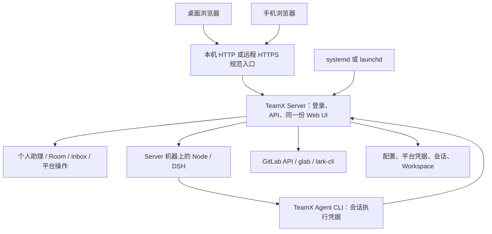

# TeamX 常驻 Server 与桌面／手机 Web Client 方案（第三版）

当前实现的概念、架构和运行入口见 [Server 架构](server.zh.md)；安装、备份与升级命令见 [安装与运行](installation.zh.md)。本文保留设计演进、阶段范围与验收要求。

> 状态：**W0 契约与隔离探针、W1 独立 Server 基础、W2 token 访问与远程 Web 已落地，W3、W4 代码与自动验证已完成，真实设备／平台出口待补；W5 运维入口与自动验证已落地，原生部署／平台出口待补，W6 发行门槛、观察工具与本机／Docker 验证已落地，真实设备／平台和 24 小时观察待补；W7–W10 待实施**。W0 的验证范围、实际证据与 Linux 发送门槛见[基础记录](implementation/server-web-foundation.zh.md)；W1 的目录、首次设置状态和生命周期验证见[实施记录](implementation/server-lifecycle.zh.md)。W2 的访问、初版模型设置、代理及本机 HTTPS／真实模型证据见[实施记录](implementation/server-access.zh.md)。模型配置已另按[模型列表、首次引导与在线切换方案](MODEL-CONFIGURATION-AND-LIVE-APPLY-PLAN.zh.md)推进，现有阶段 1–4 证据见第 3.3 节；W3 的通用与模型页面衔接见[实施记录](implementation/server-web-experience.zh.md)；W4 的浏览器授权、原操作返回和模型轮换接续见[实施记录](implementation/server-platform-authorization.zh.md)。W5 的服务模板、归档安装、备份升级恢复与验收边界见[部署记录](implementation/server-deployment.zh.md)。W6 的同归档模型／原生服务、Docker amd64 模拟证据、浏览器声明与观察门槛见[发行验收记录](implementation/server-release-acceptance.zh.md)。模型领域交付与真实手机出口仍以对应证据为准。本版保留浏览器首版和后续原生客户端路径。
>
> 更新日期：2026-11-12。本次按模型改造方案、实施记录和当前工作区校准后续契约；原 token 简化基线为 HEAD `239552e`。W3 的代码和自动验证已落地，真机与后续阶段仍按各自门槛验收。**W0–W6 交付 Web 首版，W7–W10 保留原生客户端和增强能力**；旧 D0–D4、CS0–CS8 的阶段含义与估算不再用于本版。已完成范围以各自实施记录为准，后续要求不代表能力已验收。

## 1. 目标、范围与交付

TeamX 是 **always-on 的个人助理服务**。Server 独立常驻，负责默认个人助理、Room、Inbox、平台连接、通知采集、模型与工具执行、持久化和恢复；用户在桌面或手机浏览器打开同一服务提供的 Web UI。

首版采用 **一个 Go Server + 一套响应式 Web UI + 浏览器 Client**，保持每实例一个所有者、多设备访问、一份业务状态。前后端同源部署，UI 继续嵌入 Go 程序，不另建移动站或浏览器客户端安装包。

| 场景 | 浏览器访问方式 | 服务运行位置 |
| --- | --- | --- |
| 本机使用 | 打开本机 loopback 地址 | 同一台电脑的独立后台服务 |
| 远程桌面使用 | 打开规范 HTTPS 网址 | Linux 或 Mac 上的常驻 Server |
| 手机使用 | 手机浏览器打开同一 HTTPS 网址 | 同一份远程 Server |
| 手机访问个人电脑 | 使用手机可达的 HTTPS 地址 | 个人电脑上的 Server；按网络服务模式配置 |

客户端关闭、手机切后台或网络断开，不停止 Server。真正持续在线取决于 Server 所在机器：个人电脑休眠／关机不能执行任务，macOS 用户级服务也不保证跨用户注销运行。需要长期不间断使用时优先部署到服务器。

本期交付内容：

- Server standard 发行归档，含现有内嵌 UI、固定 Node／DSH、glab、lark-cli、模板与许可材料。
- 同一份 UI 的桌面／手机布局、输入、设置、平台授权与断线恢复体验。
- 单个管理访问 token、轻量浏览器会话、网页首次模型引导与集中模型管理、Agent 调用认证、规范外部 URL 与 HTTPS 代理接入；模型管理复用独立模型方案。
- Linux amd64 的部署说明／systemd 模板，macOS arm64 的本机服务说明／LaunchAgent 模板。
- 手动安装、启停、升级、备份／恢复及最终归档验收。

**Web 首版不做**：Electron、原生手机 App、桌面一体图形安装器、本机客户端配对、跨 App 的 OAuth 票据、自动更新、PWA／Service Worker、离线编辑、Web Push、设备执行组件、多租户、Windows Server、旧开发目录自动导入和通用旧数据迁移。同一实例升级时的有限模型配置迁移由模型方案负责，验收通过后才对已有数据开放。Electron 与手机 App 的交付边界见第 14 节 W7–W10。

浏览器版保留将来增加原生客户端的可能，但不提前建设相关 IPC、登录桥接、Client-only 包或版本协商框架。平台连接与服务化是本期功能，不以“没有原生客户端”为由省略。

## 2. 相比第二版的范围调整

| 第二版内容 | 第三版处理 |
| --- | --- |
| Electron 工程、窗口、安全 preload／IPC、原生菜单 | 移到 W7；W0–W6 由浏览器承载 UI |
| Client-only、Desktop Local 两类桌面产物 | 分别保留在 W7、W8；Web 首版只交付 Server 归档与部署材料 |
| 本机 Electron 自动配对、原生服务管理页面 | 移到 W8；Web 首版统一浏览器登录，安装管理使用受控部署命令／服务管理器 |
| WebView → 系统浏览器的 GitLab 一次性起始票据 | 原生客户端需要时在 W7／W9 实现；Web 首版由同一浏览器完成授权与回调 |
| 独立常驻、稳定目录、Agent 清理 | 保留，属于 Server 基础能力 |
| 所有者密码登录、CLI／Agent 凭据、HTTPS 与规范 URL | 简化为管理 token + 轻量浏览器会话；保留 Agent 隔离和 HTTPS，不建设账号密码体系 |
| 飞书／GitLab 授权、Inbox 自动接续 | 保留并复用已有操作服务，增加真实手机与远程 HTTPS 验收 |
| 打包、手动升级、备份、最终产物验收 | 保留，不随桌面壳一起延期 |
| 独立手机 Web 体验阶段 | 明确新增，覆盖布局、软键盘、触控、后台／恢复及多设备状态 |

CSGClaw 的 Electron 实现不再是本期主要实施模板。第一版、第二版的“父进程管理 sidecar”“客户端退出时关闭服务”均不适用于本版。

## 3. 当前基础与需要补齐的部分

### 3.1 可以直接复用

- [internal/web/embed.go](../internal/web/embed.go)／[handler.go](../internal/web/handler.go) 已将 UI 随 Go 分发；[client.mjs](../internal/web/assets/client.mjs) 使用相对地址调用 API，适合前后端同源访问。
- 当前 UI 已有 viewport、窄屏媒体规则和动态视口高度，见 [index.html](../internal/web/assets/index.html)、[navigation.css](../internal/web/assets/styles/navigation.css)、[responsive.css](../internal/web/assets/styles/responsive.css)。本期是在现有布局上补齐体验，不重写框架或另建移动端业务逻辑。
- [serve.go](../internal/room/serve.go) 已有 loopback HTTP、就绪输出、Room 恢复、通知启动及信号停止，正常关闭预算为 30 秒。
- [对话式平台接入](CONVERSATION-PLATFORM-SETUP-PLAN.zh.md) 已实现飞书 C1–C6、GitLab CG1–CG4。复用真实用户依据、完整成员身份、operation ID、结果版本、选择／授权卡片、Inbox 交付和自动接续。
- 现有存储锁、请求幂等、Room／Membership／ServiceEpoch、DSH 安装路径和 Session 恢复证据继续作为业务约束；模型定义、成员引用和 Session 执行快照按第 3.3 节区分。
- [packaging](../packaging/README.zh.md) 已有 standard、固定依赖、白名单、原生检查、许可证、归档校验及验收框架。

### 3.2 源码中的主要缺口

下表记录方案制定时的源码基线；其中生命周期、认证、CLI 凭据和规范代理边界已由 W1／W2 补齐，当前使用方式与证据见对应实施记录。

| 当前事实 | 本期改造 |
| --- | --- |
| `serve` 只允许 loopback | 正式保留内层 loopback，通过 HTTPS 入口代理；不直接开放所有网卡 |
| [sameOrigin](../internal/room/ui_http.go) 仅接受 HTTP；空 Origin 可通过 | 增加登录／调用认证、规范 origin 与可信代理校验；空 Origin 不授予权限 |
| 操作者来自宿主 `USER`，请求正文携带 Caller | 固定一个操作者 ID；管理 token／会话映射为该 human，正文身份只作一致性核对 |
| [cliClient](../internal/room/cli.go) 没有认证头 | 同步贯通人工 CLI 和 Agent 临时执行凭据，不能只给页面加登录 |
| GitLab 回调从内部 endpoint 生成，按原浏览器 Cookie 校验 | 拆分规范外部 URL，保留同一浏览器中的原有授权绑定 |
| 首次模型配置原为终端向导 | 已由独立模型方案接管网页首启、生产适配器验证、托管凭据和在线生效，后续复用该实现 |
| Runtime／DSH 恢复校验真实路径、摘要和材料 | 固定安装目录，保留旧 Room 引用的版本，不从临时解压目录运行持久会话 |
| [飞书 Pin](../internal/platform/lark/pinned.go) 只支持 macOS | Linux 无人值守凭据和账号固定发送单列验证，不能凭登录成功宣布全能力可用 |

本文没有运行真实服务器／手机／平台登录。已有本机、模拟浏览器及历史接入验收不替代本期的远程 HTTPS、真实手机和 Linux 能力验收。

### 3.3 模型改造的承接基线

模型定义、凭据、成员选择、在线切换及有限迁移以[模型方案](MODEL-CONFIGURATION-AND-LIVE-APPLY-PLAN.zh.md)为准。本文负责移动适配、平台衔接、系统服务和最终产物验收，不重复建设模型服务或 Session 状态机。

- [配置与验证基础](implementation/model-configuration-foundation.zh.md)、[首次使用闭环](implementation/model-first-use.zh.md)、[在线模型管理](implementation/model-live-apply.zh.md)、[删除、迁移与交付](implementation/model-deletion-migration-delivery.zh.md)已有阶段 1–4 的实现与验证记录。阶段 4 已记录本机 darwin-arm64 standard 开发归档、真实模型／浏览器与迁移验证；W3 的新增页面、真实手机及 W5／W6 的部署／最终候选仍须补对应交集证据，不能由领域交付推定通过。
- `config.toml` 的 `models` 保存列表和默认引用；Agent 实例保存默认／固定条目选择，Session generation 保存实际模型、凭据版本和 DSH 身份。改默认影响已有的默认引用者；固定引用仍跟随该条目的执行 revision。原“模型只影响新 Room”的约定停止作为后续实施依据。
- 执行配置或凭据变化先验证，受影响成员等待当前 turn 结束后分别轮换 Session、替换 Backend；保留成员身份、Workspace、工具绑定与暂停意图。轮换会重置私有上下文，保存成功与全部生效分别展示；不因设置更新额外发起回合。
- 模型在线生效不代表 DSH 安装、服务地址或认证配置都支持热更新；旧 Session 继续使用自身快照恢复，受引用程序目录和凭据版本仍须保留。
- 本次复核已有真实模型证据采用同一上游模型的不同条目地址／参数验证切换；其他上游、DSH 版本、手机和系统服务部署的证据分别确认。W3 的模型衔接代码与自动验证已完成，后续只补尚缺的设备和阶段交集证据。

## 4. 总体架构与运行边界



| 层 | 职责 |
| --- | --- |
| Server | 唯一业务状态、认证、平台连接、执行、采集与恢复；不依赖某个标签页 |
| Web UI | 对话／卡片／设置、登录、可见状态和恢复；不执行 Agent，不持有平台 token |
| HTTPS 代理 | TLS、入口和可信来源传递；不替代应用自身的所有者／Agent 权限检查 |
| 服务管理器 | 启动、停止、有限重启、进程退出与日志；不判断外部动作结果 |
| 部署命令／模板 | 安装、查看状态、启停、升级、卸载；不暴露为普通 Agent 工具 |

Server 部署在哪里，Agent 默认就使用哪里的文件、工具链和平台凭据。手机访问服务器不会自动获得电脑文件或电脑上的模型环境。若未来需要手机访问本机目录，须另做受控文件传输或设备连接能力。

浏览器断开只结束该页面的请求／轮询。用户暂停 Agent、取消连接操作、停止 Server 是明确的独立行为，不能通过页面关闭隐式触发。

持续采集、Agent 处理、给用户发出外部提醒也是独立能力。首版沿用已有通知／Inbox／平台动作规则，不承诺浏览器关闭后还能收到手机系统推送；不能为了提醒而让用户保持页面前台。

## 5. 服务常驻与地址设计

### 5.1 运行与健康

继续围绕 `teamx serve`，提取可测试的 context、listener、ready、认证包装与配置来源选项。正式服务不依赖浏览器、stdin 或 Electron 父进程；维护 foreground 入口，交给系统管理器监管。

- 数据根保持独占，一个目录只允许一个写入 Server。安装／升级另加串行保护，禁止两个构建同时写入。
- ready 在配置、运行材料、存储锁和必要恢复检查完成后产生；端口连通不等于 ready。
- 正常停止先停止受理新执行，再结清 Agent、工具和持久状态。服务管理器预算大于当前 30 秒关闭预算。
- Linux 可采用先通知主进程、超时后清理服务 cgroup 的停止策略，例如 `KillMode=mixed`；验证 Go 清理与 DSH 独立进程组的关系，不能只杀 Go。[systemd 停止语义](https://github.com/systemd/systemd/blob/main/man/systemd.kill.xml)
- 失败重启有退避和次数限制。不确定／中断 Session 继续按现有规则暂停，不因 Server 重启自动重放未知写入。
- 进程存活、业务就绪和平台降级分别展示。模型限流、账号过期或某平台断网不应让整个服务反复重启。
- 日志轮转，保留采集积压／容量和磁盘状态。沿用既有过期、队列和回合预算，不因 always-on 放宽执行约束。

### 5.2 首期部署目标

- **Linux amd64 服务器**：systemd 系统服务，以专用普通账号执行；部署者安装 unit，确保退出 SSH、主机重启后继续运行。若采用用户服务，必须明确并验证跨注销运行条件，不能默认成立。[systemd 服务说明](https://github.com/systemd/systemd/blob/main/man/systemd.service.xml)
- **macOS arm64 本机服务**：提供用户级 LaunchAgent 模板与受控命令说明，打开浏览器使用。明确安装、启停、登录启动与卸载步骤；本期不做图形安装器。用户注销／系统休眠时不承诺继续执行。[Apple launchd 说明](https://developer.apple.com/library/archive/documentation/MacOSX/Conceptual/BPSystemStartup/Chapters/CreatingLaunchdJobs.html)
- 容器、其他 CPU 架构、Windows Server 作为后续目标，不能只改构建参数就宣称通过。

服务停止、再次启动和跨重启启用状态分别处理。显式停用不能只结束进程后又被 KeepAlive 拉起；卸载先停止并注销服务，默认保留用户数据，删除数据是独立明确操作。

### 5.3 内外地址分离

以下字段名是拟定契约，W0 固定实际命名：

W0 已固定：运行时 `internal_endpoint` 沿用 ready 的 `endpoint` 和 `TEAMX_ENDPOINT`；外部配置采用 `server.public_base_url`，完整命名与后续阶段归属见[契约记录](implementation/server-web-foundation.zh.md#固定的后续契约)。地址、认证和代理配置已在 W2 接入当前解析器；部署运维命令仍待 W5。

| 地址 | 示例 | 用途 |
| --- | --- | --- |
| `internal_endpoint` | `http://127.0.0.1:8088` | Server 机器上的 Agent CLI；依据实际 listener 计算 |
| `public_base_url` | `https://assistant.example.com` | 浏览器访问、GitLab 回调与完成页的规范地址 |

本机纯本地模式可使用固定 loopback URL；手机或远程访问必须使用设备可达的 HTTPS 规范地址。手机上的 localhost 指手机，不能把服务器 loopback 当作手机回调。

首版只支持域名根路径和一个规范外部 origin，不做子路径部署和任意别名域名集合。不同浏览器打开同一服务网址，无需客户端连接列表／服务器选择器；访问不同实例用不同网址，其登录、草稿和业务状态隔离。

HTTPS 代理到内部 loopback，保留规范 Host，只信任明确来源的代理协议传递。统一改造 `sameOrigin` 和 GitLab canonical 检查：不能继续仅依赖后端 `r.TLS`，也不能相信公网自行提交的 `X-Forwarded-*`。不以开放 CORS、删除 Origin 或随意改 Host 解决问题。[代理行为参考](https://caddyserver.com/docs/caddyfile/directives/reverse_proxy)

内部监听端口可配置；已有 GitLab Application 回调必须与稳定的外部 URL 一致。规范 URL 改变时先报告不兼容项，不自动改写远端应用。

## 6. 管理 token、轻量浏览器会话与 Agent 调用

### 6.1 一个管理 token，不建设账号密码体系

个人自托管首版只配置一个管理访问 token。持有有效管理 token 或由其换取的浏览器会话，即代表同一个 human 操作者；操作者 ID 初始化后固定在配置中，不随宿主 `USER`、token 轮换或设备变化而改变。保留既有 Caller 业务结构，不新增用户表、注册、密码哈希、密码恢复、多人 RBAC 或 JWT／刷新 token 系统。

管理 token 的最小契约：

- 全新实例的共享首启初始化使用密码学随机源生成至少 32 字节随机值；部署入口复用同一初始化及校验，不创建另一套凭据。仅确认全新或可续接的初始化允许自动准备，已有实例的 token 丢失／损坏须经部署机显式修复；不在每次启动时自动更换。
- 首版从部署账号拥有的 0600 私有 token 文件读取到服务内存。已有文件不覆盖，缺失／无效时产品模式拒绝开放业务和设置写入，并说明初始化方法。
- 人工 CLI 使用 `Authorization: Bearer <token>`；管理凭据文件由 CLI 读取，不要求把 token 写进 argv。浏览器只向当前服务的同源接口提交 token；远程必须 HTTPS，本机 HTTP 仅限 loopback。
- 统一入口保护全部私有读写 API，包括消息、平台、附件和诊断；仅必要静态登录资源、最少健康信息和精确 OAuth 回调例外。未知 token 拒绝，校验采用标准库常数时间比较，登录失败有速率限制。
- 远程访问必须 HTTPS，token 不进入 URL、普通日志、公开配置、Room 历史或浏览器持久存储；遵守 [Bearer token 的传输与保密要求](https://www.rfc-editor.org/rfc/rfc6750.html)。
- 轮换只需在部署机更新私有 token 文件并正常重启 Server；生效后旧管理 token、旧浏览器会话失效。遗失时由部署机替换，不建设公网找回流程，也不删除业务数据。

这里的 token 是访问控制入口，不替代已有成员／账号／目标校验、动作授权、幂等与恢复规则。人工持有管理 token，不等于授予 Agent 同等权限。

### 6.2 浏览器只增加轻量会话

```text
打开服务 → 输入管理 token → Server 验证并发放随机浏览器会话
                         → HttpOnly Cookie → 对话／设置／平台操作
```

浏览器会话使用独立随机值，Cookie 不直接保存管理 token。Server 在内存中保存会话摘要、有效期与固定操作者映射；设数量上限并清理过期项。退出时撤销当前会话并清除 Cookie，到期后重新输入管理 token，不新增续期协议或设备管理系统。

**首版不持久化浏览器会话。** Server 重启后浏览器重新输入管理 token；Room、平台连接、草稿和业务数据不会因此删除。使用这一明确取舍省去会话数据库、持久撤销表和跨重启登录恢复。

Cookie 使用 HttpOnly、SameSite=Lax；HTTPS 设置 Secure，本机 HTTP 使用独立名称和受限范围。写请求保留规范 Origin／CSRF 防护，空 Origin 不能免认证。管理 token 不存 localStorage／sessionStorage，平台 token 仍不交给浏览器。[浏览器存储边界参考](https://cheatsheetseries.owasp.org/cheatsheets/HTML5_Security_Cheat_Sheet.html#local-storage)

### 6.3 网页首启与模型在线管理

复用模型方案的首启和日常维护流程：`./start` 准备缺失基础文件与首次认证 → 浏览器登录 → 配置／复用模型并验证保存 → 幂等初始化默认助理并进入对话。系统服务部署调用相同初始化逻辑，以实际部署账号和独立 home 执行，不要求先运行终端模型问答、`init`、`access init` 或 export Key。

1. 部署者通过本机或受保护渠道取得私有 token，可先经 SSH 隧道访问；日志只报告访问地址和私有文件路径，不输出 token。可选 `init` 只准备基础文件与首次认证后退出。
2. 首次设置不依赖 Room／默认助理或业务 worker 已启动。浏览器表单复用集中模型管理的协议、Base URL、模型 ID、Key 和高级参数；无模型时保持认证后的受限入口。
3. 验证使用生产适配器的隔离文本、固定无副作用工具往返与进程清理；异步操作由 Server 持有，刷新查询原操作。通过后保存不可变凭据、原子提交配置并发布内存，在同一监听地址启动业务；模型保存和默认助理初始化分别报告，不重复创建助理。
4. 日常设置更新列表和服务内存，无需重启服务或重建 Agent。按默认／固定引用计算影响，等待当前 turn 结束后分别应用；页面区分配置已保存、等待、已生效和失败，提示私有上下文重置代价。手改文件不在在线生效范围内，来源冲突按模型方案处理。
5. Key 保存到 home 下独立私有存储，配置只保存不可变引用；验证与执行使用同一凭据版本，并按子进程注入。网页不要求 `api_key_env`，不依赖宿主旧值／空值；旧变量仅供迁移与旧 Session 恢复。Key 不进入 URL、浏览器存储、ToolEnv 或日志。

已有实例正常启动不强制联网重验，临时断网、限流或某模型凭据故障不触发全实例重新初始化。管理页面提供对应修复，只阻断依赖者；服务重启后仍按第 6.2 节重新登录。模型管理 API 仅对管理主体开放，不纳入 Agent 执行凭据权限。

### 6.4 Agent 凭据必须与管理 token 分开

| 调用方 | 凭据与边界 |
| --- | --- |
| 桌面／手机浏览器 | 管理 token 换取的轻量会话，映射为同一个固定 human |
| 人工 CLI | 同一管理 token 的 Bearer 请求；首版不另建人工凭据签发系统 |
| Agent CLI | 随现有成员／DSH 会话所有权管理的执行凭据，绑定 RoomInstance、AgentID、MembershipID、ServiceEpoch 与允许调用范围 |
| 平台 OAuth 回调 | 精确路径的 Cookie／state／PKCE 与原操作绑定；不授予通用 API 权限 |

同步贯通 `cliClient.request`、成员启动环境、DSH 环境过滤和工具入口。Agent 仍携带六项现有身份绑定；凭据只能映射到绑定的 agent，不能自报 `caller.kind=human` 或替换 Room／成员身份。复用既有路由与业务权限检查，不引入通用 RBAC 引擎或改写请求 JSON 的中间件。

执行凭据使用随机值，只在服务内存记录绑定及有效状态，**随执行会话生命周期有效，不做固定小时数到期／定时刷新**。会话结清、成员被替换或 Server 换代时失效；正常恢复重新发放。DSH 环境在进程启动时确定，不能假设服务换一个环境变量就能更新已运行的工具进程。

管理 token／浏览器会话绝不能出现在 DSH／工具环境、prompt、持久 Runtime／ToolEnv 或 DSH 材料中。当前 [service.toolEnv](../internal/room/service.go) 与 [DSH environment](../internal/agent/dsh/options.go) 会继承服务环境，需明确过滤；即使后续支持管理凭据的环境变量输入，也不得直接传给子进程。执行凭据仅走独立的临时执行环境，不改变恢复指纹。

HTTP 认证结果只在入口映射为已验证的业务 Caller。Room、MemberAgent、Inbox、Session 轮换不感知 Cookie、管理 token、密码或代理头；部署账号和 DSH 沙箱仍承担进程／文件隔离。源码测试可直接构造业务服务，产品入口默认认证，不能把可信本机测试路径经代理暴露成旁路。

## 7. 一套 Web UI 的桌面与手机适配

### 7.1 保持既有界面和模块

继续使用 `internal/web/assets/` 的原生模块和特性工厂，复用现有会话、成员、平台和设置服务，不另建移动端后端／UI 状态模型。主要落点为 `application.mjs`、`client.mjs`、`features/`、`styles/` 与 `index.html`。

| 区域 | 桌面要求 | 手机要求 |
| --- | --- | --- |
| 会话与成员导航 | 保留多栏、折叠和键盘操作 | 聚焦当前对话，侧栏按需展开；始终有明确返回入口 |
| 消息与输入框 | 长文本、引用、代码、快捷键可用 | 软键盘弹出后输入框／发送按钮仍可见；中文输入法组合期间不误发送 |
| 平台连接／选择卡片 | 表单和搜索候选清楚 | 不横向溢出；触控可选；刷新／新消息不销毁草稿和焦点 |
| 全局设置 | 独立于当前 Room；复用集中模型列表、共享表单和操作进度 | 窄屏可完成首次设置、模型维护和平台设置，高级项、三态兼容选择与错误可达 |
| 成员模型选择 | 默认／固定引用、目标模型与 Session 实际模型分别展示 | 选择器、等待／失败／重试在触屏可用，不能仅靠 hover 或省略状态 |
| 授权与结果 | 新标签或同页授权可恢复原操作 | 弹窗受限时支持同页；完成后能回到原会话与操作 |
| 错误／运行状态 | 区分登录、网络、服务与平台故障 | 不能只靠 hover；错误提示不遮挡当前输入／选择 |

不做全站视觉重设计。优先修正现有断点、滚动容器、弹窗高度与按钮可达性；保持桌面密度和操作效率。宽表格／代码块可局部滚动，页面主体不因单条内容产生横向溢出。

### 7.2 视口、触控与浏览器生命周期

动态视口高度、系统安全区、浏览器地址栏变化、软键盘与旋转分别验收。仅当现有 CSS 无法解决时增加局部视口处理，不依赖写死的手机高度，也不禁止缩放。软键盘与布局视口并非总同步，需实测可视区域与焦点定位。[VisualViewport 说明](https://developer.mozilla.org/en-US/docs/Web/API/VisualViewport)

- 触控目标和弹层可实际点选，不能把桌面 hover 当作唯一入口；键盘／焦点与基础可访问性继续可用。
- 页面后台时减少或暂停仅用于展示的轮询，不取消 Server 上的任务、平台操作或订阅。
- 恢复前台、`pageshow`、网络恢复时重新确认登录、实例、服务代际和操作结果，再恢复轮询；不能仅因 `online` 事件就宣称服务连接成功。
- 移动浏览器可能节流或冻结后台计时器，不能靠手机后台 JS 持续运行来维持助理。[页面可见性说明](https://developer.mozilla.org/en-US/docs/Web/API/Page_Visibility_API)

首版不增加 Service Worker、离线缓存和发送队列。断网时明确显示未连接，保留未提交草稿；已经提交但响应未知的请求按原 ID 查询，不自动创建新 ID 重发。

### 7.3 多设备与恢复

服务元数据提供持久 `installation_id`、当前 `ServiceEpoch`、必要能力与登录状态；认证前只公开最少信息，不返回路径、密钥和原始配置。UI 随 Server 发布，无需独立原生 Client 的版本协商框架。

每个浏览器保留自己的未同步输入；服务端操作、已保存消息、通知草稿和结果仍共享。遵守现有版本冲突、幂等和成员身份校验，不建设多端离线合并。

模型草稿保留原始列表／成员选择版本；新数据到达不覆盖正在编辑的字段，冲突后由用户重新核对。只保存必要的非秘密草稿及操作引用，Key 只短暂留在表单内存，按模型方案在成功、失败或离开时清除，不能纳入通用草稿持久化。

模型验证／切换使用服务持有的原操作 ID。切后台、刷新或登录过期不取消已受理操作；恢复先确认实例、登录、服务代际和完整成员身份，再查实际进度。Server 重启后未完成执行按模型方案显式重试同一目标，不自动重放验证或业务任务；已完成成员不重复轮换。

授权离开当前页面前保存必要的非秘密操作引用；返回后先查原 operation ID。刷新、浏览器后退、恢复旧页面不能重复连接、覆盖新草稿、重放消息或复活终态操作。页面隐藏和关闭不等于用户取消。

## 8. 飞书与 GitLab 浏览器授权

### 8.1 统一复用已有接入服务

继续使用 `platforms connect start/status/wait/cancel/notify/acknowledge`、原请求关联、完整成员身份、结果版本及 Inbox 自动接续。前端只观察和完成需要用户操作的步骤，不产生另一套账号／连接权威记录。

连接、账号核验、权限、通知范围、工具开关和业务写入授权分别成立。本方案不顺带改变[飞书连接与工具授权提案](LARK-CONNECTION-AND-TOOL-AUTHORIZATION-PLAN.zh.md)的默认 scope 或动作授权；其是否实施独立于 Web 服务化。

模型切换期间继续使用同一成员身份和原连接操作。当前 turn 的工具／平台请求须先正常结清，不能因登记模型目标提前撤销；轮换后通过原操作查询和 Inbox 规则接续。用户主动取消、暂停、成员替换与服务重启仍按各自语义处理；不重放结果不确定的写入，不将旧操作改绑同名新成员。

### 8.2 飞书：Device Flow 不变

当前 [auth.go](../internal/platform/lark/auth.go) 已获取官方验证链接与设备码，由 Server 持有设备码并通过 CLI 等待结果。[固定版官方实现](https://github.com/larksuite/cli/blob/v1.0.99/cmd/auth/login.go)

```text
当前浏览器发起连接 → Server 调用 lark-cli，持有 device_code
                   → 页面展示验证链接和二维码
用户点击链接／另一设备扫码，在官方页面授权
                   → Server 核验账号／权限并保存原连接操作
                   → 页面刷新结果，Inbox 按现有规则接续
```

同一部手机点击链接即可，二维码主要用于跨设备扫码。是否打开飞书 App 由官方页面和手机决定，需要实际验证；不要求手机回调到 Server 的 localhost。设备码与 token 不发给浏览器，官方验证链接只在原操作的授权视图中展示。

应用首次配置／管理员开通权限与个人授权分开。若官方配置页在手机上不适合操作，明确引导在桌面完成该步骤，不能把个人授权成功等同于应用权限齐备。

### 8.3 GitLab：同一浏览器发起并接收回调

首版保留现有授权码 + PKCE、HttpOnly Cookie、state、有效期、账号／成员／应用版本校验，修改回调地址来源和代理协议检查。[OAuth 契约](https://docs.gitlab.com/api/oauth2/)

```text
浏览器中的原对话授权按钮
  → Server 在该浏览器建立现有 OAuth Cookie 会话
  → 同页或同一浏览器的新标签打开 GitLab
  → GitLab 回到规范 HTTPS Server 回调
  → Server 校验并保存，页面／Inbox 继续原操作
```

回调示例：`https://assistant.example.com/v1/platforms/gitlab/callback`，必须与 Application 登记一致。回调与完成页可不要求正常 TeamX 登录会话，但仍严格要求该 OAuth 会话的 Cookie／state 等条件；代理层不能额外登录重定向破坏这些精确路径。

此模式没有 WebView 与系统浏览器之间的 Cookie 迁移需求，**本期不新增跨 App 一次性起始票据**。移动端新标签被拦截时改走同页授权，保留原操作引用，完成后提供固定同源的返回入口；不接受任意 return URL，不把 token 带回页面。

如果用户主动切换到另一个浏览器或另一设备，已有临时 OAuth Cookie 不会自动同步。允许其他已登录设备查看操作结果，不允许夺取进行中的浏览器绑定；应在原浏览器完成，或按原取消／重新授权机制处理，不能导出 Cookie、删除校验或复活已终结操作。

GitLab Device Flow 保留为后续独立优化，不在本期更换协议。只要同一浏览器访问同一规范服务地址，当前授权码链路即可作为首版基础。

### 8.4 Linux 飞书能力硬门槛

当前 [Pinned](../internal/platform/lark/pinned.go) 非 macOS 返回 `account_pinning_unavailable`。Linux 登录成功不证明生产发送可用，浏览器 Client 也不会改变这一 Server 限制。

W0 先验证固定 CLI 版本的无桌面凭据存储、重启解锁、读取／通知与账号固定路线；W5 对实际部署能力验收。优先采用官方支持的存储与固定账号机制，复用原锁和核验；禁止复制 raw token、绕过身份检查或默认换成机器人发送。

如果固定版本无法提供可证明的机制，明确标记发送不可用，将 CLI 升级／官方扩展作为独立增量评估。其他已验收能力可作为限定范围预览，但不能声称 Linux 飞书全能力个人助理。若目标要求首版必须发送，该项就是发行阻断条件。

## 9. 安装目录、运行材料与升级

### 9.1 版本化 Server 安装

本版没有 `.app` 或浏览器客户端安装目录。采用稳定服务根和独立用户数据根，Linux 示例：

```text
<server-root>/
  installation.json               # 安装实例与受管根信息
  releases/<build-id>/             # 校验后的完整 standard 内容，保留真实路径
  current                         # 仅用于选择下一次启动的服务构建

<home>/
  config.toml                     # 私有配置／models 列表与默认引用
  auth/admin-token                # 0600 管理 token 文件；浏览器／Agent 会话只在内存
  model-credentials/              # 私有 Key 版本；配置／快照仅引用
  model-operations/               # 在线变更目标与进度
  model-migration.json            # 有限模型迁移进度，仅迁移时产生
  model-migration-backup/         # 模型迁移原始私有文件，仅迁移时产生
  teams/                          # 初始模板与用户修改
  data/                           # Room / Inbox / 平台状态 / generation 快照与 rotation / Workspace

<log-root>/
  server.log                      # 或系统日志入口，须有轮转策略
```

macOS 可使用 Application Support 下的相同逻辑布局；Linux 专用账号选择明确绝对目录。权限、属主与持久卷由安装命令／部署模板固定，不重定向整个系统 `HOME`。lark-cli 凭据继续使用其官方后端，不因有 `auth/` 就复制到 TeamX 私有存储。

先在临时目录完整解包、验证文件／模式／链接／摘要和许可，再原子发布。服务必须以真实版本目录作为资源根，`current` 只负责入口选择；产品托管的包内 DSH 默认路径在创建新 Room 前解析为版本目录真实绝对路径，旧 Room 保持原冻结路径。用户显式配置的外部 Runtime 不被默默替换。

### 9.2 Runtime 与数据恢复

[成员配置](../internal/room/management.go)保存模型引用，[generation 快照](../internal/room/model_session.go)保存实际执行配置；[DSH state.go](../internal/agent/dsh/state.go)校验真实 BinaryPath、参数、摘要、Workspace 和材料。模型列表在线变更通过受控轮换生效，不能用最新模型参数恢复旧 Session；仅切换 `current` 也不能保证旧程序路径和恢复指纹成立。

- 保留旧 Room 引用的版本目录，首版接受必要磁盘副本，不引入独立运行时缓存／去重框架；后续回收前必须核对引用。
- 升级新 Server 后，旧 Room 仍可引用旧版 DSH；新 Room 使用新构建的有效默认路径。兼容性需实际验证，不凭“文件还在”认定成功。
- 模型切换保留原 DSH 安装归属；用实际目标的 DSH 身份核对验证覆盖，不因集中模型列表就自动升级所有旧 Room 的 DSH。不兼容者只阻断自身切换，未测试版本单列限制。
- 程序版本和数据 schema 分开处理；正常停止、备份后升级。schema 不兼容时不能只换旧 binary 作为回滚，须按备份恢复。
- 备份须在服务停止并确认写入结清后取得一致状态，包含配置、托管凭据及仍被引用的历史 Key、模型操作／迁移记录、模板、Room／Session 快照与 rotation、Workspace，以及受引用的完整运行版本。首启记录、验证回执和其他私有状态按实际存储一并保留，不能只复制 `config.toml`。平台凭据继续按官方后端单独制定备份／恢复或重新授权步骤，不假设整个 home 已覆盖。
- 启动恢复先核对模型提交与 rotation 的事实；保存后中断不意味着可自动重发验证、重复轮换已完成成员或重放未知平台动作。管理会话重新登录，未完成执行由管理页按固定目标重试；不能通过服务管理器反复重启修复某个模型失败。
- 同一受管实例的旧模型结构仅按模型方案做一次带备份、进度和专项验收的迁移；阶段 4 未通过时保留旧实例写入门禁。新安装继续使用独立数据根，不自动导入旧开发目录或其他 bundle；该迁移不授权通用历史数据修复。

完整保留归档闭包的方式比第二版的独立 runtime 缓存更简单；在 W0／最终产物分别测量每版本占用，发布说明应说明版本保留成本。

### 9.3 安装与运维入口

以下是拟定能力，不是当前已存在的命令名称；W0 固定具体 CLI／脚本入口：

| 能力 | 约束 |
| --- | --- |
| install／inspect | 校验归档与本用户／部署账号的登记根，重复安装核对原实例 |
| start／status | 通过系统管理器启动，核对已认证 ready，不因端口可连接就附着未知服务 |
| stop／restart | 正常结清，明确持久启用状态，不能按名称或未经核对的 PID 清理 |
| upgrade | 安装串行锁与预检、停旧并取得一致备份、部署新目录、切换入口、启动并核对模型／成员恢复结果 |
| uninstall | 停止并注销服务，默认保留数据；删除另有明确操作 |

这些能力只在部署机执行，不作为普通 Web 设置或 Agent 工具暴露。浏览器中的“退出登录”只撤销该会话，不停止 Server；重启／停用助理服务由部署者通过运维入口完成。

安装与系统服务启动复用第 6.3 节的基础文件／首次认证准备，固定使用部署账号、独立 home 和真实版本目录。缺模型时允许进入认证后的设置状态，不把 `setup_required` 当崩溃反复重启；已有 token 缺失须显式修复，模型临时不可用不重新生成认证或清空配置。

## 10. 打包、发布与验证原则

沿用 [dependencies.lock.json](../packaging/dependencies.lock.json) 的 standard：Node `24.22.2`、DSH `0.2.2-rc.1`、glab `1.127.0`、lark-cli `1.0.99`。不增加新的依赖 profile。standard 不含 Git、Scion CLI 或项目自己的工具链，Git Workspace 继续要求部署机 Git。

复用 [package.mjs](../scripts/package.mjs) 生成候选归档，新增薄的安装／部署材料和 Web 版验收。不创建 Electron／手机 Client-only 包；不在首次启动联网 npm install，不复制开发机配置、`.env`、会话或平台凭据。

每份产物绑定源码／版本、profile、平台／架构、依赖与安装清单。Server 与 UI 一起发布；明确静态资源重新验证／缓存策略，升级后不能长期运行旧脚本误用新 API。前台恢复发现版本或服务代际变化时保留草稿、重新读取状态；不自动重发旧请求。

候选基于已完成交付检查的模型实现：样例、团队模板、`start`／`init`／`doctor`、模型凭据读取、归档 smoke 和浏览器驱动使用同一契约。新归档不带实际 `model-credentials`、操作记录或迁移备份。无 Key 环境变量的新 home 必须通过网页首启；可选 init 不发模型请求，已有配置和身份不覆盖，macOS 下载隔离确认独立保留。

现有构建／发布矩阵仍包含四个目标与 core／standard；本文首期常驻部署仅验 Linux amd64、macOS arm64 的 standard，不据此删除原矩阵或宣称其他候选已支持。W5／W6 在现有候选资格中关联服务化与模型组合证据；若需仅发布已验收子集，须同步明确 lock、矩阵校验和发布清单策略，不能只改 workflow。

首版手动升级，不做自动更新服务。已有 profile、许可证和最终归档验收继续有效；full 的 Linux Git TLS／材料门槛仅影响包含 Git 的产物。

当前允许未签名 macOS Server 归档的发行策略可以保留，但须实际记录浏览器下载后的启动行为和步骤；Developer ID／公证不是本 Web 首版新增的强制前置条件，也不能把它说成已解决。本版无 Electron 安装器签名链与商店发行工作。

桌面浏览器、手机浏览器、真实 Server、平台和最终归档的证据分开。手机视口模拟能检查布局，不能证明软键盘、系统页面跳转、后台冻结或真实手机授权通过。

## 11. 分阶段计划：W0–W6

### 11.1 总览与交付节点

| 阶段 | 交付 | 基础人日 | 本阶段之后的能力 |
| --- | --- | --- | --- |
| W0：环境与最小契约验证 | 地址／所有者／目录契约；Linux 凭据及平台能力探针 | 2–3 | 试验结论，不发布产品 |
| W1：独立 Server 基础 | 生命周期、稳定版本目录、元数据与受限设置状态 | 3–5 | 隔离 loopback 验证，不开放远程 |
| W2：token 访问与远程 Web | 管理 token、轻量浏览器会话、Agent 隔离、HTTPS origin、模型设置 | 3–5 | 受保护的远程对话候选；手机体验／平台链路待后续 |
| W3：桌面／手机 Web 适配 | 响应式布局、新模型界面、生命周期和多设备恢复 | 3–5 | 桌面／手机可用的通用 Web 交互候选 |
| W4：浏览器平台授权 | 飞书 Device Flow、GitLab 同浏览器回调、模型轮换期间的操作接续 | 3–5 | 平台接入与会话功能候选，部署能力仍待验 |
| W5：常驻部署、打包与升级 | systemd／LaunchAgent、无人值守凭据、模型状态一致备份／升级恢复 | 4–6 | 可安装和运维的版本候选 |
| W6：最终浏览器与发行验收 | 新模型流程、真实设备／平台／归档组合验收与观察 | 2–4 | 仅通过目标及能力可正式交付 |

默认按 **W0 → W1 → W2 → W3 → W4 → W5 → W6** 推进。W3 可在 W2 契约固定后开发；W4 在 W2 的规范 URL／身份与 W3 的手机页面恢复基础上验证；W5 可以提前准备模板，但必须在授权与版本目录稳定后完成生产验收。

模型方案阶段 1–4 已有实施记录，W3 已完成模型页面衔接的代码与自动验证，真实手机出口仍待补。W4–W6 各阶段正文已包含对应的模型衔接工作，实施该阶段时一并完成，不再安排单独的“补齐阶段”。W5 面向已有实例的升级／迁移声明和 W6 正式候选，必须绑定模型交付证据并补实际部署／候选验证，领域记录不自动扩大为所有目标已验收。

W2 只是认证后的远程候选，不代表移动／平台功能完成；W4 只是功能候选，不代表无人值守和发行资格通过。不能因移除原生客户端而省略 W5／W6。

阶段编号只用于方案和实施记录，长期代码／测试／文件按领域或行为命名。每阶段只实施指定范围，完成该阶段验证后再扩大能力声明。

### 11.2 统一实施与验证原则

本节仅规定跨阶段的复用与证据原则，不单列实施任务。W3 的模型衔接要求归入 W3 正文和[实施记录](implementation/server-web-experience.zh.md)；W4 的授权／模型交集代码与自动验证见[实施记录](implementation/server-platform-authorization.zh.md)，真实出口仍待补；后续按 W5 → W6 的正文实施，其实施、验收和边界均已包含原模型补充要求。

模型方案负责列表／引用、验证与凭据、切换／恢复、删除替换和有限迁移的领域正确性；Web／部署阶段复用该实现，只验证本阶段新增交集。已通过的核心检查不因阶段切换全部重跑；有新变更、失败或证据不匹配时再补相关检查。真实手机、平台、系统服务和最终候选分别留证，不能以源码或模拟结果替代。

### W0：环境与最小契约验证

**实施记录：** [固定契约、可复跑探针、实测范围与待验门槛](implementation/server-web-foundation.zh.md)。Linux 官方固定版已证明使用加密文件后端，不依赖 D-Bus；合成凭据探针不替代真实用户续期／DPoP／发送验收，当前 Linux 发送保护仍保留。

**实施：** 在隔离 standard 数据根验证 Server 独立运行、关闭浏览器后的通知／执行；确定内部／外部地址、固定操作者、管理 token 文件、会话凭据边界、真实版本目录和部署入口。以固定 CLI 检查 Linux 无桌面凭据、重启解锁和账号固定机制，确认支持范围。

**验收出口：** 有目标平台、依赖和实际行为记录，明确 Linux 发送可行路径或阻断原因。确定首批浏览器声明：桌面 Chromium／Safari、手机 iOS Safari／Android Chrome；可以分批验收，但不能用未测平台填充支持列表。

**不做：** 完整登录 UI、跨设备授权成品、平台真实写入、Electron 或图形安装器。若关键能力需要换 CLI，先固定新增范围与预算，不在后续静默升级。

### W1：独立 Server 基础

**状态：已实施。** 新增 `serve --home` 与 `serve --server-root`，验证范围与使用方式见[实施记录](implementation/server-lifecycle.zh.md)。只在隔离 loopback 验证，设置写入和访问认证仍属 W2。

**实施：** 提取可取消服务核心，保留 foreground serve；实现稳定安装／数据根解析、真实版本路径、数据独占、最少元数据、受限首次设置状态及正常停止。保留原 Room／连接操作存储和恢复机制。

**验收出口：** 同目录双实例拒绝；冲突端口可诊断；普通停止无所拥有的 DSH／工具残留；重启不重建空数据；只读资源、空格／中文路径可用；版本目录切换不偷偷改变旧 Room 引用。相关核心回归通过。

**边界：** W1 的验收只覆盖隔离 loopback 开发环境；后续登录和规范代理已由 W2 补齐，公网部署声明仍须实际验收。

### W2：token 访问与远程 Web

**访问体验补充：** 全新安装默认仅本机免登录，已有认证保持开启。在「设置 → 安全」管理登录、token 与远程入口；远程必须登录并配置 HTTPS，监听／入口更改重启生效。本节原始默认认证描述由[访问设置补充](implementation/server-access.zh.md#本机免登录与访问设置补充)替代。

**状态：已实施。** 本机 HTTPS、真实 Chromium／模型对话与 Agent 工具调用已验证；公网／异机和手机门槛仍待验。访问方式、DSH 临时凭据传递补充及完整边界见[实施记录](implementation/server-access.zh.md)。

**实施：** 部署机生成／读取管理 token、Bearer 校验、固定 human 映射、内存浏览器会话及退出；Agent 会话执行凭据和管理凭据过滤；规范外部 URL／可信代理检查；同一 token 保护的首次模型设置与修复。UI 仅需 token 输入／设置表单，移动端完整体验在 W3。

**验收出口：** 缺失／错误 token 不能访问任一私有 API；浏览器 token 交换、退出、到期、重启后重新验证均符合契约；部署机轮换后旧凭据失效；human 由认证确定。Agent 可继续调用 Room／Inbox／平台工具且不能冒充 human，长会话不因固定 token TTL 中断；管理 token 不进入其环境或持久材料。通过 HTTPS 完成真实模型对话，设置失败可修正，伪造 Origin／代理头／正文 Caller 被拒绝，秘密不出现在日志／URL／草稿中。

**边界：** 不建设账号密码、注册／找回、独立 bootstrap、人工凭据签发、JWT／刷新 token、持久浏览器会话、配对或多租户。认证停留在 HTTP／CLI 与临时执行环境边界，不改变 Room／调度／Inbox 消费语义。平台登录与手机软键盘仍待后续真实验收。

**后续承接：** 初版单模型设置与凭据写法已由模型方案演进；W2 的认证和规范代理边界继续复用，模型配置以第 3.3／6.3 节为准，不继续扩展旧表单或终端向导。

### W3：桌面／手机共用 Web 体验

**状态：代码已实施，真实手机验收待补。** 共享布局、浏览器生命周期、输入保护与恢复、模型列表／成员选择／已交付删除替换页面的衔接已落地；自动验证和待验设备门槛见[实施记录](implementation/server-web-experience.zh.md)。未以视口模拟替代真机出口。

**实施：** 在现有模块上补齐导航、输入、卡片、设置的窄屏／触控行为；处理软键盘、可视区域、旋转和浏览器返回；增加明确连接状态、后台展示轮询控制、前台恢复和多设备冲突反馈。复用模型方案的共享表单、模型列表、成员默认／固定选择和异步操作视图；支持目标／实际模型、等待／失败／重试和已交付的删除替换界面。首次设置未知结果只查询原操作，旧待处理操作持续可达，成员实际模型／错误可点击查看；对应补充已实现，证据见本阶段记录。模型 Key 排除在通用草稿持久化之外。无新移动站、无新 UI 框架。

**验收出口：** 桌面操作和快捷键保持可用；至少一部真实手机可完整发消息、查看助理／Room／Inbox、配置平台表单，并完成网页模型设置／维护和成员选择；软键盘不遮挡发送，中文组合不误发。高级项与兼容三态可达，保存不误报全部生效；刷新、切后台及重新登录后查询原模型操作，非秘密草稿与原始预期版本保留，Key 不落浏览器存储；网络恢复不重放未知请求，新消息刷新不销毁卡片焦点。

**边界：** 不重做模型服务、rotation 或迁移。模型页面的真实手机验收继续单列待补，不能用旧设置页或视口模拟结果覆盖；完整平台 OAuth 跳转在 W4，另一手机系统和其他浏览器可在 W6 补齐声明。不做离线发送、系统推送或 PWA。

### W4：浏览器平台连接与自动接续

**状态：代码与自动验证已实施，真实桌面／手机平台授权出口待补。** 同页退路、完成页返回、原操作查询与模型交集见[实施记录](implementation/server-platform-authorization.zh.md)。

**实施：** 复用飞书服务持有的 Device Flow；GitLab 使用规范 HTTPS 回调和当前浏览器 Cookie，保留所有原校验。补齐弹窗受限的同页路径、完成页返回原会话／操作、取消／过期和查询；复用 Inbox 自动接续。核对模型切换等待／Session 轮换期间的原操作身份与接续，不提前撤销当前 turn 的平台请求，不为切换重建连接。

**验收出口：** 桌面和至少一部真实手机分别完成飞书／GitLab 单账号授权、账号核验和连接保存；同浏览器 Cookie 成立；错误浏览器／重复回调／取消后晚到结果被正确处理；授权完成无需新聊天可按原规则接续；离开页面不取消后台操作，返回查询不会重建连接。新增交集以可控检查覆盖模型变更等待当前 turn、轮换后查询原操作／消费 Inbox，以及主动暂停／取消／成员替换的原语义；实际平台证据与 fixture 证据分别记录，不为复验发起未经授权的写入。

**边界：** 模型衔接属于本阶段一并实施和验证的范围；复用已有模型 Backend／rotation，不重做模型管理或 Session 状态机，故障组合优先使用 fixture。授权通过不代表 Linux 发送／续期已通过。共享结果不等于转移临时 Cookie；不建设跨 App 票据、通用 OAuth 网关或 GitLab Device Flow。

### W5：常驻部署、归档与手动升级

代码与自动验证已落地，实施及未通过的真实出口见[部署记录](implementation/server-deployment.zh.md)。以下验收要求继续保留，不因运维入口实现就视为全部完成。

2026-11-13 安装入口收敛：普通用户通过官方 `install.sh` 一次完成下载、校验、常驻安装与启动，并建立 PATH 中的 `teamx` 命令；内部复用 `teamx service install`，用户无需先 `start init` 或再次 install，后续统一用 `teamx service` 启停维护。终端前台运行保留为开发入口。实现和验证边界见[安装器记录](implementation/server-installer.zh.md)。

**实施：** 完成 Linux systemd 和 Mac LaunchAgent 模板／运维入口；明确环境、代理、证书、日志轮转及私有目录。复用模型交付后的首启初始化与托管凭据，按部署账号检查无 export Key 的启动／重启和受限设置状态。验证官方支持的平台无人值守凭据；按 W0 证明的路线实现 Linux 账号固定适配或保留明确阻断。复用归档流水线，按第 9 节落地安装、停旧、一致备份、切换、恢复和卸载；有限模型迁移复用模型方案的进度和备份。

**验收出口：** Linux 退出 SSH／重启后运行；Mac 按登录会话规则运行；所有浏览器关闭后仍能采集、投递和执行；无隐藏 GUI 解锁依赖；显式停止不自动拉起。新归档不含私人配置／凭据／会话；新 home 经网页完成设置，已有实例不覆盖身份／模型、不强制联网重验。升级保留数据、模板修改、托管凭据历史及受引用旧程序，不出现两个写入实例；实测备份恢复、已提交模型切换中断后的查询／重试及适用的一次迁移／中断续接。恢复不得重复轮换已完成成员、自动重放验证或未知平台动作，重新登录后状态可解释。

**边界：** 模型首启、凭据与恢复衔接属于本阶段安装／运维流程，不另建模型迁移器。已有模型阶段 4 的本机开发归档记录作为复用基础，仍须核对本次部署目标与候选；未通过迁移验收的实例不得开放相关写入。只产生版本候选，正式支持矩阵由 W6 确认。Linux 飞书发送单列门槛；若要求完整能力且未通过，不能用其他测试通过替代。没有 Electron 安装包、自动更新或移动 App。

### W6：最终产物与多浏览器验收

**当前进展：** 发行门槛、只读观察工具、同一开发归档的真实模型／原生服务和 Docker amd64 模拟验证已实现，具体通过范围与未完成出口见[实施记录](implementation/server-release-acceptance.zh.md)。正式资格仍未通过；以下完整要求继续保留。

**实施：** 对绑定模型阶段 4 交付证据的同一最终归档，在干净账户验证无 Go／Node 安装要求、无 Key 环境变量的网页首启、真实模型、桌面／手机浏览器、平台读取／通知／授权和已获授权测试目标的动作。覆盖默认／固定引用、条目更新／换 Key、模型删除替换、等待／部分失败、刷新和重启后的实际后续调用；复验下载启动、手动升级、适用迁移、备份恢复及网络恢复。复用已有领域证据，重点补设备与部署组合；安排至少 24 小时观察后台采集／积压／限流／恢复。

**验收出口：** 对声明支持的桌面 Chromium／Safari、iOS Safari／Android Chrome 分别留真实证据；缺少的设备明确列待验，不宣称全支持。模型场景核对真实后续请求及执行快照，不能只凭保存成功／generation 文件判定生效；同一上游的多条目验证与不同上游切换分别说明，旧 DSH 未验兼容性单列。源码、归档摘要、依赖、模型交付基线与安装内容可追溯；生产鉴权、模型切换的私有上下文重置、升级／迁移／恢复与能力限制有使用说明；仅通过目标及能力进入发布清单。

**边界：** 模型与设备／部署的组合验证在本阶段统一验收；匹配候选的已有领域证据可复用，只对新变更或缺失交集补验。24 小时不是长期稳定性保证，单账号不是双账号，视口模拟不是真机，CLI 成功不是完整业务成功。真实外部写入只使用届时明确授权的目标；批准本方案不自动授权测试账号上的任意写入。

## 12. 验收矩阵与实施记录

| 场景 | 必须核对的结果 |
| --- | --- |
| 所有浏览器关闭 | Server 的采集／Inbox／执行持续按原机制工作 |
| 管理 token／浏览器会话 | 错误凭据拒绝；退出／到期／重启后会话失效；部署机轮换后旧 token 无效 |
| Agent CLI | 原成员身份有效；不能通过空 Origin 或伪报 human 越权；管理 token 不被继承，长会话无需定时刷新 |
| HTTPS 代理 | 正常 UI／回调成立；规范 Host／origin／可信来源检查有效 |
| 桌面与手机布局 | 同一功能可完成，代码／表单不撑坏主体，输入／焦点可达 |
| 软键盘／中文输入 | 输入和发送可见，组合输入不误发，旋转后可继续 |
| 后台／恢复／断网 | 页面不驱动后台执行；恢复先核对，不重复提交 |
| 模型首启／维护 | 无预设 Key 经网页验证并开始；默认／固定引用与目标／实际模型正确，Key 不进浏览器存储 |
| 模型切换／平台交集 | 当前 turn 正常结清，成员分别切换；暂停意图、原平台操作身份和 Inbox 消费语义保持 |
| 模型操作恢复 | 查询原 ID，提交／实际生效分开；已完成成员不重复轮换，不重放验证或未知动作 |
| GitLab OAuth | 同浏览器 Cookie、state、PKCE、应用回调和原操作匹配 |
| 飞书 Device Flow | 官方链接／扫码可用，设备码和 token 留在 Server |
| 无桌面 Linux | 凭据重启后可用；读取、通知、账号固定发送分别留结论 |
| 常驻服务停止／重启 | 清理所拥有的进程；异常会话不绕过恢复证据 |
| 升级／回退／备份 | 一致备份含托管凭据历史、模型操作、Session／rotation 与受引用程序；schema 不兼容时按备份恢复 |
| 有限模型迁移 | 复用模型阶段 4 的备份／进度；旧差异、兼容三态与 Session 指纹保持，不自动导入其他数据根 |
| 最终归档 | 干净账户、真实下载启动、模式／依赖／许可和摘要正确 |

优先执行变更相关核心／前端测试，再扩展进程／HTTP integration、真实浏览器、平台／模型和最终产物验收。沿用现有 Makefile 的 core／integration／e2e 边界；布局模拟、模拟适配器、真实桌面、真实手机、真实平台分别记录。

每阶段实施记录写明代码范围、验证环境、已通过与待验门槛、下一阶段依赖。不把认证正确性拖到 W6，不为通过检查放松既有身份／恢复规则，也不把平台授权结果当成原需求已完成。

模型证据注明方案交付版本、实际候选摘要、上游和 DSH 身份。组件／fixture、真实模型、本机浏览器、手机与最终系统服务分别记录；已有报告可证明其原范围，只有与候选／配置相匹配的证据才用于本次发行资格。W3 的未验新增页面继续列明，不能因后续模型功能合入自动视为通过。

## 13. 代码落点与工作量

| 位置 | 实施方向 |
| --- | --- |
| `internal/room/serve.go`、`config.go`、`bundle.go`、`first_access.go`、`server_setup.go` | 复用独立生命周期、共享首启／认证、受限设置与配置来源，衔接系统服务 |
| `model*.go`、`config_document.go`、既有 rotation | 消费模型方案的列表／凭据／生成快照与迁移，不另建一套；补部署和恢复交集 |
| 新内部安装／目录模块 | 版本根、清单校验、原子发布与安装登记；保持小范围，不建通用安装平台 |
| `ui_http.go`、管理入口、`cli.go` 与 DSH 适配 | 小范围 token／会话入口、固定 human 映射、Agent 凭据及继承环境过滤；保持业务权限和恢复语义 |
| `platform_connect*.go`、GitLab auth／setup | 复用操作、规范回调、同浏览器授权和返回恢复 |
| `internal/platform/lark/` | 官方 CLI 边界、无人值守凭据、已验证的 Linux 账号固定路径或明确能力限制 |
| `internal/web/assets/` | 登录／设置、移动布局、输入、授权、页面恢复；复用 `model-form.mjs`、`features/models.mjs` 与成员详情 |
| `internal/web/tests/`、真实浏览器驱动 | 桌面回归、窄屏模拟、生命周期／请求恢复和真实设备独立证据 |
| `scripts/package-*`、`packaging/`、workflows | standard 候选、服务模板、安装／升级／备份和最终资格 |

W0–W6 基础范围约 **20–33 人日**，预留约 25%–30% 后计划预算约 **25–43 人日**。假设一名熟悉项目的 Go／Web 开发者、测试设备／账号及模型可用；不含外部审批与等待。token 简化主要将 W2 从 5–8 收敛为 3–5 人日，其余阶段门槛保持；原 22–36 人日及第二版 35–56 人日不再作为本版当前预算。

以上数字是原 Web 方案的范围基线，不是当前剩余工期。独立模型改造的领域开发／迁移不重复计入 W3–W6；新增移动界面、平台交集和部署恢复验证须按最终模型交付及实际证据重估剩余工作，不能据复用关系直接承诺原预算覆盖全部增量。

| 节点 | 累计基础预算 |
| --- | --- |
| W0–W2：受保护的远程对话候选 | 8–13 人日 |
| W0–W4：桌面／手机及平台功能候选 | 14–23 人日 |
| 加 W5：常驻部署与版本候选 | 18–29 人日 |
| 加 W6：最终声明范围验收 | 20–33 人日 |

预计生产代码新增／调整约 **2,500–4,500 行**，测试／验收驱动约 **1,300–2,500 行**，涉及约 **30–50 个**源码、脚本、配置和测试文件。删除的是账号密码、持久会话与相关恢复分支，API 权限和 Agent 隔离仍须完整验证。锁文件、文档与构建输出不计入；行数只作规模估计，不是验收指标。

基础预算假设 W0 能确认受支持的 Linux 凭据方案。若 Linux 飞书账号固定发送需要升级 CLI 或扩展官方后端，另列约 5–10 人日验证／适配预算；没有可证明路径时重新评估范围，不能以粗估承诺解决。

相较第二版，减少的是原生壳、配对／跨 App 交接和图形安装管理，保留了真正的服务化成本。包体仍主要来自 Node／DSH；本期无 Electron 包体，但版本保留仍会增加磁盘占用。W0 和 W6 实测大小、启动、内存、磁盘和后台恢复，不提供未经测量的性能承诺。

## 14. 保留的后续阶段：W7–W10

W0–W6 完成后已经是可独立使用、维护和验收的产品，不要求继续实施所有原生阶段。以下阶段保留明确的开发路径，可按需要分别启动；预算不计入 Web 首版的 20–33 人日。

| 阶段 | 目标 | 依赖 | 单独粗估 |
| --- | --- | --- | --- |
| W7：Electron 轻量客户端 | 连接已有本机／远程 Server，复用 Web UI，完成原生浏览器授权交接 | W4、W6 | 4–7 人日 |
| W8：本机桌面一体安装 | Electron + Server standard 一次安装，图形管理独立后台服务 | W5、W7 | 5–8 人日 |
| W9：手机 App | 复用 Web UI，提供手机原生入口、登录与平台授权返回 | W4、W6；复用或先实现原生授权衔接契约 | 8–14 人日 |
| W10：原生通知与体验增强 | 按实际需求补充后台提醒、通知导航、授权自动返回等 | 对应的 W7／W9 客户端 | 5–10 人日，按所选能力重估 |

默认在 Web 稳定后按 W7 → W8 → W9 推进，W10 按需要选择。若优先手机，可先实施 W9；它不依赖桌面安装包，也不应为了手机 App 被迫完成 Electron。W7／W9 的共同授权需求下沉到小范围服务端契约，不重复建设账号或平台连接系统。

### W7：Electron 轻量客户端

**实施：** 增加 Electron／TypeScript／Forge 工程、本机／远程服务地址管理、协议兼容检查、按服务隔离的登录状态和安全窗口。业务页面从所选 Server 加载，平台凭据、Workspace 和执行仍留在 Server；本阶段的 Client-only 包不含 Node／DSH 等后端运行依赖。

窗口关闭和 Electron 退出都不停止 Server。远程业务页面不得获得本机安装、启停、文件或任意命令 IPC；本机管理页与业务内容分开授权。Client 和 Server 不要求版本完全相同，只为 Client 实际调用的原生接入能力增加必要的协议／能力检查。

原生客户端不能假设 WebView 与系统浏览器共享 Cookie。保留第二版的授权衔接方向：为既有连接操作签发短期、单次、限定用途的浏览器起始票据，在执行 OAuth 的系统浏览器建立绑定，再回到规范 Server 回调；不传递平台 token、不登录整个管理界面、不允许任意 return URL。票据重放、取消、过期和原操作版本检查须一起实现。

**验收出口：** 同一桌面 Client 可连接已运行的本机或远程服务；退出／强杀 Client 不影响后台；服务切换不串 Cookie／草稿／未知请求；飞书和 GitLab 授权可通过系统浏览器完成并在 Client 查询原结果；远程内容不能触发本机高权限操作。

**边界：** 首批可先验 macOS arm64 Client；其他 OS 的纯 Client 独立增加构建与实际验收，不与该 OS 上的 Server 支持混为一项。自动更新、桌面一体安装及退出后的系统推送不属于本阶段。

### W8：本机桌面一体安装

**实施：** 在 W7 Client 基础上消费 W5 已验收的 Server standard，增加本机安装引导、服务登记、首次配置／可选配对、图形状态与启停／更新／卸载入口。复用 W5 的目录、运维契约和系统服务管理器，不再创建随 Electron 退出的 sidecar。

本机高权限管理仅由打包的受信任管理页面调用固定能力；Server 与 Node／DSH 保持稳定版本路径，不依赖 `.app` 当前所在位置。Client 更新和 Server 更新仍是独立操作，卸载默认保留数据。

**验收出口：** 干净 macOS arm64 账户无需 Go／Node 或手工编辑配置即可开始使用；退出 Electron 后助理继续运行；显式停止不被自动拉起；移动／替换 GUI 不破坏后台服务；卸载和重装能明确处理原实例与数据；最终安装产物单独验收。

**边界：** 内部试用和普通用户正式分发区分。正式桌面包另覆盖签名／公证、后台服务登记和真实下载启动；证书申请及系统批准等待不计入开发人日。其他本机 Server 平台仍需实际依赖／服务管理验收。

### W9：手机 App

**实施：** 优先复用已验收的响应式 Web UI，以薄的移动容器和少量原生适配提供服务地址、登录存储、页面导航、外部授权和返回；具体容器技术在本阶段用小范围探针确定，不重写两套手机业务界面。

手机不携带 DSH，不执行服务器 Agent，不要求 App 在后台运行以保持助理在线。登录状态按服务隔离，平台 token 仍在 Server；GitLab 外部授权复用 W7 的限定用途交接契约，不能把 Cookie 复制或 token 回传当作解决方式。飞书继续使用验证链接／官方授权能力。

**验收出口：** 声明支持的 iOS／Android 平台分别通过真实设备安装、登录、对话、卡片／设置、外部授权、返回 App、前后台切换、断网恢复及升级；关闭／强杀 App 后 Server 继续。没有自动唤回能力时，提供可用的手动返回和结果查询，不影响连接完成。

**边界：** 8–14 人日是复用 Web 的基础 App 粗估，需在技术探针后按支持平台重估；商店账号／审核等待另计。iOS 与 Android 可分批交付，但不能用一端或模拟器结果宣称双端完成。系统推送、离线写入和手机文件执行不属于基础 App。

### W10：原生通知与体验增强

**实施：** 按实际需要选择桌面通知、手机系统推送、通知点击定位会话、授权自动返回／深链及后台状态提示。区分 Client 在线时展示通知、Server 主动推送，以及原有 Inbox 交付；不能将一次系统通知送达视为任务处理完成。

涉及手机系统推送时，Server 增加设备登记、撤销、推送通道与隐私控制，客户端配置系统权限／证书并在真机测试；仅打包 Web UI 不会自动获得这些能力。无需推送时可跳过该项，不为基础 App 引入整套通知基础设施。

**验收出口：** 每项启用能力有实际系统／设备证据，点击导航和账号／实例绑定正确，撤销／退出后行为明确；任何增强均不改变 Server 常驻和现有操作幂等／消费语义。

**边界：** PWA、离线编辑、自动更新、设备执行组件、多租户、旧数据导入和容器产品仍需独立评估，不归入一个无限扩大的“客户端增强”阶段。

## 15. 实施时的固定决策

本版实施时固定以下决策：

1. W0–W6 的桌面和手机都使用浏览器；一个 Server、一份 UI，不提前创建 `desktop/` 或移动项目。W7–W10 明确保留原生客户端路径。
2. Server 独立常驻，关闭页面不停止服务；本机休眠／注销限制按平台说明。
3. 个人使用采用一个管理 token、固定操作者和轻量浏览器会话，不建设账号密码体系；Agent 会话凭据与平台 OAuth 分开，业务授权规则不变。
4. 前后端同源；内部 endpoint 与规范外部 URL 分开，保留 HTTPS／代理检查。
5. 飞书 Device Flow、GitLab 同浏览器授权码 + PKCE；Web 首版不需要原生票据桥接，W7／W9 按外部浏览器交接需要补齐。
6. standard 继续负责依赖，使用不可变版本目录保留旧 Room／Session 引用；手动升级。同一实例的有限模型迁移以模型方案为准，不自动导入旧开发目录或其他 bundle，不建设通用迁移系统。
7. 真正的移动适配、打包／部署和最终真实验收都有独立阶段，不能合并成“页面能打开”。
8. 模型定义／成员引用／Session 执行快照、托管凭据、在线应用和有限迁移以独立模型方案为准；等待当前 turn 后分别轮换，保存与生效分开，旧 Session 不用最新列表恢复。不把模型在线应用扩大为全部服务配置热更新。
9. W0–W2 的已验基础继续复用，W3 已完成通用与模型页面的代码／自动验证，真机出口待补；W4 已完成代码与自动验证、真实平台／设备出口待补；W5–W6 正文是包含模型衔接的完整实施要求，第 11.2 节仅保留复用与证据原则。模型阶段 4 与 Web／部署验收分别核对，原生端按 W7–W10 分别实施，不因本文更新宣布任何待验能力完成。

## 附：源码与既有方案

- 服务：[serve.go](../internal/room/serve.go)、[config.go](../internal/room/config.go)、[bundle 初始化](../internal/room/bundle.go)、[首启认证](../internal/room/first_access.go)、[网页设置](../internal/room/server_setup.go)、[UI HTTP 边界](../internal/room/ui_http.go)。
- 模型：[模型方案](MODEL-CONFIGURATION-AND-LIVE-APPLY-PLAN.zh.md)、[配置服务](../internal/room/model_service.go)、[凭据](../internal/room/model_credentials.go)、[Session 快照](../internal/room/model_session.go)、[在线操作](../internal/room/model_apply.go)、[共享表单](../internal/web/assets/model-form.mjs)、[模型界面](../internal/web/assets/features/models.mjs)。交付证据见第 3.3 节及后续模型实施记录。
- Web：[静态服务](../internal/web/handler.go)、[嵌入资源](../internal/web/embed.go)、[应用装配](../internal/web/assets/application.mjs)、[请求与草稿](../internal/web/assets/client.mjs)、[响应式规则](../internal/web/assets/styles/responsive.css)。
- 执行与恢复：[Room 管理](../internal/room/management.go)、[Runtime](../internal/room/teams.go)、[CLI](../internal/room/cli.go)、[DSH 恢复](../internal/agent/dsh/state.go)、[进程清理](../internal/agent/dsh/process.go)。
- 平台：[GitLab 对话授权](../internal/room/platform_connect_gitlab.go)、[OAuth](../internal/room/platform_gitlab_auth.go)、[回调地址](../internal/room/platform_gitlab_setup.go)、[飞书授权](../internal/platform/lark/auth.go)、[账号固定](../internal/platform/lark/pinned.go)。
- 方案：[对话式平台接入](CONVERSATION-PLATFORM-SETUP-PLAN.zh.md)、[对话式平台设置](CONVERSATION-PLATFORM-SETTINGS-PLAN.zh.md)、[飞书连接与工具授权提案](LARK-CONNECTION-AND-TOOL-AUTHORIZATION-PLAN.zh.md)、[原打包方案](PACKAGING-AND-DISTRIBUTION-PLAN.zh.md)。实施状态与本文保持独立。
- 分发：[构建说明](../packaging/README.zh.md)、[依赖锁](../packaging/dependencies.lock.json)、[资产白名单](../packaging/bundle-files.json)、[打包入口](../scripts/package.mjs)、[发行指南](../packaging/releasing.zh.md)。
