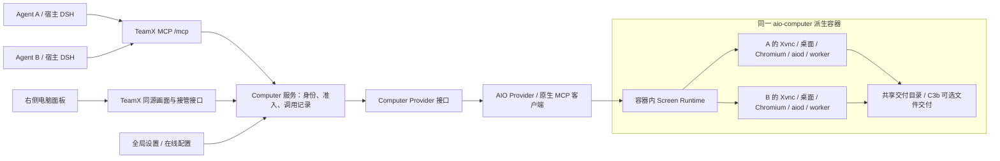

# 共享 Computer 与 Agent 独立屏幕接入方案

状态：C0、C1a、C1b、C2、C3a、C4 已实施并完成首版验收；C5「本机 Docker 托管启停」代码已实施，macOS 真实设置页、Docker、双真实 DSH／模型及浏览器全局停启与登录恢复已验，实际请求证明关闭后 Schema 卸载，详见[实施记录](implementation/computer/docker-lifecycle.zh.md)。GHCR 固定镜像已发布并核对远端 digest，公开可见性、匿名冷拉取与 Linux 宿主验收尚未完成，详见[发布记录](implementation/computer/docker-publication.zh.md)，不标记 C5 全部完成。C3b 文件交付与 MCP search／按需加载按需后置，不计入首版。方案日期：2026-11-23；C5 实施更新：2026-11-24。

本方案依据当前 TeamX `fd2558b`、`916a059` 两个提交及当日上游文档编写，并按现有配置、MCP 和生命周期接点收敛。C0 的固定构建、多屏原型与真实验收见[运行可行性记录](implementation/computer/runtime-feasibility.zh.md)。C1a 的 Provider、受管 Screen、正式 Runtime 和恢复验收见[运行底座记录](implementation/computer/managed-runtime.zh.md)。C1b 的全局在线设置、连接应用和恢复验收见[在线连接管理记录](implementation/computer/online-connection.zh.md)。C2 的成员设置、统一 MCP、Session 能力与执行结清见[成员能力与 Agent 执行记录](implementation/computer/agent-capabilities.zh.md)。C3a 的观看／人工接管、只读输入围栏和真实浏览器验收见[观看与接管记录](implementation/computer/view-control.zh.md)。C4 的打包、旧入口退出、双真实 DSH／浏览器组合及日常升级采用见[首版发布与采用记录](implementation/computer/release-adoption.zh.md)。文件交付仍未实施。

同日设计补充：Computer 保持个人部署可选使用，macOS 可通过 Docker 中的 Linux AIO Runtime 使用；Runtime 的 Linux 要求不等于 TeamX 服务或客户端只能运行在 Linux。当前仍按 C4 完成单所有者首版，不增加多用户前置、不拆分 C4。未来多 User／Space 的归属与托管接入见第 12 节及[统一用户—空间方案](WORKSPACE-AND-MULTI-USER-ANALYSIS-PLAN.zh.md)，不回写为已经通过这些验收。

同日体验补充：在已完成首版之上增加独立 C5，将全局开关接通本机 AIO 容器的按需创建、启动和停止。部署方安装并运行 Docker 后，可直接在 TeamX 设置中启停电脑；关闭保留容器、持久卷及登录态。现有手动连接继续可用，不自动接管既有容器；具体范围、镜像交付和验收见第 10 节 C5。

## 1. 目标与范围

将现有按成员配置的测试 MCP／environment 接入，收敛为 TeamX 的正式 Computer 能力：**同一所有者共享一个 Computer，每个 Agent 独立 screen、独立浏览器登录态，所有工具通过 TeamX 现有 MCP Server 提供。** 全局设置完成接入与在线配置，成员设置只有一个“启用 Computer”开关。

抽象统一 Computer／Screen 生命周期和 MCP 接入机制，工具保留 provider 的原生语义。AIO 是首个 provider 实现；不另外定义一套跨 provider 的浏览器／桌面动作 DSL。

这里的 Agent 指一个 Room 中具有完整持久身份的成员。不同 Room 中同名 Agent 分配不同 screen；名称相同、成员替换或 Room 重建均不继承原 screen。

**统一术语**：与[空间方案第 2.1 节](WORKSPACE-AND-MULTI-USER-ANALYSIS-PLAN.zh.md#21-统一术语spaceworkspace-与-workingdirectory)一致，顶层业务及权限容器只称 Space／空间；成员的文件工作区域及配置称 Workspace／工作目录；执行路径称 WorkingDirectory／当前工作目录（`cwd`）。本文的 Workspace、宿主工作目录和容器 `/workspace` 均指文件区域，不作为 Space 别名。跨模块可用 `MemberWorkspace`、`RoomWorkspaceConfig` 限定归属，不批量移动到 Agent 命名空间或改名已有配置、目录和接口；本次术语补充不改变 C0–C5 的实施范围及验收状态。

| 项目 | 首版约定 |
| --- | --- |
| Computer | 全局设置接入一个共享 Computer，属于当前 TeamX 安装及其所有者；覆盖该所有者的私信和多人 Room |
| Screen | 每成员独立图形会话、浏览器、操作进程和画面连接，支持并行工作 |
| 登录态 | 每 screen 独立 profile，跨回合、DSH Session 轮换和正常重启持久保存；首次分别登录 |
| 工具 | provider 原生 MCP 的浏览器页面操作、桌面截图与操作，以及 TeamX 状态查询；宿主与 Computer 之间的文件交付后置到可选 C3b |
| 设置与 UI | 全局“设置 → 电脑”在线接入、验证、保存和应用，无需重启 TeamX；成员一个开关；右侧“电脑”观看和接管对应 screen |
| 默认与依赖 | 全局和成员开关均缺省关闭；Computer 是可选能力，无容器／辅助程序时 TeamX 仍可独立启动和使用 |
| 执行位置 | DSH、TeamX CLI 及原有本地 Bash／文件工具继续在宿主执行，Computer 工具在容器执行 |

**平台与部署范围**：Computer 是个人部署也可显式启用的可选能力。AIO Runtime 运行在 Linux 容器内；TeamX 可以在 macOS 等现有支持平台连接该 Runtime，也可连接受保护的远端 Runtime。个人未启用时仍安装即用，不要求 Docker、镜像或辅助程序；主动启用时才配置相应环境。客户端浏览器不需 Docker。未来多用户部署的首期 Linux 约束属于多用户隔离支持矩阵，不反向限制当前个人版 Computer；各宿主／镜像架构以实际验收结果为准。

首版暂缓：C3b 文件列表／导入／导出、MCP search／按需加载、共享 Cookie／认证状态、多个 Agent 操作同一 screen、通用远端 Shell／代码执行工具、DSH 容器化、任意 MCP 插件管理、跨用户共享 Computer、多供应商／多 Computer 选择器。容器自动创建／启停由首版后的 C5 单独交付；自动销毁容器或数据卷仍后置。它们不作为独立屏幕和并行工作的前置条件。

首版的原生操作与状态查询统一使用 TeamX MCP 入口；后续文件交付沿用该入口，不同时建设对应 `teamx tools`／独立 CLI 入口。上下文控制先做到“只向有效启用的成员挂载必要 Schema，关闭完成后卸载”，search 和按需加载在后续独立阶段解决已启用成员的 Schema 常驻成本。

Computer 是运行环境与生命周期的领域对象，MCP 是 Agent 操作它的接口；画面仍通过 HTTP／WebSocket 传输。独立 screen 提供工作状态分离，同一容器内的进程与文件仍属于一个信任范围。此方案不承诺 Agent 之间的恶意代码隔离。

首版控制复杂度的约束：

- 一条受管原生 MCP 执行路径；框架附加身份、准入和执行记录，不转换 provider 的动作语义。
- 一个生效 Computer、最多一个待应用配置；更换实例时允许 Computer 短暂不可用，TeamX 服务和其他聊天继续。
- Runtime 是远端执行状态的权威；宿主保留关联与未结清记录，不镜像完整结果账本。
- 核心只组合成员能力、外部执行结清和现有暂停／轮换；不引入通用资源编排器、插件加载或新调度器。

## 2. 基线、参考与待验证项

### 2.1 已有证据和设计推导分开

| 对象 | 已核对事实 | 对本方案的含义 |
| --- | --- | --- |
| TeamX 当前接入 | AIO **1.11.0** 的浏览器 MCP、noVNC 和人工接管已有仓库验收记录 | 可复用业务行为和测试，不能视为新版多 screen 已通过 |
| 新一代 AIO | `aio-daemon` 提供浏览器等基础能力；`aio-computer` 增加 XFCE 和 `computer-use` worker | 目标选择新版 `aio-computer` 派生镜像，不沿用 1.x 作为正式实现基线 |
| 桌面 worker | 通过 `DISPLAY`／`XAUTHORITY` 选择显示会话，使用可配置监听地址 | 支撑每 screen 独立 worker 的设计；没有现成的按 Agent 分屏管理合同 |
| 浏览器 | `aiod` 连接一个配置的 CDP 地址；预制 Computer 镜像的浏览器可能需要显式启动 | 每 screen 必须同时绑定浏览器、CDP、worker 和 VNC，不能只多开观看窗口 |
| 新版 MCP | 文档列出 `browser_gui_screenshot`、`browser_gui_execute_action`；页面级工具可由独立 browser MCP 服务聚合 | 优先复用上游工具，仍须核对固定构建的 `tools/list`、Schema 和实际操作 |

上述上游事实分别见 [Quick Start](https://sandbox.agent-infra.com/daemon/start/quick-start)、[Computer Use](https://sandbox.agent-infra.com/daemon/basic/display)、[Browser API](https://sandbox.agent-infra.com/daemon/basic/browser) 和 [MCP](https://sandbox.agent-infra.com/daemon/examples/mcp)。文档示例的镜像标签为 `aio-computer:1.0.1`，仅作为候选；实施时记录实际镜像 digest、架构、`aiod`／worker／Chromium／browser MCP 版本，不使用浮动 `latest` 作为恢复依据。

Grok 的参考价值是“同一账户共享 Computer、Bot 各有 screen”。Firecracker 用于用户之间隔离，独立 screen 用于内部并行操作；官方没有公开其 screen 或共享登录态的实现。本方案借鉴产品边界，容器多屏实现由 TeamX 验证。[Computer and apps](https://docs.x.ai/grok-bot/computer-and-apps)、[Security FAQ](https://docs.x.ai/grok-bot/security-faq)

Chromium 明确限制两个运行实例共用用户数据目录，并提示同一 Linux 用户运行多个图形会话可能发生 D-Bus 串扰。因此独立 profile 还需配合独立运行目录和会话总线，首阶段验证专属 Unix 用户的方案。[Chromium user data directory](https://chromium.googlesource.com/chromium/src/+/HEAD/docs/user_data_dir.md)

### 2.2 当前代码接点

| 位置 | 当前行为／拟调整点 |
| --- | --- |
| 旧 `agent_mcp.go`（C4 已移除）、[`config.go`](../internal/room/config.go) | 删除成员级外部 MCP 文件入口；Computer 连接由全局设置持久化并发布运行时快照 |
| [`settings.go`](../internal/room/settings.go)、[`models_config.go`](../internal/room/models_config.go)、[`model_http.go`](../internal/room/model_http.go) | 参考在线设置的配置文档锁、原子提交、版本冲突和应用进度；不把启动时加载的配置副本当作在线状态来源 |
| [`model_credentials.go`](../internal/room/model_credentials.go)、[`settings.mjs`](../internal/web/assets/features/settings.mjs) | 复用私有凭据 IO 模式和全局设置导航；Computer 凭据独立命名，设置页直接接入服务 |
| [`agent/backend.go`](../agent/backend.go)、[`dsh.go`](../internal/room/dsh.go)、[`dsh_host.go`](../internal/room/dsh_host.go) | 保留通用 MCP 声明；Agent 只连接 TeamX，不接收上游地址、凭据或 AIO 配置 |
| [`agent_assembly.go`](../internal/room/agent_assembly.go)、[`backend_lifecycle.go`](../internal/room/backend_lifecycle.go)、[`dsh_lifecycle.go`](../internal/room/dsh_lifecycle.go)、[`rotation.go`](../internal/room/rotation.go) | 新增窄的外部执行结清组合接点；当前 `Release()` 只撤销凭据，DSH 的结清证据不代表远端已停止 |
| [`platform_call_lifecycle.go`](../internal/room/platform_call_lifecycle.go) | 参考关闭准入、取消信号与实际结清分离的模式；不让 Computer 依赖平台账号、通知或绑定模型 |
| [`mcp_access.go`](../internal/room/mcp_access.go)、[`history_mcp.go`](../internal/room/history_mcp.go) | 覆盖 Session 凭据、回合输入凭据以及 CLI Inbox 模式的实际 MCP 组合入口 |
| [`input_bridge.mjs`](../internal/agent/dsh/input_bridge.mjs) | 当前自动重试所有 TeamX `tools/call`；Computer 调用必须与输入读取的重试分开 |
| [`state.go`](../internal/agent/dsh/state.go) | 输入桥内容和 MCP 声明参与恢复指纹；能力冻结和桥接升级要有明确恢复策略 |
| [`management.go`](../internal/room/management.go)、[`member_reasoning.go`](../internal/room/member_reasoning.go) | 参考成员身份、持久设置和并发版本校验；Computer 设置归成员能力，不放入模型目录 |
| [`environment.go`](../internal/room/environment.go)、[`environment_control.go`](../internal/room/environment_control.go) | 复用同源画面代理、成员暂停和交还事件；绑定由环境地址改为具体 screen |
| [`environment.mjs`](../internal/web/assets/features/environment.mjs)、[`environment-viewer.mjs`](../internal/web/assets/environment-viewer.mjs) | 复用侧栏布局和输入交互，改为展示成员 screen 状态 |
| [`workspace_files_http.go`](../internal/room/workspace_files_http.go) | 复用文件展示经验，Computer 产物按来源单独交付，不伪装成已有成员 Workspace 路径 |

本方案完成后，旧 [Sandbox 方案](AGENT-SANDBOX-INTEGRATION-PLAN.zh.md) 中“成员独占容器、DSH 入容器、独立 Sandbox MCP 路由”不再作为本路线的实施顺序；其执行结清、身份、文件与真实验收要求仍适用。旧 S1 证据作为历史记录保留。

## 3. 目标架构与责任



通用层和实现层的边界如下：

| 层 | 负责什么 | 不依赖什么 |
| --- | --- | --- |
| Computer 服务 | 当前连接、成员绑定、Session 能力、screen 准入、应用与恢复协调 | AIO、Docker、X11 的具体实现 |
| Screen 资源 | 提供独立操作面、持久状态、显示通道和执行归属；标识与代次由通用层管理 | Unix 用户、具体 display 编号或浏览器启动命令 |
| MCP 接入 | 连接上游、发现／选择工具、鉴权、路由、结果传递及合同摘要 | 统一的 click／navigate 等业务动作 Schema |
| Provider／受管 Screen | 实现 screen 生命周期、唯一原生 MCP 调用、画面通道、执行状态查询和停止证明 | Room Store、Actor 调度和用户授权判断 |
| AIO 实现 | 用容器内用户、Xvnc、Chromium、aiod、worker 实现上述能力 | 其他 provider 必须采用相同进程结构的假设 |

AIO Provider 配套一个 **TeamX 维护的轻量 Screen Runtime**，编译为 Go 辅助程序，随固定派生镜像打包。它负责同一容器内的进程和 screen 管理，不建立通用 Sandbox 平台。拟放在 `cmd/teamx-computer`、`internal/computer/aio/runtime`，AIO 客户端放 `internal/computer/aio`，镜像与运行模板放 `packaging/computer/aio/`。其他 provider 不要求部署此辅助程序，只需满足通用管理合同并提供可绑定 screen 的 MCP 通道。

宿主侧 `internal/computer/` 管理 Provider 合同、能力描述和调用状态；`internal/room/` 保留成员、Session、回合、授权、调度和事件归属。底层包不导入 Room Store 或 Actor；DSH 适配器不包含 Docker／AIO 逻辑。首版只实现 `aio`，Provider 通过编译期注册选择，不建设动态插件加载平台。

C0–C4 由部署方启动、升级和备份一个容器，TeamX 自动按需管理容器内 screen；这种手动连接模式不需要 TeamX 访问 Docker。C5 可选增加宿主侧本机 Docker 启停适配器，由连接 controller 组合，独立于 Provider／Screen 和原生 MCP 执行路径。仅选择托管模式时，TeamX 服务进程需要本机 Docker 操作权限；Docker socket 不挂入 Computer 容器，也不交给 Agent。模型不能提供 endpoint、进程命令或供应方配置。Runtime 的管理凭据仅由宿主服务和受保护的 Runtime 持有，浏览器进程用户不可读取。

操作权威分别归属：成员 Actor 保存暂停意图；配置服务保存当前连接及一个应用操作；Runtime 保存 screen 控制代次、租约和远端调用状态。Computer 服务协调这些事实，不再维护第二套独立的 screen 控制状态机。

### 3.1 AIO 中每个 screen 是一组完整会话

首选实现为每 screen 创建专属非特权 Unix 用户，并启动：

1. 独立 Xvnc display、桌面会话、Xauthority、D-Bus 和 XDG runtime 目录。
2. 独立 Chromium 实例、持久 `--user-data-dir`、CDP 端口和下载目录。
3. 独立 `computer-use` worker，`DISPLAY`、会话总线和用户与桌面一致。
4. 独立 `aiod`，绑定该 worker 和 CDP；页面级 browser MCP 需要时也按 screen 独立启动、连接该 CDP。
5. 对应 VNC 连接，交给 Runtime 按 screen 代理。

每 screen 一组 `aiod` 是为了复用其按启动配置绑定的后端。不要把一个全局 `aiod` 的默认 CDP／worker 同时当作所有 screen 的工具入口。派生镜像接管默认单屏启动项，防止隐藏的默认浏览器或桌面抢占 profile／端口。

专属用户、独立 D-Bus／XDG 和进程归属的组合必须先实测。Runtime 以受控管理进程分配 UID、目录和端口；各 screen 用户没有 sudo 或切换为管理用户的能力。这里只承诺工作状态分离，仍共享同一容器及资源总额。

多 screen 的调用与画面锁按 screen 设置，不用一把全局执行锁。达到运行容量时返回容量不足，非静默排队到未知时间，也不把请求送到其他成员的 screen。

### 3.2 Provider 的最小能力门槛

每个 provider 均通过 MCP 提供 Agent 工具；screen 生命周期、画面连接和执行对账属于管理接口，可由该 provider 自己的 REST／SDK 实现。一个只有任意工具列表的 MCP Server 尚不足以实现本方案的 Computer Provider，还需证明成员 screen 隔离、持久状态、控制权撤销和远端执行结清。

新增 provider 的改动限于注册、连接配置、管理实现及兼容性测试，不应修改 Room 调度或给 DSH 增加厂商分支。工具差异由原生 MCP Schema 呈现给 Agent。通用层验证“screen 独立、操作可归属、通道可撤销”等行为，不假定 provider 内部一定有容器、Linux 用户或 Xvnc。

## 4. 全局在线接入、成员开关与持久状态

### 4.1 全局设置在线接入与应用

在已有全局设置导航中增加“电脑”，保持普通设置宽度；与会话右侧观看面板分别承担配置和使用职责。首版只有一个连接，页面提供：

- 全局启用开关（缺省关闭）、Provider（首版 AIO）、连接地址、仅写入的管理密钥，以及高级项“最大运行屏幕数”。
- “测试连接”“保存并应用”和当前连接／应用状态。保存本身也做核验，测试连接不是强制前置步骤。
- 已启用成员与运行 screen 数量、更换实例等变更的影响提示；长期操作显示应用进度，刷新后可恢复查询。

全局持久字段为 `computer.enabled`，缺省 `false`；没有 `[computer]` 配置时也按关闭处理。填入连接地址、保存密钥、存在旧 profile 或成员偏好均不隐含启用；重启沿用已保存的全局状态。关闭时可以保留连接信息，启用前再要求连接字段完整并核验能力。

示例：选择 AIO，填写 `http://127.0.0.1:18090` 及 Runtime 管理密钥，明确开启全局开关并保存后，即可在成员设置启用 Computer；不需要编辑 TOML、导出环境变量或重启 TeamX。该地址是 AIO Screen Runtime 管理入口，Provider 负责取得相应 screen 的原生 MCP／画面通道。其他 provider 可有自己的有限连接字段，不要求用户填写统一的 AIO 参数。

C5 在同一页面增加「本机 Docker 托管／手动连接」运行方式。托管方式由 TeamX 准备地址和密钥，再进入上述连接核验与应用流程；新增安装的页面默认选择托管方式，但全局开关仍关闭，既有配置缺省解释为手动连接。模式切换、容器就绪和停止状态沿用同一应用操作展示，具体合同见第 10 节 C5。

拟议 API：`GET /v1/computer` 读取脱敏配置与状态，`POST /v1/computer/validate` 仅核验连接，`POST /v1/computer/save` 创建幂等保存／应用操作，`GET /v1/computer/operations/{id}` 查询结果。写操作验证安装、服务代次、人类所有者、`expected_version` 和请求 ID；服务端核验实际 provider／instance 身份，不能仅相信客户端字段。

未接入或全局停用时 Computer 不可调用，普通聊天继续。连接只允许明确的 HTTP／HTTPS 地址，非本机连接使用受保护通道；禁止 URL 内嵌密钥、任意代理路径和模型修改全局连接。UI 输入密钥只发送给已认证的 TeamX 服务，响应仅返回 `has_credential`；更新用显式 `keep`／`replace` 动作，空输入不清除旧密钥。

**可选依赖与启动合同**：TeamX 宿主程序的正常构建、安装、启动和普通功能不要求安装 Docker、准备 AIO 镜像，或在宿主安装／运行 `teamx-computer`。辅助程序只随可选 AIO 派生镜像部署。全局关闭且无残留资源／执行记录时，不创建 provider 连接、不探测上游、不扫描 Docker／辅助程序版本，也不要求已保存的远端地址可达；设置页读取本地状态，不因打开页面自动联网。用户显式测试连接或启用能力时才按需核验；存在残留记录时只为受影响作用域发起必要恢复。

| 全局状态 | 对 TeamX 与外部环境的要求 |
| --- | --- |
| 从未启用／未配置 | 无需部署容器和辅助程序；普通聊天、Room、平台工具、Workspace 文件和日历独立运行，无 Computer Schema |
| 正常停用且已结清 | 保留配置、偏好及数据；可以停止 AIO 容器，后续 TeamX 重启不要求它存在 |
| 已请求关闭但仍有未结清操作 | 禁止新 Computer 调用，显示停用待处理；容器离线时保留相关成员的恢复／阻断事实，其他成员与普通功能继续 |

关闭请求先保存禁用意图并关闭新准入，不把“容器在线”作为接受关闭请求的前置条件；已有远端执行仍须核验，无法核验时不能报告结清完成。Computer 的不可达、恢复等待和辅助程序缺失均不作为整个 TeamX 服务就绪的前置条件，不能由全局启动等待把无关功能一起阻塞。

持久化复用现有 `configDocument` 的文件锁、并发版本和原子提交模式，服务可在 `config.toml` 中管理 `[computer]` 非敏感字段及 `credential_ref`。这只是存储格式，正式操作入口为全局设置 API；运行时从已提交的不可变快照取值，保存成功后发布新快照，正常重启再加载同一持久状态。无需文件监视或重新解析整份配置，禁止保留一个与 UI 设置竞争的启动绑定文件。

密钥保存于安装私有的 `computer-credentials/`，参照已有凭据 IO 的 0700 目录、0600 不可变版本文件和引用模式；不要放进模型凭据命名空间或成员快照。最多一个待应用配置，其目标、原配置版本和进度存在有界操作记录中；重启先恢复该操作，阻止受影响成员越过未完成的结清／轮换。普通聊天及无关联成员不等待远端服务。复用已有配置写入冲突处理，不覆盖其他全局设置或注释。

在线应用按变更影响收口：

| 变更 | 生效方式 |
| --- | --- |
| 首次接入 | 核验构建、实例、工具合同和所需能力，原子保存后在线发布；成员缺省关闭 |
| 密钥更新／地址改变但核验为同一实例、同一工具合同 | 在线发布新连接快照，不轮换 DSH Session；已发出的调用保持原目标，画面按需重连 |
| 最大运行数调整 | 新准入立即采用新值；降低到当前运行数量以下时阻止新建，不停止已有 screen |
| 更换 provider／实例或已接受工具合同改变 | 暂停相关 Computer 准入，结清旧操作与输入连接，替换连接和工具目录，完成相关 Session 轮换后恢复；更换实例时先停止本安装拥有的旧 screen 并保留旧数据，仅更新工具合同时保留原 screen／profile |
| 全局停用 | 立即关闭新工具／接管准入，结清调用和输入连接后停止 screen，轮换相关 Session 并卸载 Computer Schema；保留配置、成员偏好、profile 与文件，其他成员继续 |
| 全局重新启用 | 重新核验实例和合同，按保留的成员偏好完成有效能力与 Schema 的受控应用，按需恢复 screen；不静默向旧 Session 增加工具 |

连接应用用同一操作 ID 串行推进，通常为“核验 → 等待结清 → 提交／轮换 → 完成”，失败保留已完成步骤供同操作重试。关闭或只保存未启用连接时不强制远端核验；有残留执行才进入相应结清。候选验证失败时旧连接继续生效；开始结清后阻止相关新调用，遇到未结清执行或人工接管则保持待处理，不能强抢 screen。旧连接只供结清与核验，不再承接新任务；首版不做新旧 Computer 并行调度或无缝迁移。

提交前重验配置版本与候选身份，原子保存后更新内存状态。提交后失败沿同一目标继续完成轮换，不能重新解析候选或重放旧动作；重启从操作记录和已提交配置对账，成员准入在恢复完成前保持关闭。复用现有轮换记录，应用记录只保存受影响成员及已有轮换操作 ID，不再复制一份成员执行状态机。

普通凭据更新保留旧客户端直至在途调用结清；变更操作记录保留旧连接信息仅供核验。禁止原地修改共享客户端的地址或 Header，结清后释放旧引用。始终只有一个目标 Computer 承接新任务，MCP facade 和 TeamX 服务持续运行。用户可以在线配置，涉及实例／合同的变化仍要完成相关 Session 的结清与轮换。

### 4.2 每成员一个开关

首版成员字段为 `computer_enabled`，缺省 `false`。存于 `managedMember`，配独立 `computer_settings_version`；不混入 `modelSelection`，也不改变全局模型默认值。私信与多人 Room 使用同一字段与服务逻辑。成员模板的批量默认开关后置。

设置接口拟为 `POST /v1/members/computer`，包含完整成员身份、已认证人类调用者、服务代次、设置版本、操作 ID 和 `enabled`。一个幂等设置操作负责“保存意图、停止新准入、等待结清、轮换 Session、发布完成状态”，复用现有成员控制与轮换协调。UI 只有一个开关，可展示“应用中／恢复待处理”；无需用户再填 screen、MCP 或端口。

启用操作可预检镜像合同与容量，并创建 screen。容量被其他请求占用时返回明确状态；失败不伪装成已可用。关闭立即阻止新的 Computer 操作，当前已发出的操作按第 6 节结清；保留 profile 和文件，不以关闭开关隐含清空账号。

有效启用状态由全局连接状态和成员开关共同决定。开启时在结清／轮换流程后挂载该成员接受的 Computer 工具；关闭时立即拒绝新调用，结清后轮换该成员 Session，使 DSH 重新发现工具，后续实际模型请求中不再携带这些 Schema。只过滤服务端 `tools/list` 不算完成卸载。其他成员保持自己的状态；Room 历史保留，私有 Session 上下文按现有轮换规则重置。全局停用对相关成员执行同样的卸载流程，但不覆盖其个人开关偏好。

### 4.3 持久与临时身份

| 身份／状态 | 生命周期与作用 |
| --- | --- |
| `installation_id + owner_id + computer_id` | 共享 Computer 的逻辑归属；首版与当前单所有者部署一致 |
| Computer `instance_id` | Runtime 在受控持久卷保存的实例身份；更换数据卷产生新身份，不能仅按 endpoint 判断 |
| 连接配置版本 | 全局设置的已提交版本，用于 CAS、应用恢复和在途调用关联；不维护任意历史连接目录，凭据只保留引用 |
| 完整 `MemberIdentity` | `RoomID + RoomInstance + AgentID + MembershipID`，是 screen 的唯一归属 |
| `screen_id` | 随机不透明 ID，跨普通回合、Session 轮换和正常 TeamX 重启复用 |
| `screen_epoch` | 桌面进程组重建时增加；旧请求、VNC 输入及元素句柄失效 |
| 服务代次／Session generation／turn | 每次准入检查的框架身份；从凭据解析，不由模型提交 |
| `operation_id`／控制租约 | 框架生成，区分工具执行和人机控制；不作为模型参数 |

宿主私有 Computer 状态目录只保存成员映射、能力摘要、一个连接应用操作，以及变更调用的关联／未结清标记；沿用现有原子快照写入，不新建数据库。Runtime 保存 screen 元数据、UID／端口分配和远端变更调用终态。宿主不保存另一份截图／完整工具结果账本，敏感参数原文不持久化。

Session 单独冻结 `enabled + computer_id + provider + instance_id + tool_contract_digest`，其中 `enabled` 是有效能力而非单独的成员偏好，由 Room 持久 owner 保存；不要把 capability 状态塞进模型配置。连接地址或凭据值变化不等于执行能力变化。恢复指纹增加通用能力摘要，必要时通过 `agent.Launch`／DSH Options 传递，不通过伪造 MCP URL 或 Header 区分能力。凭据值和临时租约不进入指纹。

普通 Session 轮换保留 screen；screen 重建后更新代次并发送“画面已重建，请重新观察”的事件。能力合同或 Computer 实例变更先结清、再轮换；密钥值更新仅刷新连接。旧快照缺省为未启用，不能自动获得 Computer。

### 4.4 AIO 文件布局与回收

容器持久卷建议分为：

```text
/var/lib/teamx-computer/     # Runtime 元数据及各 screen profile，受保护
/workspace/agents/<screen>/ # 该 screen 的 downloads/、screenshots/ 和交付文件
/workspace/shared/          # 显式用于成员之间交换的文件
```

成员路径是组织和交付边界，不宣称其构成同容器内的安全隔离。共享目录采用可协作权限；profile、控制密钥和 TeamX 数据不进入共享目录。宿主成员 Workspace、TeamX 数据根、个人 Home 和 Docker socket 均不整体挂入容器。

首版保留容器内下载与持久目录布局；这些目录不代表已提供宿主文件交付。文件列表、导入／导出及 Workspace 链接衔接在可选 C3b 实现。

关闭面板只释放画面连接；普通 Session 轮换不回收桌面。关闭开关后结清并停止该 screen 进程组，保留数据；再次启用按同一成员恢复 profile，开启新 screen epoch。成员删除／Room 删除先撤销全部访问、停止并核验进程，再标记数据待清理；清理随既有删除操作记录执行。新成员不复用旧 profile。首版不做定时淘汰或自动清空登录态。

## 5. MCP 组合与工具合同

### 5.1 统一入口，分别保持业务语义

所有 Agent 只声明 TeamX 的 `teamx` MCP Server。工具在共享服务中注册，通过请求上下文过滤和校验；`tools/list`、`tools/call` 都必须执行能力检查，不能只靠前端开关或工具隐藏。关闭成员的 Agent 侧也要通过受控轮换移除实际工具定义；Input／History 工具继续遵守各自原有规则。

当前 `/mcp` 有回合输入凭据、Session 执行凭据及不同 Inbox 模式的分支。新增统一的框架调用上下文，包含完整成员、服务代次、Session generation、运行中回合和可信调用 ID；两个分支均显式解析该上下文，再组合 Input／History／Computer 工具。输入专用凭据本身不构成 Computer 授权，必须另检查有效能力快照、当前开关及 screen 状态。

当前依赖 `mcp-go v1.5.0` 有按上下文过滤工具的能力；实施时复用其过滤／中间件接点。实际执行仍由 Computer 服务做准入和执行归属校验，以覆盖设置变化、成员撤销和并发竞态。

Input 的消费确认仅用于输入；Computer 结果不进入 Inbox 的已读、回执或 `teamx/received` 协议。原有输入／历史行为和 CLI Inbox 模式保持各自的合同。

### 5.2 provider 原生 MCP 工具，经同一机制接入

**统一接入机制，保留原生工具合同。** Provider 返回指定成员的受管 Screen，内部 MCP 客户端完成协商、发现和调用；AIO 的 `browser_navigate`、`browser_gui_execute_action` 等按其自身 Schema 执行。其他 provider 使用自己的工具目录，不必转换成 AIO 名称，也不必实现 TeamX 定义的统一浏览器动作集。

唯一调用链为：`TeamX /mcp → Computer 服务准入 → 受管 Screen.Call → 该 screen 的原生 MCP`。发现工具、查询状态与执行都绑定同一个 Screen；原生 MCP 客户端是 provider 内部细节，不向 Room、Agent 或通用调用者暴露可直接执行的连接，避免与受管调用形成第二条路径。

TeamX 保留经选定工具的名称、描述、`inputSchema`、`outputSchema`、annotations 及结果中的文本／图片／结构化内容、`isError`。不把 click／fill 的参数重写成另一套语义，不改坐标或元素索引定义，不把结果转换成自造成功回执。上游资源引用等内容若暂不受当前 Agent／传输支持，应在核验时报出兼容性缺口，不能静默丢弃。

工具默认保持原名；如与 TeamX 保留名冲突，仅允许在连接级使用固定、可逆的命名空间前缀，并把映射纳入合同摘要。没有冲突时不额外增加别名或重复工具。身份、调用 ID 和 screen 绑定经框架上下文／通道传递，不注入原生工具参数。MCP 客户端会话、连接池与上游状态按 screen 隔离，不能把共享一个网关误实现成共享同一个 browser MCP 会话。

首阶段抓取固定构建的 `tools/list`，按完整工具选择首版发布集合，保留其原 Schema；选择工具属于准入策略，不能借过滤之名裁剪或改写工具参数。后续更新重新比较合同摘要，工具目录变化按全局应用流程结清、替换并轮换；不同时服务新旧两套工具目录，也不随实时上游列表静默改变旧 Session 的能力。

| 工具来源 | 名称示意 | 交付要求 |
| --- | --- | --- |
| AIO 页面工具 | `browser_navigate`、`browser_get_text`、`browser_click` 等 | 以固定构建实际发现为准；覆盖现有网页导航、文本读取、表单、标签页和下载流程 |
| AIO 桌面工具 | `browser_gui_screenshot`、`browser_gui_execute_action` | 原样使用原生合同，绑定各自 screen 的 worker |
| TeamX 管理工具 | `computer_status` | 这是 TeamX 自己的状态查询，返回有限状态和提示，不伪装成 provider 工具 |
| TeamX 文件交付工具（可选 C3b） | `computer_files_list`、`computer_file_export`、`computer_file_import` | 首版不发布；后续负责容器交付文件与成员 Workspace 的交换，清楚区分于 provider 的原生文件工具 |

C0 输出最终原生清单并锁定；缺失工具不得靠猜测名称补齐。首版不发布通用 shell／code、任意路径文件操作、浏览器服务关闭或任意 JavaScript evaluate 等完整工具；复合工具中未获准动作由独立准入策略拒绝，并保留原 Schema 和明确错误。不要把原生 annotations 当作执行无副作用或可安全重试的证明。

桌面视觉操作只向支持图片输入并通过材料准入的 Session 开放；文本模型保留页面文本／DOM 路线。工具返回截图必须验证到达真实模型的多模态输入，网页端能看画面不等于模型看到了截图。

### 5.3 参数、容量与错误

模型提交任务参数，不提交成员身份、screen ID、endpoint 或认证 Header。`screen_epoch` 和供应方句柄由框架绑定；重建后拒绝旧句柄并提示重新观察。

沿用现有请求 128 KiB、响应 8 MiB 的上限做首轮验证；截图保留原生图片与坐标语义。需要降低图片大小时优先使用上游原生参数并明确其尺度，不在代理层静默缩放后仍宣称使用原坐标。若确需调整传输限制，只针对 Computer 有界配置，不放宽输入消费合同。超限返回可执行的错误，不裁掉 JSON 或确认部分结果。

TeamX 的准入／连接错误至少区分：`computer_disabled`、`computer_unavailable`、`screen_capacity`、`screen_busy`、`human_control`、`stale_screen`、`operation_unknown`、`contract_mismatch`；与 provider 原生业务错误分开表达，原生错误结果保留。忙碌属于状态反馈，客户端不得据此自动重放写操作。

## 6. 并发、取消与恢复

### 6.1 screen 级准入

不同 screen 可同时运行。每个 screen 的 Agent 工具调用串行执行，桌面输入、页面操作和人工输入共享同一控制门；有限等待到期返回 busy，不建立无界队列。

等待准入与实际执行分开：尚未发往上游的请求取消后可安全退出；已发出的请求要记录终态。任何等待网络、进程或 VNC 退出的动作都不持有全局 Room／Store 文件锁。

### 6.2 Computer 操作不沿用输入重试

修改输入桥：只对已有输入／历史白名单保留原重试；Computer 原生调用缺省不透明重试。可信 `X-Teamx-Call` 经框架认证上下文限定后派生 `operation_id`，不由模型拼接。首版只要求当前 DSH 路径接通，未来 ACP 后端按同一可信调用合同接入，不为未实施的后端预建桥接平台。

按经核验的 provider 工具策略区分记录强度：

| 调用 | 执行记录 |
| --- | --- |
| 已核验只读，如截图、页面文本读取 | 保留内存中的在途计数与 screen 绑定，退出／交接仍需等待完成；不为每次读取持久化结果或截图账本 |
| 页面导航、点击、输入、提交及其他变更 | 宿主先保存最小未结清关联；Runtime 按调用 ID 保存接受记录和终态，承担去重与核验权威 |
| 未知工具或复合工具中不能证明只读的动作 | 默认按变更处理；不凭原生 annotations 自行认定可重试 |

变更调用只有一套远端执行记录：宿主在发出前保存成员、generation、turn、screen epoch、工具名、参数摘要及调用 ID；Runtime 在执行前保存接受记录。同 ID 同参数只查询／返回原状态，同 ID 不同参数拒绝。结果正常返回后宿主关闭未结清标记，不再复制完整终态和结果；响应丢失时查询 Runtime 原 ID，不能用新 ID重发动作。

Runtime 在“动作已执行、终态未落盘”时崩溃，或断线后无法核验结果，记录为 `unknown`。尚不能证明远端停止时，阻止该 screen 后续变更与交接；通过下一节的停止核验建立结清事实。执行已停止与网站业务结果已确认是两件事：允许结清后只读观察或人工核验，保留未知动作提示，提交／付款等效果不自动补发，也不因 screen 重建被标为成功。

记录只用于同一调用的去重、结清与故障恢复，不建设完整业务事务系统，不承诺外部网站的 exactly-once。参数原文、密码和截图不进入持久执行记录；原生响应仅在 Runtime 内存中短期、有界保留。响应过期或进程重启后只提供终态／结清事实，明确结果内容不可用，不伪造原生业务回执或重发调用。未解决调用的 ID、摘要、终态／结清事实不能随响应内容一起删除；按代次归档，拒绝旧代次重新执行。

### 6.3 取消、结清与重启

HTTP 断开、MCP 取消、宿主 DSH 退出都不等于远端动作结束。退出回合、轮换、关闭能力和删除成员统一按作用域关闭新准入，再通过受管 Screen 等待或核验远端执行。作用域仅使用现有成员、Session generation 和可选 turn 身份。

无法取得终态时，仅处理受影响 screen：Runtime 停止其浏览器、worker、aiod、桌面及关联子进程，并按专属 UID／进程树核验；GUI 启动的后台进程也要纳入。C0 必须证明这一路径不依赖特权容器或挂 Docker socket。无法证明停止则保持 blocked。共享容器不得因一个成员的轮换或故障被整体停止。

Runtime 重启以新的启动代次先关闭所有旧输入租约，对账旧进程和非终态操作，再接受新的服务代次绑定。旧 TeamX 服务不能继续发出变更；绑定更新必须具备排他所有权及 fencing，不能仅相信时间已过。持久 profile 可复用，画面／元素状态重新获取。

| 情况 | 处理 |
| --- | --- |
| 打开第二个 Agent 的 screen | 独立准入，第一 screen 不等待、不切换 |
| screen A worker 失败 | A 阻断或重建，B 继续；A 的 pending 调用不转移到 B |
| DSH Session 正常轮换 | 结清旧回合、撤销旧凭据，复用 screen 与 profile |
| 供应方不在线 | 返回 unavailable；不阻塞其他非 Computer 工作，不回退到宿主浏览器 |
| TeamX／Runtime 重启 | 对账并撤销旧租约；未结清执行先保持阻断 |
| 镜像／工具合同变化 | 预检并比较摘要；需要时结清、轮换，拒绝静默改变旧 Session 工具集 |

### 6.4 核心生命周期只增加一个窄的组合接点

在 Room 应用组合层提供可缺省的 Computer 执行门，收口“关闭指定作用域准入、异步结清、读取已保存结清事实”三个操作。从未启用、没有资源或恢复记录的成员直接通过，不探测 provider；已关闭开关但仍有在途调用、输入租约或未结清记录的成员必须继续核验，不能按当前开关跳过。底层实现调用受管 Screen，核心不读取 UID、端口、容器或 AIO 文件。

| 已有入口 | 接入方式 |
| --- | --- |
| `sessionHost.PrepareTurn` | 校验成员能力与恢复门；为本回合登记作用域，实际使用时按需取得 screen |
| `PreparedTurn.Finish` | 返回回合结果前关闭该回合新准入并结清在途调用；结清错误合并进回合错误，不能先发布 completed 再等待远端 |
| `dshSession.Close` 与已有 owned close | 本地关闭与 Computer 结清都完成才认定已结清；远端失败保留 pending 并可重试，不只检查 `dsh.ErrCleanupPending` |
| `rotation.go` 的异步任务、持久后端检查 | 在写入 `old_closed` 或切换代次前读取同一结清事实；复用现有异步等待与轮换记录，不新增 Actor 轮换状态机 |
| 启动恢复、关闭 Room 的检查、成员／Room 删除和 Workspace 切换 | 复用同一执行门核验／结清；启动先恢复未结清记录，关闭 Room 也能核验，不依赖先启动 Agent |

`Host.Release()` 继续只负责可重复撤销，不能在无错误返回的函数中隐藏远端等待或丢失结清失败。组合代码可扩展 `backendCleanupSettled` 等现有错误判定，保留本地 DSH 与远端资源的独立结清事实；不把本地进程退出作为远端证明。

网络等待由现有异步生命周期任务承担，Actor 回调只接收结果；配置锁、Room／Store 锁内不执行远端 IO。不改 Room 调度算法、输入消费证明、`modelSelection` 或 DSH 的模型循环，也不把 Computer 变成一种新的 Agent backend。

## 7. 人工观看、接管与交还

沿用现有右侧布局、可展开宽度、移动端键盘和临时输入清理行为。产品入口统一为“电脑”：私信默认对应成员；多人 Room 可切换已启用成员的 screen。未启用时给出开启位置，启用但尚无 screen 时可由人类打开面板触发按需创建。

接管仍复用成员 Actor 的持久暂停与 `pauseRevision`，新增 screen 控制约束：

1. 持久暂停目标成员后续调度，并关闭其 screen 新工具准入；等待当前回合及远端动作结清。
2. 当前回合在等待接管时再次调用 Computer，应得到明确的接管等待状态以结束回合，不能无限卡住。执行尚未结清的异常／unknown 保持 blocked；已核验停止、仅业务结果未知时可进入受控人工核验，成员仍暂停，故障 Session 不自动恢复。
3. Runtime 将该 screen 控制权交给唯一页面租约，开启该页面输入；其他页面只能观看。其他成员 screen 继续运行。
4. 完成时先关闭操作连接并等待退出，再投递按接管 ID 去重的固定 Room 事件；随后按原暂停意图恢复该成员。恢复失败单独报告。
5. 页面关闭／断线／租约过期／服务重启均收回人类输入并保留暂停，不自动恢复。普通观看关闭只断流。

控制权属于 screen。不能继续按“多个成员共用同一 base URL”拒绝接管，因为新方案中相同 URL 下的不同 screen 是正常情况。

继续通过 TeamX 同源接口转发 noVNC 静态资源和 VNC 连接，上游密钥不进入浏览器。**观看权限必须在服务端落实**：Runtime 的只读 VNC 凭据／服务端过滤应拒绝输入，操作连接另行验证控制租约；不能仅依赖 noVNC `viewOnly`。若候选 VNC 无法可靠实现两种模式，需先补受限输入过滤并验证，不能带着仅客户端只读进入正式验收。

交还事件只说明操作已完成，要求重新观察页面；不带密码、Cookie 或输入文本，不构成新的外部写操作授权。接管关闭的输入连接必须有退出围栏，防止交还后迟到按键。

## 8. 文件与产物交付（可选 C3b，不计入首版）

本节保留后续文件交付的设计与安全约束，待有文件导入／导出需求时独立实施。首版不建设文件交付工具、接口或占位 Schema；浏览器可在所属 screen 内下载，原生截图仍可返回模型图片块，但不承诺将这些产物导出为宿主 Workspace 链接。

浏览器下载默认进入所属 screen 的 `downloads/`；截图既返回模型图片块，也可通过受控导出保存为产物。原有 1.x 截图导出补丁不成为新镜像依赖。

通用文件交付使用绑定成员／screen 的不透明 artifact 引用和有界字节流；AIO Provider 将其解析到第 4.4 节的具体目录，其他 provider 可用对象存储或自己的文件 API。Room 层不硬编码 `/workspace` 或其他供应方路径。

C3b 用统一文件适配处理两个方向：

- **导入**：从当前成员已授权的 Workspace 文件引用复制到自己的交付目录，带大小、摘要和来源；复制前后重验 root 身份，拒绝路径穿越、符号链接逃逸和覆盖未确认目标。
- **导出**：从自身 downloads／screenshots 或显式 shared 下选文件，复制到当前成员 Workspace 的 `computer/` 子目录，以无冲突文件名和摘要确认。随后复用现有文件链接与浏览器展示；只给最终相对路径，不返回容器绝对路径当作宿主链接。

共享文件夹是协作入口，导出来源必须可说明；同一路径并发写采用冲突反馈或原子发布，不对共享目录建立全局任务锁。profile、Runtime 元数据和其他任意路径均不通过文件工具导入／导出。

成员工作目录（Workspace）切换只影响后续文件交付的目标，不重绑 screen profile、不把旧 Workspace 自动暴露给新会话；旧任务继续使用其冻结的 root，root 失效则导出失败并保留容器产物供核验。这里指成员绑定的文件工作目录变化；未来页面切换 Space 仍按所属空间定位 Computer／screen，不把原空间的任务或文件交付改投到新空间。

## 9. 内部接口与代码组织

只保留 Provider 和受管 Screen 两个资源合同。Provider 负责核验连接与取得 screen；对该 screen 的工具、控制和结清操作全部从同一个受管对象进入。AIO 用 Runtime 私有 HTTP 实现，其他 provider 可以使用自己的管理 SDK，不要求采用同一 HTTP 路由或进程模型。

| 操作 | 作用与约束 |
| --- | --- |
| `Provider.Inspect` | 返回 instance、启动代次、原生工具合同和容量；不创建正式成员 screen |
| `Provider.EnsureScreen(binding)` | 完整所有者和成员归属下幂等创建／恢复，返回受管 Screen；同身份并发只建一份 |
| `Screen.Tools`／`Screen.Call` | 从同一绑定发现原生工具并执行；Call 必经准入与执行归属，内部原生 MCP 连接不向外暴露 |
| `Screen.Operation`／`Screen.Drain` | 查询变更调用状态，关闭指定执行作用域准入并等待结清；只返回事实，不重新执行 |
| `Screen.Control`／`Screen.View` | 管理排他控制、续租、撤销与画面流，验证 screen epoch 和当前控制代次 |
| `Screen.ReadArtifact`／`Screen.WriteArtifact`（可选 C3b） | 后续按绑定的交付引用读写有界文件流，目录约束由 provider 落实；首版不要求新增这些接口或占位实现 |
| `Screen.Stop` | 结清并停止该 screen 进程范围；默认保留数据，成员删除另走显式删除操作 |

`Screen.Call` 的私有执行信封携带框架身份、调用 ID 和原生 MCP 参数，返回原生 MCP 结果，不构成第二套浏览器 API。AIO Runtime 接受后只转发到已绑定 screen 的 `aiod /mcp`；没有独立的公开 `OpenMCP → CallTool` 旁路。公共 MCP 编解码可复用同一客户端库，但裸客户端只由 provider 内部持有。

在 `internal/computer/` 收口上述合同、成员绑定、工具摘要和错误；`internal/computer/aio` 实现具体连接与 Runtime。Room 层用 `computer.go`／`computer_mcp.go`／`computer_settings.go`／`member_computer.go` 收口服务组合、框架上下文、全局设置及成员控制，生命周期执行门也集中于该组合层。Web 的 `features/computer-settings.mjs` 由现有 `settings.mjs` 组合，用已有全局 settings 更新通知刷新状态。

可从 `environment*.go` 提取通用代理与输入连接管理，保持 Actor 调度所有权。通用凭据 IO 如需提取仅下沉读写／权限原语，Computer 和模型仍使用独立命名空间；无需另起一套 Room 或模型服务。

能力摘要应包含 provider、原生工具名称、名称映射、完整 Schema、已接受工具集合及影响执行的版本信息，Schema 仅为计算摘要做确定性规范化，发布给 Agent 的原生结构不改写。上游偶发不可达不改变对外工具目录；状态工具报告不可用。镜像 digest 保存用于 AIO 部署核验，普通凭据轮换不改变工具合同。

## 10. 实施阶段与验收

阶段按完整行为切片推进，每个阶段均保留正常聊天、输入／历史和未启用成员回归。C0 是本方案的可行性门槛，未通过时先调整派生镜像／screen 启动方式，不把正式目标降为共享单屏，也不先铺完全部 UI。

首版顺序：`C0 → C1a → C1b → C2 → C3a → C4`；按当前已记录的完成状态，首版路线已完成。推荐下一步独立实施 `C5`，补齐本机 Docker 托管启停；不依赖 C3b、MCP search 或多 User／Space。C3b 与 MCP search／按需加载均按需后置，不阻塞 C4 或首版完成；保留原阶段编号，避免与既有记录混淆。每个单元分别实施、验证和报告完成边界；阶段名不进入长期代码／测试命名。每阶段完成相应回归，C4 做首版范围的跨模块组合验收，不承接此前尚未完成的安全检查。C2 的执行、取消、关闭、恢复与升级验证要求保持完整。

本次 User／Space 设计只补充后续接入合同：当前 C4 不等待空间 S1–S5，不强制改造 Computer 身份、配置布局或部署权限，也不因多用户方案新增首版验收门槛。继续完成既定个人／单所有者接入与组合验收；后续多空间、多用户分别在相应空间阶段验证。

| 单元 | 独立交付结果 | 明确后置 |
| --- | --- | --- |
| C0 | 两个 screen 在固定构建上独立操作、持久保存且可单独停止 | 正式管理服务、设置与 Agent 接入 |
| C1a | 可通过受控服务入口使用的 Provider／受管 Screen 及恢复底座 | 用户设置、Agent 调度与工具发布 |
| C1b | 全局设置在线接入、配置保存和连接应用 | 活跃 Agent 的能力／Session 轮换由 C2 接通 |
| C2 | 成员开启、执行、关闭、取消和恢复的完整安全闭环 | 右侧接管、文件交付及按需搜索 |
| C3a | 观看、服务端只读和人工接管交还 | 文件传输工具 |
| C4 | 首版打包、综合验收、升级采用与旧入口退出 | C3b 文件交付、search／按需加载及其他后续能力 |
| C5（首版后，代码已实施） | 本机 Docker 托管 AIO：全局开启自动准备／启动，关闭结清后停容器，再次开启复用数据；真实验收与发布状态单列 | 自动升级／销毁、远端 Docker、既有容器收编、多空间编排 |
| C3b（可选，不计入首版） | 按需交付 MCP 文件交付与宿主 Workspace 的双向闭环 | 目录同步、对应 CLI 入口 |

### C0：固定新版镜像并证明两个 screen 可独立工作

**交付**：多屏可行性原型、派生镜像构建模板、固定依赖记录、Schema 清单及可复跑证据；使用隔离容器和测试账号，不改当前测试 Agent 的环境。允许用固定脚本配置两个 screen，并用最小辅助代码验证停止／只读条件；不提前建设正式调用记录、完整 Runtime 管理协议、设置页或接管状态机。

**必验**：

- 同容器两个专属用户的 Xvnc／桌面／D-Bus／Chromium／aiod／worker 同时运行；CDP、GUI、VNC 都落在对应画面。
- A 输入随机标记，B 同时导航／点击，画面、焦点、标签页、下载均无串用；共享目录文件可协作。
- 两个 profile 分别登录虚构站点，重建桌面或重启容器后登录可恢复，B 不自动继承 A 登录。
- GUI 工具、页面工具、截图图片块均真实可用；记录白名单及 Schema，禁止仅以 HTTP 健康探针代替功能证明。
- 人工控制 A 不影响 B；服务端观看连接拒绝键盘、鼠标和粘贴输入。
- 停止 A 的整个进程范围，包括 GUI 启动的后台进程，B 继续；无需 privileged 或 Docker socket。记录 CPU、内存、启动耗时和停止证据，容量以实测决定。

**门槛**：发布 `docs/implementation/computer/runtime-feasibility.zh.md` 及有界证据，明确通过项、失败项和固定构建。

**实施结果（2026-11-23）**：C0 已通过，[记录与证据](implementation/computer/runtime-feasibility.zh.md)包含固定 amd64 派生镜像、双屏独立操作／登录恢复、21 项原生工具、服务端只读 RFB、单屏完整停止及残留 ICE socket 恢复。当前资源结果来自 ARM 宿主上的模拟运行；正式 Provider、设置和 Agent 接入仍留后续阶段。

### C1a：建立 Provider 与受管 Screen 运行底座

**交付**：Provider／受管 Screen 合同、AIO Runtime 与唯一调用路径。完成 screen 生命周期、变更调用去重／核验、代次 fencing、Drain／Stop 和重启对账；通过受控服务入口完成真实供应方验收，不开放普通 Agent 使用，不修改成员调度或建设全局设置 UI。

**必验**：同身份并发创建唯一 screen；成员替换／Room 重建拒绝旧归属；容量有界；部分启动失败无泄漏；变更响应丢失不重复执行，执行后落盘前崩溃进入 unknown；已核验只读调用不产生持久结果账本，但仍参与 Drain；screen 故障不停止其他 screen；重启后旧租约不能操作。

用两种工具目录不同的测试 Provider 验证管理层可替换；假实现只用于通用合同测试，不代表第二个真实供应方验收。检查公共层和 Room 层没有 AIO 工具名、X11／Docker 分支。

此阶段定型原生工具合同摘要和远端执行事实；成员能力快照及核心生命周期组合在 C2 实现。

**实施结果（2026-11-23）**：C1a 已通过，[运行底座记录与证据](implementation/computer/managed-runtime.zh.md)包含 Provider／Screen 合同、认证 AIO Runtime、唯一受管调用、变更去重、服务／screen fencing、Drain／Stop、终态提交故障与真实 Runtime 崩溃恢复。固定 amd64 镜像在 ARM 宿主模拟运行，双屏 GUI／DOM、登录恢复、原 ID 点击去重及遗留 UID 后台进程停止已验；两种工具目录的替身合同、定向 race、既有输入／History／MCP 回归和全仓编译检查通过。全局设置、正式 Agent 工具和调度仍未接通。

### C1b：交付全局设置与在线连接管理

**交付**：全局“电脑”设置页、在线核验／保存 API、私有凭据、原子配置发布和一个待应用操作。用户可在线首次接入、修改同实例连接／凭据、调整容量及停用连接，无需手工编辑配置或重启 TeamX。

**必验**：首次接入、验证失败保留旧配置、版本冲突、多页并发保存、密钥不回显、保存响应丢失可查询恢复；服务进程保持不变即可更新连接。用 C1a 的受控 screen 验证结清后替换，旧连接只供核验，新实例在准入打开前不接任务；操作任一步骤重启后继续同一目标，最多一个待应用操作。降低容量不停止现有 screen，停用／重启不删除 profile；原子写入不改坏其他设置或注释。

**默认关闭／无容器必验**：缺少 `[computer]`、缺少 `computer.enabled`，以及显式关闭且保留离线连接三种状态下，均可启动 TeamX、打开设置并使用普通功能。环境不提供 Docker、AIO 容器或 `teamx-computer`；运行时 provider 实例／连接的创建与探测计数为零，编译期能力描述注册可保留。只保存未启用连接不要求上游在线；显式测试／启用时才核验并准确报告不可用。正常停用后停止测试容器并重启 TeamX，持久状态仍关闭。

**边界**：此时尚无正式启用的 Agent，验证的是连接管理闭环。涉及活跃成员的暂停、能力变更与 Session 轮换由 C2 接通并验收；若发现已有成员绑定而对应协调尚未完成，拒绝执行该替换，不报成功，也不跳过轮换。不得把设置页能保存连接当作 Agent 已可安全使用的证据。

**实施结果（2026-11-23）**：C1b 已交付全局“电脑”设置、在线核验／保存 API、独立私有凭据、共享配置原子发布和单一待应用操作。默认关闭／离线保存零 Provider IO、多页并发与版本冲突、逐步重启、原回执恢复、容量降低、实例替换结清、成员协调拒绝及不确定提交围栏已验；真实双 Runtime 与 TeamX HTTP、桌面／手机浏览器组件、定向 race 和相关回归见[在线连接管理记录与证据](implementation/computer/online-connection.zh.md)。正式成员能力、Agent 工具与 Session 轮换仍留 C2。

### C2：统一 MCP、成员开关与 Session 能力

**交付**：全局连接与成员一个开关衔接，provider 原生工具经统一 MCP facade 接入；两类凭据上下文组合、输入桥重试收紧、能力快照、窄的外部执行门及既有轮换组合。浏览器和桌面操作形成完整 Agent 闭环，并提供使用指导。

阶段内按“框架身份与唯一调用路径 → 结清／关闭／恢复组合 → 成员开关与正式工具发布”推进，作为一个安全交付单元验收；不单独发布只有调用、缺少取消或关闭保证的版本。此时只发布已实现的原生操作及管理工具，文件交付工具到 C3b 实现后再加入。

**必验**：

- A／B 同时通过同一 TeamX `/mcp` 操作各自 screen，跨成员指定或伪造身份失败。
- 未启用时既不发现工具，也不能直接调用；关闭后立即阻止新调用，结清／轮换完成后 DSH 实际模型请求不再包含 Computer Schema；不能只验服务端目录。其他 Agent 的工具集合保持原状态；再次启用保留本成员 profile，按新会话重新挂载工具。
- Session 凭据、回合输入凭据以及 CLI Inbox 模式都覆盖；Input 消费证明和 History 行为不受 Computer 结果干扰。
- 点击已成功但响应丢失时实际只执行一次；409／5xx／网络异常不会触发变更调用的透明重放。
- 正常恢复／轮换保留 screen；能力变更按规则轮换；旧代次不能误操作重建后的 screen。
- 回合终态、owned close、活跃／关闭 Room 轮换、启动恢复、成员／Room 删除及 Workspace 切换均检查同一外部执行结清事实。远端 pending 不因本地 DSH 退出或关闭能力被标为成功；`Release()` 不隐藏失败；无资源／记录的未启用成员不发起 provider IO。
- 所有原生调用经过同一准入与记录路径；不保留裸 MCP 旁路。远端等待不持有 Actor／配置／Store 锁，输入消费证明和调度逻辑不因接入而重写。
- 对比上游与 TeamX 暴露的工具名称／映射、完整 Schema 和结果块；覆盖结构化输出、`isError` 和未知字段，确认没有语义转换或静默截断。不同测试 Provider 的原生工具均可接入，不强制统一成 AIO 工具名。
- 在线换同实例凭据不轮换 Session；在线更换 provider／实例／工具集合按影响范围轮换，非 Computer 成员继续工作，TeamX 服务不重启。
- 全局停用移除所有相关 Session 的 Computer Schema，并保留各成员开关偏好；重启或恢复不会重新挂回已关闭的工具。记录实际请求中的工具名称／数量和定义体积，不记录凭据，不用推测代替上下文占用证据。
- 全局从未启用、无遗留资源／记录时，在缺少 Docker／AIO／辅助程序的环境完成真实普通 Agent 回合，模型请求不含 Computer Schema，provider 未构造／探测。曾启用的成员正常停用后，在容器停止的条件下仍可正常聊天和重启恢复；如有未结清记录，只阻断相关执行，TeamX 启动、其他 Agent 和普通功能不等待容器，不能用关闭开关掩盖旧执行。
- 真实 DSH／模型分别完成页面文本任务及桌面图像任务；文本模型只发布适用工具，图像任务证明模型读到了图片。

**升级路径在此阶段验证**：输入桥文件摘要属于 `configDigest`，修改桥接可能影响其他已有 Session。使用隔离的旧版本状态验证原会话恢复、必要的结清／轮换、Room 历史保留及旧代次失权；覆盖 Computer 未启用的既有成员。C4 仅采用已验证路径，不将第一次兼容性验证留到日常数据切换。

**实施结果（2026-11-23）**：C2 已交付成员单一开关、冻结能力、原生 MCP facade、两类凭据与 CLI Inbox 组合、输入桥重试白名单，以及回合／owned close／活跃与关闭 Room 轮换共用的外部执行结清门。受控双 Provider、原生扩展字段、取消／丢失响应／恢复、旧桥升级与旧连接旁路拒绝已验；真实 AIO＋DSH＋模型完成文本和随机图像任务，实际模型请求证明关闭后 Schema 卸载，全局停用保留偏好，停止容器后的正常重启复用原 generation 并完成普通回合，Provider 构造数为零。从未启用的真实普通 Agent、定向 race、Go／前端及成员开关浏览器证据见[成员能力与 Agent 执行记录](implementation/computer/agent-capabilities.zh.md)。日常旧连接未切换，观看／接管、文件交付和发布采用仍留后续阶段。

### C3a：交付观看与人工接管

**交付**：统一“电脑”入口、成员 screen 选择、服务端只读观看、接管与交还。复用 C2 的成员暂停和外部执行门，完成成员设置与工具栏文案，不展示内部端口、代次等实现细节。

**必验**：A 被接管时 B 持续工作；多页面互斥；等待、取消、失联、租约过期、异常阻断、停止核验后的 unknown 人工检查、输入退出围栏、幂等交还和新手动暂停优先均覆盖；只恢复应恢复的成员。

真实浏览器验证桌面／移动模拟视口、侧栏切换和草稿保留；用一次性表单和虚构账号验证实际输入、登录持久化及交还，不需要真实平台写入。本单元不发布文件交付工具。

**实施结果（2026-11-23）**：C3a 已交付统一“电脑”入口、成员 screen 选择、同源只读观看和人工接管／交还。Runtime 排他租约、控制作用域／代次、服务失权、服务端 RFB 过滤及带应答的输入退出 Fence 已接通；等待／取消、断线／过期保留暂停、unknown 停止核验后的人工检查、固定事件幂等和新手动暂停优先均已验证。真实固定 AIO Runtime、TeamX HTTP 与 Chromium 完成桌面／390px 手机、实际键盘鼠标、虚构账号登录及停止重建后的独立登录保留，A 接管时 B 原生调用持续。证据与普通回归／定向 race 见[观看与接管记录](implementation/computer/view-control.zh.md)；Agent 调度使用受控后端，双真实 DSH／模型组合仍留 C4，文件交付仍按可选 C3b 后置，日常旧连接未切换。

### C4：切换现有试验接入、清理旧入口并完成验收

**交付**：移除 `server.agent_mcp_file`、成员外部服务器列表及只为其服务的代码；文档以全局设置接入为正式路径，更新 Agent MCP 文档、会话／成员帮助和 AIO 打包说明；旧验收证据保留历史版本说明。

**范围**：C4 承接 C0 至 C3a 已交付能力，不依赖 C3b；正式文档明确首版支持网页／桌面操作、观看和人工接管，文件交付尚未提供。打包、日常接入切换、旧入口退出与该范围的综合验收仍为首版必做项。

现有唯一测试成员按完整身份显式启用新 Computer；首次创建独立 profile，不自动复制旧容器 Cookie、私有配置或全部工作区。旧容器保留到新路线验收完成后再由部署方处理。旧字段仅可短期保留用于输出明确迁移错误，不维持双接入通道，也不静默忽略。

**切换前应用已有升级验证**：先列出实际受影响 Session 及结清状态，再按 C2 已验证的兼容／轮换路径切换；不能声称只影响测试成员，不绕过指纹、不清空 Room 历史。各阶段已完成的回归和证据随发布复核，有新变更时才补相应验证。

**最终验收**：完整 Go／前端回归；定向 race 覆盖能力切换、并发调用、重建和接管；固定新版容器、真实 TeamX HTTP、两个真实 Agent／DSH 并发、真实 Chromium UI 的组合验收。分别标明替身测试、真实供应方测试、真实模型任务、真实浏览器和模拟移动视口，不能互相替代。

常规构建和默认回归不依赖运行中的 Computer；无容器回归可用受控后端验证，真实模型／AIO／多屏验收保持独立显式开关或测试标签，不因机器检测到 Docker 就自动启用，也不作为普通 TeamX 启动门槛。发布同时复核已在 C1b／C2 验证的无容器独立运行路径。

**实施结果（2026-11-23）**：C4 已移除成员外部 MCP／裸 environment 路径，旧字段仅返回明确迁移错误；交付可选 Runtime 归档、现行文档和日常采用。固定 Runtime、真实 TeamX HTTP、双真实 DSH 并发与 Chromium 接管组合通过，当前源码的真实文本／图像、Schema 卸载及无容器恢复再次通过。日常 7 个初始化 Session 完成结清与轮换，唯一测试成员显式启用新 profile，10 个 Room 原有 587 条消息逐条保留，旧容器保留。默认全仓 Go、874 项前端、定向 race、vet 和 e2e 编译通过；额外 integration 全量限时未完成、通知迁移夹具修正的定向复验，以及切换中一次自动恢复读取回合的取消与核验均在[首版记录与证据](implementation/computer/release-adoption.zh.md)中明确保留。文件交付和按需加载仍后置。

### C5：本机 Docker 托管创建与启停（代码已实施，发布与平台验收单列）

**目标与判断**：C0–C4 已解决成员 screen、调用结清和在线应用；手动准备密钥、建容器、启动及停止是新增阶段要消除的使用成本。C5 在全局开关外接一层窄的本机生命周期管理，不改 Agent 工具或多屏模型，也不扩成通用容器平台。下文保留作为实施合同，代码、真实验收与镜像发布的实际完成范围见[托管启停记录](implementation/computer/docker-lifecycle.zh.md)，不将本机已有镜像当作公开分发已完成。

#### 范围与设置体验

- 首版支持 TeamX 服务直接运行在 macOS／Linux 宿主，连接该宿主可用的 Docker Desktop／Docker Engine，运行 Linux AIO 容器。浏览器客户端位于何处不影响此边界；TeamX 自身容器化、远端 Docker、其他容器引擎和多空间自动分配后置。
- 「设置 → 电脑」保留一个全局开关，增加运行方式：**本机 Docker 托管**由 TeamX 管理容器；**手动连接**沿用地址／密钥和现有逻辑，只管理 screen，不操作外部容器。新安装默认选托管方式但不开启；旧配置缺少运行方式时按手动连接处理，不自动收编 C4 的日常容器或复制 Cookie。
- 托管模式不要求填写 endpoint、管理密钥或执行 Docker 命令。显示准备镜像、创建、启动、核验、就绪、等待结清、停止及失败原因；高级项仅保留必要的 screen 容量与 CPU／内存限制。保留现有“保存并应用”动作，不另建一个与全局开关竞争的容器开关。
- 托管模式的显式「检查环境」只检查 Docker 可用性与运行条件，不拉镜像、建容器或试启动；手动模式继续提供「测试连接」。打开设置、只保存关闭配置或从未启用时，不探测 Docker。缺少 CLI、daemon 未启动、服务账号无权限时给出具体原因，普通聊天不受影响；不自动安装／启动 Docker Desktop，不执行 sudo。

#### 镜像与宿主适配

**镜像交付是本阶段的一部分**：C4 目前只生成 `linux/amd64` Runtime 构建归档，要求部署方手动 build；原始 `aio-computer` 镜像也不包含 TeamX 的受管合同。C5 必须提供与 TeamX 版本配套、可拉取的预构建派生镜像，以及固定引用／digest、架构和工具合同清单。首次启用时按需拉取，后续核验并复用本地镜像；准备期间允许较长等待、显示进度和同操作重试。不能把手动 build 留作正常使用前置，却宣称已交付一键启用；固定镜像现已推送 GHCR；公开可见性、匿名冷拉取仍按[发布记录](implementation/computer/docker-publication.zh.md)单独核验。

当前锁定底座仅有 `linux/amd64` 证据。首期可沿用，在 Apple Silicon 上明确标为模拟执行并实测启动与双屏容量；不可运行时报告架构条件不足，不只凭宿主装有 Docker 就判定支持。原生 arm64、多架构镜像和无人值守自动升级后置；已创建容器继续使用其固定镜像，TeamX 升级不静默替换容器或数据。

建议在 `internal/computer/` 下新增独立 `docker` 包，由 `computerController` 组合，只提供环境检查、确保资源、启动、检查状态和停止等有限操作；AIO Provider 仍只连接 Runtime，DSH／Agent 和通用 Screen 合同不包含 Docker 分支。首版调用本机 Docker CLI 即可，不要求 Compose 或常驻新服务。使用固定可执行文件和参数数组，不执行用户提供的命令／Shell 模板；容器参数从已验证的部署模板生成。

只接受经检查的本机 Docker 连接，兼容 Desktop／Engine 的本机 socket 和服务账号环境；记录选定 context、实际 endpoint 与 daemon 身份，后续显式使用同一连接。不能每次隐式跟随全局 context、`DOCKER_HOST` 的变化去另一台引擎建同名资源；不接受远端 TCP／SSH context。该权限仅属于可信宿主服务，不新增可由模型调用的 Docker MCP 工具。Docker daemon 权限涉及宿主控制面，沿用[官方安全边界](https://docs.docker.com/engine/security/)。

#### 持久资源与归属

每个安装／所有者的托管 Computer 只有一个容器、一组命名卷和管理凭据。`config.toml` 增加 `computer.runtime_mode = "manual" | "docker"` 等非敏感字段，缺省为 `manual`；实际 Docker 连接、容器 ID、卷名、镜像身份、托管凭据引用和已验证 Runtime instance 等记录置于私有 `computer-state/`，关联现有 ComputerID 和应用操作，切到手动模式时仍保留。密钥沿用 `computer-credentials/`，自动生成并以 root 持有的 0600 文件注入容器，不进入命令参数值、环境变量、标签、日志或浏览器响应。

沿用 `GET /v1/computer`、保存／应用及操作查询 API，增加运行方式、有限部署参数和脱敏托管状态；环境检查通过独立只读语义的检查请求完成。写操作继续验证人类所有者、服务代次、请求 ID 和 `expected_version`；托管 endpoint、凭据引用与资源身份由服务端派生，不接受浏览器提交任意容器 ID、挂载、启动命令或 Docker 参数。

资源使用可重复定位的名称及安装／Computer 归属标签；名称只用于定位，操作前核对已保存 ID、标签、挂载和镜像，不能操作碰巧同名的外部容器。Docker 创建成功但回执丢失时，以同一操作记录和归属信息恢复，避免重复建容器／卷；本地连接锁继续保证只有一个 controller 推进。备份恢复后遇到不同 daemon 或归属冲突时保持待处理，不新建第二份实例绕过冲突。

沿用现有受管部署参数：`--init`、资源限制、`no-new-privileges`，状态卷挂载到 `/var/lib/teamx-computer`、文件卷挂载到 `/workspace`；管理端口仅发布宿主 `127.0.0.1`，内部 CDP／VNC／worker 不发布。宿主端口可由 Docker 分配后读取，避免固定端口冲突；写入派生 endpoint 后仍核验 Runtime 身份和管理合同。不得挂 Docker socket、宿主 Home、TeamX 数据根或成员 Workspace 到 Computer。

关闭只停止容器，保留两个命名卷、Runtime 元数据、profile、文件和密钥；不使用 `--rm`、自动删卷或 prune。命名卷的持久性见 [Docker Volumes](https://docs.docker.com/engine/storage/volumes/)。曾使用的容器／卷被外部删除或挂载发生变化时保留异常和旧执行记录，不静默补一个全新 Runtime 冒充原实例；自动修复／重建和显式清理入口后置。

#### 全局开关与应用顺序

| 触发 | 托管模式行为 |
| --- | --- |
| 首次全局开启 | 持久记录应用意图与资源归属 → 检查 Docker／镜像 → 创建卷与容器、注入密钥 → 启动并等待 Runtime → 核验 instance／合同 → 沿用现有连接提交、成员能力与 Session 应用；完成后才报告就绪 |
| 再次全局开启 | 核对并启动同一容器，复用卷、密钥和 profile；先对账旧执行、取得新服务／screen 代次，再按保存的成员偏好恢复有效能力，不重放未知动作 |
| 全局关闭 | 先持久保存关闭意图并拒绝新工具／接管 → 收回并等待输入连接退出 → 结清调用并停止所有自有 screen → 完成相关 Session 轮换及 Schema 卸载 → 停止托管容器并检查实际状态；全部完成才报告已停用 |
| 成员关闭、Room 关闭／删除或某屏故障 | 沿用原 screen 级处理，不停止共享容器；即使所有成员偏好关闭，容器仍由全局开关管理，不另加空闲自动停机策略 |
| TeamX 重启且全局已开启 | 异步核对并确保同一容器运行，然后恢复原连接与执行门；不阻塞整个服务就绪，不先创建另一份 Computer |
| TeamX 重启且全局已关闭 | 正常结清、容器已停时零 Docker／Provider IO；有未完成关闭操作则恢复原操作，禁止先启动新任务，必要时仅为旧作用域恢复 Runtime 以完成核验 |
| Docker／容器意外退出 | 标记 Computer 不可用，限制频率地重连／启动同一容器并对账；保持未结清围栏，绝不自动重试原工具动作；其他功能继续 |

这里的“自动关闭”由**全局停用**触发。首期不把 TeamX 进程退出等同于全局停用：保存的 enabled 意图不变，正常服务退出沿用已有执行结清，容器可继续保留运行，重启复用。容器使用 `restart=no`，避免 Docker 重启策略与全局禁用意图竞争；由 controller 在需要时确保运行，相关语义见 [Docker restart policies](https://docs.docker.com/engine/containers/start-containers-automatically/)。

全局关闭可以在 Docker 离线时接受并持久保存；UI 显示“关闭待处理”，不能因为本地开关已关或 `docker stop` 返回成功就报告远端已结清。未知执行先走第 6 节的 screen 停止核验；仅业务效果未知但已证明执行停止时可继续关闭，未知结果仍保留。无法证明停止、输入尚未退出或 Session 轮换未完成时，不越过执行门强停共享容器。Docker stop 默认可能在超时后发 SIGKILL，须在应用结清后才使用并检查实际退出状态，见[官方停止语义](https://docs.docker.com/reference/cli/docker/container/stop/)。

#### 现有流程改造与恢复

复用 `computer_connection.go` 的单一应用日志、请求 ID、版本校验和锁；新增准备资源／等待就绪／停止容器等可恢复步骤，不另建一套互相竞争的容器调度状态机。现有 `advance()` 单步 10 秒超时、`validate` 失败即终止操作的实现不能直接承载镜像拉取／首次启动：长操作应分步异步执行、持久记录结果并支持原 ID 重试，HTTP 请求结束或用户刷新不能丢失后台工作。Docker 响应丢失后先 inspect 对账，不盲目重复创建或停止。

连接核验前只准备候选资源；核验失败不得替换现有连接或放开能力。托管资源已创建但应用失败时，记录准确资源和失败步骤；能证明没有活跃执行的本次候选可停止，数据卷保留，重试复用。托管／手动切换也只保留一个生效连接：先结清旧连接；旧模式为托管时停止其容器，旧模式为手动时只停止自有 screen，不停止部署方容器。旧 profile 不自动搬迁；切回原托管资源时核对身份后复用。

准备期间可接受新的关闭意图：同一串行操作先关闭准入，等待／取消在途准备并检查实际资源，已启动的本次候选经结清后停止；保留原操作回执和关闭请求的关联，不要求用户等待镜像准备全部成功后才能关闭。其他互斥配置变更仍按现有版本冲突规则拒绝。CPU／内存等需重建容器的部署参数在首版创建后只读，自动调整／升级后置；运行中的 screen 容量继续沿用原管理合同。

#### 交付与验收

按“可分发固定镜像及适配器 → 配置／应用恢复与执行门 → 设置 UI → 真实使用验收”完成同一个 C5 行为切片，不单独发布只能创建却不能可靠关闭的版本。同步更新 AIO 部署说明、电脑帮助和支持矩阵；长期代码／测试按行为命名。

- **真实无手工 Docker 闭环**：macOS Docker Desktop 与 Linux Docker Engine 分别从无托管资源开始，仅在设置页开启，完成拉镜像、创建、就绪和两个成员独立操作；实际浏览器接管虚构账号登录，关闭后确认容器停止、实际模型请求无 Computer Schema，再开启保留各自登录态。记录宿主／镜像架构、模拟执行条件、资源、冷／热启动与停止耗时；未验证的平台明确保留为未验。
- **恢复与幂等**：覆盖拉取失败、架构不支持、daemon 离线／权限不足、资源不足、端口分配、创建／启动／停止响应丢失，以及各持久步骤后 TeamX 重启。重复保存／刷新只推进原操作；context 改变、同名外部容器、卷或 Runtime 身份异常不会误操作或静默新建。
- **关闭与并发**：活跃调用、人工接管、unknown、全局启停交叉请求及准备中关闭均遵守原执行门；未结清不能报告成功。关闭过程中重启后不再次启用；成员／Room 级操作与单屏故障不误停其他成员。模式切换不停止手动容器、不自动复制登录数据。
- **可选依赖与权限**：无 Docker 且全局从未启用，或正常关闭后容器停止，仍可启动、打开设置并完成普通 Agent 回合；Docker／Provider IO 为零。凭据不进入前端、日志或容器可见环境；模型无法调用 Docker，内部端口不暴露。
- **回归证据**：默认 Go／前端回归不启动 Docker；用受控适配器覆盖上述持久恢复与失败分支，定向 race 覆盖并发切换。真实 Docker／AIO／模型／浏览器用独立显式验收入口，分别报告证据，不能以已有 C4 结果替代 C5 启停闭环。

**后置边界**：不自动安装 Docker、不自动升级镜像、不删除容器或数据卷、不收编旧实例、不做 idle 自动停机、远端 Docker、通用编排或多 User／Space 分配；C3b 文件交付和 MCP search 保持原计划。本阶段完成标准是：已有可用 Docker 的受支持宿主上，用户通过全局开关就能准备并启停本机 Computer，正常关闭后不再需要额外手动停止容器。

**当前实施结果（2026-11-24）**：已接通本机 Docker 适配器、私有资源归属、后台准备／等待 API 就绪／结清停止、全局设置、准备中取消、原回执恢复和 Runtime boot 租约代次。固定派生镜像与显式发布流程已准备；macOS Docker Desktop、AIO、真实设置页与 HTTP、双真实 DSH／模型及 Chromium 完成自动创建／启停、接管登录、关闭后实际模型 Schema 卸载、再开启登录保留与成员隔离，测试资源已单独清理。全仓 Go、866 项前端、定向 race、vet 和 e2e 编译通过；早期失败记录保留。GHCR 固定候选已发布且远端 digest 与锁一致，包当前 private，匿名请求 HTTP 401；公开分发、冷拉取与 Linux 宿主仍待验，详见[发布记录](implementation/computer/docker-publication.zh.md)。日常实例未切换，不回写 C4 的历史完成范围。

### C3b（可选后续阶段）：交付文件列表、导入与导出

**启用条件**：有宿主 Workspace 文件导入或容器产物导出的实际需求时再实施，可在 C4 完成后独立交付，不计入首版完成条件。

**交付**：TeamX 内置 MCP 文件交付工具、受管 Screen 的有界文件流，以及文件引用与宿主 Workspace 的衔接。Agent 可将本地文件交给自己的 Computer，也可将下载／截图产物导出为可打开的 Workspace 链接；沿用统一 MCP，不新增对应 CLI。

**必验**：原生浏览器实际下载的文件经导出后可由现有文件 UI 打开；导入文件可被对应 screen 的原生浏览器工具使用；覆盖二进制完整性、摘要／大小、重复操作、同名冲突、中断临时文件清理、路径逃逸、成员与 screen 隔离、Workspace root 失效和共享目录的显式来源。文件字节不经过模型上下文，不依赖宿主成员目录挂载到容器。

增加文件工具后复用 C2 的合同变更／轮换流程；验证已启用成员受控获得新 Schema，关闭成员仍不挂载这些工具，不能向旧 Session 静默追加。文件传输在关闭、取消、删除和连接替换时参与同一结清门，不另建资源恢复状态机。独立交付时补齐文件工具使用文档、必要的打包更新及与既有关闭／接管／恢复行为的组合验收。

### 后续阶段：MCP search 与按需加载（不计入首版）

目标是在 Computer 已有效启用时，按任务选择当前模型请求需要的工具 Schema。Session 已接受的能力集合与合同固定，实际加载子集可动态变化；search 不授予新权限，也不因每次选择而轮换 Session。

实施需同时核对 TeamX 的工具发现接口与 DSH 的工具装配路径，完成“搜索候选 → 激活原生 Schema → 按原合同调用”；只增加搜索工具、仍全量注入 Schema 不算交付。首版不预建占位 search 工具、不依赖该功能降低上下文成本，继续以成员开关控制挂载。

独立验收比较同一任务的工具定义体积、搜索／调用轮次和成功率；验证筛选结果实际改变模型请求中的工具集合、原生 Schema 保持一致、旧权限不扩大，以及关闭成员不残留工具。具体搜索接口和激活保留策略在该阶段按实际后端能力设计，不阻塞首版。

## 11. 首版完成标准与后续方向

首版完成需 C0、C1a、C1b、C2、C3a、C4 全部通过：全局设置可在线接入、更新和停用 Computer，普通配置变更无需重启 TeamX；成员开关控制有效能力和实际模型请求中的 Schema；两个 Agent 能在同一容器内并行操作自己的 screen，登录态各自持久化，原生 MCP、观看、人工登录／接管／交还完整，异常不会误重放动作或停止别人的 screen；旧成员 MCP 配置入口退出正式路径，打包、文档、升级切换与综合验收完成。C3b 文件交付和 MCP search／按需加载均为可选后续能力，不作为首版完成条件。

全局默认关闭和 Computer 可选依赖同属完成条件：未启用或正常停用后，TeamX 在没有 AIO 容器、Docker 和辅助程序的环境仍可独立启动及使用普通功能；关闭后的实际模型请求无 Computer Schema。有遗留执行的恢复边界保持，不以容器缺失阻塞整个服务，也不伪造远端结清。

首版已完成观看接管和发布切换，形成“Agent 操作 → 用户观看／登录／接管 → 交还”的日常使用闭环；文件交付待有实际需求时再实施。首版主要成本仍是多屏运行管理和远端结清；原生 MCP 与在线设置有现成基础。通过单一调用路径、单一当前连接、Runtime 执行权威和窄的生命周期执行门控制复杂度。共享登录态后置，独立操作、并行能力、接管和恢复保证保留。

首版之后优先 C5，补齐“全局开启 → 自动准备／启动 → 使用 → 全局关闭 → 结清并停容器 → 再开复用登录”的部署体验；它有自己的交付与验收，不改变 C0–C4 已完成的范围，也不以 C3b 或多用户能力为前置。

后续可独立评估共享认证服务、通用远端 Shell／代码工具、更多供应方及按所有者隔离的 microVM。扩展时沿用 Computer／Screen 管理合同和原生 MCP 接入机制，供应方连接参数留在全局设置，不放回成员设置，也不要求不同供应方使用同一套动作 Schema。

## 12. 后续多 User／Space 接入（不阻塞当前 C4）

### 12.1 归属和运行环境

当前单所有者首版继续使用全局连接。引入 Space 后，将其原地接入默认空间；每个 Space 至多一个生效 Computer，空间内各 Room 成员继续独立 screen。同一用户的个人／工作空间分别维护连接、开关、应用操作、恢复记录和登录态，不按 UserID 自动共享 Computer。

空间 API、缓存和资源归属使用 `SpaceID`／`space_id`；成员文件交付继续使用 Workspace 及其受控 root。新增协议不使用 `WorkspaceID` 表示顶层空间，保留 `/workspace` 容器路径及既有文件协议，不因命名变更迁移卷、profile 或 Session。

当前 AIO Runtime 只有一个持久 owner 和一组服务租约，不能让多个空间 manager 直接共用：不同 owner 会被拒绝，同 owner 的不同服务代次会互相 fencing。首期多空间接入优先每个启用的 Space 独立 Runtime／容器、持久卷及管理凭据；可在同一宿主运行。手动分配不要求 TeamX 访问 Docker；C5 仅负责单所有者本机托管，未来如复用到多空间，须另接管理员分配、空间归属与配额，不直接扩成普通用户可控制 Docker 的入口。未启用的空间不准备容器。

独立 screen 只分离同空间工作状态，不承担跨用户／空间的强隔离；`/workspace/shared` 限于本空间。相互不信任的多用户上线前，须验证文件、凭据、内部 CDP／VNC／worker 端口、网络和资源边界。Computer 容器不替代多用户方案对 DSH、本地 Bash／文件工具的执行隔离。

### 12.2 身份、配置、授权与生命周期

| 接点 | 后续接入要求 |
| --- | --- |
| 身份 | 显式绑定 Installation、Space、Computer 与完整 MemberIdentity；OwnerID 对应正式 User，不能用它代替 SpaceID。空间来自可信请求／执行上下文，不加入 provider 原生工具参数 |
| ComputerID 与升级 | 当前 ID 由 installation＋owner 计算，同一用户多空间不能继续这样派生；新 Computer 使用受控持久身份。旧 Computer 接入默认空间保留原 ID、instance、screen、profile 及执行记录，不直接重算或改写 Runtime owner |
| 配置与恢复 | 每空间独立 controller、私有配置／凭据引用、状态根、客户端、应用操作及恢复范围；连接版本和实例租约不跨空间共用，一个空间变更不围住其他空间 |
| 个人设置 | 引入 Space 后“设置 → 电脑”配置当前空间；唯一默认空间时延续现有体验，仍可在 macOS 等已验收平台显式接入 AIO |
| 多用户设置 | 管理员登记／分配运行环境并管理 endpoint、密钥及硬配额；普通用户只看本人空间状态、操作成员开关、观看及接管，不取得 Runtime 管理凭据或任意地址探测能力 |
| 观看与接管 | 先验证 User 对 Space 的权限，再验证原 Room／成员／screen 和页面租约；长连接复核账号及空间状态，退出、停用、撤权时收回输入并等待退出，保留原暂停／交还规则 |
| 生命周期与配额 | 账号／空间停用、归档／删除、撤销分配进入既有结清门；unknown 保留原实例及证据，不先删卷或释放占用。Server／User／Space 容量统一受限，同一实例及卷不重复分配给其他空间 |
| 可选 C3b | artifact 绑定 Space、成员、screen 和授权工作目录 root；shared 不跨空间，禁止同一用户用其他空间引用读取或导入产物 |

当前 Runtime 会拒绝不匹配的 owner，身份协议扩展必须作为有记录的升级：先停止新准入并结清，再登记默认空间映射、更新协议及核对恢复；不以改 hash 或复制 Cookie 完成迁移。原路径和身份尽量保持；必须轮换私有 Session 时明确报告并保留历史。个人部署后续升级多用户时再核验管理员分配与执行边界，不强制当前个人实例提前切换部署模式。

### 12.3 与空间实施阶段衔接

| 阶段 | Computer 相关范围与验收 |
| --- | --- |
| 当前 C4 | 按原范围完成首版打包、旧入口退出、个人使用和双 Agent／真实 Runtime／模型／浏览器组合验收；不依赖正式 User／Space 或多用户部署 |
| 空间 S1 | 将已有连接及恢复记录原地登记到默认 Space，沿用原 owner；保留个人设置、原 Computer／screen／profile 和未结清事实，无新增账号操作 |
| 空间 S2 | 每空间独立 controller／私有状态与 Runtime 分配；同一用户双空间并行不串配置、登录、shared、画面和租约；保留个人 macOS 等平台使用，不增加单用户版强执行隔离承诺 |
| 空间 S3 | 在 Linux 验证跨空间运行环境及 DSH 全执行链边界；拒绝同一真实 instance／卷的重复分配，约束凭据读取、内部服务访问与资源总额 |
| 空间 S4 | 管理员分配／撤销、普通用户权限、账号停用和空间归档／删除接通原结清流程；两用户各两空间交叉访问及撤权后的 WebSocket／输入均受控 |
| 空间 S5 | 启用 Computer 的 Linux 部署补充真实 HTTPS／WebSocket、升级备份、跨重启恢复及并发验收；复用当前 C0–C4 证据，针对新增边界补测。Computer 未启用不阻挡基础多用户部署验收 |

这些工作在空间阶段实施和估算，不追加到当前 C4。Provider／Screen、原生 MCP、受管执行、只读观看、人工接管及异常结清继续复用；不重做个人／多用户两套 Computer，不把当前用户数或客户端 OS 作为底层调用判断。
