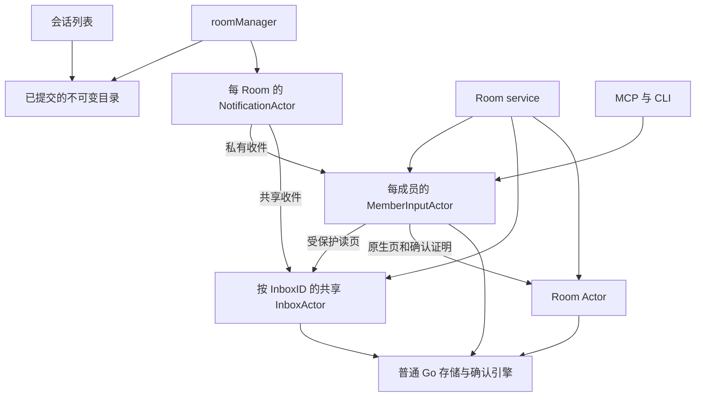

# 统一 Inbox、Actor 所有权与存储方案

状态：S1 已实施并完成相关验收，见[会话目录实施记录](implementation/unified-inbox-catalog.zh.md)；S2 已实施，验证见[私有输入 owner 实施记录](implementation/unified-inbox-member-owner.zh.md)；S3 已实施，验证见[共用 writer 实施记录](implementation/unified-inbox-writer.zh.md)；S4 已实施，验证见[通知 owner 实施记录](implementation/unified-inbox-notification-owner.zh.md)；S5 已实施，相关主要验证及满载测量边界见[共享 Inbox 实施记录](implementation/unified-inbox-shared.zh.md)；S6 已实施，Room 共同内核、清空／确认／升级恢复及分层验收见[Room 存储实施记录](implementation/unified-inbox-room.zh.md)。本文合并通知与输入 Actor 所有权方案、统一 Inbox 存储方案，并作为这两项工作的统一实施依据。文中类型和消息名是拟议内部合同。当前代码基线为 `c1ea70a`，实施时复核后续变更及实际完成证据。

## 1. 目标与设计判断

原基线的后台通知维护在 `roomManager.mu` 内扫描输入、解析关联和规划回收，会阻塞使用同一锁的会话列表。S1 已将目录读取与该锁隔离，来源及输入写入仍待后续阶段切换。统一输入路径直接调用按成员组织的 Repository，正文、成员消费和回合协调仍耦合在同一个存储对象中。目标是让目录独立可读、通知与输入有明确所有者，并用同一存储内核支持私有 Inbox、共享 Inbox 和 Room 时间线。 [当前通知组装](../internal/room/platform_notifications.go) · [成员维护入口](../internal/room/platform_references.go) · [平台存储](../internal/room/input_stream_storage.go)

主干采用三个边界。Actor 负责业务协调、串行受理和生命周期，普通 Go 引擎负责存储算法。正文所有权按 Inbox 确定，消费所有权按成员确定。跨所有者操作以固定身份、持久证明和明确的完成语义衔接。

| 维度 | 判断与设计选择 |
| --- | --- |
| 可行性 | Room 已有共享正文和独立确认，平台已有分段日志、幂等投递和按流检查点，优先复用这些机制。 |
| 模块清晰度 | 来源服务负责采集与来源确认，Inbox 负责可靠收件、正文及回收，成员负责正式交付和消费，业务模块负责跟进及动作。 |
| 复杂度 | 整体属于中高复杂度。重点在并发 writer、来源释放证据和共享读页的恢复，按完整行为分阶段验证。 |
| 扩展性 | 私有输入、多人广播、Room 时间线及定向事件使用共用存储和消费原语。多人中由一人办理的需求由任务模块增加认领、结清及接手规则。 |

对外继续采用 `inbox_list`、`inbox_read`，成员从服务绑定取得执行身份，自主选流。平台通知投向私有或共享 Inbox。Room 自身的消息和交互事件进入 Room 时间线，Room Actor 维护公共顺序、成员、清空和原生读取证明。输入交付、业务办结和外部动作分别记录。

## 2. 身份、数据与持久权威

| 对象 | 身份及持久内容 |
| --- | --- |
| Inbox | `RoomIdentity + InboxID`。私有 Inbox 与精确 Membership 建立稳定映射，共享 Inbox 使用独立 ID，Room 时间线使用固定 Inbox 身份。 |
| 物理分区 | Inbox 加分区键。私有平台沿用 provider 分区，共享首个场景使用单来源订阅、单分区，Room 时间线保持一条公共顺序。位置沿用 `partition + seq`，序号单调且不复用。 |
| 逻辑流 | 由 Inbox 及适配器归组身份确定，一个分区可交错保存多个流。跨分区无全序，同一流按收件顺序读取。 |
| 成员订阅 | 精确 Membership 加 `GrantID`，保存订阅状态。撤权后重新订阅产生新 GrantID。私有场景复用已有成员归属，新增 GrantID 用于共享订阅。 |
| 成员消费 | 按成员订阅、分区及逻辑流保存检查点和同页确认凭证。Room 的唯一游标和证明继续随原生状态提交。 |
| 执行与正式页 | 成员的 Session generation、turn、call、page、固定范围、实际位置、预算及准备结果。沿用现有协调器和 Session 结果证明。 |
| 业务事实 | 已有来源关联、跟进对象、授权、动作回执和结果版本，由原业务模块持久化。 |

私有 Inbox 的位置、DeliveryID、stream_ref、source_ref 及旧持久路径继续可用。共享物理索引按 Inbox 构建一次，成员只保存自己的检查点和有界目录视图。共享 stream_ref 绑定当前成员和 GrantID，服务解析到物理逻辑流。共享 source_ref 绑定房间、记录位置、成员及 GrantID，落在该成员来源关联目录。引用打开时仍检查当前权限。Room 保留原序号、回复引用、事件 ID 及流身份。 [现有模型](../internal/inputstream/contract.go) · [来源引用](../internal/room/input_stream_sources.go)

## 3. Actor 所有权与普通 Go 引擎

| 所有者 | 写入职责及生命周期 |
| --- | --- |
| roomManager | Room 目录、runtime 引用、操作槽和全局配置。短锁登记准入，发布不可变目录。跨所有者等待在锁外。 |
| NotificationActor | 每个完整 RoomIdentity 一个。拥有来源订阅 State、来源 worker、配置与数据修订、在途投递及来源释放判断。生命周期属于管理目录，runtime 关闭后按现有准入规则保留来源能力。 |
| MemberInputActor | 每个活动 MemberIdentity 一个。拥有成员目录、回合协调、额度、准备结果和平台消费检查点，协调 Room 原生读取。由 Room service 管理，Session 轮换撤销旧执行代际并保留持久输入。 |
| Inbox 正文所有者 | 拥有该 Inbox 的记录、投递去重回执、配额、接收成员关系、共享读页保护和回收。私有阶段由 MemberInputActor 承担，接入共享时增加按 InboxID 唯一的 InboxActor。 |
| Room Actor | 拥有 Room 成员、时间线业务规则、公共顺序、清空及原生游标。作为 Room 正文所有者使用共用引擎，发布根为 room.json。 |
| MemberAgent 和调度器 | 就绪、回合、名额、暂停、Session 与有限恢复。查询输入 owner 的轻量已提交状态。 |
| 跟进与动作模块 | 来源关联、业务单元、规则、授权和动作回执。提供持久关联及可释放性证据。 |

私有阶段可以在一个 Actor 内协调正文与成员消费，内部接口分别传 Inbox 身份和消费成员身份。共享阶段由一个 InboxActor 接受投递，各 MemberInputActor 接受成员正式读取，Room Actor 按原生协议提供时间线。来源投递不依赖目标成员的 Session。正文引擎只在处理可见范围时接触成员身份，执行代际和回合留在消费协调层。



所有者间的依赖通过受控 task 发起，处理循环继续响应状态及完成消息。原有 Repository 内部 mutex、局部 Store 持久化锁和进程目录锁可保留。运行中每份可变持久状态只有一个受理写入的 owner，MCP、HTTP 和维护任务都经该 owner 操作。离线升级、加载与停机核查在取得独占所有权后使用引擎。 [现有 Repository](../internal/inputstream/storage.go) · [Room 候选提交](../internal/room/room.go)

### 3.1 普通 Go 内核的最小能力

S2 按以下四组整理现有代码的受限入口，由同一私有 owner 调用。分组用于明确依赖和审查，可以复用现有类型、加载器和文件。

| 能力 | 输入与职责 |
| --- | --- |
| 正文追加与快照 | 接受经适配器核验的编码记录、Inbox 身份、去重键和容量约束，负责位置、段范围、校验、发布及恢复。 |
| 成员消费 | 接受成员订阅、逻辑流、预期起点和实际页证明，负责幂等确认、检查点及跳过记录。 |
| 执行协调 | 保存执行身份、预算、固定页和准备结果，校验合法阶段转换，接续已知请求和持久证明。 |
| 回收规划 | 接受有限候选、保留策略和已核验的释放事实，计算可回收前缀并校验提交范围，负责持久清理及恢复。 |

GitLab 原生对象解释、当前 Session 执行权限、Grant 有效性、关联释放条件及 Room 成员规则由领域适配器和 owner 核验。内核将 generation、turn、GrantID 等作为不透明身份保存并校验相等关系，验证候选结构和版本，执行持久提交及恢复。这四组能力通过静态组装复用，沿用既有适配器合同。

## 4. 执行模型与操作合同

handler 校验身份和状态，登记 operation 并冻结参数。存储和外部查询由 `StartTask` 执行，完成回调检查 activation 与 operation，持久化成功后安装结果并应答。一个 owner 同时最多一个改变持久状态的任务，材料准备和网络查询可在固定输入上并发。查询返回上次安装的不可变投影，task 持有引擎变更槽时 handler 不访问该引擎的可变 map 和 slice。

接口围绕完整操作组织。内部阶段函数继续复用，在操作确有持久边界或外部等待时才需要消息接续。

| 操作 | 所属 owner 与完成语义 |
| --- | --- |
| ReadSubscription、ConfigureSubscription、CommitSourceCandidate | 通知 owner 返回快照或提交当前订阅候选。变更在持久化安装后完成。 |
| ReceiveInput | Inbox 正文 owner 按固定投递身份可靠收件，成功返回持久回执。 |
| CheckSourceRelease | 通知 owner 对固定候选返回来源侧释放状态和证据，详见第 7 节。 |
| CheckMemberRelease | 成员 owner 对有限候选核验消费、跳过及关联释放证据；未加载时由 service 受控读取已提交快照。Grant 撤销终态由 Inbox owner 本地核验，详见第 10.1 节。 |
| InspectInputs、ListInputStreams、PreviewInputHistory | 成员 owner 生成授权视图。Inspect 只读取轻量投影，list 的曝光计费经成员 owner 提交。 |
| PrepareInputRead | 成员 owner 接续权限检查、预算预留、固定页、来源关联和材料准备，成功返回已保存的可交付结果。共享正文保护由第 8 节协议取得。 |
| RecordInputHandoff、ConfirmInputRead | 成员 owner 持久记录输出交接，接收匹配的 Session 证明后提交检查点和同页证明，再结清正式页。 |
| RequestMaintenance | Inbox owner 合并请求并按批推进。受理与完成分别表达，内部需要等待时返回 operation 完成回执。 |
| Quiesce、撤销执行、撤销订阅 | 相关 owner 停止对应范围新准入并结清已受理工作，完成后才允许释放资源。 |

内部写请求携带完整资源身份和稳定 operation ID，执行操作另带 generation、turn、call、page。完成消息携带 activation。调用者取消等待后，owner 仍负责结清已受理写入，重试沿用原 operation。旧 activation 的完成结果只能由原 operation 核对，当前 owner 不安装其内存结果。

初始等待队列建议每 owner 最多 64 项，达到上限返回可重试 busy。每个 Inbox 维护只有一个运行实例及一个 dirty 标记，来源单订阅最多一个查询和一个投递尝试。完成与生命周期消息采用 actorx 已有机制，关闭停止新批次。批次结束给业务写入执行机会，持续写入时也保留维护机会。跨 owner 的 task 等待期间不持 manager、Store 锁或对方需要的变更槽，读释放状态和证据查询必须可直接响应已提交投影。

## 5. 会话目录与轻量状态

manager 在目录元数据、runtime 和操作槽安装后原子发布 roomsCatalogSnapshot。启动在对外服务前发布初始目录，嵌套 map、slice 和指针目标一起冻结。GET 读取目录快照，再在锁外取得各 Room 的已提交摘要并编码响应。普通锁竞争不产生目录 409，Room busy 作为数据表达。

消息预览、成员名、时间及 human-read 统计复用现有视图，后续按实测增加有界缓存。按操作者隔离人类读取统计，单 Room 摘要读取失败按局部 unavailable 表达。清空、删除和重开期间的迟到结果检查 RoomInstance 及运行代际。健康状态通过安全 accessor 或投影读取。

InspectInputs 返回已提交的计数、ready、progress、blocked 和恢复状态。成员轮询只查这个投影，来源核验和维护由独立合并任务更新投影。所有者加载完成前明确表达未就绪。提交后先安装可读投影再发 SSE 失效信号，observer 只发信号。 [目录入口](../internal/room/management.go) · [成员轮询](../internal/room/member.go) · [输入状态](../internal/room/input_stream_runtime.go)

## 6. 持久 writer 与存储发布

### 6.1 writer 并发合同

现有通知来源共用 `m.store.save`，其健康、目录准备和关闭状态需要先适配并发。文件算法沿用同目录临时文件、文件同步、原子替换及目录同步。合同如下。

1. 同一路径由唯一 owner 串行，不同 Room 路径的文件 I/O 可并发。短健康锁管理 closed、uncertain、准入及在途计数。目录准备按目录保护，共用 writer 只管理文件和健康边界。
2. 一次任务从健康准入到目录同步或明确失败都登记在途。关闭和未知提交冻结新的准入。已经准入的任务允许结清，分别记录成功、明确未提交或提交不确定。原调用者获得自己的结果，任何后续业务写入重新经过健康准入。
3. 例如 A 的目录同步失败、B 已替换成功且同步成功，A 返回未知，B 可返回已提交。B 仍在执行时，由 B 自己完成判定。全局冻结不把 B 的成功变成未提交，也不允许在冻结后启动新的来源确认。
4. 冻结范围沿用当前共享 Store 的范围，局部 Room Store 沿用其现有冻结范围。冻结后所有管理入口和来源写入口都经过相同健康规则。关闭先停止准入，再等在途任务，最后释放目录锁。换 Actor 地址不能绕过未知提交。

先交付 writer 的并发、冻结和关闭测试，再开启通知 owner 的多 Room 并行写入。Room 局部 Store.mu 仍可能串行化同一 Room 的部分持久操作，其等待和持锁时间纳入测量。 [当前持久化](../internal/room/storage.go)

### 6.2 统一追加与发布

共用 Go 引擎负责段读写、字节边界、内容校验、固定快照、位置索引及提交候选。物理正文先同步，再原子发布已提交范围、序号、回执和本次需要一起生效的状态。发布成功才算可靠收件。Room 将候选写入 room.json，平台写入分区发布根，两者使用同一存储原语和故障判定。

私有多 provider 继续沿用成员总配额的持久预留及结清。共享首个场景为单分区，配额、订阅和日志根在同一个原子文件提交。配额与已收件记录必须一致，具体发布载体由持久适配器承载。来源 State 和成员协调器保留各自的提交权威。

追加重试先查回执，同键同来源摘要返回原位置，同键异摘要冲突。发布前崩溃以已发布范围恢复，完整未发布尾部也按未提交处理。发布后应答丢失回放原回执。已发布范围内正文缺失或校验失败按损坏处理。清理先发布回收边界，再删除旧段或重写边界段。

Room 接入共同内核时使用已提交字节边界，只读取和校验发布范围内的内容。追加后的未发布尾部在重开或下次追加前隔离或截断。清空保留后缀需要新段时先写新段，再原子提交清理边界和成员有效起点。纯消费确认不重写正文。Room 原生消息、事件编码和单一 ReadThrough 保留，消费校验复用通用函数，结果由 Room 原生候选提交。 [Room 日志](../internal/room/room_input_log.go) · [原生确认](../internal/room/input_stream_room.go)

## 7. 来源查询、投递与释放证据

### 7.1 查询与来源确认

保留 provider Source、State、Runner 和 StepHost 的核心能力。runner task 从通知 owner 读不可变 State 及范围，候选提交检查配置版本、数据修订、owner activation、连接 revision 和 credential stamp。来源查询与投递确认并发时，旧候选冲突重试，禁止把已释放 ID 重新放进 pending。runner 只在持久提交成功后推进自己的运行缓存。

一次投递按以下顺序执行。

1. 通知 owner 固定精确来源 Key、Item.Key、DeliveryID、冻结 Route、来源摘要和目标 runtime 代际，登记 operation。
2. task 通过短时目录查询取得已准入的目标正文 owner，调用 ReceiveInput，目标再次检查身份和准入。
3. 目标发布成功返回持久回执。通知 owner 在完成回调中基于当前已提交 State 核对原项，持久保存来源确认。
4. 来源确认成功后唤醒目标维护，目标收件成功后更新成员就绪。唤醒与 SSE 丢失由已提交事实重查补足。

来源 pending 在目标发布前失败时保留。目标成功而来源确认丢失时以同 ID 重投。关闭或配置变更不能回滚已受理目标收件，排队项保留原冻结目标。来源停用、凭据失败、retired 和容量阻塞分别处理，释放容量只解除容量阻塞。 [现有来源合同](../internal/platform/notification/source.go) · [投递实现](../internal/platform/notification/delivery.go)

### 7.2 CheckSourceRelease 合同

输入 owner 固定一批已发布候选，请求通知 owner 核验其来源侧是否可释放。完整 pending 库存与历史订阅枚举留在通知模块，输入模块只理解以下结果。

| 状态 | 含义与用途 |
| --- | --- |
| unknown | 来源未完整加载、相关 writer 提交不确定、证据损坏、身份或历史命名空间无法核验、owner 关闭或无法证明释放。继续保护正文和去重回执。 |
| held | 已知来源仍有对应 outstanding 项。继续保护，来源状态变化后重查。 |
| released | 能从已提交来源事实证明该精确投递身份的来源保护已解除。可来自持久确认或按既有策略排除，同时返回原因以供诊断。 |

请求每项包含 Room、Inbox 目标、SourceID、SubscriptionID、冻结路由版本、DeliveryID、目标记录位置及来源摘要。结果包含同一候选身份及摘要、状态、原因、通知 activation、相关持久数据修订和可核验的证据引用。来源模块核验历史 disabled、retired 及冻结目标的事实，未知项逐项返回 unknown。

通知侧实现可以继续使用完整已提交库存，但必须分别证明 provider 的命名空间完整性、冻结身份正确及释放终态单调。GitLab Events、Todos、Lark 都要覆盖查询与确认并发、配置变化、过期和重启。仅发现 ID 不在一张 map 里不足以返回 released。来源历史证据的压缩必须保留仍有目标记录时需要的证明能力，无法证明时返回 unknown。

释放查询本身只读取已提交投影。证据仅适用于这批目标中已存在的候选，新增输入另查。回收前验证相关 activation 仍有效，并重验本地关联、消费及页保护。终态已证明单调时，后续无关来源修订不会使该精确 released 结果反转。若 owner 重开或证据的生存期无法判定则重查。released 只满足来源侧条件，最终回收仍由 Inbox owner 决定。

## 8. 正式读取、共享保护与恢复

### 8.1 共用成员交付协议

list 汇总当前成员的 Room、私有及共享流，复用关注排序、有限曝光和目录分页。read 接受 stream_ref 和可选 limit，按所选流的最早待交付顺序读取。私有和共享平台输入共用成员现有单回合 25 条平台额度，Room 沿用自身默认 20 条及既有读页限制。目录预算、图片预算也归该成员执行。

正式页继续使用 `reserved → prepared → awaiting_confirmation → settled`。准备时固定快照上界、实际位置及检查点起点，保存来源关联和可重供结果。在首次对外输出前持久记录 handoff，进入 awaiting_confirmation，随后完整写出结果并等待运行时提供匹配的持久 Session 结果证明。取得证明后原子提交检查点和同页证明，再结清页。请求重试复用原页，旧证明不能确认另一个成员、订阅或执行。只有可证明未对外交付且无未知提交的本地失败，才能按既有规则安全终止并释放预留。 [交付与接收证明](../internal/room/input_stream_delivery.go) · [确认](../internal/inputstream/consumption.go)

Room 页通过 Room Actor 的原生读页及 ConfirmInput 推进唯一游标，成员协调器保存协调证据。Room 确认已提交但成员页未结清时凭原生证明补结清。首次恢复、Session 轮换、有限输入恢复、未知动作结果及人工暂停继续经现有门禁。

### 8.2 共享正文和成员页的持久交接

共享阶段的正文保护归 InboxActor，成员正式页归 MemberInputActor。用持久记录和可重试的页身份衔接这两个写入者。

1. 成员先持久登记准备意图，冻结第 8.3 节规定的身份、检查点起点、读取范围及预算。共享 owner 按此请求幂等选择固定页，校验订阅，持久登记实际位置和保护凭证后返回。两边都保存足以重试原页的身份。
2. 成员保存 reserved 页及保护引用，再在保护期内读取和准备材料。页准备不持有共享 owner 的变更槽，共享可继续收件。临时预览 pin 由 owner 在取得只读段视图前登记，渲染完成或取消后释放。
3. 成员取得 Session 证明后先持久提交自己的消费检查点及同页证明，结清成员页，再凭这些证据请求共享 owner 幂等解除保护。丢失解除应答可重试，保留原页证明直到保护解除已核实。
4. 准备意图已保存但保护未取得时，重试原 ID。保护已取得但成员 reserved 尚未落盘时，从意图接续原固定页。成员证明已提交而保护未释放时按证明补做释放。没有匹配证明、执行尚未结清或任一提交不确定时保留保护。
5. 共享 owner 重开先恢复持久保护，再开放维护。成员状态暂不可读时继续保护。只有成员 owner 核实安全的交付前终止，或既有执行结清协议给出明确终态，才允许取消该页并释放其保护。正式页保护由持久协议结清，预览 pin 仅覆盖当前只读任务。

成员侧检查点是消费权威，共享 owner 记录页保护及已核验的释放凭证，不维护另一套成员消费游标。跨 owner task 可以查询彼此的已提交证据，不能持有会阻塞对方完成的变更槽。停止过程按任务依赖结清，未知结果通过重开核对。

### 8.3 固定页与确认的幂等合同

固定页请求携带完整 Room、Inbox、分区、成员、Grant、逻辑流、generation、turn、page ID、该流检查点起点，以及成员 owner 已预留的有效条数额度。已有固定观察上界时一起传入，否则首次固定时由共享 owner 确定。默认值在准备意图中归一化一次，重试复用同一请求摘要。

共享 owner 保存原请求摘要，并返回固定快照、原检查点起点、扫描边界、该流可推进边界、实际记录位置、剩余条数或 has_more、页摘要及保护凭证。摘要覆盖请求身份、实际位置和边界，成员确认推进的是该流的可推进边界，其他流的消费状态由各自检查点决定。

- 同 page ID、相同请求摘要，返回原固定页和当前操作状态。后续追加不改变原页，已结清的重试不新建保护或重复扣预算。
- 同 page ID 但起点、Grant、流、执行、范围或预算不同，返回冲突。页回放仍校验当前访问权限和保留边界，撤权或合法回收后返回明确状态。
- 确认时先匹配已经持久提交的同页证明，命中则返回原确认结果。首次确认才检查当前该流检查点仍等于原页起点，随后核对身份、边界、实际位置及 Session 证明，原子提交检查点与同页证明。起点不匹配且无同页证明时返回冲突。

复用现有 Reserve、Confirm 和 OwnedPage 的请求比对、起点校验及证明结构，按共享记录身份补齐字段。内部 page ID 和保护凭证由 owner 管理，MCP 继续使用既有两工具参数。

## 9. 共享 Inbox 的业务范围与权限

首个完整用例为共享 GitLab 项目事件。操作者在 Room 中复用现有项目、连接及成员选择控件，显式建立一条共享 gitlab/events 订阅。绑定实际实例、连接账号和项目，换账号或项目时建立新订阅。已有个人 Todo 和飞书私有配置继续使用私有目标。这个用例用于验证通用共享能力，其他来源按各自的授权与原生身份接入。

notification.Target 增加以 InboxID 定位的 shared_inbox 模式。共享 DeliveryID 由来源订阅、原投递键和目标 Inbox 派生。私有旧算法保留。来源在采集时冻结目标和版本，目标首次可靠发布时冻结实际 GrantID 集合，并与正文、回执一起保存。同一 ID 重投沿用该集合。接收集合至多为当前 Room 的成员上限。

新成员从加入后首次发布的记录开始，撤权后重新订阅获得新 GrantID。并发加入、撤权与追加由共享 owner 排序。同一项目的记录 #1、#3 属于 MR 流 A，#2 属于 MR 流 B。甲确认 A 只推进甲的 A，乙仍有自己的待交付记录，甲的 B 仍待消费。丙在 #3 发布后加入，重投 #3 只返回原回执，丙从下一次新收件开始。

目录、预览、正文、来源引用、附件及结果重供都检查当前 Membership、活动 GrantID 和记录冻结的接收集合。撤权先停止该订阅的新交付，与成员 handoff 结清后持久关闭 GrantID。已输出而等待 Session 证明的旧页可凭相同持久结果证据结清消费，撤权后的正文查询返回权限错误。撤权过程中崩溃后保持停止准入，按持久操作进度继续核对。证据不足按既有回合结清屏障处理。

成员移除只关闭该成员的订阅和读取，其他成员继续消费共享正文。无有效接收者时暂停共享来源新增查询，新记录保持 pending，已发布记录仍可回放回执。操作者配置和预览沿用 Room 管理权限，成员页标识共享来源及自己的消费状态。

共享授权允许读取已经保存的通知快照。采集连接和接收账号证据留在来源及原生 payload 中，适配器显式核验共享订阅的来源身份和记录一致性。成员自己的跟进、远端对象解析和动作继续核对其执行账号及实际目标，不能把采集账号替换成成员账号来通过校验。远端权限不足明确返回业务不可用，已授权保存快照仍可正式交付。图片准备沿用既有绑定和下载权限，失败按现有材料状态表达。

## 10. 有界维护、容量与回收

基本有界维护随输入 owner 接入交付。每个 Inbox 一个合并任务，初始每批最多 128 条候选或 10ms 规划预算，先达到者结束。底层 ConsumptionRelease、Plan/Prepare/CommitReclaim 都接受有限候选或增量状态，扫描、校验、段重写及索引更新一起计量。单批最多处理一个边界段及有限完全释放段。批次后让出执行机会，约 1MiB 段的单次系统调用成本纳入实测。

追加、来源释放、消费、跳过、业务关联、容量不足及保留期到期唤醒维护。Inspect 不触发扫描。缓存最早阻塞位置及相关修订，相关状态变化或下一到期时间失效重查。获取来源释放证据在固定候选上进行，等待期间不占据对方需要的资源；本地提交前重验候选仍在同一发布范围、相关业务版本、订阅终态和全部保护。冲突则重算本批。

| 记录 | 满足回收的条件 |
| --- | --- |
| 私有平台 | 过保留期、来源 released、成员已消费且关联可释放或已有合法跳过、无在途页和未知提交保护。沿用既有过期跳过配置。 |
| 共享平台 | 过保留期、来源 released、冻结集合内每个 Grant 都有终态、无正文保护。终态为已确认且来源关联可释放、持久过期跳过，或撤权/移除已结清。成员离线或 owner 尚未加载均不构成释放。 |
| Room 时间线 | 按操作者显式清空及 Room 原生规则计算，保留定向事件和在途页保护，并在原生候选中提交清理边界与有效读取起点。 |

消费与跳过分别记录，业务完成状态由原业务模块维护。只清理符合条件的连续前缀，先发布回收边界再删段。共享最慢成员会阻挡同分区前缀，页面诊断显示最早阻塞位置及待结清成员。关联和释放视图均可从权威记录重建，不永久累积逐条墓碑。

### 10.1 每个 Grant 的释放证据

回收逐条检查记录冻结集合中的每个 Grant。页保护覆盖正在交付或恢复的正文，成员释放核验覆盖尚未产生正式页的待消费记录。InboxActor 先核验本地已结清的 Grant 关闭终态，其余对一批固定候选调用 CheckMemberRelease，请求绑定成员、Inbox、Grant、分区、逻辑流、位置及记录摘要，批次受现有维护上限约束。结果逐项使用 unknown、held、released，带相同候选身份、终态原因及相关持久修订或证据引用。

| 事实 | 权威与重建方式 |
| --- | --- |
| 已消费且关联可释放 | 从成员按流检查点和持久来源关联核验。成员 owner 安装的投影可加速读取，重开仍可由原文件重建。 |
| 过期跳过 | 沿用成员侧持久跳过记录，绑定 Grant 及实际位置或明确范围。后台维护先请求成员 owner 提交跳过，成功后核验，即使该成员从未准备过正式页也能推进。 |
| 撤权或成员移除已结清 | InboxActor 从自身持久 Grant 关闭记录及关联页的结清结果核验。关闭操作完成前，记录中仍保留未决页保护。 |

证据已完整核验才返回 released，仍待消费或交付则为 held，文件缺失、身份不符、证据未加载或提交不确定则为 unknown。成员 owner 未加载时，通过 service 在受控 task 中复用既有加载校验读取已提交快照，运行中的成员写入仍由原 owner 负责。成员离线或不在名单中本身不构成释放依据。

移除成员及删除其输入状态前，先把相关 Grant 的关闭与结清结果持久保存到共享 Inbox；中断后继续按操作进度恢复。InboxActor 可缓存带候选范围及证据版本的释放投影，回收提交前重验相关业务修订和页保护。消费进度单调、Grant 关闭已结清等终态按对应持久证据复用，投影失效时从权威记录重建。相关记录、回执和保护全部释放后再压缩 Grant 证据。该接口复用现有检查点、跳过及 Grant 记录，无需逐条建立第二份成员消费账本。

### 10.2 容量

私有平台与 Room 沿用当前容量。共享 Inbox 默认 10,000 条或 64MiB，单条及回执限制沿用平台规则，正文及索引计量一次，各成员 Session 结果分别保存。S5 首次交付每 Room 一个共享项目 Inbox，配额与发布根同次提交。同一项目的多个 MR 流可以在这一 Inbox 中按原生对象归组。多个共享 Inbox 的创建及 Room 总配额作为后续扩展，再按实际内存、磁盘和目录规模确定预算与预留规则。达到容量时保留原输入，阻塞相关来源新增查询，来源原 ID 重投，其他独立配额的输入继续运行。

## 11. 生命周期、布局与兼容

运行时所有者先预留身份，再加载恢复，ready 后才发布地址。加载失败保留具体错误。通知 owner 可先于 Room runtime 存在，目标不可用时保留 pending，正常 Room 打开流程决定目标何时可接收。关闭某个 runtime 结清其所有成员、共享及 Room owner，通知 owner 按既有规则保留来源状态。

成员撤销和 Session 轮换先停止对应准入，再结清在途投递、正式页、材料和业务解析。轮换保留 Inbox 内容及消费进度，共享成员移除不停止整个共享 Inbox。删除 Room 还要停止来源 worker 和通知 owner，然后沿用 deleting → removing 步骤。全服务退出先冻结全部新准入，统一期限内按依赖结清，最后 Stop/Wait 并释放 Store 和目录锁。等待超时保留所有权和阻塞状态。

前四阶段沿用当前私有和 Room 持久路径及格式。共享阶段新增如下数据，原消费和来源关联目录仍由成员持有。

```text
shared-inboxes/<inbox-id>/partition.json             # 订阅、Grant、配额、日志根、回执、页保护
shared-inboxes/<inbox-id>/records/<segment>.jsonl     # 正文及冻结的接收集合
agents/<membership-id>/shared-input/<inbox-id>.json  # 该成员按流检查点与同页证明
agents/<membership-id>/input-state.json             # 成员执行、准备意图、正式页与恢复
```

可变文件保留版本、校验和尺寸上限，保留的回执、订阅和证明均有界压缩。Room 接入共用段内核需要格式调整时，复用既有独占升级框架，校验备份、staging、步骤进度和最后发布。保留原位置、已清理边界、来源引用、游标及原生证明。升级中断按进度恢复，业务已经产生新写入后保全增量再决定修复或恢复。 [升级实现](../internal/room/input_upgrade.go)

## 12. 代码落点与审查清单

| 代码 | 开发内容 |
| --- | --- |
| internal/platform/notification 的 manager、delivery、store、source、expiry | 每 Room 来源 owner、StepHost 适配、修订核对、CheckSourceRelease、异步目标投递和确认。provider 规则保留在 provider 中。 |
| internal/room/platform_notifications.go、platform_references.go、相关平台配置入口 | Actor 组装、准入和连接代际、配置/HTTP 适配、过渡 Gate 的移除、来源与成员变更通知。 |
| internal/room/member_input*.go、共享 Inbox owner | 生命周期、完整操作接口、变更任务槽、轻量投影和操作结清。按现有 actorx 生成规则更新 bindings。 |
| internal/room/input_stream_*.go | 列举全部 inputStorage、platformInputHandle、repository 调用，收件、协调器、曝光/图片预算、preference、预览和来源引用全部经唯一 owner，所有者边界按 Inbox 与成员区分。 |
| internal/inputstream 的 storage、consumption、owned_pages、reclaim | 分离正文与成员消费能力，有界候选和共享保护，复用现有序号、回执、结果缓存及恢复。Room 私有编码由领域适配器持有。 |
| internal/room/storage.go、room_input_log.go、input_stream_room.go | 健康并发准入、关闭、段内核与发布载体、原生 Room 证明适配。 |
| followups、platform_call_lifecycle、MCP、附件及图片材料 | 保留业务和权限权威，异步解析时固定身份，关联变化唤醒维护，旧引用与撤权校验完整。 |
| management、runtimes、runtime_assembly、service、deletion、ui_update、human_read_catalog | 不可变目录、生命周期与健康状态、按操作者隔离的投影和提交后信号。 |

最终路径中 m.mu 只用于短时元数据和准入，来源 State、目标写入、扫描、网络及 Actor Call/Wait 在锁外。输入链路以 owner operation 替代 inboxMu、p.work、p.discovery 的相应职责。局部 Store.mu 保护业务关联与原子写入，只覆盖有限本地工作。通知 Host.Gate 及旧 callback 锁序在切换完成后清除。原 AgentInbox 兼容入口有独立所有权，新旧 writer 不共写。

## 13. 分阶段交付

以下按 S1 → S2 → S3 → S4 → S5 → S6 推进，S3 的 writer 改造可提前开发，但 S4 切换前必须验收。指定阶段实施时交付该完整边界、真实检查结果和剩余门槛。类型及测试按行为命名。原 Actor A1 对应 S1，A2 与统一存储第一阶段合为 S2，A3 拆为 S3/S4，A4 的基本有界要求提前到 S2、热点优化按测量进入 S4/S5，A5 的真实验证分配到各阶段。原共享阶段对应 S5，Room 内核阶段对应 S6。

### 核心文档随阶段交付

核心概念和架构文档随对应阶段一起更新，并纳入该阶段完成标准。内容以已实现并核验的正常入口为准，反映实际状态所有者、持久路径、读取与确认合同、生命周期及故障恢复。阶段进度、测试清单、性能样本和待实施设计保存在本方案及 implementation 记录中。

| 阶段 | 文档交付与核验重点 |
| --- | --- |
| S1 | 更新 [Server 架构](server.zh.md)和 [Room 架构](room-architecture.zh.md)中的目录读取、已提交投影、局部不可用及 SSE 职责，说明后台维护与列表读取的实际边界。 |
| S2 | 更新[核心概念](concepts.zh.md)、Room 架构和 [Agent 收件箱](inbox.zh.md)，沉淀公共正文、成员独立消费、逻辑流、两工具入口及 Session 结果证明。对照当前代码修正旧的 turn_number、next_cursor、仅写出即消费和逐条 JSON 文件等已失效说明。建立 `docs/storage-architecture.zh.md`，记录实际 Room 日志/发布根、成员平台分区、消费检查点及协调器的权威与恢复关系，并在[文档目录](README.zh.md)和相关架构页增加入口。 |
| S3 | 更新存储架构中的 writer 准入、路径所有权、并发提交结果、冻结范围及关闭结清，用具体故障窗口说明已准入任务的结果如何判定和重开核实。 |
| S4 | 更新[平台架构](platform-architecture.zh.md)、Room 架构、存储架构及 Inbox 说明，按实际实现写清通知 owner、可靠投递、来源确认、来源释放三态、有界维护和成员轻量状态查询，核对旧 Gate 和回调锁序说明。 |
| S5 | 更新核心概念、平台架构、Inbox 说明及存储架构，补齐共享配置入口、Inbox 正文与成员消费的职责、Grant 加入/撤权、固定页与成员释放证据、容量和回收。明确首个共享项目 Inbox 的交付范围及用户可观察的阻塞原因。 |
| S6 | 更新 Room 架构、存储架构及[安装与运行](installation.zh.md)，沉淀共同存储内核、Room 原生发布、清空、确认与自动升级恢复的最终合同，核对磁盘布局和备份恢复说明。 |

核心概念面向使用者解释行为，架构文档面向开发者明确所有权和数据流，存储架构集中说明持久布局与提交/恢复协议，Inbox 文档提供配置、读取和排查入口。相同合同以主文档为准、其他页面链接引用。文档验收检查链接、示例参数、路径及状态描述与该阶段代码一致，已交付能力可从文档目录找到。

### S1 · 会话目录独立可读

实施状态：已完成。不可变目录、锁外摘要与编码、健康/settings 已提交投影、局部不可用、SSE 发布顺序及相关故障/race/Chromium 验证见[实施与验收记录](implementation/unified-inbox-catalog.zh.md)。额外全仓普通回归通过；完整集成套件超时且后续过宽补跑已停止，不作为本阶段门槛。

交付不可变目录元数据快照、锁外摘要和编码、同步安全的健康读取。覆盖创建、改名、打开、失败、busy、删除、默认助手及 settings 的目录失效，单 Room 摘要故障局部呈现。

验收用故障钩子阻塞后台维护和来源写入，在释放阻塞点前完成至少 100 次列表请求，全部取得正常目录。race 覆盖快照发布/读取，真实服务和浏览器验证刷新与切换。记录无维护和有维护的延迟分布。此阶段的实际隔离范围为目录读取，来源及输入切换后续完成。

### S2 · 私有输入 owner 与基本有界维护

实施状态：已实施，成员 owner、有限候选、过渡来源证据、正式页与生命周期验证见[实施记录](implementation/unified-inbox-member-owner.zh.md)。

交付 MemberInputActor 和按 Inbox/成员分离的内部接口，私有场景由一个 owner 承担两项职责。按第 3.1 节划定正文、消费、执行协调及回收规划四组受限能力，内部继续复用现有类型及旧格式加载器。正常收件、MCP/CLI、协调器、正式证明、预算、目录和只读预览全部经 owner。沿用磁盘格式，完成轻量 Inspect、请求合并、底层有限候选、批次间调度及预览 pin。收回旁路写入，审查内核入口的输入均为已核验身份、候选或事实。

来源侧使用有限的过渡适配，旧 Gate 内固定本批目标候选并由通知适配器按第 7 节返回释放结果。该批旧路径可持 Gate 等待有限维护结束，输入 owner 不反向请求 Gate，受理 operation 明确携带过渡证据。正常成员 Inspect 已脱离维护。S4 删除此适配及相关长锁。

验收已有数据重开、同键幂等及摘要冲突、A/B/A 消费、跨分区同序号、并发预览和确认、图片预算、Room 原生确认和 Session 证明恢复。阻塞一批维护，验证释放后业务任务在下一批前有机会执行。真实 DSH 私有读页及服务重启通过，重复打开、轮换和移除无双 writer 或提前关闭。

### S3 · 共用持久 writer 并发基础

实施状态：已完成，健康准入、路径与目录保护、并发故障结果、关闭及重启验证见[实施记录](implementation/unified-inbox-writer.zh.md)。依用户后续指示以相关主要测试为准，慢全仓补跑已停止，不作为本阶段完成门槛。来源并发切换仍属于 S4。

交付第 6.1 节的健康准入、路径所有权、不同 Room 并发写入、冻结和关闭合同。管理写入及通知写入全部经过相同健康入口。保持原文件算法和既有冻结范围。

故障测试覆盖 A 未知且 B 已成功、B 在写入不同边界、未知后新准入拒绝、成功任务后续来源确认受冻结阻止，以及关闭等待全部在途任务。阻塞一个 Room 的文件同步，其他 Room 不同路径的已准入保存可完成。race 覆盖健康、目录缓存及关闭状态，私有服务正常重启回归。S4 只在这一合同通过后开启并发来源持久化。

### S4 · 每 Room 通知 owner 与可靠释放协议

实施状态：已实施。每 Room 来源 owner、无 Gate 的可靠投递与确认、来源释放三态、到期缓存及隔离服务/provider/浏览器/DSH 分层验证见[实施记录](implementation/unified-inbox-notification-owner.zh.md)。真实 Events 当前样本无新增命中，完整正文失败窗口采用隔离 fixture 验证；未声称生产部署或全仓/e2e 全套通过。

交付 NotificationActor、StepHost、来源候选修订核对、异步投递、来源确认、CheckSourceRelease、连接和配置变更及完整生命周期。删除生产 Host.Gate 和 S2 过渡适配，两条维护入口收敛为 owner 唤醒。本阶段同时按实测收敛增量索引、阻塞前缀缓存、到期重查、段重写和重载热点。

验收 Events、Todos、Lark 的真实启用路径，分别验证查询与确认并发、历史订阅、冻结目标、disabled/retired、过期、来源重开和未知证据。以稳定 ID 在目标发布与来源确认之间退出重启，复用原回执并恢复消费。阻塞一个 Room 的投递和来源保存，其他 Room 的目录、状态、来源提交和输入投递均完成，持续写入时维护仍有进展。

在隔离真实服务中验证积压期间刷新、切换 Room、正常重启及真实 DSH 确认。记录列表/状态成功率、延迟、扫描与持久化次数、任务数和内存。常规本地 fixture、真实 provider、浏览器及模型证据分别说明，覆盖到的实际链路明确列出。

### S5 · 共享 Inbox 的双成员完整闭环

实施状态：已实施，正常配置、Inbox owner、Grant、固定页、独立消费、来源与成员释放、共享回收及真实 GitLab／双成员 DSH／HTTP MCP／浏览器／重启验证见[实施记录](implementation/unified-inbox-shared.zh.md)。按用户后续要求以相关主要测试为准；长时间串行灌满样本超时，不计为吞吐验收通过。

交付 GitLab 项目事件共享订阅的配置和预览、InboxActor、成员目录汇总、独立消费、持久页保护、来源关联和共享回收。实现 GrantID 加入/撤权及旧引用检查。先以每 Room 一个共享项目 Inbox、一个订阅和两个成员完成用户可用的闭环，后续按 Inbox 身份扩展更多共享目标。

开发前将第 8.3 节固定页与第 10.1 节成员释放合同落实为请求/响应类型及持久字段，复用已完成的消费和加载能力。补测同页同参重放、同页改起点或 Grant 冲突、确认已提交后应答丢失，以及无正式页的过期跳过、成员 owner 未加载、移除后重启的释放重建。证据不足时保留正文，未消费且无页保护的记录继续显示 held。

验收一份正文和物理索引、一次来源确认、两份成员进度。覆盖甲读完乙未读、成员加入后旧 ID 重投、撤权与 handoff 并发、owner 重开、共享保护与成员页各持久边界中断、成员已确认但释放应答丢失。相关页和来源证据缺失时正文保持保护，成员移除后其余成员可继续。

用获准项目的只读真实平台链路、两成员真实 DSH、HTTP MCP、服务重启和页面预览复验。满载测量正文、索引和成员结果缓存的实际占用、首页及重开成本。来源容量暂停、恢复重投、慢成员阻塞诊断及默认过期策略通过正常入口验证。

### S6 · Room 接入共同存储内核与升级验收

实施状态：已实施。沿用原生分段格式，Room 与私有／共享输入复用段、发布和确认原语；故障、升级中断、真实服务、Chromium、真实 DSH 图文及测量见[实施记录](implementation/unified-inbox-room.zh.md)。全仓 Go 额外回归在总时限处中断，不计为全仓通过；生产启用未执行。

接入共用段操作、发布校验及确认原语，Room Actor 构造原生候选并由 room.json 原子发布。格式变更使用独占、可恢复的自动升级，保留消息/事件序号、成员身份、游标、去重回执及原生证明。

验收普通发言和回复、定向事件、成员加入、图文读页、确认后应答丢失、清空与在途页竞争、清空后重启，以及升级各持久边界中断恢复。对比追加、确认、清理和重开，纯成员确认不写正文。真实服务、浏览器和 DSH 回归通过后记录具体构建和数据目录的验收，实际生产启用按届时授权目标执行。

## 14. 验证与最终审查

| 故障/竞争 | 应保持的结果 |
| --- | --- |
| 维护、来源保存、响应编码或慢连接阻塞 | 目录可读，不持 manager 锁，不阻塞无关 Room。 |
| 同 DeliveryID 并发重投及同键异摘要 | 最多一次发布，摘要冲突明确，来源确认原项。 |
| 来源旧查询晚到、历史来源缺失、释放信号丢失 | 已释放身份不重入 pending，unknown 保持保护，事实可由持久来源核查。 |
| 输出部分写出、Session 证明丢失、确认或保护解除应答丢失 | 原页与证明可恢复，未结清正文继续保护，无跨成员或跨 Grant 确认。 |
| 关联更新、消费与回收并发 | 本地事实提交前重验，固定候选不外推到新记录，前缀边界及容量准确。 |
| 关闭、移除、轮换与已受理任务并发 | 先停止准入再结清，保留未决所有权，旧 activation 不安装到新 owner。 |
| 未知提交与其他并发写入 | 每个任务保留真实结果，新准入冻结，重开按发布根和持久操作核对。 |
| 队列满、持续输入、到期但无新输入 | 有界背压、业务和维护都有执行机会，定时到期能重新推进。 |

定向测试用 channel 或故障钩子控制明确边界，检查阻塞释放前独立请求已经完成。性能验证记录实际分布与工作量。每阶段先做涉及包的定向测试、race 和故障验证，再按改动跑全仓 Go 与相关前端回归，真实服务/模型/provider 验证按阶段合同执行。文档方案自身只检查设计一致性、链接和格式，实施证据留待开发阶段生成。

实施完成后逐项回答，每份状态的唯一 writer 是谁，每个操作何时算完成，每个允许回收的事实来自哪里，重启时如何核实这些事实。面向使用者的架构和操作文档按已交付行为更新，阶段进度与验收证据保存在 implementation 目录。
