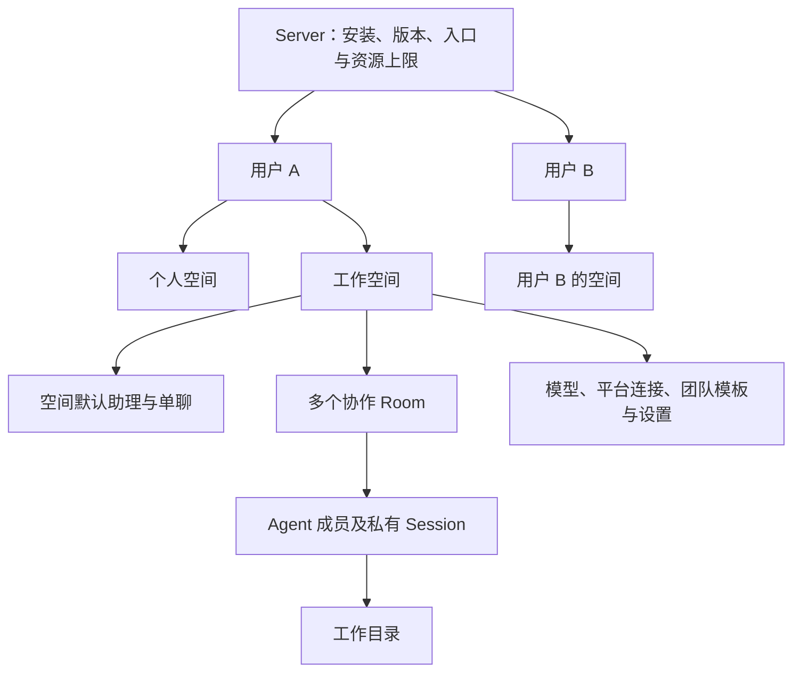

# TeamX 多空间（Space）与多用户：分析及设计方案

初稿日期：2026-11-21；设计及实施更新：2026-11-24。状态：**S1a、S1b、S2a、S2b 已实施，S1、个人最小部署组合及个人多空间 S2 完成；S3a 历史隔离探针完成，证据保留，其每空间业务 worker 路线结论已被替代；S3b 资源准入与 S3b.1 已完成，真实 SRT＋DSH 接入及恢复出口通过；S3b.2a 代码及组件／真实 Linux CLI 底层检查已实施，真实飞书用户授权／刷新／DPoP 验收待完成，其完整出口尚未关闭；S3b.3 共享服务双空间与真实模型增量检查已通过，正式出口仍等待 S3b.2a 前置验收；S3a.1 独立 SRT 能力实测完成并记录目录与监督条件，DSH 组合兼容已在 S3b.1 实际接入中闭合，S4a 的认证／用户生命周期、空间授权及撤权结清代码与本地闭环已实施，真实 SSO 与完整 Linux 组合验收待完成；S4b 服务应用来源与受控 OAuth、管理员配置／轮换／停用及空间私有 grant 已实施，真实 GitLab 与所选 Linux 产物验收留 S5，见[实施记录](implementation/gitlab-service-applications.zh.md)；S3 与 S4–S5、Gordis P3 尚未完成**。实际范围、验证及停止点见 [S1a 记录](implementation/space-identity-s1a.zh.md)、[S1b 记录](implementation/space-runtime-s1b.zh.md)、[S2a 记录](implementation/spaces-create-switch-s2a.zh.md)、[S2b 记录](implementation/spaces-archive-restore-s2b.zh.md)及 [S3a 记录](implementation/space-execution-isolation.zh.md)。初稿源码分析基线：当时检出目录，HEAD `fc9ae9d0a8ad09599cc9fd851c448fec2e84e431`，包含已有未提交改动，不视为固定提交的完整审计。设计复核明确 manager 的职责、关闭及重开边界，将 P3 改为紧邻 S2 的独立验收单元，不阻挡多空间交付；后续实施仍须复核源码入口。

初稿同日补充复核：依据当时打包 DSH `0.2.2-rc.1` 的实际沙箱实现，明确其“限制写入、未限制为仅本工作目录可读”的边界；核实 TeamX 的 glab 调用已使用临时私有配置及显式 token。执行隔离是验收要求。当前主线固定为共享核心进程、每空间业务实例和独立 Agent 执行边界；优先验证 SRT 外层约束整个 DSH，Docker／K8s 执行后端按需后置，不将每空间业务 worker 作为必选架构。

平台凭据补充结论：固定版本 lark-cli `1.0.99` 在 Linux 上可以分别指定配置与加密凭据目录，具备按用户／空间分开保存的基础；TeamX 尚需接通并验证完整生命周期。macOS 的凭据后端不随配置目录自动隔离。具体设计见第 6.1–6.5 节，不能概括成“glab 能隔离、lark-cli 做不到”。

## 1. 结论与建议

**采用统一的用户—空间模型：个人多空间是只有一个用户的特例。所有部署共用 User、Space、空间授权和业务运行时；个人部署自动维护唯一用户，保持安装即用，不增加注册或账号管理步骤。先交付单用户多空间，再分阶段开放多账号管理与托管隔离能力；多用户部署首期只支持并验收 Linux。**

Space（空间）是 TeamX 的顶层业务容器：个人生活、工作等场景分别拥有自己的会话、Agent 上下文、默认助理、连接、通知、日历和设置。这样既解决当前实际需求，也为未来一个 Server 服务多个用户建立自然边界。现有 Room 是一次对话或协作的边界，承担不了多场景的完整隔离；只给会话加分组或标签也不足以覆盖凭据、后台任务和默认配置。

统一模型下，各交付范围的复杂度不同：

| 目标 | 可行性与复杂度 | 主要工作 |
| --- | --- | --- |
| 同一用户拥有多个私有 Space | 高可行，中等复杂度 | 最小用户登记、统一空间授权、多份业务运行时、配置与凭据归属、显式路由、UI 切换和旧数据接入 |
| 多个用户共用一个 Server，各有私有 Space | 可行，高复杂度 | 复用已有模型和授权链，补齐多账号登录与管理、执行与文件访问隔离、资源限额、运维与恢复 |
| 多个人进入同一个 Space 协作 | 可以继续演进，当前不建议一起做 | 多人可见性、私有助理、共享与个人连接、权限及逐人已读等新产品语义 |

**运行方向：共享核心进程＋独立 Agent 执行。** SpaceRuntime／roomManager 是空间业务及持久状态的 owner，可以长期共享一个可信 Go 进程；DSH、Shell 及可执行不可信内容的工具链进入独立执行边界。首先验证 [Anthropic Sandbox Runtime（SRT）](https://github.com/anthropics/sandbox-runtime) 包住整个 DSH，复用现成文件／网络约束；这只是首选候选，尚无本项目真实接通证据。TeamX 不自建容器调度器，也不把 SRT 的监督进程称为每空间业务 worker。Docker／K8s 后续承载执行环境，仍复用核心业务合同。调整与逐项推进见第 9.2、11.2、11.5 节。

**推荐近期范围：单人多私有空间。** S1 就登记正式 User，并通过 `owner_user_id` 关联空间；用户数量不改变数据模型、授权链或运行时合同。第一版按一个 Space 一个 owner 设计，无需提前实现组织、邀请、RBAC、计费或共享频道。用户提出的第二个场景也只需要“多个用户分别拥有空间”，并不要求同一空间多人协作。

实施采用**一套业务内核、按模块组合的部署能力**：个人／多用户仍是宿主策略边界，多用户可选第三方认证或内置账号组合，不增加业务层的模式分支。S3 后优先接入独立可替换的 OpenCSG 认证模块，具体协议参考 CSGClaw；原 S4 的内置凭据与完整用户管理保留为可选单元，后续可组合交付。S1 完成最小显式装配，S2 先在既有生命周期下交付多空间；Gordis P3 作为紧邻 S2、可同期开发但独立验收的单元，不作为空间或认证模块的技术前置。两份专项方案保留各自合同，**第 11.2 节是联合实施顺序的唯一来源**；完整 P2r／P4b／P5 按需推进。认证边界、源码参考及交付条件见第 9.1 节；本次仅调整设计，未实现第三方认证。

首发以**部署时直接选定个人或多用户组合**为正常路径：主线完成 S3、S4a 与所选组合的 S5；需要托管 GitLab 接入时增加 S4b。个人 GitLab 继续自建／导入应用，多用户通过独立应用来源与受控交换模块使用服务应用。S4c 的永久删除、个人转多用户迁移分别作为后续可选单元，S4d 内置账号／完整管理亦按需组合；常规版本升级、备份恢复及必需撤权结清仍在主线。

首批多用户不以 Git 仓库操作为主要需求，S3b.2 拆为 **S3b.2a 首发工具与基础保护**、**S3b.2b 托管 Git 代执行**。后者独立后置，未完成前关闭多用户组合全部相关宿主执行入口；个人现有 Git 保留。S4b 的 GitLab 应用／纯 API 接入与 Git 仓库操作分别选择，已验证沙盒内的 Git 使用也不自动等同于托管 Git 能力。

Computer 保持个人部署可选使用，macOS 可通过 Docker 中的 Linux AIO Runtime 接入；本方案对多用户部署的首期 Linux 约束不限制个人版 Computer。[Computer 方案](SHARED-COMPUTER-INTEGRATION-PLAN.zh.md)已记录 C4 首版完成，C5 的代码、真实验收与发布缺口按其自身记录判断；不以空间或 Gordis 接入追加前置或重新实施。空间归属和托管权限在后续 S1–S5 接入，见第 6.7 节。

原空间范围的粗估为个人多空间 **11–19 人日**，其上增加多用户隔离与验收 **22–40 人日**。这是加入联合装配／P3 前的基线，不能直接作为新联合批次的总工期；最小部署组合、选定服务 P3 及 Computer 接入增量在第 12 节单列说明，开工时按实际差异收敛。多用户按 Linux 目标估算，不含非 Linux 多用户支持或完整 P5 裁剪。

## 2. 命名与产品边界

### 2.1 统一术语：Space、Workspace 与 WorkingDirectory

顶层业务及权限容器固定称为 **Space／空间**；成员的文件工作区域及其配置保留 **Workspace／工作目录**；单次执行实际使用的目录路径称为 **WorkingDirectory／当前工作目录**。UI、文档、代码和新增协议沿用同一组含义，顶层不再以 Workspace 为别名。

统一映射如下：

| 对象 | 产品用语 | 代码／协议用语 |
| --- | --- | --- |
| 顶层业务及权限容器 | 空间，例如“个人”“工作” | `Space`、`SpaceID`、`SpaceContext`、`SpaceRuntime`、`/v1/spaces` |
| 对话与协作单元 | 会话／Room | `Room`、`RoomIdentity` |
| Room 中的 Agent 身份 | Agent／成员 | `MemberIdentity`、`MembershipID` |
| 成员的文件工作区域、准备及关联配置 | 工作目录 | `Workspace`；跨模块或需要区分归属时使用 `MemberWorkspace`、`RoomWorkspaceConfig` 等限定名 |
| 一次执行的实际目录路径 | 当前工作目录 | `cwd`、`workingDirectory`；作为路径属性使用 |

Workspace 以文件目录为基础，也包括可选仓库／平台关联、准备及生命周期；WorkingDirectory 只表达执行路径，不替代完整 Workspace 概念。现有 `workspaceConfig` 包含 Room 默认值和成员目录映射，不能为命名一致全部搬入 Agent 命名空间。具体成员归属仍使用完整 MemberIdentity，不以同名 Agent 推断为同一工作目录，也不因使用 `MemberWorkspace` 就禁止现有串行协作中明确共享目录。

新增顶层字段、CLI 选项和类型统一使用 `space_id`、`--space`、`SpaceID`，不使用 `workspace_id`／`WorkspaceID` 表示 Space。UI 使用“切换空间”“空间设置”“选择工作目录”；文档标题和正文称“多空间／多 Space”。现有文档文件名保留，避免因术语变更破坏已有链接。

实施时只新增 Space 边界并按上下文限定工作目录名称，不批量改名已有 `workspaceConfig`、`/v1/workspace`、`server.workspace_roots`、`workspace.root` 或 `workspaces/<membership_id>/`。原工作目录 handler 可在 `/v1/spaces/{space_id}/workspace/...` 下复用；SpaceID 选择业务边界，内部 workspace 路径继续表达工作目录。命名不要求迁移已有目录、重建 Session 或修改历史身份；新增空间 owner 关系也不复用 Agent 的 MembershipID。

### 2.2 关系模型



Server 是部署与管理边界，User 是认证与账号主体，Space 是业务数据及配置边界，Room 是对话与协作边界。Server 管理用户目录和空间目录，通过 `Space.owner_user_id` 表达归属；一个用户可以拥有多个 Space，一个 Space 只有一个用户 owner，Room 只属于一个 Space。

个人部署使用完全相同的关系，只把用户数限制为一。增加第二个用户时新增 User 和 Space 记录，沿用同一空间布局和业务装配，不为此重建原用户、重写 Room 或重新分配原空间。多人共享一个 Space 是另一项产品能力，不由增加用户数量自动获得。

同一用户在多个空间中使用同一稳定 UserID，但默认助理、Agent Membership、Session、已读状态和业务数据分别存在各自空间。不能因为是同一用户，就复用模型私有上下文、平台授权或长期规则。

### 2.3 统一模型下的个人与多用户部署

产品上可以称为个人版／多用户版，工程上使用同一数据模型、认证后的请求主体、空间授权链、业务运行时及发布流程。部署模式只选择账号开放、管理入口、宿主资源与执行能力策略；业务层不因个人部署跳过 owner 检查，也不维护两套 Room、平台或存储实现。不提前引入许可证／商业版本体系。

| 维度 | 个人模式 `personal` | 多用户模式 `multi-user` |
| --- | --- | --- |
| 用户与空间 | 自动登记唯一正式 User，可以拥有多个私有空间 | 沿用相同 User／Space 模型，允许多个用户各自拥有一个或多个私有空间 |
| 首次使用与认证 | 自动创建默认空间，无注册、账号选择或新增强制登录步骤；沿用现有访问配置及模型／平台设置流程 | 优先第三方认证，由准入策略登记／绑定本地 User；也可组合内置凭据与用户管理。认证后沿用同一空间授权链 |
| OS 支持 | 延续当前支持范围，不因本方案额外限制 OS | 首期只支持并验收 Linux；不将 macOS 多用户隔离列为发布前置 |
| 业务能力 | 保留现有 Room、Agent、平台工具、通知、日历和工作目录使用方式 | 复用相同业务能力，按已验收的平台／执行支持矩阵开放 |
| Computer | 可选开启，未启用不要求 Docker；macOS 等已验收平台可连接 Linux AIO Runtime，owner 管理本人空间连接 | 可选按 Space 分配，首期 AIO 每空间独立 Runtime／容器、卷及凭据；管理员配置环境，普通用户只使用所属空间 |
| 工作目录 | 保留受管目录及现有允许根范围内的外部目录选择 | 默认系统分配；仅能浏览所属空间获授权的文件区域 |
| 平台接入与凭据 | 保留已有连接及自建／导入应用体验；新增空间仍需明确配置，已有 OS 差异如实展示 | 选择托管 GitLab 时由服务提供应用，用户只需登录授权；未选能力明确禁用，用户 token／连接按空间私有，禁止部署账号默认登录兜底 |
| 执行边界 | 可信个人部署，延续现有沙箱语义；不承诺 Agent 之间完整读取隔离 | 全工具链强制保护其他用户／空间、控制面和未授权宿主资源 |
| 部署控制 | owner 继续管理自己的部署 | 普通用户仅管理自己空间；监听、版本、执行程序、插件及挂载由管理员管理 |

“个人模式不区分 OS”表示不人为新增平台限制，不能抹平现有 CLI／Keychain 等实际差异；“多用户只支持 Linux”是首期正式支持边界，不代表任意 Linux 环境天然可靠。部署仍需满足并验证隔离后端、凭据、工具及恢复条件。

Computer 的 Runtime 运行平台、TeamX 服务端和浏览器客户端分别判断：AIO Runtime 要求 Linux，个人 TeamX 可在 macOS 等支持平台通过本机 Docker 或受保护远端连接；浏览器客户端不需 Docker。未来多用户服务端仍按首期 Linux 边界验收；不按实际用户数量决定 Computer 可用性，也不把个人部署排除在该能力之外。

限制优先落在宿主资源控制能力：多用户普通用户不能浏览全服务器目录、提交任意宿主绝对路径、指定可执行程序、注入任意进程环境或加载服务器插件。模型选择、连接授权、通知和业务设置继续开放在本人空间及服务策略范围内，不能为收紧部署权限顺带取消正常业务功能。

### 2.4 模式选择与统一执行规则

建议使用部署级启动配置，例如 `deployment.mode = "personal" | "multi-user"`，具体字段位置在 S1 实施时确定。新安装和既有安装默认个人模式，不改变原访问设置。模式不能由普通用户、Agent 或单次请求切换，也不在运行中通过改 Cookie／内存标志切换。

认证来源与用户管理是独立的部署选择：个人沿用现有访问边界；多用户优先选 OpenCSG 认证，内置凭据和完整用户管理可后续组合。由启动装配选择认证实现及用户准入策略，不为每种组合新增 `deployment.mode` 值，也不将提供商名称传入 Inbox／History／Agent／Room 的核心逻辑。具体配置名在对应单元确定，不开放普通用户修改认证服务器或切换认证提供商。

启动时解析模式、管理员策略与实际后端能力，形成有效能力视图；控制面、HTTP／CLI／MCP 和业务装配使用同一组规则。模式差异集中在初始化、认证入口和部署能力准入；业务请求统一使用已验证的 UserID、SpaceContext 和操作权限，不逐业务分散判断 `personal`。UI 依据服务端返回的有效能力展示目录选择、服务设置等入口；直接调用 API、使用旧客户端或手动构造请求同样受服务端限制。个人部署不能通过直接调用用户管理接口增加第二个用户。无需为两种模式维护两套页面或通用权限规则引擎。

模式只在启动装配边界选择实现与参数，不作为 Room、Session、平台工具和 Computer 业务函数的通用分支输入。所需实现未编译、绑定缺失或多用户隔离能力不足时，启动前明确失败，不注入“允许所有请求”的空实现或静默回退个人组合；可选能力缺失按有效能力视图明确禁用。编译选择、运行可用性和当前 User／Space 操作权限分别校验。

多用户模式在非 Linux、缺少合格执行隔离或关键身份边界时拒绝进入业务服务，不能静默降级为个人模式。单个平台尚未通过验收时明确禁用该能力；若它是部署要求的必需能力，则启动／发布验收失败。个人模式不受多用户模式尚未完成的后端阻挡。

个人与多用户通常在首次部署时选定组合。首发验证全新个人／多用户安装，以及各组合内的常规版本升级、备份与恢复；不承诺已有个人数据直接切换为多用户。启动时识别已有业务根的部署归属，跨模式复用未经过迁移的根应明确拒绝并保留原数据，不因修改模式配置自动重绑用户、搬目录或放开账号。

个人转多用户保留为后续独立迁移命令模块（S4c.2），按需装配、不作为常驻服务或首发前置。届时需停服与一致备份，保留原 UserID／SpaceID／业务归属，显式绑定合格登录身份，核验目录授权、凭据后端及执行／恢复路径；操作中断可继续，失败保留证据。统一模型为这项迁移保留条件，当前不预建迁移框架，也不把它与同模式版本升级混同。

### 2.5 个人部署保持安装即用

内部正式 User 身份由服务自动维护，不增加用户的账号操作：

1. 新安装首次启动时，以可恢复的初始化操作登记唯一 User 和默认 Space；用户无需注册、填写用户名／密码、创建个人资料或先选择空间。进入现有首次配置流程或默认空间，模型和平台连接仍按原流程配置。
2. 已有安装直接登记原持久 owner 为 UserID，自动进入接入后的默认空间；不增加账号迁移向导，不更改历史身份。系统初始化／升级流程负责持久化及异常恢复。
3. 个人界面隐藏用户管理及用户选择；只有一个空间时直接进入，多空间时提供空间切换。内部用户目录不要求对应一套用户管理页面。
4. 访问认证保持现有行为：允许本机免登录的既有配置继续可用，已有 token／会话要求继续生效，不为统一模型新增强制登录，也不因自动用户映射放宽远程访问限制。

安装即用指不新增账号门槛，不表示自动提供模型 Key 或平台授权。自动初始化只在明确的新安装状态执行；重启、升级重试不能新建另一用户或默认空间，登记损坏／缺失时保留证据并报告修复要求，不能靠生成新身份恢复表面可用。

## 3. 初稿源码基线与当前实施接点

下表保留初稿时的源码事实，用于解释 S1／S2 的改造动机，不能当作当前仍未实施的任务清单。当前状态与新增接点见表后复核及第 11 节。

| 初稿时事实 | 对新方案的影响 | 源码入口 |
| --- | --- | --- |
| 一个 Server 对应私有 home、配置、固定 owner 和一套管理 token | 必须把部署设置、用户身份和空间设置拆开 | [serve.go](../internal/room/serve.go)、[server_access.go](../internal/room/server_access.go) |
| `serveRoomManager` 启动一个 `roomManager`；manager 持有 Room 目录、runtime、平台注册表、通知、默认助理等 | **优先复用一个 manager 管一份空间业务**，比在每个底层查询里新增过滤更贴合现状 | [management.go](../internal/room/management.go)、[serve.go](../internal/room/serve.go) |
| manager 数据根包含 `rooms.json`、`rooms/<id>`、`platform-connections.json` 等 | 独立根目录可以保留现有 Room／Inbox 存储模型 | [platform.go](../internal/room/platform.go)、[storage.go](../internal/room/storage.go) |
| 模型凭据及模型操作位于配置 home 下；模型控制器面向当前 manager | 不能只隔离 data，必须同时隔离模型配置、Key、验证与切换操作 | [model_service.go](../internal/room/model_service.go)、[serve.go](../internal/room/serve.go) |
| 无可用模型时，启动路径进入实例级 `setup_required`，不启动业务服务 | 新空间缺模型只能阻塞该空间，不能让其他空间退出业务服务 | [serve.go](../internal/room/serve.go)、[server_setup.go](../internal/room/server_setup.go) |
| 浏览器会话只记录到期时间；认证层固定使用 `a.operator` | S1 即统一解析正式 User 并映射 Caller；个人认证入口映射唯一用户，多账号阶段扩展凭据与管理；客户端声明的 caller 不是认证依据 | [server_access.go](../internal/room/server_access.go) |
| SSE、浏览器缓存与草稿已校验实例／Room／operator，但没有 SpaceID | 所有页面资源及异步响应需增加空间作用域 | [application.mjs](../internal/web/assets/application.mjs)、[client.mjs](../internal/web/assets/client.mjs)、[ui_updates_http.go](../internal/room/ui_updates_http.go) |
| 外部目录未显式配置时默认允许服务账号 HOME；目录占用检查主要在 manager 内 | 改成空间允许范围；跨 manager 的外部目录冲突需要统一核验 | [workspace_directories.go](../internal/room/workspace_directories.go) |
| 启动 `[env]` 会用 `os.Setenv` 修改进程环境；正常 DSH 启动会继承过滤后的环境 | 空间配置必须显式传入子进程，不能通过修改全局环境切换空间 | [config.go](../internal/room/config.go)、[options.go](../internal/agent/dsh/options.go) |
| GitLab 工具已创建临时 `GLAB_CONFIG_DIR`，过滤替代 token 来源，再注入所选连接的 token | 无须从头解决 glab 全局登录串号；重点是连接／grant 的空间归属与调用准入 | [main.go](../tools/gitlab/main.go) |
| lark-cli 的 Linux 后端支持配置／凭据分别指定目录，但 TeamX 尚未向 Client 注入独立 dataDir，当前 Pin 只开放 Darwin；macOS 凭据后端不随 configDir 改变 | Linux 有明确适配路线，不能将当前 Pin 门槛误解为 CLI 不支持；macOS 单独评估凭据命名空间 | [client.go](../internal/platform/lark/client.go)、[pinned.go](../internal/platform/lark/pinned.go) |

当前复核：S1／S2 已由 [SpaceRuntime](../internal/room/space_runtime.go)、[spaceServer](../internal/room/space_server.go) 形成同进程空间业务装配、私有根、路由及归档恢复；[Agent 合同](../agent/backend.go)已经分开 Factory／Host／Component，输入准备和结果确认仍在核心。DSH 的 [本机启动](../internal/agent/dsh/process.go)、[运行身份](../internal/agent/dsh/identity.go)和状态文件仍依赖本机进程／路径；新增隔离适配应沿这些接点推进，不能假定替换 binary 就完成解耦。[服务端工具执行](../internal/platform/tool/process.go)及 [workspace Git](../internal/room/workspace_git_managed.go)另有宿主子进程，不能遗漏。S3b 已有 [共享额度](../internal/room/execution_resources.go)，仍不是 OS 硬资源限制。

可复用的部分包括 Room 状态机、持久 owner、通知交付与去重、Session 轮换、动作 unknown 处理、文件提交围栏。主要变化在执行装配和能力授权接点，不重做已通过的空间路由或为隔离重写核心业务。

当前检出目录还在进行模块和扩展边界调整。实施时应重新核对入口和类型位置，复用届时已有的装配合同；不要求先完成全部架构重构，也不应同时重写插件体系。背景见[现有模块边界分析](ARCHITECTURE-MODULE-BOUNDARIES-ANALYSIS.zh.md)。

## 4. “隔离”需要交付到哪一层

必须分别验收以下三层，避免把“列表看不到”当作隔离已经完成：

| 层次 | 单人多空间的交付 | 多用户上线前的补充 |
| --- | --- | --- |
| UI 与请求隔离 | 认证入口解析唯一 User，服务端验证 owner；空间独立的会话、搜索、设置、草稿、事件流；每次请求明确目标 | 多账号凭据与会话接入同一授权链，补齐账号停用、撤权和跨用户访问验收 |
| 数据与配置隔离 | 独立业务根、连接、模型 Key、上下文、规则及后台任务 | 共享可信核心按授权取得所属空间资源；Agent 不能直接读取私有根，备份、日志与管理接口受控 |
| 执行与资源隔离 | 仍按可信个人部署，明确其本机访问边界 | Agent／工具不能读写其他空间、控制面或宿主凭据；首发轻量共享保留基础准入与保护，精细硬配额后置，不承诺资源公平或独立可用性 |

单人版先实现前两层，可以满足场景组织和正常业务访问隔离。**它不承诺抵抗同一操作系统账号下 Agent 的越界执行。** 若“个人与工作隔离”包含防止模型误读另一个场景文件的硬要求，应把第 9 节执行隔离提前到单人版。

未来开放给相互不信任的用户时，第三层是上线前置，不能仅靠 cwd、提示词、路径前缀或 DSH 的 `workspace-write` 配置推断安全。现有 Sandbox 接入方案也明确：增加远程 MCP 工具不自动约束 DSH 的本地 Bash 与文件访问，见 [Sandbox 方案](AGENT-SANDBOX-INTEGRATION-PLAN.zh.md)。

### 4.1 当前 Agent 工作目录的实际保护范围

TeamX 已为成员提供独立 cwd、DSH 状态目录和 `DSH_PERMISSION_MODE=workspace-write`，并非完全没有沙箱。但当前固定发布版本的语义是：

- DSH 的文件 sandbox 在写入／编辑／移动／删除时检查可写范围，读取操作直接沿用本地文件系统实现。
- macOS Shell profile 使用 allow-default，再禁止范围外的文件写入；Linux bwrap 只读挂载宿主根目录，Landlock 配置允许读取 `/`。它们均未把读取范围限定为成员 cwd。
- 可写集合还包含后端规定的临时目录及显式附加目录，不能将其简化为“只写本工作目录”；网络也不是这项文件写入策略的隔离目标。

源码依据：[固定版本 fs-sandbox](https://github.com/deepseek-ai/deepseek-harness/blob/dsh-v0.2.2-rc.1/packages/fs/fs-sandbox/src/index.ts)、[固定版本进程 sandbox](https://github.com/deepseek-ai/deepseek-harness/blob/dsh-v0.2.2-rc.1/packages/sandbox/sandbox-local/src/profiles.ts)。本地发布包实现与这些关键规则一致。

补充做了最小行为探测：调用本地打包 sandbox provider 的 Seatbelt profile 构造方法，在项目内新建两个不位于允许临时区的测试工作目录，只使用合成正文。结果是 A 读取 B 的测试文件成功、写 A 成功、写 B 返回 `EPERM`，B 原内容保持。测试后清理了合成目录；没有读取真实凭据、调用模型或进行 ACP 端到端验收。因此“读到其他空间文件”是现有策略允许的行为，不需要先假设发生沙箱逃逸。

这也解释了为什么凭据仅分目录还不够：同一 OS UID 的两个进程通常都能读取该 UID 的 0600 文件；取到其他连接的 token 后，调用远端 API 不需要写那个连接的目录。必须同时保护凭据选择与实际可读权限。

## 5. 推荐架构：共享核心、每空间业务实例与独立 Agent 执行

### 5.1 为什么选这个方向

| 路线 | 优点 | 成本与适用性 |
| --- | --- | --- |
| 每个空间单独部署完整 TeamX，由用户切换地址 | 复用现有能力最多，可临时满足多场景 | 多份端口、登录、升级与配置；无法自然形成一个 Server 下统一用户体验 |
| 一套 manager／存储中给所有对象加 SpaceID | 最终可能有更高共享效率 | 当前对象横跨大量文件和 owner，容易漏过滤；需要广泛改变持久数据及查询路径 |
| **共享核心进程，每空间独立 manager／业务根，Agent 独立受限执行** | 复用现有运行时、授权与文件布局，避免增加空间业务进程及内部 RPC | 需要保持空间依赖归属，约束整个 Agent 执行链；核心进程故障会影响其承载的所有空间 |

推荐第三条，并将共享核心作为正式可交付形态。Space 是业务授权边界，manager 是核心内的业务实例，Agent 执行环境是 OS 强制约束边界，三者不要求一一对应为进程、容器或 Pod。可信核心可以按空间管理凭据和 Room 数据；不可信执行不得因此取得核心账号的宿主访问权限。未来若容量或故障域要求拆分核心，应另行设计分片、单写入者保护和持久存储，不作为 S3 前置，也不承诺切换执行后端就自动得到多节点高可用。

### 5.2 职责划分

- **控制面**：安装与 release、入口和认证、用户、空间目录及 owner、空间启动／停止、共享 GitLab OAuth 应用及 Secret、跨空间目录授权、多用户 Computer 运行环境分配及管理凭据、资源总上限、管理审计。
- **空间运行时**：一个空间内的 Room manager、默认助理、模板、模型管理、平台连接、可选 Computer controller 及其恢复协调、通知采集、日历任务、SSE hub 与业务存储。
- **Room／成员 owner**：继续维护现有持久状态和结清协议，不负责查询用户目录或判断其他空间。

这里的 **manager 指现有 Go 后端对象 `roomManager`**，不是 Agent 角色或人类管理员。它持有一份业务根及目录锁、Room 索引与运行实例、空间设置／默认助理、平台连接及后台服务，分发请求并协调恢复／关闭。具体消息、成员执行、回合调度和 Session 持久状态继续由原 Room 服务、Actor 及后端负责。源码见[管理对象](../internal/room/management.go)、[装配](../internal/room/serve.go)和[关闭协调](../internal/room/runtime_shutdown.go)。

SpaceRuntime 直接拥有一份 roomManager 和它实际需要的依赖，提供外层装配与生命周期接点；不新增第二个 manager 重复维护 Room 列表、默认助理、操作进度或调度。控制面只管理用户／空间目录和运行单元的准入、位置及启停，不再次执行 Room 业务管理。`notification.Manager` 等名称相似的对象各自保留通知 worker／排空等专项责任，不合并成全能管理器。

空间运行时继续在同一核心进程内装配。S1 的普通 Go 工厂与显式依赖、S2 的空间路由和关闭责任保持；P3 仍独立。Agent 执行适配优先复用已有 `agent.Factory`／`Host`／`Component` 与 DSH 后端接点：核心准备输入、签发限定凭据并确认结果，隔离实现约束进程、文件和网络。启动／运行身份检查／恢复／取消／关闭必须使用同一个有效执行选择，不能只给 Open 增加 wrapper，而检查仍把 wrapper 当作 DSH 本体。无需先创建通用执行平台、空间内部 RPC 或新的持久 owner。

控制面目录锁只覆盖登记与短状态提交，不持锁等待模型、CLI、Room 关闭或网络请求。每空间保留自己的提交围栏、目录锁、取消和结清流程；一个空间损坏或缺模型时，其他空间仍可使用。

认证层也需要拆分：用户认证及浏览器会话由统一入口持有，S1 即产出正式用户主体，空间运行时只接收已验证的请求主体、固定 owner 和本空间执行凭据能力。个人部署的既有认证入口或允许匿名访问的入口都由服务端映射唯一用户，再走同一 owner 检查；多账号部署只替换身份解析来源，不替换空间授权。不能把当前含固定 `a.operator` 的 `serverAccess` 原样共享后再临时改 operator。后台回执、日历、默认助理与已读存储使用显式注入的 owner；`humanOperator()` 中的操作系统 USER 仅可作为展示默认值，不能成为权威身份来源。

部署管理权限单独作为控制面能力核验；个人用户按部署策略拥有原管理能力，不把“只有一个用户”写成空间业务的特殊授权分支。未来普通用户也不因拥有某个空间而获得部署管理权限。

### 5.3 存储建议

新空间采用稳定的 SpaceID 路径，名称与用户名变化不触发搬迁：

```text
<server-root>/releases/...           # 共享、只读发布版本
<home>/
  config.toml                       # 仅部署级设置
  auth/                             # 服务管理与用户登录状态，禁止挂给 Agent
  oauth-applications/               # 多用户模式共享的应用登记与 Secret，控制面私有
  spaces.json                       # 空间目录、owner、生命周期及运行位置
  users.json                        # S1 即有的最小用户目录；个人部署自动登记唯一用户
  spaces/<space-id>/
    space.json                      # 空间配置版本、时区、业务默认值
    models/                         # 模型目录、Key、验证与应用操作
    teams/                          # 本空间自定义模板
    platform-cli/                   # 经验证的 CLI 配置／凭据后端
    computer/                       # 可选 Computer 配置、成员映射、应用与恢复记录；旧空间可原地登记
    cache/                          # 空间私有的材料、临时文件
    data/
      rooms.json
      platform-connections.json
      rooms/<room-id>/...            # 原有 Room／Inbox／Session／默认工作目录
```

这是目标布局，不要求第一阶段移动旧目录。`SpaceRecord` 只登记受控运行位置；HTTP 创建请求不能提供任意 `data_dir` 或服务器绝对路径。旧目录接入由部署端迁移流程登记，见第 10 节。

继续使用现有 JSON／JSONL 和独占 writer，首版无须引入 PostgreSQL、Redis 或对象存储。新建的空间目录也要有版本、原子发布和未知提交保护，不实现第二套弱化版文件写入。多节点或多个进程共同写一个业务根不在本次范围；需要水平扩展时另评估元数据数据库和存储访问模型。

### 5.4 最小身份模型

```text
User:  id, status, auth_version                 # 所有部署均正式登记；升级沿用原 owner ID
Space: id, owner_user_id, name, status, version
SpaceRuntime: space_id, runtime_epoch, state
BrowserSession: user_id, auth_version, expires_at  # 需要登录时使用；Cookie 不保存空间选择
ExternalIdentityBinding: provider_id, authority, subject -> user_id  # S4a，受验证外部身份的持久映射
```

S1 建立最小权威用户目录及统一查找／状态校验，个人部署也使用正式 User 记录；无需同步实现注册、密码、用户管理页面或多账号登录。新安装自动初始化唯一用户，已有安装保留原持久 owner ID，避免为了命名一致去改历史作者、回执和策略。UserID 不取自显示名、邮箱、OS 用户名或客户端 caller，也不因模式切换而改变。

登录凭据与 User 分开保存，token 继续只存摘要。浏览器登录会话绑定 UserID 与认证版本，服务端校验用户状态；旧会话按受控升级规则绑定原用户，不能从请求补填身份。个人允许免登录的访问不必为此强制创建浏览器会话，但仍须由认证边界产出唯一 User 主体。统一授权不会把免登录策略带入多账号部署。

SpaceID 随机生成、不可复用；删除后同名重建使用新 ID。`status` 区分 provisioning、active、suspended、deleting、deleted 及可恢复失败。显示名不承担寻址和授权。

空间 runtime epoch 在重启／重建运行时后变化，在浏览器切换时保持。它只负责外层运行实例的过期请求校验，不能替代原 Room service epoch、Session generation 或成员生命周期；空间目录的配置写入继续使用 expected version 防止并发覆盖。

无需给每条 Room 消息和每个输入记录重复增加 SpaceID：已有业务根的唯一归属加上受控运行时路由即可形成边界。跨越入口、Agent 执行边界、缓存、任务或外部回调的引用必须携带或绑定 SpaceID；已有 `RoomIdentity`、`MemberIdentity`、generation 与证明语义保留。不能把裸 RoomID 当作跨空间定位依据。

未来真要多人共享一个空间，再增加独立的 User–Space membership，并设计个人连接、私有助理及已读语义；不要把 `owner_user_id` 简单扩成数组就宣布支持协作。

### 5.5 部署组合与按空间实例化

启动装配负责选择类型和依赖，领域服务只接收所需的窄合同。下表是职责边界，不要求第一批一次创建全部公开接口；S1 只提取已有个人路径确实使用的合同，S3／S4 随真实第二实现补齐。

| 差异面 | 个人默认组合 | 多用户默认组合 | 共用部分 |
| --- | --- | --- | --- |
| 身份入口 | 原访问校验后映射自动登记的唯一 User；保留已有免登录配置 | 可替换认证模块：优先 OpenCSG，内置凭据可选，OIDC 等后续按需接入；禁止唯一用户兜底 | 同一本地 User、会话、状态／认证版本和 Space owner 授权 |
| 用户准入与管理 | 自动初始化，用户数上限为一，不显示账号管理页 | 最小准入／绑定／停用及资源管理必需；内置凭据、完整用户管理界面可选，亦可配第三方认证 | 同一用户目录、唯一生命周期 owner、持久操作及撤权结清 |
| GitLab 应用来源与交换 | 本人创建／导入私有应用，使用所属空间的配置与凭据能力 | 选择托管 GitLab 时启用服务应用目录及受控 OAuth 交换／刷新，普通用户不取得共享 Secret | 同一授权编排、用户／空间绑定、grant／连接持久 owner、刷新及撤权协议 |
| GitLab 应用管理入口 | 本人管理自己的应用；保留原 Client ID／Secret 配置及授权流程 | 管理员配置／轮换／停用服务应用；普通用户只选择并授权 | 同一应用描述、权限检查与影响范围反馈；普通用户管理自己连接的权限保持 |
| 工作目录访问 | 已有允许根及受保护目录策略 | 管理员分配的空间授权区域 | 路径校验、绑定、占用及结清规则 |
| Agent 执行环境 | 默认原生 DSH 与原沙箱，不新增 SRT 安装／初始化前置；以后可显式选已验收的隔离实现 | Linux 组合选择通过 S3 验收的 SRT 执行实现；必需隔离不可用则拒绝，不回退原生 | DSH 后端与执行环境分开装配，复用同一 Factory／Host、Session 身份、取消与恢复；不复制两套 DSH 后端 |
| Computer 环境取得 | 手动连接或已有本机 Docker 托管 | 管理员按 Space 分配独立环境 | Computer／Screen、原生 MCP、观看／接管和执行结清 |
| 限额与入口 | 个人默认额度及原管理能力 | Server／User／Space 额度及独立管理权限 | 同一限额校验与服务端有效能力视图 |

用户数上限、额度和允许根优先使用类型化策略参数；身份来源、执行环境及 Computer 环境取得存在真实替代行为时使用实现合同。策略对象不成为通用权限规则引擎，普通 User／Space 授权仍在共用业务入口执行。UI 依据服务端有效能力展示入口，不能自己根据部署模式重新推导权限。

模块先以普通 Go 工厂及窄合同接入实际入口，未来再由 Gordis 注册、选择与装配；不将整套个人／多用户业务各包装成一个插件。用户初始化差异由同一用户服务消费的准入策略表达，GitLab 应用来源与交换、认证及执行环境在确有替代实现时分模块。公共字段、额度或一次性命令不机械变成资源插件；未接入 Gordis 时不预建 Host，不在授权／刷新等业务函数中散布部署模式判断。

空间运行时由 `SpaceContext + 私有资源根 + 窄宿主操作 + 所选工厂` 装配；类型目录及不含凭据的静态描述可共享，连接、模型 Key、CLI 上下文、通知运行资源、Computer 客户端及 pending 操作默认按空间构造。禁止把可变全局实例注册成所有空间共用服务，禁止向领域层注入整个 manager、Gordis Host／Scope 或通用 service locator。

Gordis 集成仅存在于装配适配层，Space／Room／Session 模型及存储格式不依赖 Gordis。实施 P3 时才引入其运行依赖；适配接通选定服务的实际资源启停，只移除已经由新路径完整替代的重复调用。原业务关闭协调、唯一 writer、准入、取消、未知结果核实及持久结清继续由原 owner 负责，不把它们当作插件旁路删除。Plugin generation、Space runtime epoch、RoomInstance、MembershipID 和 Session generation 分别保留，不能互相替代。

第一版保持静态类型注册，不开放插件安装、热替换或动态执行任意代码。Space 按业务生命周期创建／关闭时可以实例化所选服务，不等同于开放插件管理；关闭 A 的资源范围不能停止 B。Host／实例布局在独立 P3 单元根据真实资源边界验证并记录，未实施 P3 时不创建预备 Host；不能把 Gordis Scope 当作用户授权或 OS 隔离。

### 5.6 唯一关闭权威与运行实例重建

现有 `roomManager.shutdown` 负责冻结 Room、关闭新准入、取消平台调用／通知及生命周期任务，在锁外并行等待各 Room、通知和在途操作，核验后才关闭日历并释放 Store。关闭超时或未知结果保留原记录及目录所有权。这是业务正确性协议，不应改写为通用的插件逆序停止，也不新增一套 SpaceRuntime 状态机镜像这些内部结清事实。

SpaceRuntime 的关闭入口调用原协调合同，控制面只有在该合同报告结清后才登记运行单元已停止并释放有关占用。原通知 `CancelRoomLocked`／`WaitRoom` 等准入与等待接点继续存在；P3 只能在该协议明确的位置接入实际资源停止及完成／失败反馈。若插件停止会先销毁 Room 仍需查询的服务、隐藏关闭超时，或释放未结清资源的句柄，应暂缓 P3，不能为接入框架重写核心关闭顺序。

归档后恢复、正常停服再启动和运行实例重建应创建新的 roomManager／通知 Manager 等对象，从持久状态恢复；不在已经 `Stop`／`close` 的对象上再次 `Start`。当前通知 Manager 的 `Stop` 会设置 stopping，后续 Start 明确拒绝，见[实现](../internal/platform/notification/manager.go)。新运行实例使用新 runtime epoch，UserID、SpaceID、Room／成员身份及 profile 保持；Session 按原路径／指纹合同恢复，不因重建运行对象就自动轮换或清空历史。

旧实例尚未结清时，保留它的引用、锁、操作及失败证据并允许按原合同重试关闭；不能先移除目录登记、释放实例／卷分配，或同时打开同一根的新实例。重试关闭仍作用于原对象；只有结清完成后的重新启用才构造新运行实例。相关失败只围住原 Space，其他空间继续使用。

## 6. 数据、配置与凭据的归属

| 资源 | 默认归属／行为 |
| --- | --- |
| Room、默认助理、单聊、Agent 配置及私有 Session | 空间私有；新空间创建新的默认助理，不复制历史上下文 |
| Inbox、History、长期规则、Followup、日历与定时任务 | 空间私有；游标、去重、授权及结果不跨空间继承 |
| 平台连接、OAuth grant、CLI profile、账号验证、通知订阅 | 空间私有；连接同一外部账号也需显式在目标空间配置 |
| Computer 连接、成员 screen／profile、shared、应用与执行恢复记录 | 空间私有；个人 owner 可配置，托管多用户由管理员分配运行环境及受保护凭据能力，普通用户不读写管理密钥 |
| GitLab OAuth 应用、Client Secret、回调地址及允许 scopes | 多用户模式按 GitLab 实例由服务统一管理，空间仅持应用引用；个人模式保留现有自建／导入流程 |
| 模型目录、默认模型、API Key、验证及应用操作 | 空间私有，默认用户自行配置 Key；不自动使用另一个空间的 Key |
| 时区、输入保留策略、调度默认值、成员显示名 | 空间私有；既有 Room 的冻结设置继续按现有规则变化 |
| 自定义团队模板、指令和 Skill 配置 | 空间私有；发布包内不含个人配置的模板／静态实现可只读共享 |
| 运行时 binary、内置平台实现、Web 静态资源 | Server 管理、只读共享；普通用户不能选择任意服务器可执行文件或安装插件 |
| 网络监听、public origin、代理、发布版本、资源硬上限 | Server 管理；空间设置不能覆盖 |
| 主题等纯外观偏好 | 可按用户共享；房间选择、草稿、搜索、日历位置必须按空间保存 |

不默认实现“全局用户连接池＋空间授权引用”。它会同时引入用户 token 共享、撤权传播、刷新锁和跨空间引用关系。若未来确需复用同一用户授权，应做显式的 CredentialGrant，说明授权主体、使用范围、撤销和配额；不能仅复制 token 或复用 profile 名。**服务共享 OAuth 应用不属于共享用户授权**：Client ID／Secret 标识 TeamX 应用，access／refresh token 才承载具体用户授权，第 6.6 节分别设计其归属。

这里需要区分**本地状态隔离**与**外部账号天然共享的事实**：同一个 GitLab／飞书账号连接两个空间后，远端数据本来可能相同，远端授权撤销也可能同时影响两边。本方案保证 TeamX 不隐式共享本地连接、历史和权限，不承诺外部平台给每次授权提供独立生命周期。

模型与 CLI 的环境按空间显式构造。禁止在请求或空间启动时切换进程级 HOME、USER、平台配置目录或 API Key。可保留受控部署环境，空间差异只进入对应 `exec.Cmd.Env`／运行配置；模型和工具只得到当前执行所需的凭据。

平台凭据需要逐适配器核验登录、刷新、注销、账号切换和真实发送；隔离能力不足的入口必须明确不可用，不能回退到部署账号默认凭据。GitLab OAuth、Scion 和普通 Git 的 helper／配置也需要同类核验。飞书的 Linux 与 macOS 实现不同，具体如下。

GitLab 的现有基础应直接复用：`tools/gitlab/main.go` 已隔离 glab 配置、过滤环境中的其他 token 来源，只将当前调用的 `GITLAB_HOST`／`GITLAB_TOKEN` 交给工具。新增工作是将连接、用户 grant／刷新和调用许可绑定到空间，并将多用户模式的应用登记与 Secret 提升到控制面；不能把整份注册表原样按空间复制。模型 Key、TeamX 登录会话、执行凭据和原始业务数据也有归属，身份授权并不等同于 CLI 凭据管理。

### 6.1 平台能力与 TeamX 当前接入状态

| 工具／平台 | 已核实的能力 | TeamX 需要补齐的部分 |
| --- | --- | --- |
| glab | 当前 TeamX 工具使用临时私有配置和所选连接 token，不依赖部署账号的全局 glab 登录 | 用户 grant、连接及调用许可归属具体空间，共享 OAuth 应用由控制面提供；继续校验所属用户与成员绑定 |
| lark-cli／Linux | `LARKSUITE_CLI_CONFIG_DIR` 指定配置目录；`LARKSUITE_CLI_DATA_DIR` 指定加密凭据所在数据根，各根保存自己的密钥与密文 | 所有 CLI 调用显式传入所属空间的两个目录，增加 Linux 账号固定适配，并完成真实登录、刷新、DPoP 和操作验收 |
| lark-cli／macOS | 配置可分目录；凭据使用 OS 账号相关存储及 Keychain，configDir 本身不建立独立凭据命名空间 | 保留现有账号固定能力；若要凭据完全分开，另评估 OS 身份或受支持后端，不能套用 Linux dataDir 方案宣称已完成 |

依据当前固定版本的 [Linux 凭据后端](https://github.com/larksuite/cli/blob/v1.0.99/internal/keychain/keychain_other.go)、[macOS 凭据后端](https://github.com/larksuite/cli/blob/v1.0.99/internal/keychain/keychain_darwin.go)及 [TeamX Client](../internal/platform/lark/client.go)。Linux 的密文和 `master.key` 位于指定数据根的 CLI service 子目录，不要求 D-Bus／Secret Service；这些文件仍需要实际读取权限保护。macOS 的数据路径按 OS HOME 计算，Keychain 访问也不能通过只修改 configDir 隔离。

当前 `Pinned` 在非 Darwin 平台返回 `account_pinning_unavailable`，表示 TeamX 尚未提供并验收该后端的账号固定实现，**不表示 lark-cli 本身无法区分多个用户的配置和凭据**。现有“固定账号”解决不因 profile 切换而误选账号；它与“其他空间进程无权读取这份凭据”分别验收。

### 6.2 Linux 推荐布局与进程注入

采用空间私有、连接私有的 CLI 上下文。由于空间只有一个 owner，这同时满足按用户归属，且不会让同一用户的个人／工作空间自动共享授权：

```text
<space-private-root>/platform-cli/lark/<connection-id>/
  config/                   # CLI 管理的配置
  data/<cli-service>/       # CLI 管理的加密凭据与 master.key
```

空间创建或授权 provisioning 时由服务预分配稳定连接标识及私有路径，后续授权操作始终复用原上下文。连接名、profile 名和外部账号 ID 不直接决定服务器路径；Agent 和浏览器不能提交任意目录。

每个 lark-cli 子进程使用显式构造的环境：

```text
LARKSUITE_CLI_CONFIG_DIR=<该连接的 config 绝对路径>
LARKSUITE_CLI_DATA_DIR=<该连接的 data 绝对路径>
```

两个值一起注入 `exec.Cmd.Env`，不修改 Server 的全局环境。登录／应用配置、权限检查、读取、发送、刷新、注销及后台通知都使用相同归属；不能只给登录流程传目录，而查询或续期仍访问默认 HOME。凭据、应用 secret、DPoP 状态及相关临时文件的实际落点均纳入核验，不能只观察 config.json。

账号固定需要临时只读配置时，可创建仅含指定账号的配置并在调用前核验身份，但必须继续使用该连接固定的私有 dataDir。不要每次复制凭据目录生成新的刷新状态；凭据读写仍交给官方 CLI，TeamX 不自行实现其加解密或把 token 导出给 Agent。

缺少、无效或不属于当前连接的目录应在 TeamX 准入时失败；已有凭据缺失／损坏则进入需修复／重新授权状态，不静默选用默认账号。上游 Linux 后端遇到无效 dataDir 可回退默认位置，因此服务必须验证路径和环境确实生效，而不能仅设置变量就认为边界成立。

### 6.3 身份绑定、刷新与注销

每次调用先从已授权空间解析连接，核验连接 generation、credential revision 和预期外部账号；不能依据 provider、同名 profile 或“当前账号”猜测。CLI 命令不支持的账号选择方式不能靠假设补足，必要时沿用只含一个账号的临时配置加实际身份核验。

同一凭据上下文的初始化、授权更新、刷新及注销遵守统一协调顺序，避免多个 CLI 同时初始化密钥或互相覆盖授权。长网络等待不占用跨空间锁；具体锁粒度要结合固定 CLI 已有机制验证。取消、超时或断线保留原操作 ID，先查询原结果再决定是否重试，不能顺手新建另一套连接目录。

本地断开只移除本连接的配置与使用权限；远端 revoke／logout 明确其影响范围。若同一外部账号在两个空间重复授权，远端仍可能共享或替换 grant，本地分目录不能保证远端授权互不影响。不得递归清理整个用户的 CLI 数据根、删除其他连接的密钥或修改部署者默认登录。

旧默认空间现有 CLI 凭据先原地登记、保持可用；新空间默认新建私有上下文，不自动复制旧密钥或注销旧账号。将旧连接迁入私有目录需要单独核验官方存储、账号、刷新和 DPoP 连贯性，必要时显式重新授权。备份同时覆盖所属配置、完整凭据后端及必要密钥；只恢复配置或重新生成主密钥不能恢复已有密文。

### 6.4 与访问授权及执行隔离的分工

三层分别回答三个问题：HTTP／MCP 身份授权决定“谁能请求这个空间的连接”，连接解析和 CLI 上下文决定“使用哪份外部授权”，OS／沙箱权限决定“执行进程能否自行读取别人的凭据”。模型 Key、登录会话、执行令牌和业务正文也在这些边界内，不只涉及 glab 与 lark-cli。

私有目录使用受控权限，并位于 Agent 工作树之外；但同 UID 下的 `0700`／`0600` 不会区分逻辑用户，密文与主密钥同样可读时也不能形成用户隔离。S2 验证正常受控调用不会串配置／账号，S3 再验证整个 Agent 执行链不能绕过这些调用入口读取其他私有根。Linux CLI 的双目录能力让凭据分开保存有明确路线，不替代 S3，也不要求由此直接选定容器架构。

### 6.5 适配与验收清单

| 交付项 | 关键验收 |
| --- | --- |
| Client 归属注入 | 所有命令族和后台调用使用正确的 configDir／dataDir；不同空间并发时无进程全局环境切换；无效／缺失路径拒绝且不回退 |
| Linux 账号固定 | 匹配应用、租户和用户；切换 profile、登录其他账号或删除凭据后拒绝误选；不能仅删除当前 GOOS 判断就宣布支持 |
| 凭据完整生命周期 | 初始化、真实登录、跨进程读取、实际刷新、DPoP、正常重启与明确授权的操作均使用同一上下文；身份和预期目标分别核对 |
| 两用户／两空间交叉验证 | 不同账号，以及同一外部账号在不同本地上下文的场景均覆盖；更新／断开 A 不修改 B 的本地文件；远端共享撤销的影响明确报告 |
| 停用、删除与恢复 | 先结清相关 worker／工具和刷新操作，再清理本连接；完整备份恢复原凭据，缺密钥时明确失败；不接触默认 HOME 下无关 CLI 状态 |
| 执行读取边界 | 在 S3 用合成凭据验证 Agent 文件工具、Shell、子进程不能读取其他上下文；`0600` 或加密文件的存在不单独作为通过证据 |

源码与目录注入测试证明适配结构；真实 Linux 登录、刷新、DPoP 及平台操作证明运行能力。当前只核实了能力与适配缺口，没有在本轮进行真实飞书授权或发送。新增平台能力按此支持矩阵验收，不以 CLI 支持某环境变量推断 TeamX 已具备完整多用户能力。

### 6.6 多用户 GitLab：共享应用，独立用户授权

**多用户模式默认由部署者为每个接入的 GitLab 实例配置一个服务 OAuth 应用，普通用户只需登录并授权，不必每人创建应用。** gitlab.com 与公司自建 GitLab 按各自 origin 分别登记；部署策略需要时可登记多个应用，但首版不要求用户理解这层配置。应用可由部署者或组织持有，不要求一定使用 GitLab 管理员创建的实例级应用；实际可用性服从目标实例策略。依据 [GitLab OAuth 应用说明](https://docs.gitlab.com/integration/oauth_provider/)与 [OAuth API](https://docs.gitlab.com/api/oauth2/)。

归属分成三层：

| 层次 | 保存内容及所有者 | 约束 |
| --- | --- | --- |
| 服务应用 | 控制面保存 application ID、GitLab origin、Client ID、Secret 引用、回调、允许 scopes、版本和状态 | 仅管理员配置、轮换和停用；Secret 留在可信核心，不向浏览器或 Agent 执行环境分发 |
| 用户授权 | 所属空间的凭据 owner 保存应用引用、TeamX UserID、实际 GitLab UserID、access／refresh token、实授 scopes、到期与修订 | 按当前登录用户和目标空间提交；不使用应用所有者的用户 token，不自动跨用户／空间复用 |
| 业务连接 | 空间内 Platform 记录引用确切用户凭据，成员工具、订阅和操作再引用该连接 | 保留原 generation、身份核验、调用许可与撤权结清规则 |

共享应用的最大 scopes 不代表每个用户已经授予全部权限；远端操作由实际授权账号及其实授 scopes 决定，不因应用创建者身份获得额外权限。GitLab 的应用所有者 ID、GitLab 授权用户 ID、TeamX 用户 ID 和 SpaceID 分别建模，不互相推断。

普通用户流程为：在当前空间选择管理员提供的“公司 GitLab”等入口 → 跳转该实例登录并确认授权 → 回到原空间并核验账号 → 建立本人连接。用户不填写 Client ID／Secret、不创建应用；未配置的实例显示需管理员接入，不能在多用户普通用户流程中自动创建／导入服务器应用。个人模式保留当前自建／导入应用流程，不要求改用统一应用。平台连接授权与 TeamX 账号登录保持分开，本阶段不顺带实现 GitLab 登录 TeamX。

S4b 通过**应用目录／查找、受控 OAuth 交换／刷新和应用管理能力**接入真实第二实现，个人私有应用与托管服务应用在启动装配时选择；具体接口按现有消费者提取，不另建通用授权框架。业务编排取得应用引用、公开元数据及版本后，固定原用户／空间与操作，再经受限能力完成交换；托管实现不通过返回 Secret 来模拟个人配置，网络完成后的 grant 提交仍由所属空间原 owner 决定。

S4b 交付 GitLab 账号授权与平台 API 能力，不自动启用核心代执行 Git 的仓库准备、clone／fetch／push 等功能；它们另依赖后续 S3b.2b。仅发布已验证的纯 API 能力时，不要求 Git 代执行先完成；若纯 API 的具体实现转调 Git 或执行可控程序，须按真实执行链纳入对应门槛。认证 grant 的存储和权限不因两项拆分而复制或扩大。

个人版的应用创建／导入、Client ID／Secret 配置、授权、刷新、轮换及断开保持原体验；私有应用不自动提升到服务应用目录，也不要求个人改用管理员应用。S4b 的共用接点变更须定向回归这些路径。未选择托管 GitLab 的多用户组合可以先交付基础能力，其 UI 与直接 API 均不开放未支持的 GitLab 接入，不借个人应用或部署账号兜底；这不影响个人组合原有 GitLab。选择交付托管 GitLab 时，S4b 及相应真实 S5 验收必须先通过。

应用配置与 Secret 只由控制面持有。授权码交换及需要 Secret 的刷新由受控 OAuth 服务完成，空间通过应用引用请求原目标 grant 的操作；不把 Secret 复制进空间配置或工具环境。空间凭据 owner 固定用户、grant、修订和操作 ID，网络完成后重验并提交原 grant；受控 OAuth 服务不能成为另一个直接写空间快照的 writer，也不能代替空间的最终授权判断。

授权开始时固定 UserID、SpaceID、应用 ID／版本、GitLab origin、原浏览器会话、state／PKCE 和操作 ID。回调只沿原记录处理，重验用户／空间及应用状态，取得真实账号后才绑定；用户切换空间或同时授权不改变目标。应用不可用时明确阻塞该连接流程，不改选其他应用／实例或借用管理员账号。

应用变更与用户断开分别处理：用户断开只停止原空间连接并按既有规则处理自己的 grant，不能删除共享应用；管理员停用／删除应用会影响引用它的用户，必须展示影响范围并结清有关授权、刷新和在途调用。Secret 轮换通过应用版本协调，保留已有 grant 的真实状态，不因换 Secret 就宣称全部用户 token 已撤销，也不自动批量重新授权。已有访问 token 的使用遵守服务端应用状态与原调用许可。

同一 GitLab 用户在同一应用下反复授权多个空间，远端 grant／撤销语义可能关联；本地不能据此宣称授权完全独立。首版仍显式连接各空间、分别限制本地访问，不自动复制 token；需要跨空间复用一次登录时，另设计用户授权及空间使用 grant。该问题不影响多个不同用户使用同一应用的基本接入方式。

当前 `OAuthApplication`、`OAuthCredential`、Platform 已区分，且存在共享应用下多账号独立刷新／重新授权的测试，见 [类型](../internal/platform/registry/types.go)、[提交](../internal/platform/registry/oauth_login.go)、[测试](../internal/platform/registry/platform_test.go)。目前仍在一份私有注册表保存应用和用户凭据；多用户实施需拆出服务应用目录与受控交换／刷新入口，适配查找及持久引用，不能仅把 UI 的“创建应用”按钮隐藏。个人旧应用及 grant 保持原路径；进入多用户模式时由管理员显式登记、核验应用与引用，不在不同空间各保存一份可独立修改的共享 Secret。

选择 S4b 的必测行为包括：两名非应用所有者完成授权；任一用户刷新、断开或 scope 变化不改写另一用户 grant；并发回调／跨空间请求／错误 GitLab origin 被拒；普通用户和 Agent 无法读取应用 Secret 或修改共享应用；轮换／停用在授权或刷新中发生时按原操作核实；个人自建／导入应用路径保留。对应 S5 用真实 GitLab 和选定 Linux 产物验证授权、刷新、重启及受控操作，组件测试不替代这些出口；未选择该能力的组合明确标记不支持，不承受这组验收门槛。本设计暂不推广为所有平台统一应用共享，飞书等平台按自身应用及凭据模型单独评估。

### 6.7 可选 Computer 的空间归属与平台边界

[Computer 方案](SHARED-COMPUTER-INTEGRATION-PLAN.zh.md)已记录 C4 单所有者首版完成，C5 后续范围及发布验收仍按其自身记录推进；个人 macOS 通过 Docker 使用 Linux AIO Runtime 的路线保留，不附加本方案或 Gordis 前置。空间实施时复用既有 Provider／Screen、MCP、能力冻结、观看／接管及执行结清，不再建设个人／多用户两套 Computer。

- **每空间归属**：每 Space 至多一个生效 Computer；controller、配置、凭据引用、客户端、应用操作和恢复范围分别装配。同一 User 的多个 Space 也不共用 profile、shared 或实例租约。新空间默认未启用，保持无容器使用普通功能。
- **身份与升级**：Computer 绑定显式关联 Space 和完整 MemberIdentity。现有 ComputerID 由 installation＋owner 派生，新空间不能沿用该规则；旧 Computer 原地登记到默认空间，保留原 ID、instance、screen、profile 及未知执行记录。Runtime 归属协议变更先结清、再受控迁移和核验恢复，不直接重算 ID 或复制 Cookie。
- **运行环境**：当前 AIO 是单 owner／单服务租约 Runtime，首期每启用空间独立 Runtime／容器、卷及管理凭据；不让多个 manager 直接共用。个人 owner 自行配置，多用户由管理员登记并独占分配；不要求自动创建容器或给予 TeamX Docker socket。共享目录仅本空间可用，容器及内部端口／网络的实际隔离在 S3 验证。
- **请求与管理**：个人“设置 → 电脑”随 Space 作用域自然接入；多用户普通用户只查看本人空间状态、操作成员开关、观看及接管，管理员管理地址／密钥／分配及硬配额。MCP、画面、WebSocket、接管和后续 artifact 均走统一 User／Space 授权，账号停用、归档或撤权关闭已有流及新准入，并结清原操作。
- **支持矩阵**：个人继续支持已验收的 macOS 等宿主接入 Linux AIO Runtime；多用户服务端首期仍 Linux。浏览器客户端不需 Docker，当前只有一个账号的多用户部署也可选用 Computer。Computer 容器不替代 DSH、Bash／文件工具的完整多用户执行隔离。

S1 登记既有默认空间归属；S2 接入双空间私有运行时和个人设置；S3 验证强执行边界及总配额；S4 接通管理员分配、账号权限与撤权结清；S5 对启用 Computer 的部署补充真实组合验收。原 C4 无需等待这些阶段；基础多用户部署不因可选 Computer 未配置而阻挡发布。

## 7. 请求、Agent 与异步任务的空间绑定

### 7.1 对人类请求采用显式空间路由

建议协议草图：

```text
GET    /v1/access/session                         # 已认证用户身份
GET    /v1/spaces                                 # 仅自己的空间及有限状态
POST   /v1/spaces                                 # 创建本人空间
PATCH  /v1/spaces/{space_id}                       # 改名等控制面操作
DELETE /v1/spaces/{space_id}                       # 后续可选 S4c.1；未实现永久删除前不开放

GET    /v1/spaces/{space_id}/rooms
POST   /v1/spaces/{space_id}/send
GET    /v1/spaces/{space_id}/models
GET    /v1/spaces/{space_id}/updates
GET    /v1/spaces/{space_id}/workspace/directories  # 现有“工作目录”接口
```

所有空间业务 API 都经过统一授权与绑定，再进入所属 manager。现有 handler 可由适配层裁掉空间前缀后复用，避免逐业务重写运输层。新增控制面接口有自己的请求校验，不能直接套用当前固定 Caller 的全部 POST envelope 规则。

所有部署共用授权链：**按部署访问策略认证 → 取得正式 UserID 并校验用户状态／认证版本 → 验证空间状态允许本次操作且 owner 匹配 → 取得受控 SpaceContext → 校验 Room／成员／执行代际 → 执行业务操作**。个人允许免登录的访问由认证边界映射唯一用户；启用登录时从受验证的会话解析，多账号模式不接受唯一用户兜底。请求路径的 SpaceID 是目标选择，不是授权依据；body 的 caller 只允许匹配服务端身份，必要时由边界适配生成。新空间的 setup、归档恢复等操作使用明确的状态准入，不能以尚未 active 为由取消 owner 校验。

Cookie 只绑定登录用户；“当前空间”存在页面 URL 和本页状态中，不能通过修改全局 Cookie／服务端 currentSpace 来决定请求目标。这样标签页 A 可以打开个人空间，标签页 B 同时打开工作空间，互不改变。

`/v1/access/session` 在两种部署中返回相同的用户身份合同；个人免登录入口也返回服务端确定的唯一用户。既有 `operator` 字段若需短期兼容，固定对应相同 UserID，不成为独立身份来源。后台任务和 Agent 继续从持久归属或执行凭据取得用户／空间，不借用浏览器当前身份。

新增入口缺少空间作用域时明确报错，不按“最近使用的空间”回退。旧客户端短期兼容仅可固定路由到迁移得到的默认空间，列明退休范围；新 UI、Agent 和 CLI 必须走显式绑定，不能永久维护两套含糊协议。

不可见空间与其对象统一返回不泄露存在性的错误；鉴权失败不先读取对象内容。随机 ID 只辅助寻址，不能代替 owner 检查。[OWASP 多租户安全指南](https://cheatsheetseries.owasp.org/cheatsheets/Multi_Tenant_Security_Cheat_Sheet.html)也要求租户上下文来自可信身份，并贯穿资源访问与后台处理。

### 7.2 保持 Agent 输入简单

创建执行凭据时额外绑定 `SpaceID + space runtime epoch`，继续绑定原 Room、成员、Session generation、turn／call。MCP、CLI 执行令牌与浏览器／管理身份仍分开。

Agent **不需要在每个工具参数里填写 space_id**，也不获得列举其他空间的工具。空间从执行令牌和注入的 endpoint 得到；若 URL 与令牌空间不一致，立即拒绝。History、附件、source_ref、动作目标也在同一作用域内解析，不接受凭其他空间引用跨根读取。

`/mcp` 可继续作为固定执行入口，由令牌绑定定位空间；不要要求工具正文新增重复身份。普通 CLI 可用显式 `--space` 选择人类操作目标；Agent 的环境固定目标，不能借该参数覆盖令牌。

### 7.3 后台与回调不能依赖页面选择

- 通知 worker、定时任务、重试和恢复从持久所属空间获得上下文，页面切走后继续执行。
- 缓存、pending operation、去重和 worker 索引使用空间＋原业务身份；共享限流设施只共享必要的配额状态，不共享响应正文。
- OAuth 开始时固定 SpaceID、UserID、浏览器 session、provider origin、operation ID、state／PKCE；回调从原授权记录定位空间，不能从当前页面或可编辑 return URL 选择空间。回调到达时重验用户／空间状态。
- 统一 OAuth callback 在共享核心内依据受控 state 映射到所属空间的唯一提交 owner；不为回调新增空间 worker 或内部 RPC，也不向浏览器暴露内部凭据。保留原 canonical origin 和 Cookie 绑定。多 provider 的回调防混淆原则见 [RFC 9700](https://www.rfc-editor.org/rfc/rfc9700.html)。
- SSE 只发送该用户当前订阅空间的变化；创建、连接名、错误和操作完成状态也受作用域约束。退出／撤权／停用后撤销旧流和执行凭据。

## 8. UI 体验

在桌面侧栏顶部显示当前空间名和切换入口，手机主导航保留同一入口。菜单展示可访问空间、创建和改名；首版不需要 Slack 式常驻第二列图标栏。已有成员“工作目录”选择入口保持原语义。

建议页面 URL 为 `/spaces/{space_id}/...`，与 Space 术语一致，支持刷新、收藏和跨空间消息深链。只有一个空间时直接进入默认空间；多个空间时可记住该用户在该设备上最近访问的空间，深链优先。无权限深链显示不可访问，不改投到其他空间。

切换的完整行为：

1. 以原空间键保存草稿、消息位置和未确认操作引用，关闭原 SSE，取消未完成的显示读取。
2. 切换页面作用域，关闭成员详情、连接授权等抽屉，清除当前页面敏感内容及临时附件预览。
3. 获取新空间 bootstrap／目录，恢复它自己的会话与位置，启动对应 SSE。
4. 旧请求即使取消不及时，返回结果也必须匹配空间、视图版本和业务身份，才允许安装到页面。

空间切换不会取消已受理的服务端任务。消息发送超时、平台动作 unknown、模型切换和授权操作仍归原空间；用户回到原空间后查询原操作，不把写请求换成新空间重发。正在编辑的表单可保存本空间草稿或明确提示未保存；不得跨空间带入。

所有业务缓存至少按 `installation_id + user_id + space_id + 原资源身份` 分区；运行期快照另含 epoch。正文草稿不因普通服务重启丢失；悬而未决的写请求保留最初执行身份。检查范围包括附件草稿、授权返回引用、房间缓存、日历偏好、搜索结果、错误提示、Blob URL 和内存缓存，不能只改 localStorage key。

设置分成“空间设置”和“账号／服务设置”。模型、连接、时区等属于当前空间；服务监听、版本、文件挂载和用户管理只给部署管理者。个人部署不新增注册、用户选择、账号资料或用户管理页面，保留原部署管理入口；多用户普通用户仅看到自己的账号及空间设置。首次默认空间自动创建，按原模型设置流程进入使用；只有主动创建其他空间时才增加空间操作。多用户工作目录选择器只展示“空间文件”“项目目录”等授权区域，不能上溯浏览宿主根目录；原有绝对路径输入方式仅在个人模式保留。创建新空间先显示独立模型设置页，不导入其他空间的 Key、连接或消息；可以显式复制不含凭据的模型描述、公开模板，并预览复制范围。

多用户 GitLab 接入直接展示可用实例及“登录并授权”，不要求创建／导入应用或填写应用 Secret。共享应用的配置、scope 上限、状态及变更影响仅在管理员入口管理；空间展示本人连接的账号、实授权限和状态。实例未配置时解释需要管理员接入，不误报为用户登录失败。

首版只展示当前空间的未读、搜索和活动。跨空间统一搜索／通知汇总涉及新的披露与跳转语义，后续单独做；若只是列出本人空间名称，不构成业务数据混合。

## 9. 多用户：身份、执行和资源边界

### 9.1 在统一用户模型上开放多账号登录与管理

User 目录、会话用户绑定及空间 owner 校验在 S1 已具备。S3 隔离通过后，S4a 优先交付**独立可替换的 OpenCSG 账号认证模块＋共用最小用户生命周期**；原管理员创建账号、发独立登录凭据及完整用户管理界面保留为可选 S4d。二者使用同一本地 User、会话、Space 授权和撤权结清合同，不能各自建立用户库或替换业务 owner。本节设计合同继续适用；S4a 的代码与本地闭环状态见下方记录，不声明完整多用户验收或 Gordis 插件完成。

#### 9.1.1 认证、用户管理与部署组合

| 能力 | 负责范围 | 首次交付安排 |
| --- | --- | --- |
| 可替换认证模块 | 发起外部登录、验证回调及远端身份证明，返回受验证的外部身份；内置实现则核验本地凭据 | S4a 先接 OpenCSG；通用 OIDC 等实现后续按需替换 |
| 共用用户生命周期与会话 | 外部身份绑定本地 User、准入／停用、auth version、会话签发／撤销、默认 Space 的可恢复登记 | S4a 必需，最小管理可由受保护配置／CLI 提供 |
| 可选用户管理模块 | 创建／绑定用户、查看状态、停用／恢复及管理界面；内置凭据实现提供凭据发放／轮换 | S4d 按部署需求交付，管理界面也可组合第三方认证；不管理外部账号的密码 |
| 资源与业务授权 | Space owner、目录／Computer 分配、额度、新副作用准入及在途结清 | TeamX 共用能力，不交给认证提供商或管理界面自行实现 |

个人组合继续自动初始化唯一用户并沿用原访问方式，无外部登录依赖；第三方托管组合选 OpenCSG 认证与最小准入／管理能力，可选完整用户管理界面；内置账号托管组合选本地凭据与用户管理，复用 S4a 的共用用户生命周期而不要求启用 OpenCSG。各组合在启动层选择，不在领域函数中判断认证来源，也不默认同时开放所有登录方式。S4d 暂缓不阻挡第三方组合的 S4／S5；内置账号组合必须完成 S4d 和对应部署验收后才能声明支持。

#### 9.1.2 OpenCSG 实现参考及复用边界

2026-11-24 S4a 实施：按用户确认沿用 CSGClaw 自有 SSO，认证模块、登录路由、用户／会话持久登记、按 owner 的空间目录与本机 CLI 停用／撤权结清已接通，本地双用户及恢复检查通过。真实 SSO、远端状态检测与完整 Linux 组合验收仍待完成，S4a 正式出口和 S3 前置门槛保持。回调支持字面回环 IP 的本机 HTTP 验收，远程继续要求 HTTPS；详情见[SSO 与用户生命周期记录](implementation/opencsg-auth-preflight.zh.md)。

参考仓库为 `/Users/russellluo/Projects/work/opencsg/projects/csgclaw`，本次只读源码基准 HEAD `7227930b0ff534db0154c2d98e02010727b29da9`，所列认证文件无工作树差异；不是远端登录验收。主要参考：

- [登录服务](../../../work/opencsg/projects/csgclaw/internal/auth/login.go)：`Login`／`buildLoginURL` 使用 `/sso/login?redirect_url=...`；回调接收 `jwt_token`／`jwt`，读取 `current_user`／`uuid`，再通过 CSGHub `/api/v1/user/{user}/tokens?app=git` 请求及用户资料查询完成账号接入。当前这条链是 OpenCSG 自有 SSO 协议，不直接称作已实现的 OIDC。
- [HTTP 登录入口与回调](../../../work/opencsg/projects/csgclaw/internal/api/auth.go)、[登录站点目录](../../../work/opencsg/projects/csgclaw/internal/api/auth_login_sites.go)与[站点探测](../../../work/opencsg/projects/csgclaw/internal/api/auth_site_check.go)：参考登录跳转、回跳、错误反馈及站点校验的职责划分。TeamX 托管认证站点由部署者配置，站点目录只作选择参考，普通用户提交的 URL 不成为受信身份源。
- [认证存储](../../../work/opencsg/projects/csgclaw/internal/auth/store.go)：仅参考账号／凭据与展示状态的划分；不复用其进程级默认 Service／单份登录记录。TeamX 多用户按主体与登录尝试隔离状态，浏览器只获得本地会话。

CSGClaw 登录还会获取内置模型 API Key、刷新模型／连接及重置环境相关 runtime。这些不属于 TeamX 账号认证模块：登录不自动改模型、不向所有空间分发 CSGHub token 或 API Key、不重建 Room／Session。以后若要接入 OpenCSG 模型或业务凭据，使用独立、显式授权的能力。

复用前须补齐与托管环境相关的协议证明：源码 `JWTClaims` 仅解码 payload，`auth_state` 主要携带编码后的环境与回跳参数，两者不能单独视为已验证身份和防重放证明。S4a 要在固定受信端点完成签名／有效期／受众等适用校验，或通过提供商支持的服务端验证确认 token 与不可变用户标识的绑定；受保护的取 token 请求成功、公开 profile 或未验证的 `uuid` 字段不能替代该绑定证明。具体可信接口／公钥、标识稳定性及回调状态透传能力在开工时核实，无法建立完整证明则该认证实现不通过，不降级接受 payload。

#### 9.1.3 独立模块合同与未来 Gordis 插件

建议先以 `internal/authn` 的窄合同与 `internal/authn/opencsg` 的实现分包，具体位置／签名按实际调用确定；实现不反向依赖 `internal/room`。首个真实消费者只需登录发起、回调完成及受验证外部身份结果等合同，不预建通用认证框架。外部身份包含提供商标识、固定信任域、稳定 subject 及展示信息，不能直接返回可任意选取的本地 UserID、SpaceID 或管理员权限。

宿主负责登录尝试的随机一次性标识、浏览器绑定、有效期、原始受控回跳与原子消费；模块执行外部协议并返回验证结果，共用用户服务再完成准入、身份绑定和本地会话签发。失败或重放不产生会话，不创建替代 User；远端成功但本地提交中断时沿持久操作继续核实，不重复创建 User／默认 Space。登录事务、用户目录、空间目录与会话分别保留唯一 owner，认证模块不取得整个 manager／Store 或直接写业务数据。

OpenCSG 登录地址、CSGHub 信任域及回调地址由部署配置固定；登录尝试固定配置版本，回调不能覆盖端点或将凭据转发到任意 URL。若协议以 URL 携带 token，回调完成后立即清除敏感参数、使用 no-store／限制 Referer，并对应用与入口代理的回调日志脱敏；原始远端 token 不进入页面持久存储、草稿、Space 配置或 Agent 环境。仅按协议确需保存的凭据由认证专用私有存储持有，不作为平台 grant 隐式复用。

未来将 OpenCSG 实现经薄适配注册为 Gordis 认证插件：宿主继续持有用户／会话及撤权责任，插件只提供协议实现与实际资源的生命周期。先完成普通 Go 模块与替换合同，不等待通知服务 P3，不在 S4a 引入 Gordis 依赖、预建 Host 或实现安装／热替换。插件接入另行记录版本、真实消费者与失败清理；仅当外部插件确有需要时公开最小合同，替换认证实现不要求重写 Room／Inbox／History／Agent。

#### 9.1.4 稳定身份、停用与管理权限

`ExternalIdentityBinding` 持久保存受验证的 `(provider_id, authority, subject) → UserID`，受信域由部署定义，不从回调任意认领。OpenCSG 的 subject 优先核实服务端证明的不可变 UUID／账号标识，不能只信回调中的 `uuid`；未来 OIDC 实现使用已验证的 issuer＋subject。邮箱、显示名和 `current_user` 展示名不作为自动合并依据。个人转第三方托管时，由受控升级显式绑定原 User，保留既有 Space 和作者；认证提供商变更／重新绑定是单独管理操作，不靠同邮箱自动接管原空间。

S4a 首发实现全新多用户部署中的用户登记与本地身份稳定，不要求完成已有个人数据的身份迁移；上一段的个人转第三方托管约束由后续 S4c.2 承接。认证方式和用户初始化策略分别组合，提供商只返回受验证身份，共用用户服务按准入策略执行创建／绑定，不让 OpenCSG 模块直接创建空间或推断可接管的既有 owner。

首次登录按配置的允许名单或受控登记策略创建本地 User 与默认 Space，并沿同一可恢复操作保持幂等；第三方认证通过不自动获得服务使用权或管理员权限。本地用户停用、外部身份解绑、凭据变更等按对应范围递增认证版本并撤销会话／Agent 凭据，阻止新副作用，沿原协议结清在途工作。普通退出终止相应 TeamX 登录会话，不等于停用账号或归档其所有空间，不删除他人会话／连接。

OpenCSG 外部停用／撤销的检测与传播必须根据实际协议验证：明确事件、服务端复核或有效期策略的检测时限和失败行为，不假设本地 Cookie 会自动失效。缺少即时通知时保留 TeamX 本地管理撤权能力，并如实声明远端状态同步时限；无法验证的撤权能力不写成已支持。认证服务不可用时不发放新会话、不回退个人主体；已有会话按已验证的有效期与状态策略处理。

内置账号组合中，独立随机登录 token 只存摘要，轮换／停用撤销会话和流；保留此能力的产品价值，作为 S4d 而非第三方组合的前置。当前不新增自选密码、公开注册、邮件验证或密码找回；以后支持密码需独立完善凭据存储及恢复。所有组合保留 HTTPS、Origin／CSRF 校验和登录限速。

部署管理身份与普通用户身份分离。现有管理 token 在迁移后保持原 owner 的业务身份，不自动成为能访问所有新用户数据的万能网页登录凭据；部署管理可优先保留在本机 CLI，并使用独立受控管理能力。服务端管理员拥有机器与备份权限，通常仍能接触数据，本方案不提供对部署者的端到端加密隐私保证。

所有部署从 S1 起通过 `space.owner_user_id == principal.user_id` 授权，登录场景的主体来自本地会话。S4a 的最小用户生命周期必须提供停用与撤权，不随完整管理界面后置；已发出的外部写入不能假装已撤销，未知结果仍按原流程核实。OpenCSG 登录与第 6.6 节 GitLab 业务授权分别验证；登录凭据不自动成为任意 Space 的平台 grant。多人共用一个 token 不构成多用户。

### 9.2 执行隔离：共享核心与 SRT 优先路线

必须实现的是 Agent／工具不能绕过业务授权读写其他用户／空间、核心私有根或未授权宿主资源。核心的多份 SpaceRuntime、roomManager、平台注册表、通知和存储继续共享进程；独立业务目录不等于独立进程。少量用户可以简化运维，不能减少互不信任用户之间的边界验收。

| 对象 | 唯一责任 | 当前部署选择 |
| --- | --- | --- |
| 可信核心 | User／Space 授权、凭据、Room／通知持久状态、执行准入和业务结清 | 同一 Go 进程中的空间业务实例；保留 S1／S2 装配 |
| Agent 执行边界 | 约束整个 DSH、其文件工具、Shell 与后代进程，限定文件与网络 | 首选验证 SRT；一期不改 DSH 业务代码，不部署每空间业务 worker |
| 受控平台能力 | 核验成员／连接／grant，选择凭据及目标，记录操作和 unknown | 可信核心处理纯 API 能力；会执行不可信内容的子进程另纳入受限执行 |
| 执行宿主 | 提供实际 OS 隔离、进程回收及所选资源策略 | 近期 Linux 轻量共享；精细硬配额与 Docker／K8s 等执行后端后置，不自建调度器 |

**执行模块与部署选择。** DSH 后端负责 ACP、输入输出及原 Session 协议，执行环境负责受控启动、策略与环境、进程及代理资源。S3b.1 复用 `agent.Factory`／`Host`，按真实接点提取最小执行合同，装配为“个人 → 原生执行 → DSH”或“Linux 多用户 → SRT 执行 → DSH”；统一适配不意味着个人也启动 SRT。正常启动、运行检查、恢复、轮换及模型验证使用同一选择；原生实现不探测或初始化 SRT。执行句柄覆盖 ACP 通道、取消、后代／代理结清，不能只替换 `BinaryPath`。

模块先以普通 Go 工厂实现，SRT 验证通过后再提取正式合同，不预建完整执行框架；后续按独立单元完成 Gordis 薄适配。插件只贡献执行工厂及实际资源，DSH 本体身份与执行实现／策略身份分开保存，Session、Store 锁、输入消费及恢复／结果判断仍归原 owner。个人与托管在启动层选实现，核心业务不判断 SRT 或部署模式，未选择 SRT 不承担其运行前置；可选构建裁剪另属 P5。

**SRT 接入方式。** 候选为 `TeamX → 每 Session 独立的 SRT 启动／监督进程 → DSH → Shell／子进程`；外层覆盖 DSH 内置文件读取，不能只替换 Bash。SRT 策略由核心根据已授权的 Space、Member、工作目录及 Session generation 生成，普通用户和模型不能指定任意宿主路径、可执行程序、环境继承或弱化参数。各 Session 不共用可变 SRT manager／代理配置，避免串策略；Supervisor／代理不拥有 Room 状态或结果确认权。

SRT 使用现成 OS 机制和网络代理，可免去 Docker 镜像及容器编排，但不是零成本或自动安全。2026-11-24 源码评估依据为 [README](https://github.com/anthropics/sandbox-runtime)、[配置](https://github.com/anthropics/sandbox-runtime/blob/main/src/sandbox/sandbox-config.ts)、[Linux 实现](https://github.com/anthropics/sandbox-runtime/blob/main/src/sandbox/linux-sandbox-utils.ts)和 [CLI](https://github.com/anthropics/sandbox-runtime/blob/main/src/cli.ts)；上游为 Research Preview，`main` 内容不作为已发布承诺。S3a.1 必须锁定实际可取得的版本、源码／产物摘要、完整依赖及目标 Linux 前置，不能运行时安装 latest 或仅换版本号就认定已支持。

必须共同闭合以下边界：

- **文件与凭据**：SRT 默认读权限并非仅工作目录。明确保护整个核心私有根、其他空间、宿主 HOME／凭据及别名路径，仅开放必需工作文件、Agent 私有状态和只读发布依赖。自己的 Room 原始存储、平台 token／CLI 主密钥和管理 token 也不因同空间而直接交给 Agent。区分 DSH 自身可写状态与核心拥有的 reference／backend 恢复证据及 writer／锁，不能将整个 Room 或含核心检查点的状态父目录无条件设为可写。进程环境使用最小允许集合，只供给必需的单 Session 模型凭据与委托 token，不继承其他连接或部署凭据；既有 CLI 私有上下文继续归可信能力 owner，不把完整凭据目录挂给 DSH。
- **内外沙盒**：保留 DSH 现有 `workspace-write` 及审批语义作为默认。SRT 可能阻止 DSH 的嵌套 bwrap；先核验兼容后端。若必须显式由外层承担强制隔离、调整内层模式，应单列有效策略、保留审批并验证外层边界；这不是自动 fallback。禁止为了跑通就开启任意嵌套 user namespace、弱网络或全 Unix socket 访问；依赖缺失／警告涉及必需能力时启动拒绝。
- **网络及内部通道**：模型上游、TeamX MCP／CLI 回调、必要平台出口分别列目标与权限，验证 Node／Go／CLI 客户端的代理行为；仅放行指定域名不代替业务授权。限制宿主本机／内网／云元数据与其他执行环境，校验解析地址、重定向、IPv4／IPv6、上游代理及 Unix socket 旁路。内部请求继续绑定 User／Space、完整成员与运行代际，不能信任 loopback 或开放整个宿主网络；不引入空间业务 RPC。
- **服务端代执行**：DSH 请求 API 后由核心启动的 Git／CLI 不属于 DSH 后代，外层 SRT 不会自动覆盖。S3b.2a 盘点全部可达执行链并保证首发开放工具安全，未适配的托管 Git 在 UI、直接 API／CLI、自动仓库准备及工具转调等路径均禁用，不借个人原实现兜底；实际安全适配与完整启用验收留 S3b.2b。其他开放工具仍须经过受限执行或有证据的安全路径。沙盒内 Git 仅在已验证的目录／网络／最小凭据策略下使用，不自动获得核心 GitLab token 或托管能力；个人原流程保持。
- **生命周期与恢复**：核心继续唯一决定准入、取消、业务结清和结果核实；执行适配证明 DSH、后代及 SRT 代理／桥接进程已退出。ACP 返回或 wrapper 退出不能代替结清，故障与超时保留锁和原操作。保存原 DSH 身份并补充隔离实现版本、依赖及有效策略摘要，不能只指纹化 SRT launcher；临时 token、随机代理端口不进入持久身份。工作／状态／发布路径和业务端点保持稳定，策略变化按明确兼容规则处理，不静默重放或替换原 Session。
- **宿主权限与资源**：执行权限与资源可用性分别验收。SRT 的数据／凭据／网络隔离、受限宿主权限和进程结清仍必需；少数人轻量共享首发按第 9.3 节保留基础保护，暂不实现每用户／Space 的精细硬配额。不让共享核心以 root 运行或获得任意 systemd／容器控制能力；确需的辅助权限固定且受限，不能借资源策略选择扩大权限。

原 S3a 的真实 DSH、文件／Shell／CLI、UID、取消和容器替换证据保留，但实验没有实际多空间核心入口，不能证明每空间业务 worker 架构最优，也不能替代 SRT 验收。当前撤回的是“选定每空间业务 worker／容器”的架构结论；不删除原始收据、测试和失败记录，不回滚 S1／S2 或共享额度代码。详见第 11.5 节。

若 SRT 在锁定目标上不能满足边界或兼容原生命周期，记录具体失败；下一候选为有界增强 DSH 或现成宿主隔离，必要时 Docker 执行环境。一次只验证和接入一条正式路线，不同时建设数套后端。Docker／K8s 后续复用执行身份、授权、取消和恢复合同，但仍须验证路径、网络、存储和资源差异；不自动拆核心、引入节点调度或承诺多副本写入。可选 Computer 的独立 Runtime 按第 6.7 节保留，SRT 不约束其远端 MCP 执行。

### 9.3 配额与故障控制

首发面向少数获准用户轻量共享 Linux。数据、凭据和执行权限仍按 User／Space 严格隔离；资源策略默认轻量共享，不要求每用户／Space 都有独立 CPU、内存、进程或磁盘硬配额。资源策略在部署时显式选择，与个人／多用户、原生／SRT 实现分开装配，不新增业务模式分支；不能把隔离失败伪装成资源策略降级。

| 范围 | 轻量共享首发 | 后续严格资源策略 |
| --- | --- | --- |
| 数据、凭据及执行权限 | 必须通过 S3 完整边界验收 | 保留相同要求，不以硬配额替代授权或隔离 |
| 基础保护 | 复用空间／Session 准入、执行超时、取消结清及已有输出／上传／队列上限；仅补真实缺口 | 继续复用，不另建业务调度或结果 owner |
| 精细资源隔离 | 接受共享资源竞争，不承诺单用户耗尽资源时其他用户不受影响 | 有需求时独立落实并验证每用户／Space 的 CPU、内存、进程、磁盘／临时文件及服务总量约束 |

首版保留一个核心写入各自业务根的模型，不做多副本同时写。空间离线、磁盘满、模型不可用和通知积压分别展示；一个空间损坏不阻断其他空间 bootstrap，但共享核心崩溃仍可能影响全部空间，不承诺进程级故障隔离。业务空间只按原归档／关闭协议结清，不能按浏览器离线回收；执行环境回收还须满足其 Session 与外部任务结清合同。

已有 `executionResources` 是单核心进程共享的业务准入：`active_spaces` 计 active／archiving 业务记录，`sessions` 计已占有且尚未结清的 Session（含空闲和部分打开失败），不是活跃 prompt 数、worker 数或 cgroup 限制，保留现有字段。额度在取得 SRT／DSH 资源前申请，结清必须同时覆盖新增监督／代理资源；失败不能提前释放。个人默认 0 的语义保持，多用户启动必须解析出有限有效额度，不能照搬无限默认值。

S3b.2a 只补首发开放工具的安全与上述基础保护；盘点并验证未选 Git 等能力不存在可触发旁路，不为此提前实现托管 Git。平台限流沿实际账号／应用上下文协调，CLI 配置／凭据继续按第 6 节的空间／连接归属适配，不新增通用队列、公平调度或计费。部署者可用 systemd 等现成设施配置服务总量保护，按实际配置说明效果；这不等于各空间有独立资源保障，也不要求核心动态管理 cgroup 或文件系统配额。

轻量共享下，一个任务高负载、内存不足或磁盘耗尽可能影响全服务；有限 Session 额度、上传限制或磁盘轮询不宣称能防止任意 Shell 写满磁盘。异常按原持久健康围栏、取消及结清协议处理，资源紧张不能扩大授权、提前释放句柄／锁或伪造成功。未来交付严格资源策略时再独立验证 OS 支持、权限、临时文件／日志覆盖及耗尽行为；未实现则明确不支持，选择该策略时拒绝启动，不静默回退轻量共享。缺少每空间硬配额不阻挡显式选择轻量共享的组合，缺数据／执行隔离仍必须阻挡多用户。

日志与操作审计带 UserID、SpaceID、原业务身份和 operation ID，正文与 token 默认不进入部署级日志。用户只能查看本空间的业务诊断，公开 health 只提供有限服务状态；备份下载、全局存储路径和执行宿主诊断属于管理权限，不能沿用“个人 owner 即部署管理员”的隐含假设。

性能与容量按 S5 的所选组合实测，记录代表性的空空间、执行成员与后台采集资源增长；不为首发另建常驻监控系统，也不凭有限业务额度承诺单机用户数或资源公平。自带模型 Key 能减少费用耦合，但不提供宿主资源保障。

## 10. 旧数据接入、备份与生命周期

### 10.1 推荐旧数据原地接入默认空间

已有 Room／DSH 恢复依赖绝对 cwd、运行时路径及冻结配置。**第一轮不要把整个旧 data 或 Room 目录搬到 `spaces/<id>`。**

建议在停服、取得 home／data 独占锁并完成一致备份后，用一次有记录的升级：

1. 将现有固定 owner ID 正式登记为唯一 User，登记默认空间及 `owner_user_id`，固定 SpaceID 与原 data、teams、模型目录及 release 引用；已有认证凭据和可保留会话绑定原用户，不新增账号设置步骤。
2. 将原连接、模型、模板和设置明确归属默认空间；网络、认证等留在控制面。配置拆分使用 staging 与持久升级日志，逐项校验后发布空间目录，失败继续原操作。
3. 旧业务目录和 Room／成员／Session ID、消息序号、原作者、游标、去重、授权和未知动作结果全部保持。
4. 完成接入后由默认空间独占旧资源，Server 不再将其当作所有空间的全局配置。新建空间使用新的独立布局。
5. 重启核对原 Session 恢复、平台账号、通知继续交付、定时任务、默认助理、历史和工作文件，再开放其他空间创建。

用户登记、默认空间登记与配置归属变更使用同一可恢复升级操作；中断后继续原操作，不能每次重试生成新 UserID／SpaceID。后续开放多账号只新增用户及其空间，不重新解释原 owner 关系；部署权限和执行后端变更按第 2.4、9 节单独核验。

本节 S1 的旧数据接入是个人组合内部升级，继续保留；已有个人部署转换成托管多用户属于另一项后续 S4c.2，不作为首发 S4／S5 的迁移要求。多用户首发从新的受控业务根初始化，常规版本升级及备份恢复仍需验证稳定身份、原路径与业务恢复。

对旧绝对路径保留受控登记，不把“任意可填写 data_dir”变成用户功能。将来物理搬迁作为单独部署操作，需要备份、路径重写／稳定挂载和恢复验收；不能通过复制目录默认支持跨空间克隆。

首版不支持把现有 Room 移到另一空间。它同时牵涉成员、外部连接、grant、规则、任务、目录及恢复证据。若只为整理内容，先支持导出可读历史或显式创建新会话，不自动迁移执行权限。

### 10.2 空间创建、停用与删除

创建请求有持久 operation ID：先登记 provisioning，再准备配置、数据根和默认助理；重试返回原空间，不能因超时创建两份。未配置模型的空间允许进入设置，状态为 setup_required，其他空间照常工作。

永久删除作为后续可选 S4c.1，当前首发以归档／恢复提供生命周期管理，不暴露尚未实现的硬删除入口。以后实现删除时分两步：先停用并禁止新受理，撤销流／执行凭据，取消可取消任务并等待 Room、通知、工具和外部动作结清；结清成功后才标记可清理。超时或 unknown 保留 deleting 状态、证据和目录，不先删文件；备份保留期另行说明。暂缓永久删除不省略账号／空间停用、撤权和已有归档结清。

首发个人及基础多用户组合保留停用／归档，永久删除留给后续完整清理阶段。归档会停止后台采集和定时执行；切换空间不会。空间恢复不应重放历史通知或重复外部写入。

### 10.3 外部目录与备份

**个人模式**保留当前受管目录和 `server.workspace_roots` 使用方式，包括未配置时服务账号 HOME 的现有默认范围、显式空列表关闭外部绑定，以及 home／配置等受保护目录检查。新空间默认使用受管目录，owner 可从允许范围内显式选择外部目录；不强制改走多用户模式的管理员授权流程。所有空间的私有数据与凭据目录都应纳入目录选择保护，避免误绑定为工作树；这项选择保护不等于对 Agent 增加完整读取隔离。

**多用户模式**默认由系统为空间、Room、成员准备工作目录；用户可通过文件上传、克隆仓库等方式准备工作材料。选择器仅浏览所属空间的授权文件区域，不继承服务账号 HOME、部署级宽泛 roots 或个人模式的服务器绝对路径输入。确需外部项目时，由管理员把宿主目录／卷分配给指定空间，用户只在该区域内选择。

控制面保存受控的“授权标识 → SpaceID → 宿主根／卷及访问方式”映射。人类请求使用授权标识和区域内相对位置；服务端核验归属后解析到内部执行路径，用户不能编辑宿主映射。浏览、预览、绑定及错误反馈均服从同一范围；逻辑路径展示不能代替实际路径和权限校验。只读材料区域不能直接作为需要写入的 cwd。

目录授权与工作目录绑定区分处理：分配根表示该空间可使用这一资源，Room／成员绑定表示谁当前占用其中的工作树。先对跨空间的外部根进行独占分配，再复用空间内的绑定规则，不能让两个 manager 各自检查通过后落到同一宿主目录。

统一冲突规则如下：

- 跨用户、跨空间默认拒绝同一工作目录及祖先／子目录重叠；首版不开放跨空间共享可写目录。管理员批准的公共只读材料单独授权，不能据此共享可写 cwd。
- 核对规范化后的真实目录／后端卷与位置，处理 symlink、不同挂载入口等别名；使用容器时不能只比较各容器都叫 `/workspace` 的文本路径。路径校验后被并发替换的风险由执行层继续约束。
- 授权、已安装绑定、准备中与未结清变更都占用资源；通过控制面的短提交边界完成冲突重验及登记，不持跨空间锁等待 clone、模型或工具操作。
- 占用关系从持久权威登记恢复；关闭页面、暂时停用 runtime 或重启不自动释放。切换目录／删除时，旧执行与操作结清后才释放旧占用，防止两个执行单元同时使用。
- 同一空间内保留当前调度语义：同一串行 Room 的成员可显式使用完全相同目录；并行执行默认各用独立工作树，跨 Room 的重叠约束继续执行。不能以允许协作为理由放松跨空间边界。

当前实现已具备允许根校验及 manager 内按目录相等／包含关系的冲突检查，见 [workspace_directories.go](../internal/room/workspace_directories.go)。新增工作是模式化入口、空间授权与跨 manager 的资源分配；不重写已有 Room 内调度规则。多用户模式的目录 API、文件工具、Shell 和子进程必须配套限制，不能仅在 UI 中隐藏服务器目录。

个人模式下，已有默认空间的外部目录保留原语义，升级时登记并核验；转入多用户模式前须按空间重新确认授权与隔离，不能直接沿用宽泛允许根。外部目录不是 TeamX 可随空间删除的资产，归档、删除和恢复均不能误删原工作文件。

继续提供整实例停服一致备份，扩展清单覆盖用户／空间目录、所有私有根、配置和依赖 release；CLI 的 Keychain／外部凭据按实际后端说明覆盖方式。恢复核对账号、路径与身份，防止同一空间被两个核心实例同时写入。首版不承诺单空间导出导入、跨实例恢复或在线一致快照；这些需要自己的身份和依赖迁移协议。

## 11. 分阶段交付与验收

S1–S5 保留为空间业务阶段，Gordis P 编号保留为扩展机制阶段；**实际实施顺序以第 11.2 节联合批次表为准**。近期先交付 S1＋最小部署装配，再交付独立可用的 S2 多空间；P3 紧邻 S2 评估，适配保持薄且关闭权威清楚时可同期开发，但独立验收，不阻挡 S2 或 S3–S5。User 模型、统一身份解析及空间授权属于 S1，不能推迟到多用户阶段。S1a、S1b 已实施，验证范围见文首实施记录；每批交付可观察行为，不以字段或空接口代替功能。

S1–S5 是产品里程碑，不作为一次实现或一个 PR 的默认范围。S1／S2 按 **S1a → S1b → S2a → S2b** 逐单元验收，全部所属单元通过才声明对应阶段；已完成状态以文首记录为准。S4／S5 按所选部署组合的必需单元及能力出口判断完成，不要求所有可选支线先通过。各单元保持服务可运行，开工时结合实际代码细化，不预先固定全部接口或逐文件任务。S3a 历史探针保留；当前下一步为 S3a.1，正式隔离接入须 S2 与新路线验证通过。

| 阶段 | 完整行为与主要变更 | 必须通过的出口 | 暂不交付 |
| --- | --- | --- | --- |
| **S1：统一用户身份与默认空间闭环** | 最小部署组合及空间依赖注入；新安装自动登记唯一 User／默认 Space，旧安装沿用原 owner；会话绑定与统一授权、请求绑定、配置拆分及旧数据原地接入，包含已有可选 Computer 归属 | 个人默认组合实际承接原入口，无新增账号步骤；原身份、业务与恢复保留；工厂零启动，缺少必需绑定明确失败；错误主体／空间被拒；升级中断可继续 | 多空间 UI、多账号管理、Gordis 生命周期及强执行隔离 |
| **S2：单用户多个私有空间** | 空间创建／改名／切换／归档；每空间 roomManager、setup、页面及缓存作用域、平台凭据和目录冲突登记；可选 Computer 按空间装配；原关闭协调保持 | 两空间业务及资源独立；个人 macOS Computer 保留；A→B→A、双标签、重启及迟到响应正确；归档后以新实例恢复，关闭超时保留原锁且不影响其他空间；不能新增第二用户；不要求 P3 完成 | 多账号管理、强执行隔离、永久删除与跨空间移动；P3 独立验收，完整平台裁剪及 P5 后置 |
| **S3：执行隔离与首发工具闭环** | 复用 S3a.1 独立机制证据，经 S3b.1、S3b.2a、S3b.3 闭合实际 DSH 兼容、原生／SRT 执行、目录授权、首发工具及基础保护；可选 Computer 验其独立边界 | 所选开放能力不越权；未选托管 Git 在全部核心执行入口关闭；必需隔离缺失拒绝，原取消／恢复／unknown 保持；轻量共享不承诺资源公平 | S3b.2b 托管 Git、精细硬配额后置；多账号开放与多人共用空间不在本阶段 |
| **S4：多账号认证与私有空间开放** | S4a 为全新多用户部署接入 OpenCSG 可替换认证、最小用户生命周期／撤权、目录与可选 Computer 分配及限额；S4b 按托管 GitLab 能力选入 | 基础组合 S4a 通过；声明托管 GitLab 时另需 S4b；两用户各两空间交叉拒绝，准入／会话不串账号，撤权结清及资源权限通过；个人原流程保留 | S4c.1 永久删除、S4c.2 个人转多用户、S4d 内置账号／完整管理后置；Gordis 插件、通用 OIDC、邀请／复杂角色／公开注册／计费 |
| **S5：交付准备与所选组合部署验收** | S5.0 完善 Linux amd64 standard＋SRT 打包／安装并冻结候选；S5a 用该包验证新部署、systemd／HTTPS、同组合升级与备份恢复；S5b 验真实能力、并发及容量 | 候选包可复现且依赖／安装校验闭合；所选认证、DSH／平台在实际产物成立，身份／数据及恢复保持，跨模式旧根误用被拒；发布产物与能力矩阵 | 不以 S5.0 通过代替实机验收，不等待未选 Git、S4c／S4d 或 Gordis P5；非 Linux 多用户及高可用后置 |

S1 整体出口涵盖新安装自动初始化、旧安装无新增账号操作、统一身份／授权以及默认空间真实运行，分别按 S1a／S1b 的责任验收；不能只加 `users.json` 和 `owner_user_id`，继续让业务请求使用全局固定 operator。使用合成的非 owner 主体验证同一授权入口会拒绝访问，无需为此提前开放账号管理。S1 的提取不以完成所有 `internal/room` 拆包作为前置。

S1 新增 UI、类型、字段及路由按第 2.1 节统一命名：顶层只使用 Space／空间，成员文件区域保留 Workspace／工作目录，实际执行路径使用 `cwd`／`workingDirectory`。既有 Workspace 配置、接口及目录名不作为此次改名对象，也不以重命名它们作为空间交付前置。

S2 不引入个人专用 manager／数据布局／权限实现。S3 验证整个 Agent 与受控工具执行边界，原空间业务保持同进程；新增 wrapper、代理和宿主资源随真实执行实现一起验收。S4 在既有身份模型上组合认证实现、最小用户生命周期和资源管理，不重做 S1；完整内置账号管理后置不等于省略准入、停用及撤权结清。不得绕过 S3 的隔离验收开放给互不信任的用户。S5 按实际选定的认证与能力组合验收后交付多用户支持，不推导未验证组合也已支持。

S2 的平台验收按声明支持的能力逐项通过，glab 复用既有注入机制，lark-cli 按第 6.1–6.5 节接通所属平台的凭据上下文。Linux 双目录能力已核实，账号固定和真实生命周期仍须适配验收；macOS 不直接承诺同样的凭据独立性。尚未通过的能力在支持矩阵和 UI 中明确限制，不能让新空间静默借用默认空间的连接。

Computer C4 首版及 C5 本机 Docker 托管按其自身完成记录和剩余验收推进，不等待 S1–S5 或 Gordis P3；上表只安排之后的空间接入。个人版保留可选 Computer，未来多用户部署只有一个账号也可使用；未启用 Computer 的空间／部署不承担容器依赖或相关发布门槛。真实容器／模型验收保持显式执行，不加入普通构建与默认测试前置。

### 11.1 需要专门覆盖的反例

以下按所属阶段及所选能力执行；未选托管 GitLab、永久删除或迁移等支线时，只验证相应入口未开放及不能借用其他组合能力，不为满足清单提前实现支线。既有个人能力的受影响回归仍保留。

- 个人新安装、刷新、重启或初始化中断重试，不重复创建用户／默认空间，不出现注册、用户选择或新增强制登录页；模型／平台首次配置保持原流程。
- 旧安装升级中断后继续原登记，原 owner、历史作者、UserID、默认 SpaceID 和数据位置不漂移；用户目录损坏不自动换身份重建。
- 请求伪造 UserID／caller、缺少有效主体、主体停用或会话认证版本过期时，个人和多账号入口均按统一规则拒绝；个人直接 API 不能突破单用户限制，多账号入口不能降级为唯一用户映射。
- 两个浏览器同时发起 OpenCSG 登录，回调交换、重放、过期或修改站点／回跳参数时不串主体、不发替代会话；只解码的 JWT、无法证明归属的 UUID／同邮箱账号不能认领既有 User。登记／签发中断后重试不重复创建 User／默认 Space。
- OpenCSG 不可用、远端账号停用或本地 User 被撤权时，按已声明的会话／状态检测策略处理；撤权关闭已有流并结清在途动作，不能回退个人身份。登录不改模型、不把 token／API Key 送进任意空间或 Agent；未启用认证模块的个人部署照常可用。
- 个人／多用户全新部署按所选模块初始化，普通版本升级不换 User／Space 或数据归属；首发尝试用已有个人根直接启用多用户时，在变更原数据前明确拒绝。后续 S4c.2 才验迁移后的原 ID、外部身份绑定及目录／执行边界，不能将它写成当前已支持。
- Computer 个人 macOS 使用继续可用；未启用时无容器也能正常聊天。两个空间不能争夺同一 Runtime 服务租约，不能经 endpoint 别名重复分配真实实例／卷，也不能读取另一空间的 profile、shared、画面或操作状态；撤权关闭已有 WebSocket／输入并保留未结清记录。
- 在工作空间 URL 中带个人空间的 Room、附件、stream_ref、source_ref、cursor 或 operation ID；不能读取正文或操作原资源。
- 使用 A 的 Agent token 请求 B 的 MCP／CLI／平台工具，或用旧空间／Session 执行代际请求新 runtime；拒绝且不重放。
- A 的慢 HTTP、SSE 重连、授权回调或图片下载，在用户切换 B 后返回；数据只归原空间，不能覆盖页面。
- A 正在模型验证／迁移、磁盘异常、执行长任务或注销平台连接，B 仍可读目录和执行自己的任务。
- 同一平台账号出现在两个空间，刷新、撤销、profile 切换与凭据失效保持明确归属，不选中另一个账号兜底。
- 共享 GitLab 应用由两个非所有者账号授权，回调不能串用户／空间；普通用户断开不删除应用，刷新不覆盖他人 grant；管理员轮换／停用与在途操作按应用版本协调，Secret 不进入空间或 Agent。
- 两个用户尝试绑定重叠外部目录、设置任意执行路径／env、读取宿主 HOME 或访问其他 Agent 执行环境；在相应部署边界被阻止。
- 同一真实目录经 symlink／不同挂载入口重复分配、父子目录并发授权、变更未结清时重绑定或重启后抢占，均不能绕过跨空间登记；同空间串行成员显式共享仍按原规则可用。
- 个人模式现有允许根、绝对路径选择与平台接入继续可用；多用户模式的旧客户端、直接 API／CLI 请求不能恢复这些宿主权限；缺隔离后端不得降级运行。
- 创建、删除、升级、模型应用或平台写入中断后重启；原操作继续核实，不复制数据、不重复副作用、不提前删证据。

测试分为领域／HTTP 合同、双空间集成、真实浏览器和真实运行时／部署验收。普通 fixture 测试通过不替代真实 DSH、CLI 凭据、操作系统隔离或代理链路证明。实施期间运行相应包与必要回归；S1a 已执行的检查见实施记录，其余阶段的上述验收仍待实施。

**实施备注：优先运行相关测试。** 当前 Room 包完整测试及全仓回归耗时较长，验证默认选择改动相关的测试、受影响包及必要的 integration／race，可用 `-run` 精确选择用例；不将整个 Room 包或 `go test ./...` 作为每个子单元的默认检查。仅在共享合同改动影响广泛、相关测试不足以覆盖风险，或明确的阶段／发布出口确有要求时扩大范围，并在实施记录说明原因。针对性验证通过后，只有新增改动、失败或未解决的问题才触发补测，避免重复等待拉长整体实施时间；仍须满足本单元实际涉及的授权、隔离、结清与恢复出口，记录未覆盖范围，不把局部通过表述为全仓通过。

### 11.2 唯一联合实施顺序

本表统筹两份方案的先后、前置和停止点；Gordis 文档继续定义 P 单元的技术范围及验收，不另维护一张竞争顺序表。批次及其 a／b／c 单元只用于实施与验收记录，不进入长期类型、文件和测试名称。细分按完整行为及其状态责任划界，不拆成类型、接口、实现、补测试等无法独立判断正确性的步骤。

| 批次 | 前置 | 本批完整交付 | 必须通过的出口 | 明确暂缓 |
| --- | --- | --- | --- | --- |
| **第一批：S1a → S1b** | 开工时复核现有纯工厂、启动、访问认证及 Computer 状态，不重做 P0 | S1a 先让现有业务使用正式唯一 User、默认 Space 和统一授权；S1b 再闭合个人部署组合、SpaceRuntime、配置归属与所有入口装配；旧数据原地接入 | 各单元按第 11.3 节独立验收；全部通过才声明 S1。新／旧安装可启动、无新增账号门槛，身份及业务恢复稳定，工厂零启动且错误身份拒绝 | Gordis 运行依赖、多空间 UI、多账号入口、通用权限引擎、完整 P2r／P4b／P5 |
| **第二批：S2a → S2b** | 第一批 S1a／S1b 完成，原生命周期合同和空间依赖可用 | S2a 创建／改名／切换并独立使用空间，含最小 UI、配置／凭据／目录／Computer 和异步作用域；S2b 增加归档、结清后新实例恢复及相关中断处理 | 各单元按第 11.4 节验收；S2a 即须隔离资源和迟到响应、保留关闭安全性；S2b 通过才声明完整 S2，可独立交付 | P3 不作为出口；全部平台插件化、按需编译、所有服务迁 Gordis、多用户强隔离 |
| **独立 P3：紧邻 S2** | 空间生命周期边界已明确；若与 S2 同期开发，仍分别报告完成；满足第 11.6 节进入条件 | 选定通知运行服务经薄适配接入 Gordis；资源启停实际使用新路径，业务关闭仍由原协调权威负责 | 正常入口接通；原业务取消／等待保持；失败清理、超时重试、旧对象保留和双空间不串资源通过 | 适配若要求重写核心关闭或转移多个 owner，保留可用 S2 并暂缓 P3；不阻挡第三批 |
| **第三批：S3b.1 → S3b.2a → S3b.3** | S2 完成，复用已取得的 S3a.1 独立机制证据与适用条件；DSH 兼容在 S3b.1 实际接入中解决并验收；P3 不前置 | S3b.1 原生／SRT 执行与恢复；S3b.2a 首发工具、目录／CLI 作用域及基础保护，禁用未适配托管 Git；S3b.3 后续单独汇总证据并补少量首发组合缺口 | 三个主线单元通过才完成轻量共享 S3；开放执行链不越权、禁用能力无旁路，代理／后代结清及原恢复保持；个人原生 DSH 无 SRT 前置 | S3b.2b 托管 Git、精细硬配额、每空间业务 worker、Docker／K8s 后端、通用调度器、多账号开放、Gordis 执行插件及完整 P4b |
| **第四批：S4a 基础多用户，S4b 按能力选入** | 第三批 S3 隔离通过；已有身份与空间合同保持稳定 | S4a 全新多用户部署的 OpenCSG 独立认证、准入／会话／分配及撤权；需要托管 GitLab 时增加 S4b 应用来源／交换与管理员配置模块 | S4a 通过声明基础组合 S4；声明托管 GitLab 的组合另需 S4b。两用户各两空间交叉拒绝，停用关闭流及新准入并结清；个人 GitLab 自建／导入不受影响 | S4c.1／S4c.2／S4d、Gordis 插件、邀请／复杂 RBAC／组织／计费后置；未选 GitLab 能力不开放相应托管入口；未完成 S5 不声明正式支持 |
| **第五批：S5.0 → S5a → S5b** | S5.0 开发可在执行合同稳定后与 S4a 同期推进；最终候选冻结及 S5a 须所选 S3／S4 出口通过，Git 等能力仍按各自前置 | S5.0 扩展 Linux amd64 standard 包、SRT 固定依赖与安装校验；S5a 用同一候选实机 systemd／HTTPS 部署、升级与恢复；S5b 验真实使用和容量 | 三单元分别报告；候选包摘要固定，实机部署与所选能力出口通过才声明 S5。个人原生与原 Git 保留，未选能力入口关闭，支持矩阵区分 GitLab API／托管 Git／沙盒内 Git | 不等待 Gordis P5、未选 Git、S4c／S4d；不因打包开发提前改日常服务，不以归档 smoke 代替实机部署或发布验收 |
| **按需后续／独立支线** | 有托管 Git、严格资源保障、永久清理、迁移、内置账号／管理、平台裁剪或后端需求 | S3b.2b Git 代执行独立交付；精细硬配额、S4c.1／S4c.2／S4d 分别验证；执行／认证／Git 能力后续完成 Gordis 薄适配，P2r／P5／P4b 按需推进 | 每项只声明真实能力；新组合补所选真实验收，原轻量共享不回退；Git 不仅开按钮，严格策略不只设参数 | 不提前开展全部支线，不把它们设为首发基础多用户前置 |

第二批 S2 通过即可交付或停留在个人多空间产品，P3 状态独立记录；第三至五批按托管需求继续，不等待 P3。P3 若暴露 P2r 依赖，先列明具体操作、原 owner 和出口，再决定是否做有界准备；若需要改写业务关闭协议或转移多个持久 owner，暂缓该 P3 单元，不回退已通过的 S2、不删验收要求。完整 P4b 依具体后端任务独立开展，S3 不自动承接全部后端能力整理。

第四、五批优先验证全新 OpenCSG 多用户部署，基础路线为 **S3 → S4a → S5**，托管 GitLab 组合在发布前加入 S4b；S4b 是该能力的完整门槛，不是所有多用户部署的统一前置。S4c.1／S4c.2／S4d 各自按需求安排，普通升级和备份恢复仍是 S5 必做项。后续补新能力只补受影响的组合验收，不重新标记原组合待实施。模块的 Gordis 接入另行交付，不以“模块已可替换”声明插件化完成；批次编号只表达范围，不要求按编号把可选支线排在 S5 之前。

S5 细化为 **S5.0 打包／安装接入 → S5a 实际部署 → S5b 真实使用与容量验收**。S5.0 可提前开发，最终候选须包含已通过出口的首发代码及所选能力；S5a 消费其冻结产物，不能边验收边临时拼依赖。默认交付沿既有决定：Linux amd64 standard 为基础，多用户 SRT＋OpenCSG＋轻量共享与已验收首发工具，个人兼容沿原生 DSH；Git／Computer 等按已声明能力追加，不要求用户到 S5 再枚举全部模块组合。

完整主线为 **S3b.1 → S3b.2a → S3b.3 → S4a → S5.0 → S5a → S5b**，按所选能力验收；各单元当前状态以文首记录为准。不重复独立 SRT 探针，也不把单个执行接入或打包检查视为实际部署通过。S3b.2b 可后续启用，S4b 可单独提供已验证的纯 API；发布托管 Git 仓库操作再补其执行、授权与相应 S5，不把支线重新纳入基础主线。

### 11.3 第一批实施单：默认空间与最小组合

**整体行为**：用户按原方式安装或启动 TeamX，自动进入默认空间／现有 setup；原 owner 变为正式 User，旧数据及访问要求保持。S1a 先交付真实身份闭环，S1b 再交付运行时与装配闭环，两者分别验收。

开工先记录实际 HEAD、相关工作树差异和可复用检查，重点核对 `boot/run.go`、`internal/room/serve.go`、`server_access.go`、`management.go`、模型／通知／Computer 装配及关闭入口。原已通过阶段不重新标待实施，不操作日常数据来试验升级。

#### S1a：正式身份与默认空间

实施范围与验证见[默认空间与正式身份记录](implementation/space-identity-s1a.zh.md)。

1. 落实第 5.4 节的唯一 User、默认 Space 及可重试登记。旧 owner、数据根及 Computer 归属原地接入；已有 data、模型、teams 不搬迁，不重算 ComputerID、不改变 Session 指纹。
2. 现有 manager 可以继续承接唯一默认空间，但所有实际入口必须绑定已登记的默认空间，按第 7 节校验主体、空间及执行身份。保留原认证配置，服务端解析主体后映射 Caller，不从共享访问对象临时改 operator，不保留未授权时回退全局固定身份的业务旁路。
3. HTTP／SSE、普通管理、显式单 Room、Agent／CLI、后台及恢复入口在现有结构中取得明确的默认作用域。个人免登录按访问策略映射正式唯一 User，原启用认证的入口继续要求原凭据；UI 不增加注册、用户选择或新强制登录步骤。

**出口与停止点**：隔离目录验证新安装、旧安装、无模型 setup、原认证开启／关闭、默认助理及任务、重启与初始化中断重试；原身份与默认空间 ID 稳定，合成的错误 User／Space、伪造 caller 及不匹配执行令牌被拒。现有业务真实使用统一授权，不能仅新增数据字段。覆盖受影响 Session、平台及可选 Computer 的身份／恢复合同。通过只声明 S1a；可以保留当前 manager 结构，不要求此时完成全部配置和生命周期提取，也不开放第二空间或第二用户。

#### S1b：空间运行时与最小部署装配

已实施，实际装配、资源归属、关闭责任及验证见[实施记录](implementation/space-runtime-s1b.zh.md)。

1. 在启动层接入普通 Go 工厂及必需依赖，个人默认组合真实使用。纯选择／工厂校验不读凭据、不启动进程或后台任务；先验证组合，再执行可恢复初始化，缺少必需绑定明确失败。
2. 拆出默认 SpaceRuntime 的启动、请求处理、状态及关闭接点，直接拥有现有 roomManager，保持其业务关闭权威。完成控制面与空间配置归属，模型、平台和 Computer 等取得明确的私有根、owner 及必要能力。复用 S1a 已登记的身份和根，不重复迁移或另建业务目录／管理层。
3. 将 S1a 各入口、setup、后台任务及恢复接入同一装配路径，移除被替代的固定构造旁路；兼容入口仅映射已登记默认空间。无需先完成全部 `internal/room` 拆包，不引入 Gordis、通用容器或无消费者接口。

**出口与停止点**：个人默认组合承接原业务，工厂检查零资源启动及缺必需绑定失败；验证配置归属、初始化失败清理、原关闭超时保留资源／锁并可重试，以及 Session、平台和可选 Computer 的恢复。复用 S1a 有效证据，对因提取受影响的入口补针对性回归与实际后端／浏览器验收，保留个人 macOS 路线，不机械重跑全部历史样本。S1a／S1b 均通过才声明 S1 和最小组合完成，可独立交付；不声明 Gordis、多空间或多用户已可用，下一单元为 S2a。

### 11.4 第二批实施单：独立可用的双空间

复用 S1 装配接点，由每个 SpaceRuntime 直接拥有一份 roomManager、私有配置和后台资源，不增加重复业务管理层。共享静态描述，不共享可变连接、凭据上下文或 pending 操作。按 S2a、S2b 顺序交付，不需要先引入 Gordis，也不以 P3 状态判断产品完成。

#### S2a：创建、切换与独立使用

**完整行为**：用户通过最小完整 UI 创建／改名／切换空间，分别完成 setup 并使用已声明支持的聊天、模型、平台、任务和可选 Computer。请求、页面缓存、草稿、HTTP／SSE／WebSocket、异步响应、CLI 凭据、回调和后台任务从首次接入就绑定空间；切换页面不停止原空间后台业务。登记并拒绝跨空间目录冲突，不能以“稍后补隔离”先共用默认空间连接。尚未通过的平台能力在支持矩阵和 UI 中明确限制；个人已有默认空间能力保持。

**出口与停止点**：用实际 manager、通知服务及受控来源验证双空间独立运行、普通重启与 pending 恢复；A 未配置模型、启动失败或执行长任务时 B 仍可使用；创建失败及正常关闭沿用原清理／结清协议，超时保留原对象、句柄和锁，不能提前另开同根实例。验证错误空间与执行令牌被拒、跨空间目录冲突、A→B→A、双标签、迟到响应不覆盖另一空间。启用 Computer 时验证真实实例不重复分配及流的空间授权，保留个人 macOS 与未启用时的无容器路径。通过可交付创建／切换能力，只声明 S2a；暂不暴露归档／重开入口，不声明完整 S2。

#### S2b：归档、结清与新实例恢复

已实施，状态、唯一关闭责任、故障恢复及实际 DSH／Computer／浏览器验证见 [S2b 记录](implementation/spaces-archive-restore-s2b.zh.md)。

**完整行为**：在 S2a 上新增归档与恢复入口。归档停止该空间后台采集和定时执行，阻止新准入并撤销相关流／执行凭据，沿原 manager 协调业务结清；关闭超时保留原对象、操作证据及目录锁并允许重试，其他空间继续运行。

**出口与停止点**：验证归档中断、关闭超时／重试、pending 核实及重启恢复。只有旧实例结清后才能构造新的 roomManager／通知 Manager 和 runtime epoch，加载原持久状态，保留 Space／Room／成员／profile 身份及 Session 恢复合同；不得在 stopped 对象上 Start，不重放历史通知或重复外部写入。归档状态下的旧页面、回调和令牌不能重新启动业务，恢复后旧运行代际被拒。S2a／S2b 均通过才声明 S2 完成；P3 仍独立，不阻挡此交付或后续 S3。

两单元的普通回归使用本地／受控来源；真实平台、模型、Computer 和浏览器按新增或受影响组合单独验收。资源归属、异步隔离和已有关闭安全性随 S2a 功能一起完成，S2b 不承接这些基础缺口。复用有效历史证据，不重复扩大测试或把单次构建当作真实恢复证明。

### 11.5 第三至五批的装配与验收边界

以下为建议单元及完成边界，进入各阶段前结合实际代码、owner 和隔离结果细化，不提前建立全部抽象或承诺精确工期。阶段出口以联合表的所选组合为准：基础多用户 S4 以 S4a 闭环判断，托管 GitLab 另需 S4b，S4c／S4d 独立后置；任一单元通过都不自动证明其他能力或正式 S5 发布验收已完成。

#### 已有 S3a／S3b 的保留、调整与撤回

| 已有内容 | 处理 | 证据与后续责任 |
| --- | --- | --- |
| S1／S2 的空间身份、独立业务根、同进程 manager、路由及归档恢复 | 保留 | 本次不改身份、存储布局或原关闭 owner |
| S3a 合成数据、真实 DSH／CLI、UID 与容器探针及取消／恢复收据 | 保留为历史实验 | [记录](implementation/space-execution-isolation.zh.md)中注明适用边界；Docker 是该实验载体，不成为产品依赖 |
| S3a“选定每空间业务 worker／容器”的结论 | 撤回并标记已被替代 | 不删除原证据，也不把旧通过改称 SRT 通过；当前没有正式空间 worker 需要回滚 |
| S3a 实验内的 root／降权 launcher、外层 `danger-full-access` 和特殊挂载 | 仅留实验，不搬进生产 | 正式 SRT／内层 DSH 策略须重新验证；不继承实验特权或自动关闭沙盒 |
| S3b `executionResources`、创建／恢复准入与 Session 结清后释放 | 保留并在 S3b.2a 补齐 | [记录](implementation/space-resource-admission.zh.md)；活跃空间／占有 Session 不改称 worker／prompt 数；SRT 退出证明接回原关闭合同 |
| 每空间业务进程、业务 RPC、容器调度、独立 OS 账号分配作为统一前置 | 从当前主线移除 | 实际仍需的宿主权限仅由选定执行实现决定；不为复用实验强制增加基础设施 |

S3a.1 独立机制证据已取得并复用；正式 DSH 的执行兼容与监督接点已在 S3b.1 闭合，首发工具／目录及完整共享核心组合仍须 S3b.2a／S3b.3 验收。S3b.1 已取得接入／恢复证据，但 S3b.2a 与 S3b.3 尚未通过，已有资源准入不等于完整 S3b 完成。S3b.2a 是基础主线，S3b.2b 是后续可选 Git 能力，编号不表示必须先做后者才能进入 S3b.3。新代码／测试按行为命名。

#### S3a.1：SRT＋完整 DSH 的有界路线验证

**2026-11-24 按用户澄清拆分验收：独立机制实测完成，完整部署组合未通过。** SRT 独立文件、网络、子进程及故障监督探针共 153 项检查通过；预存硬链接暴露与外部监督责任单列为适用条件，见[独立能力记录](implementation/srt-independent-isolation.zh.md)。DSH loopback 不再阻挡独立机制验证，其[历史兼容结果](implementation/srt-dsh-isolation.zh.md)保留；后续 S3b.1 已取得修复后的真实接入证据，完整 Linux 部署组合仍属 S3b.3。以下完整 DSH 条目仍须在正式组合验收中通过，不能由独立探针替代，也不据此开放多用户。

**前置／范围**：S2 与历史 S3a 证据可用；在新建隔离目录和目标 Linux 环境中，先用锁定版本 SRT 包住 Python／Node／Go／Shell 及其进程树，独立验证强制隔离；整个真实 DSH 的组合验收留到后续 Linux 部署，不接管日常 home，不改个人生产启动。核实 Node、bwrap、seccomp／代理桥接等完整依赖及发行环境能力。Docker 可作为一次性 Linux 测试载体，但其特权、挂载或弱化嵌套设置不能替代计划支持的宿主条件。

**后续 DSH 部署组合仍须验收**（不阻断本轮独立机制实测）：

1. ACP stdio 启动、版本／agentInfo 与退出可观察，诊断不污染 ACP stdout。A、B 为同用户双空间，C 为另一用户的合成执行域，另设核心及本空间服务凭据区；通过真实 DSH 文件工具、Shell、子进程及链接验证自身可用、其他私有区拒绝。受控模型响应证明工具链，另对实际所选模型上游做无平台副作用的普通回合，分别记录证据。
2. 验证模型、TeamX HTTP MCP／CLI 回调及必要平台连接经过精确放行；同时拒绝未授权宿主端口、其他执行域、元数据、DNS／重定向／IPv6 和 Unix socket 旁路。使用测试专用、限定空间／成员的凭据，不能借测试免鉴权 listener 证明正式通道。
3. 核验 DSH 内层沙盒与 SRT 的组合，记录实际生效配置和必须的调整；不以开启弱化选项、给核心 root 权限或接受关键能力降级为通过条件。明确失败后端与错误分类，不把沙盒不可用当作正常任务拒绝。
4. 正常退出后以原工作／状态／发布路径及 SessionID 恢复；真实 Shell 就绪后取消并独立核验后代、桥接／代理退出及延迟副作用缺失；杀死 wrapper／DSH／代理、断开回调时原 Session 不被伪装为正常可恢复。并行 B 不受 A 失败影响；未结清时禁止新一代执行。

**出口／停止点**：提交脱敏版本、摘要、有效策略、读写／网络拒绝及生命周期证据，说明哪些是受控来源、真实模型和实际 Linux 宿主。独立机制结果为后续接入提供可行性及适用条件，不能代替目录准入、完整 DSH 或业务组合验收；正式首选及开放声明仍须相应完整出口；失败就记录具体缺口，评估 DSH 有界增强或另一现成执行机制，不同时实施多条生产后端，不降低 S3 的安全出口。

#### S3b.1：正式 Agent 执行接入与恢复闭环

**2026-11-24 实施状态：S3b.1 已完成。** 原生／受控替代执行回归，以及非 root Linux 的真实 SRT＋DSH 正式 Room MCP／CLI、取消、故障、重启恢复与轮换通过；真实执行双空间隔离与资源结清证据及其层次见[执行接入记录](implementation/agent-execution.zh.md)。模型端为受控合成服务，不冒充后续真实模型／完整组合验收。多用户保持关闭，本次未实施 S3b.2a。

**前置**：S2 与 S3a.1 独立机制证据可用，不要求重复独立探针；已知 DSH 兼容必须在本单元实际接入中解决并验证，不能凭机制通过声明接入完成。**完整行为**：复用 `agent.Factory`／`Host`，分开 DSH 后端协议与原生／SRT 执行合同；新建、恢复、轮换、模型验证与运行身份检查统一选择实现，纯元数据检查不启动资源。个人保持原生 DSH 与原沙箱，不检查／初始化 SRT；Linux 多用户选择经实际接入验证的 SRT，缺依赖或必需隔离时在开放业务前拒绝，不回落个人执行。共享核心继续拥有 SpaceRuntime／manager，不改 Room／输入存储或持久 owner，不复制 DSH 后端。

策略绑定完整成员、空间、Session generation 与批准目录；新建空间不借另一空间的环境。固定实际 DSH／SRT／依赖身份和有效策略摘要，保留 DSH 本体的原校验，不持久化随机 token／代理端口。补齐 ACP 通信、模型／MCP／CLI 回调、代理清理与资源占有，正常退出保持原 Session 恢复。部分打开失败若已有未结清的 SRT／代理资源，必须保留非 nil Session／执行句柄及额度，由原关闭入口继续处理；只有无资源或已结清才允许返回空句柄。原 Session 因后端或有效策略变化不满足恢复条件时，保留原证据并报告，私有 Session 轮换只在原结清与既有授权流程下进行，不自动重放或静默重置。

**出口**：正式 Room／成员入口覆盖新建、取消、故障、重启恢复及轮换，原生组合无 SRT 前置且行为保持；隔离组合双空间独立、旧代际拒绝、关闭超时保留对象／锁／额度并重试原执行。受控替代实现证明业务只依赖窄合同；DSH 本体与执行环境身份分别校验，不只修改 launcher 指纹。模块先普通 Go 装配，未来 Gordis 仅贡献工厂及实际资源，不接管 Session／Store 或结果 owner。本单元不声明服务端代执行已安全或 Gordis 已接入；多用户准入保持关闭，下一步 S3b.2a。

#### S3b.2a：首发工具、禁用边界与基础保护

**2026-11-24 实施状态：代码已实施，完整出口待真实平台验收。** 首发保留 GitLab 和飞书，共用个人版平台／tools／CLI／结果 owner；Git 仓库代执行与 Scion 后置。平台工具准入、Linux 飞书私有上下文、Git 全入口禁用及基础保护的实际改动、验证层次和待验收项见[实施记录](implementation/platform-tools-admission.zh.md)。多用户总开关仍关闭，不能据此声明 S3 或 S3b.3 完成。

**前置**：S3b.1 通过。**完整行为**：列明首发开放的工具族，复用 Space／连接配置、账号、凭据与目录归属，补齐其环境过滤、目标校验、撤权、执行安全及原结果 owner 的真实缺口。盘点全部可达路径以关闭未选能力；首发不做托管 Git 的完整安全适配。多用户组合禁用核心代执行 Git 的 UI、直接 API／CLI、自动 clone／仓库准备、目录中的 Git 探测及工具转调入口，Agent 工具发现／帮助与实际能力一致；基本目录选择、文件浏览／上传不因此取消，个人原有 Git 流程保留。不只隐藏按钮，不借个人路径或默认账号兜底。

开放的纯 API 能力可留可信核心，可执行不可信内容的部分使用已验证隔离或安全路径；工具若转调 Git／其他未适配程序，须一并禁用或先闭合该链。沙盒内 Git 可按已验证的文件／网络／最小凭据策略使用，不自动注入核心 GitLab token，也不算托管 Git 已交付。目录允许根、占用与链接访问一致；复用已有空间／Session 额度、超时、输出／上传／队列上限及监督／代理结清，不另建 CLI 隔离模型、精细硬配额或公平调度。

**出口**：所选工具的错误连接、跨空间 token、参数／路径／链接与网络旁路被拒；未选 Git 的直接调用、旧客户端、自动任务及工具转调不能启动宿主 Git。验证基本文件／目录使用及个人 Git 回归；超时、取消、满额和失败不提前释放所有权，平台写入超时保持 unknown 核实。资源竞争可影响响应或服务可用性，不能导致越权、丢失证据或伪造成功。通过后进入 S3b.3，不要求 S3b.2b 通过。

#### S3b.3：首发组合增量验收

**2026-11-24 实施状态：新增共享服务双空间串联与真实模型检查已通过，正式阶段出口尚未关闭。** 按本轮用户指令先补可独立执行的增量证据；同一 Linux 服务、真实 SRT＋DSH、实际模型上游、MCP／CLI、A 归档时 B 继续执行、A 原 Session 恢复、旧代际／委托拒绝及最终结清通过，见[实施记录](implementation/shared-service-acceptance.zh.md)及证据（本地验收文件 `shared-service-acceptance-evidence.json`）。S3b.2a 的真实飞书 OAuth／刷新／DPoP 前置门槛仍未关闭，不改写其出口，也不据此声明 S3b.3／整体 S3 完成或进入 S4a；多用户保持关闭。

**前置与实施方式**：正式出口要求 S3b.1／S3b.2a 通过，作为独立单元核验；不改 S3b.2a 的内容、出口或当前实施边界，也不将本单元并入其收尾。S3b.2b 不前置。

**证据复用优先**：先核对 [S3b.1 执行接入记录](implementation/agent-execution.zh.md)及其证据（本地验收文件 `agent-execution-evidence.json`）、S3b.2a 完成时的记录与实际变更。已有真实 SRT＋DSH、ACP／MCP／CLI 回调、取消／故障、重启恢复／轮换、锁／额度及双空间隔离证据，在相关实现、依赖、策略与运行条件仍适用时直接引用。仅在新增变更、失败或未解决缺口影响原结论时定向补测，不默认重跑既有故障矩阵、独立 SRT 探针、Room 整包或全仓回归，不为阶段编号另建一套重复测试。

| 验收项 | 本单元最小范围 |
| --- | --- |
| 首发工具与禁用边界 | 引用 S3b.2a 的工具／权限及 Git 禁用证据；只补尚未覆盖的组合入口或后续变更，不重写其已有用例 |
| 正式共享服务双空间串联 | 优先复用满足同一组合条件的服务级证据；不足时只补一条正常 Linux 服务入口的 A／B 场景：分别执行，A 归档／重开时 B 可继续使用，恢复后身份／作用域及旧代际处理正确。执行层双空间与服务单空间证据不能自动拼成该串联已通过 |
| 真实外部模型 | S3b.1 模型端为合成服务；若届时仍无可复用的实际上游证据，补一条经正常服务及所选执行实现的最小真实模型回合与 MCP／CLI 回调，区分受控模型与实际上游，不展开全部模型矩阵或外部平台业务写入 |
| 其他所选能力 | 个人原生路径、基础准入／超时、恢复与结清优先引用有效证据；只对受影响行为补测。Computer 等仅在所选组合确实启用且缺证据时补对应增量，不重跑其历史完整验收 |

**范围限制**：按轻量共享策略验证，不承诺资源公平或独立可用性。未选托管 Git／Computer 等能力只确认入口关闭，不执行其真实业务样本；精细硬配额、Docker／K8s、完整发行、容量与长时观察继续留给相应后续单元／S5。数据与执行隔离、原输入／Store／唯一关闭 owner、unknown 及撤权结清要求保持；相关失败或证据缺口不能靠复用记录略过。真实平台写入仍须具体目标与授权。

**出口／停止点**：交付一份简短记录，列明有效复用来源及适用条件、新补检查、未选能力与剩余阻挡项；已有证据足够的项目无需新增测试或复跑。所选组合的必需出口均有有效证据且无相关未解决失败，才声明 S3b.3／该组合 S3 完成并进入 S4a，不宣称全仓或未选能力通过。S3b.2a 完成后再依据实际差异确定补验清单，不预先扩大其实施范围。

精细硬配额／严格资源策略是后续独立单元，不属于轻量共享 S3 的必做出口；仅在选择交付时验证 OS 机制、权限、CPU／内存／进程及磁盘／临时文件覆盖、耗尽与恢复。原生／SRT 执行的 Gordis 插件亦单独接入并验收，不阻挡上述 Go 模块主线，不与通知服务 P3 或完整 P4b 捆绑。

#### S3b.2b：托管 Git 代执行，后续可选单元

**前置／范围**：复用 S3b.1 的执行合同与 S3b.2a 的目录／能力边界，可在首发后单独实施。覆盖托管仓库准备、clone／fetch／push 及其他核心 Git 路径，限制可控仓库配置／hooks、参数、链接、网络与凭据供给，使用已验证执行边界或有证据的安全路径；原操作 ID、账号绑定、凭据租约、取消／unknown 与唯一结果 owner 保持。启用后所有正常入口真实使用新适配，不能只解开禁用标志；个人实现保持原体验，能力撤销仍保留并结清原操作。

**出口**：实际入口验证仓库创建／准备、授权读写、错误路径／连接、跨空间凭据、恶意配置／hooks、取消、超时及重启核实，证明不绕过 SRT 或业务授权，不提前释放锁／句柄。多用户主体及所选 GitLab 授权复用 S4a／S4b 的相应合同，组件证据不代替实际 Linux／Git 组合；真实平台写入单列目标与授权。通过后补受影响的 S5 才声明托管 Git 仓库操作支持，不重做已完成基础组合，也不把它与 S4b 纯 API 能力捆绑。

#### 后续认证与发布单元

本轮 S4a 代码及本地闭环已实施，真实验收与生产开放仍按门槛保留，见[实施记录](implementation/opencsg-auth-preflight.zh.md)。

- **S4a：OpenCSG 独立认证模块与基础多用户闭环。** 在 S3 通过后按第 9.1 节接入：先核实可信回调验证、稳定身份及撤销协议，再交付独立模块、真实登录入口、本地 User／会话、按准入策略登记用户／默认 Space、目录／可选 Computer 分配及额度。以全新多用户部署为入口，最小管理用受保护配置／CLI，不等待完整管理界面、永久删除或旧个人数据迁移。定向验证两用户各两空间交叉拒绝、并发回调不串主体、篡改／重放／过期被拒、登记中断可恢复、本地停用撤销浏览器／Agent 凭据及已有流并结清、远端状态检测时限及认证不可用时不降级。用受控替代实现验证宿主只依赖窄合同，未选择 OpenCSG 的个人启动不读其配置或访问远端；错误地跨模式复用旧业务根须在改数据前拒绝。真实 OpenCSG 协议验收在隔离环境执行，不以 fixture 宣称已接通；更换认证来源不要求改核心业务。通过可声明基础多用户组合 S4，正式支持仍需所选 S5，不声明 Gordis 插件化、托管 GitLab 或迁移已完成。
- **S4b：托管 GitLab 应用来源、交换与独立 grant，可选能力。** 代码与本地验证见[实施记录](implementation/gitlab-service-applications.zh.md)，正式支持仍需对应真实 S5。需要交付托管 GitLab 时，按第 6.6 节以个人私有应用／托管服务应用的真实替代接入窄合同，交付管理员配置／轮换／停用，以及用户授权、刷新、断开和并发回调的完整生命周期。共用编排继续固定 User／Space／应用版本和操作 ID，原空间 owner 提交 grant，Secret 留在控制面，不串用户／空间。个人自建／导入及其授权／刷新／断开继续可用，相关改动做定向回归；通过受控替代与正常入口验证业务调用不依赖部署模式分支。S4b 和对应真实 S5 通过后才声明托管 GitLab；未选择的组合明确禁用该托管能力，不借个人私有应用或管理员账号兜底，不阻挡基础 S4／S5。
- **S4c.1：永久删除，后续可选生命周期单元。** 复用归档及唯一关闭 owner，增加停用、结清、可清理到受控硬删除的可重试闭环，超时／unknown 保留证据与目录，外部工作文件不误删，资源占用只在相应结清与释放条件成立后解除。验收中断重试、越权、原目录／Computer 归属及故障保留，不重新实现 Room 关闭协议。交付前只提供已有归档／恢复，未实现的硬删除入口不开放；不阻挡基础多用户 S4／S5。
- **S4c.2：个人转多用户，后续独立迁移命令模块。** 有实际迁移需求时再交付停服备份、前置检查、原 User 与受验证外部身份显式绑定、目录／凭据／执行边界核验及可重试转换。保留原 User／Space／Room／成员身份、数据和连接，后端／路径变化单独验 Session 恢复；操作失败保留证据，正常重启不重复副作用。通过独立命令按需装配，后续可作为 Gordis 命令贡献，不建常驻迁移服务。转换实现及其真实验收前，不支持直接修改模式配置复用原个人业务根；不阻挡全新多用户首发或同模式版本升级。
- **S4d：内置账号与完整用户管理，可选支线。** 保留原本地账号能力，按需求分别交付内置凭据适配与用户管理界面，两者独立选择，按所选能力记录完成状态。内置凭据提供管理员创建账号及独立高熵凭据发放／轮换；管理界面通过共用命令也可管理第三方用户的本地状态和资源，可只启用界面而不启用内置登录，不操作外部密码。认证、管理和资源策略分别组合，同一用户目录／auth version／撤权 owner 保持唯一。验证所选能力的创建／轮换／停用／恢复、管理权限、会话撤销及个人回归，补受影响部署组合的 S5 验收后再声明支持。可在第三方组合发布后实施，不阻挡其 S4／S5；不同时引入密码体系或另建用户库。
- **S5.0：Linux standard＋SRT 打包与安装接入。** 执行合同／manifest 稳定后即可开发，可与 S4a 同期推进；最终候选冻结须首发所选 S3／S4 出口通过。本单元完善交付机制，不实施生产部署，不代表 S5a／S5b 完成，详见下方实施单。
- **S5a：候选包的实机部署、同组合升级与备份恢复。** S5.0 通过后，在指定的 Linux amd64 验收机和全新业务根，用其同一冻结安装包经正式入口部署，以普通服务账号运行 systemd；验证 HTTPS、真实所选认证（首发 OpenCSG）及本地会话、普通版本升级、启停／故障恢复和备份还原。记录包摘要、实际系统基线与服务配置，不以源码测试进程代替安装产物。认证／凭据或隔离前置缺失明确失败，升级保留身份／数据及恢复语义，跨模式旧根误用拒绝。复用有效证据，保留个人新／旧安装及原生路径的受影响回归；未选组合不扩大验收，S5b 继续负责真实能力与容量。
- **S5b：容量与所选能力发布验收。** 在 S5a 产物上验证登录并发、外部认证故障／撤销传播、长时观察和声明支持的平台／模型／浏览器。GitLab API／共享应用要求 S4b 及真实授权／刷新／撤权；核心代执行 Git 仓库操作另需 S3b.2b 及实际仓库／取消恢复验收；沙盒内 Git 只按其实际范围声明。未选 Git 代执行时验证全部入口关闭，不跑其完整业务样本；启用 Computer 时补其真实组合。复用有效证据，修复只重跑受影响范围，支持矩阵区分各能力。所选出口均通过才正式支持，不要求未选 S3b.2b 或 S4c／S4d 完成；Gordis 与按需编译仍独立。

#### S5.0 实施单：先交付可验收的安装包

1. **固定输入与系统基线。** 复用现有[打包入口与 standard 定义](../packaging/README.zh.md)，在匹配的 Linux amd64 构建环境组装，明确与验收机匹配的 Linux／glibc 基线、动态库闭包及所需内核能力。保持 TeamX、Node／DSH、模板、glab、lark-cli 等既有 standard 内容，不因托管 Git 后置删除个人能力，不顺带扩展为全部平台／包型的 SRT 矩阵。
2. **接入可复现的 SRT 资源。** 将选定 SRT 版本、npm 完整依赖／integrity、监督／代理所需资源和摘要纳入打包清单，复用包内 Node，不从实验目录或日常 home 拷贝运行时／凭据，不在启动时安装 latest。逐项明确 bwrap、socat、ripgrep 等辅助程序随包或作为受支持宿主前置的方式，并校验版本／摘要和目标动态库；内核、namespace 等宿主条件单列，不能以文件存在代替运行能力。具体选择在本单元闭合，不留给 S5a 临时补环境。
3. **完成安装与配置校验。** 沿现有安装流程发布实际 release 路径，生成／校验该安装的 SRT 部署描述、程序／依赖摘要、受控目录／端点及所需固定服务配置，明确普通服务账号、no-new-privileges 等执行前置。包中不嵌入私有账号、token 或验收机绝对路径。个人默认原生 DSH，不新增 SRT 专有运行前置；仅所选 SRT 组合检查其依赖与权限，缺失或不合格拒绝，不回退原生。升级保留旧 release、稳定业务路径及原 Session 身份／恢复合同；不兼容变化明确报告，不静默重置或重放。
4. **验证并冻结候选。** 运行受影响的打包／安装合同与归档启动 smoke，覆盖归档 inventory／摘要、依赖缺失或不匹配拒绝、个人原生无 SRT 初始化及生成部署描述的路径／权限。有效历史证据复用，不默认 Room／全仓回归，不在普通构建／CI 引入真实模型、登录或浏览器业务验收。交付可重建的候选归档、校验摘要、依赖／宿主前置清单、所选组合与检查记录；候选包含首发最终代码，后续变更须重建并补受影响检查。

**出口与停止点**：S5.0 以“候选包、安装接入及针对性检查通过”独立交付，系统服务、HTTPS 和真实宿主运行能力留 S5a／S5b；打包通过不等于实际部署通过。只完善现有 standard 链路，不新增产品版本体系、容器镜像调度或 Gordis P5 生成／裁剪前置，亦不自动发布或切换日常服务。

每批实施记录列出：准确覆盖的 S／P 单元、原 owner 及唯一写入／结清责任、已删除旁路、针对性检查与实际验收、未覆盖项和下一停止点。只完成飞书等实现的一个准备操作，不等于完整 P2r；只接入一个服务，不等于全部平台由 Gordis 管理。出现构建或普通回归失败先定位实际差异，不以扩大范围、删验证或更换日常配置完成交付。

### 11.6 独立 P3 实施单：保持业务关闭权威

**进入条件**：优先评估空间通知运行服务，复用 `internal/platform/notification.Manager`、原 `Start`／`Stop`、通知宿主及 P2n 来源绑定；先画清 `roomManager.shutdown` 的冻结、取消、并行等待、业务结清和 Store 释放关系。只有能够通过窄适配接入实际资源管理、原协议不重写、唯一 owner 不转移时才实施。来源 Bind 是零 IO 声明，包装它不算 P3；整个 roomManager、Room／订阅／Session 也不机械包装成插件。

**实施边界**：在装配适配层引入核验过的 Gordis 版本及静态类型目录，选定服务按空间获取窄宿主和资源；正常路径确实使用新适配。原 roomManager 继续协调准入和关闭，`CancelRoomLocked`、`WaitRoom`、持久提交及未知结果核实不是待删旁路；仅对由新适配完整替代的资源启停移除重复调用，不同时让 manager 与插件各自独立决定整空间已停止。临时本地映射只证明源码集成，发行不依赖相邻 checkout。

**验收**：实际入口的启动、Ready、失败清理、关闭超时、原对象保留及重试、双空间独立和旧 generation 拒绝。Ready 表示本地资源与恢复门成立，不要求远端平台一直在线；停止回调退出或 Scope 清理完成不能代替业务结清。验证插件清理不会提前销毁 Room 等待所需对象，未结清时保留原服务、句柄和 Store 锁；结清后重开构造新 Manager，不在 stopped 实例上 Start。与 S2 同期开发时可复用同一有效证据，但完成状态分别判断。

**停止点**：如果接入需要改变核心关闭顺序、转移多个持久 owner、更改输入消费协议或引入通用调度器，停留在已验证的 S2 实现并记录 P3 的具体阻碍；不搭空插件、不放宽结清条件，也不回头要求 S2 等待。P3 独立完成后只声明该服务已接入生命周期；完整平台可选依赖及 P5 裁剪仍需各自验收。

## 12. 基线工作量、联合增量与投入产出

下表保留原空间阶段的人日基线，用于定位主要不确定性，不是第 11.2 节联合路线的完整报价。细分为 a／b／c 是为了控制变更与验收范围，不按比例拆分旧估算，也不另将子单元相加重复计费；各单元开工时按实际差异和验证成本重估。已完成的 Gordis P0／P1／P2n／P2t／P4a 及 Computer 工作不重复计入；第一批部署组合和后续 Computer／托管接入增量尚未逐项估时。P3 作为独立单元估算，未实施时不把它计作 S2 的剩余必做成本。

表内 S4 仍是原内置账号路线的历史基线，不作为 OpenCSG 组合的现行估价。基础首发只计 S4a 及所选 S5；选择托管 GitLab 才计 S4b 和相应验收。S4c.1 永久删除、S4c.2 迁移与 S4d 单列为后续可选成本，不能继续计入基础多用户首发必做范围。各单元按真实增量估算；复用外部登录仍需用户登记、撤权及部署验收。

新增 S5.0 的 SRT 归档、辅助依赖及安装／配置实现需单独估算，不视为已包含在原 S5 的 5–8 人日验收基线。S3 负责执行合同与依赖验证，S5.0 负责正式交付机制，S5a／S5b 负责候选包的实机与使用验收；共用实现及有效验证不重复计费或重复执行。

| 阶段 | 粗估人日 | 主要不确定性 |
| --- | --- | --- |
| S1 | 4–7 | 最小用户目录与统一主体／授权、自动初始化与旧身份接入、模型启动门槛、旧数据及 endpoint 合同 |
| S2 | 7–12 | 平台凭据后端、UI 异步状态覆盖面、多空间生命周期与完整回归 |
| S3（历史 worker 基线，待重估） | 10–20 | 当前重估 SRT、原生／隔离执行模块、工具链安全、基础保护及生命周期；精细硬配额和每空间业务 worker 不计入首发必做范围 |
| S4（原内置路线） | 7–12 | 原多账号登录与管理、共享 OAuth 应用／独立 grant、撤权结清及配额、完整删除、部署升级；OpenCSG 组合与可选 S4d 分别重估 |
| S5（原验收基线） | 5–8 | 原真实平台／部署／容量验收；新增 S5.0 打包与安装开发单列，不能把同一实现同时计入 S3、S5.0 和 S5a |

原空间基线合计 **33–59 人日，约 7–12 周串行工作量**，不作为新联合路线已覆盖所有增量的承诺。估算包含原范围的实现和针对性验证；等待账号授权、环境准备、跨平台排障或与其他改动合并会增加周期。极简“多个目录＋切换列表”原型不能替代本文定义的完整行为与隔离。

上述 S3 与总量是旧业务 worker／较强托管路线的历史粗估，不能直接用于当前轻量共享路线。基础首发按 S3b.1、S3b.2a、S3b.3 重估原生／SRT、首发工具安全、未选入口关闭、基础保护及实际验收；复用 S3a.1 证据，DSH 兼容成本留在实际接入中。S3b.2b 托管 Git、精细硬配额、Docker／K8s、Gordis 执行插件与核心分片单列后续所选成本，不因盘点 Git 入口就计入完整仓库功能，也不承诺固定天数。

联合路线将最小部署组合、用户登记、会话绑定及 owner 授权集中在第一批，后续复用；第二批先用原生命周期交付双空间，独立 P3 再按实际资源适配成本判断，不重做已完成扩展合同。P3 进入前盘点关闭关系及具体 P2r 阻碍，单列新增适配、必要验证和可复用证据，不与 S2 强制捆绑或将两份原方案时间简单相加。S1 装配与 S3 路线验证后再收敛后续工期，不因组合统一假设执行隔离成本消失。

个人与多用户部署共用业务实现，差异成本集中在部署策略、目录授权／统一占用及升级验收。多用户首期限定 Linux，可避免同时承担 macOS 等平台的完整隔离适配，但个人模式仍需在现有支持目标上回归；不能仅凭少支持一个 OS 就按比例削减总工期。

Computer 已完成工作不重复计入，也不因联合路线追加其原首版成本；C5 独立推进，不把本机 Docker 托管重写成 Gordis 的首个试验服务。后续空间身份接入、实例独占分配、管理员权限及多用户隔离属于 S1–S5 的新增范围，选择交付可选 Computer 时单列增量；未启用 Computer 不承担这些运行依赖。

投入产出上，第一、二批直接解决个人生活／工作分离，并验证原生命周期在多空间下仍然成立；P3 只有在窄适配能简化实际资源管理时投入，不能靠给已有管理器加包装来制造收益。第三至五批优先交付全新 OpenCSG 多用户部署，保留最小用户生命周期、执行隔离与普通升级／恢复；S4b 按托管 GitLab 能力选择，个人应用配置不被替换。永久删除与跨部署迁移缺少首发高频需求，拆为 S4c.1／S4c.2 后置；原内置账号与完整管理界面以 S4d 按部署需求组合。认证、应用来源／交换等模块后续按独立单元完成 Gordis 薄适配，迁移以命令贡献装配，不成为首发前置；完整 P2r／P5 和 P4b 按需评估。上线人数少也不能省掉多用户执行边界。

首版应避免：为此重做 Room／输入存储、全面引入数据库、预建组织／角色系统、实现跨空间账号共享、同时承诺多节点调度、以 UI 入口控制代替执行权限。可以共享的发布资源继续共享，私有业务运行单元保持清楚。

## 13. 设计选择与后续范围

设计已确认统一用户—空间模型、个人部署保持安装即用、部署差异集中装配及两份方案按联合批次穿插交付；S1a／S1b 实施状态见文首记录，其余范围仍按阶段推进。其余边界继续采用下表推荐值：

| 决策 | 推荐默认值 | 改变选择的影响 |
| --- | --- | --- |
| 当前是否需要同空间多人协作 | 不需要，一个空间一个 owner | 若需要，必须补充共享／私有内容、连接与已读模型，明显扩大范围 |
| 用户与空间模型 | 所有部署使用正式 User／Space；个人是单用户特例；同一主体合同、空间授权和运行时 | 分开建模会造成身份、归属、请求与数据迁移返工 |
| 术语与命名 | 顶层 Space／空间，文件工作区域 Workspace／工作目录，执行路径 WorkingDirectory／当前工作目录；已有配置与存储名保留 | 同一概念维持一个名称，避免顶层别名、无关改名和身份／路径迁移 |
| 个人首次使用 | 自动登记唯一 User／默认 Space，旧安装沿用 owner；无新增注册、用户选择、资料或强制登录步骤 | 账号管理若提前出现在个人流程，会增加不必要的使用门槛 |
| 产品与代码组织 | 同一套核心与发布流程；个人／多用户仅选择部署策略和能力准入；默认个人部署 | 分叉维护两版会放大业务修复、存储和平台适配成本 |
| 差异实现方式 | 第一批建立最小部署组合，领域层接收正式主体／SpaceContext 及窄合同；第二批沿用原生命周期，P3 独立接入 | 不新增重复 manager，不改写核心关闭协议；策略参数不必机械包装成插件 |
| manager 与关闭权威 | 共享核心中的 SpaceRuntime 直接拥有现有 roomManager；原业务关闭协调、writer 与结清合同保持唯一 | 业务实例不等于独立进程；不为隔离拆成空间 worker 或增加业务 RPC |
| Agent 执行与模块 | 个人默认原生 DSH、多用户 Linux 选择已验证 SRT；DSH 后端与执行环境解耦，S3b.1 先 Go 模块、后续 Gordis 薄适配 | SRT 不可用时不回退原生；Session／Store／输入与结果 owner 保留，不复制后端或只改 launcher 指纹 |
| 轻量共享与资源策略 | 数据／凭据／执行权限必需，S3b.2a 只闭合首发工具、禁用边界与基础保护；托管 Git 的 S3b.2b 及精细硬配额后置 | 资源竞争可影响全服务，不承诺公平或独立可用性；未选 Git 无可触发旁路，资源策略不放松隔离 |
| 后续部署 | 单机先共享核心＋宿主隔离执行；Docker／K8s 作为后续执行后端 | 不建设容器调度器；核心分片、多节点存储和高可用另行设计与验收 |
| 归档恢复与重开 | 旧实例结清后创建新运行对象及 runtime epoch，加载原持久状态；旧实例未结清时保留原对象／锁并重试关闭 | 不在已 stopped 的 Manager 上 Start，不提前释放资源再打开同根实例 |
| 身份与管理交付边界 | S1 建立最小用户目录及空间授权；S4a 先接 OpenCSG 与共用最小生命周期，完整管理作为可选 S4d | 身份模型不推迟到 S4；界面后置不省略准入、停用与撤权结清 |
| 单人版的隔离强度 | UI／业务数据及配置隔离，可信个人部署 | 若要求 Agent 也完全看不到其他场景文件，提前 S3 |
| 模型与用户授权复用 | 默认各空间独立配置；允许显式复制非敏感描述；不因共享应用自动共享 token | 共享用户 grant 需另设计空间使用授权、撤销和刷新归属 |
| GitLab／Git 模块与组合 | S4b 提供应用／授权与纯 API，S3b.2b 另提供核心代执行 Git；沙盒内 Git 按已验收范围使用，不自动获得核心凭据 | 个人原流程保留；未选能力不阻挡基础发布且入口关闭；声明仓库操作须同时满足执行与所选授权合同 |
| 旧数据处理 | 原地登记为默认空间，暂不支持跨空间移动 Room | 物理搬迁要承担 Session 恢复与路径迁移成本 |
| OS 支持边界 | 个人模式延续现有范围；多用户首期仅支持并验收 Linux | 个人模式不新增 OS 限制，多用户的非 Linux 支持以后独立评估 |
| Computer 支持与阶段 | 个人 macOS 等平台可选连接 Linux AIO Runtime；C4 已完成，C5 按自身记录独立推进，后续按空间登记及分配 | 不将 Runtime 的 Linux 要求扩大为个人禁用或额外的 Gordis／多用户前置；托管权限与强隔离在 S3–S5 验收 |
| 工作目录权限 | 个人保留允许根内选择；多用户默认受管目录、外部资源由管理员分配 | 多用户普通用户不输入宿主绝对路径；目录 API 与 Agent 执行同步限制 |
| 目录冲突边界 | 跨用户／空间不共享可写 cwd，统一持久登记；保留同空间串行 Room 的显式共享 | 未来跨空间共享要另设计访问、调度及撤销，不能只放开选择器 |
| lark-cli 凭据归属 | Linux 按空间／连接注入独立 configDir＋dataDir，补齐账号固定及生命周期验收 | macOS 另评估 OS 身份／凭据后端；不把当前适配缺口认定为 CLI 无法隔离 |
| 多用户登录与模块 | S4a 参考 CSGClaw OpenCSG 自有 SSO，先做独立可替换模块，受验证身份绑定本地 User／会话；S4d 提供可选内置凭据 | 不把自有 SSO 当作已实现 OIDC，不直接复制单账号全局状态；未来 Gordis 薄适配不转移用户／会话 owner |
| 用户管理组合 | 第三方认证组合保留最小受控 CLI／配置管理；完整界面与内置账号作为 S4d，也可组合第三方认证 | S4d 未实施不阻挡第三方组合 S4／S5；内置组合需另通过自身验收，不能与外部账号密码管理混同 |
| 生命周期与迁移 | 首发按部署时选定的个人／多用户组合运行，保留归档；S4c.1 永久删除与 S4c.2 跨部署迁移分别后置 | 常规版本升级／备份恢复仍必需；暂不支持已有个人根直接改模式转换，不自动重绑身份或搬数据 |
| 交付与验收分工 | S5.0 生成 Linux amd64 standard＋SRT 候选包；S5a 用同一包做 systemd／HTTPS 实机部署，S5b 验真实使用与容量 | 复用 Node 与当前打包链路，不把安装包包含资源等同于个人启用 SRT；不等待 Gordis P5，不以归档 smoke 代替实际运行 |
| 当前实施顺序 | 第 11.2 节为唯一顺序；复用已完成证据，S3b.2a → S3b.3 → S4a → S5.0 → S5a → S5b；S5.0 开发可在接口稳定后同期准备，最终候选与实机仍按前置验收 | 各阶段状态以文首为准；Git、精细硬配额、P3 及完整 P2r／P4b／P5 不作基础前置，S3b.2a 当前范围与已有证据不改 |

第 11.3 节 S1a／S1b 已完成：默认业务经过正式 User／Space 授权，运行时与个人部署组合承接原使用及恢复。S2a 创建、改名、切换及独立运行已完成，验证及支持矩阵见 [S2a 记录](implementation/spaces-create-switch-s2a.zh.md)。S2b 归档、结清和新实例恢复亦已完成，验证及停止点见 [S2b 记录](implementation/spaces-archive-restore-s2b.zh.md)。第二批已通过，可交付完整个人多空间 S2。S3a 的历史探针及限制见[记录](implementation/space-execution-isolation.zh.md)，其每空间业务 worker 路线已被本次共享核心设计替代；S3b 共享额度见[记录](implementation/space-resource-admission.zh.md)，代码保留，S3b.1 正式执行接点与真实 SRT＋DSH 接入／恢复出口已通过，见[执行接入记录](implementation/agent-execution.zh.md)。**S3a.1 本轮独立 SRT 能力实测已完成**，结果及目录／监督条件见[记录](implementation/srt-independent-isolation.zh.md)；DSH 执行兼容已在 S3b.1 闭合，完整首发组合留待 S3b.2a／S3b.3，按第 11.2／11.5 节继续推进，不同时开工多个后端。S3 未完成，多用户仍未开放；P3、可选 GitLab／Computer 和后续 Docker／K8s 各按自己的出口判断。
