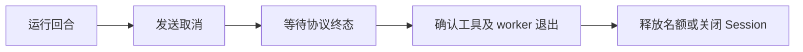

# Agent 运行时

[internal/agent/dsh](../internal/agent/dsh/) 管理一个本地 DSH 进程、一个 ACP v1 Session 和独占状态目录，不依赖 Room，也不内置回合队列。[Room 薄适配](../internal/room/dsh.go)负责角色、当前工具身份、懒启动、恢复选择及私有活动展示。

## 准备 DSH 与配置

用户先完整安装经验证版本的 DSH，再将其可执行程序路径填入 TeamX；DSH 的 Node、依赖包、profile 模板和运行时资源须完整保留，无需安装 DSH 源码仓库。还需模型网络和凭据，以及受支持的进程观察能力。当前进程治理支持 macOS/Linux。组件不安装或升级 DSH，调用方负责选择并验证实际安装版本。

在服务配置（默认 `~/.teamx/config.toml`，项目内使用 `.teamx/config.toml`）中配置默认 runtime，格式见[示例](../.teamx/config.example.toml)；团队也可在 [team.json](../.teamx/teams/README.md) 中提供完整覆盖：

| 字段 | 含义 |
| --- | --- |
| `runtime.dsh.binary_path` | 已安装的 `dsh` 可执行程序绝对路径，可用 `command -v dsh` 查找 |
| `runtime.dsh.binary_args` | 可选；普通 DSH 安装省略。开发时用 Node 启动才需要填写 CLI JS 的绝对路径 |
| `runtime.dsh.artifact` | 可省略；高级用法可标注构建来源和版本，显式提供时两个字段均须填写 |
| `runtime.model` | 协议、模型、地址和密钥环境变量名 |

组件追加 ACP profile 参数，启动不经过 shell，不展开 `~`、变量或命令。工作目录需存在；配置中的路径须指向本机安装。服务环境优先，`config.toml` 的 `[env]` 补充未设置变量；不自动加载 `.env`，团队及房间 JSON 只保存密钥环境变量名。

本地基于源码构建也可以模拟用户安装，但构建后还需将完整运行时部署到独立目录。仅指向仓库内的 `lib/bin.js`、使用 `pnpm link`，或复制一个 JS 文件，都不能验证脱离仓库运行。联网环境可在 DSH 仓库构建后部署 CLI：

```sh
pnpm install --frozen-lockfile
pnpm run build
pnpm --filter @deepseek-ai/dsh deploy --legacy --prod \
  --config.allow-unused-patches=true /absolute/path/dsh-install
/absolute/path/dsh-install/lib/bin.js --version
```

部署后的 `lib/bin.js` 本身是带 Node shebang 的可执行入口，可以作为 `binary_path`，也可以通过安装目录的 `dsh` 启动器调用；服务的 `PATH` 须包含兼容的 Node。安装验证应从独立工作目录执行，确认依赖链接均落在安装目录内，并验证 ACP 建会话、关闭与恢复。npm 发布验证还需使用实际 tarball 在新目录安装，上述本地部署不能代替发布包验收。

仓库中的团队模板不包含本机路径，使用全局默认 runtime。普通安装的 `runtime.dsh` 只需 `binary_path`：

```json
{
  "binary_path": "/absolute/path/to/dsh"
}
```

省略 `artifact` 时，TeamX 用相同启动入口执行 `--version` 自动读取安装版本，并从 ACP `initialize.agentInfo` 读取运行时身份。当前 DSH 的 ACP 版本属于适配层，与 CLI 安装版本不同，因此两者分别核对。这些信息与可执行文件摘要、启动参数及配置一起记录在私有 Session 的 `backend.json`。恢复时先核对本地配置和正常关闭证据，再于发送 `session/resume` 前核对安装版本及 ACP 运行时身份；不匹配即停止，不自动新建或重放。显式 `artifact` 标注仍可用于固定构建，由调用方保证实际产物匹配，TeamX 继续核对标注、可执行文件摘要及 ACP 身份。已有房间保留原 runtime 快照，编辑模板后重启服务并新建房间生效。

`deepseek-messages` 使用 DSH 的 DeepSeek Messages 适配；`openai-completions` 需要模型基础地址。模型选择核对 ACP 实际提供的配置及回执，不静默换模型。API 和字段定义见 [options.go](../internal/agent/dsh/options.go)，用户配置统一参照[团队模板](../.teamx/teams/README.md)。

`runtime.model.input_modalities` 可选，缺省保持文本流程。显式值只接受不重复的 `text`、`image`，且须包含 `text`；图片仅支持 `openai-completions`。例如已确认部署支持图片的模型可设 `input_modalities = ["text", "image"]`。该字段沿全局默认、团队完整覆盖和 Room 冻结快照传递，生成配置仅在精确模型条目声明 `input`，不扩大整个网关的能力。TeamX 在 ACP `initialize` 前写入模型配置；显式启用图片而握手未返回 `promptCapabilities.image = true` 时，建会话失败，不降级为文本。未设置该字段的原有配置与恢复指纹不变；改变模型或模态仍须使用受控 Session 生命周期，不修改旧恢复证据强行续接。

图片能力已完成 I1–I3：Room／Inbox 的 GitLab 通知会在固定当前回合范围内只读准备已保存文字和图片，按来源成组提交。默认合计扫描 25 条记录、传 4 张图片，单图 2 MiB、累计 4 MiB、单图 16777216 像素、准备时间 30 秒；可通过服务级 `[server.image_materials]` 调整，见[配置示例](../.teamx/config.example.toml)。只识别已保存文字中的完整图片引用，不补读全文；纯文本 Session 不下载图片，预算、格式、权限或超时导致的未覆盖材料会明确告知模型。准备材料不推进 Room 已读、Inbox 消费或 matters 状态，也不授予操作权限。TeamX 只在有界内存中准备图片，DSH 会通过其既有附件机制持久保存到私有 Session 存储；不能将此理解为图片全程不落盘。真实 GitLab 的 Room／Inbox 读图已在 I4 得到验证；独立短码、恢复、浏览器等结果分别记录，不能据此声称一期全部验收通过，见[图片验收手册](gitlab-image-acceptance.zh.md)和[当前实施记录](GITLAB-IMAGE-UNDERSTANDING-PLAN.zh.md#84-i4-实施与验证记录2026-11-05)。

真实验收使用实际安装的 DSH，并在私有报告中记录启动路径、参数、CLI 版本及启动程序摘要。Session 的 `backend.json` 另行记录 ACP 运行时身份和恢复所需配置。更换安装产物后需重新验证能力。

## Session 契约

`Open` 只接受新状态目录，完成 ACP 握手、建会话、模型配置和后端引用提交。`Resume` 只恢复满足条件的原 Session。`Run` 保留文本包装入口；`RunPrompt` 接受有序的 `[]dsh.ContentBlock` 文本／图片块，图片 `Data` 是原始字节，由组件转为 ACP base64。`SupportsImages` 同时检查显式模型声明与握手能力。每次执行一个回合，并发调用返回 busy。`Close` 停止接纳、取消并结清资源，可重复等待。

组件累计文本输入默认最多 1 MiB、原始图片累计最多 4 MiB，二者独立计量且可收紧。图片接受 PNG、JPEG、GIF、WebP，校验非空数据、MIME 和实际文件签名；不接受 URL。完整 JSON-RPC 帧在 base64 扩展及文本转义后检查，最多 8 MiB，包含 Session 和请求标识。输入校验或帧超限发生于发送前，不禁用健康会话；组件拒绝整次无效输入，不自动裁图或重放。Room 负责下载、像素检查、每图和每轮预算及确定性裁减。

单回合默认上限为 15 分钟，按模型与工具执行的总耗时计算。服务通过 `server.dsh_turn_timeout = "30m"` 或 `--dsh-turn-timeout 30m` 调整，重启后同时适用于已有房间和新房间；它不进入角色与模型的恢复指纹。手动取消立即发出取消请求，后续协议和进程结清仍使用独立期限。

只有匹配当前 prompt ID 的完整终态才结束回合。`end_turn` 表示模型正常结束，不证明业务目标成功；预算耗尽、拒绝、取消和协议失败分别记录，不自动续跑。普通文本和诊断保持私有，向 Room 发言必须显式调用 CLI。

ACP 持续读循环不执行策略回调；写入串行且有期限，反向请求 worker 有界。额外权限请求默认取消；自定义策略只能选择此次原始选项，并须遵守 context。凭据在公开错误与诊断中脱敏，DSH 自身历史仍属于私有数据。

## 取消、关闭与资源归属



取消调用返回或进程退出请求发出，都不足以释放责任。组件需确认协议读取、worker、已观察工具及归属进程树结清；不能按裸 PID 杀进程或让新 Session 与不明旧执行重叠。

协议 EOF、部分写入、未知响应、超限或不可信终态会停用会话并报告结果可能不确定，不重放 prompt。关闭超时后后台仍持有清理责任与目录锁，后续可再次等待。服务 Ctrl-C / SIGTERM 先停止新接纳并冻结所有 Room 的调度，再在统一期限内并行结清各房间管理操作、成员、工具、通知查询和存储；一个失败不跳过其他房间。失败按完整房间身份记录，未结清继续保留运行归属和根目录锁，不能把超时当作正常退出。

## 正常恢复与显式轮换

| 动作 | 前提与结果 |
| --- | --- |
| 原 Session 恢复 | 有可靠正常关闭证据；产物、角色、模型、工作区及落盘配置匹配；DSH 支持 resume；保持原 SessionID 与私有记忆 |
| 显式轮换 | 确认旧执行全部停止后切换持久代际；新 Session 懒创建，旧目录保留；私有上下文不迁移 |
| 重新开始讨论 | 全队结清和轮换后清空公共历史；工作文件及预算保留 |

受管服务按各房间的持久协作意图恢复，界面是否查看不参与判断；已全部暂停且已结清的房间按需打开。重复打开健康实例不更换 Session 或续额。恢复时更新当前 CLI 身份；恢复失败不静默新建。遗留 running 回合记为 interrupted 并暂停，正常恢复资格不意味着自动重放旧回合。失败会话可在执行结清后显式重置，但结清证明不等于原会话正常恢复许可。

状态目录含锁、启动记录、`backend.json`、独立 DSH home/agents 及私有历史；Room 在 `session.json` 引用具体代际。`settled.json` 仅供显式重置核对，并在再次启动前消费，不授予原会话恢复权。

当前不支持宿主崩溃后的自动进程接管、私有记忆自动摘要迁移或自动轮换。命令见[运行手册](../internal/room/README.zh.md#回合预算与轮换)。

## 真实验收

真实测试默认跳过。设置 `TEAMX_DSH_BINARY_PATH` 为已安装的 DSH 启动程序路径；省略时从测试进程的 `PATH` 查找 `dsh`。普通安装不需要额外参数；用 Node 启动时，将 `TEAMX_DSH_BINARY_PATH` 设为 Node 路径，并用 JSON 字符串数组 `TEAMX_DSH_BINARY_ARGS` 提供 CLI JS 的绝对路径，参数直接传给进程，不经 shell：

```sh
export TEAMX_DSH_BINARY_PATH=/absolute/path/to/dsh
# Node 启动方式：
# export TEAMX_DSH_BINARY_PATH=/absolute/path/to/node
# export TEAMX_DSH_BINARY_ARGS='["/absolute/path/to/dsh/lib/bin.js"]'
```

再设置 `MODEL_BASE_URL`、`MODEL_ID`、`TEAMX_DSH_API_KEY_ENV` 及该变量指定的模型密钥。也可用 `TEAMX_DSH_ENV_FILE` 显式读取凭据，此时通过 `PATH` 中的 Node 解析 dotenv；直接提供密钥时不需要这个解析步骤。测试按实际安装产物记录证据，Session 自动识别 CLI 版本及 ACP 身份，并继续核对原会话恢复条件。生产服务仍不自动读取 `.env`。输出与失败处理要求见[验证说明](../internal/room/README.zh.md#验证入口)。

选择下表一项，将开关置为 1，并设置尚不存在的绝对 `TEAMX_DSH_OUTPUT`：

```sh
TEAMX_DSH_REAL=1 TEAMX_DSH_OUTPUT=/absolute/new-session-evidence \
  go test ./internal/agent/dsh -run '^TestRealDSHSession$' -count=1 -v -timeout 10m
```

| 开关 | 测试入口 | 范围 |
| --- | --- | --- |
| `TEAMX_DSH_REAL` | `internal/agent/dsh: TestRealDSHSession` | Session 角色、记忆、工具、取消与关闭 |
| `TEAMX_DSH_IMAGE_REAL` | `internal/agent/dsh: TestRealDSHImage` | I1 独立图片的随机数字短码与布局识别、正常关闭；另设 `TEAMX_DSH_IMAGE_RESUME=1` 可附加恢复后读图检查 |
| `TEAMX_GITLAB_IMAGE_REAL` | `internal/room: TestRealGitLabImageMaterials`（`-tags e2e`） | 真实私有 GitLab 图片的 Room／Inbox 材料与纯文本降级；另设 `TEAMX_GITLAB_IMAGE_MODEL=1` 验证真实模型，详见[手册](gitlab-image-acceptance.zh.md) |
| `TEAMX_GITLAB_IMAGE_COVERAGE` | `internal/room: TestRealGitLabImageCoverage`（`-tags e2e`） | 两图、缺图、截断及预算的真实下载；不涉及模型 |
| `TEAMX_GITLAB_IMAGE_BROWSER` | `internal/room: TestRealGitLabImagePreview`（`-tags e2e`） | 隔离页面和 Room／Inbox 图片地址；浏览器须另行核对并保存截图 |
| `TEAMX_DSH_ROOM_REAL` | `internal/room: TestRealDSHRoom` | 生产 CLI 单成员协作 |
| `TEAMX_DSH_COLLAB_REAL` | `internal/room: TestRealDSHCollaboration` | 多成员、失败隔离及原会话恢复 |
| `TEAMX_DSH_ROTATION_REAL` | `internal/room: TestRealDSHRotation` | 显式轮换及新旧 Session 隔离 |
| `TEAMX_DSH_SHUTDOWN_REAL` | `internal/room: TestRealDSHShutdownRecovery` | 工具运行时 Ctrl-C、进程结清及原 Session 恢复 |

受管房间使用 [TestRealDSHManagedRooms](../internal/room/activation_real_test.go)，传入 `-teamx-management-real-output ABS_NEW_DIR`、`-teamx-management-env-file ABS_ENV_FILE`、`-teamx-management-base-url MODEL_URL`。该入口覆盖双房间真实工具并行、后台公共消息、原 Session／预算保留、后续调度及全部房间退出结清。这些测试会调用真实模型，不在普通检查中启用。

图片入口使用同样的安装、网关、密钥和新输出目录变量，`MODEL_ID` 选择实际模型（I1 使用 `qwen3.8-flash`）。测试从随机数字生成纯像素 PNG，答案不进入 prompt，且要求模型不使用工具并准确返回短码和两处图形布局。报告记录安装摘要、精确路由、ACP 能力、图片数量／字节数和实际回答；不保存 base64 或凭据。该独立入口不访问 GitLab；Room／Inbox 图片链路使用上表的 GitLab 入口分别验收。I4 将此验收入口的模型输出预算调整为 8192，覆盖真实路由的思考与回答；短码识别仍严格核对，误读不会进入恢复检查。
