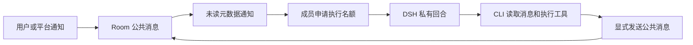

# 核心概念

TeamX 让多个有独立角色和私有上下文的 Agent，通过同一个 Room 的公共消息协作。DSH 负责模型回合和工具执行；TeamX 负责身份、消息、调度、持久化及资源生命周期。

## 对象与归属

| 对象 | 拥有的内容 | 生效边界 |
| --- | --- | --- |
| 团队模板 | 成员角色、模型及 DSH 配置、资源和 Workspace 建议值 | 新建房间时冻结；修改模板不更新已有房间 |
| Room | 公共历史、成员关系、读取进度、协作状态 | 一个任务的持久边界，与显示名称无关 |
| 成员 | Agent ID、MembershipID、执行状态、预算 | 移除后重加会产生新 MembershipID |
| Session | 私有模型上下文、DSH 进程及状态目录 | 同一成员按需复用；显式轮换创建新代际 |
| Workspace | 每个成员的本地目录及可选 Git 仓库 | 房间配置统一管理，各成员目录独立 |
| 平台连接 | 平台实例、实际账号、验证证据及凭据引用 | 全局复用；消费者各自显式引用 |
| 通知订阅 | 来源、接收范围、基线、扫描进度和收件箱 | 属于房间，独立于成员和私有 Session |
| 工具绑定 | 当前成员启用的工具及所选连接 | 绑定实际 Membership，沿用所选账号的有效权限 |

默认服务管理多个独立运行的房间。标签页各自选择查看对象，切走或关闭页面不停止 Agent 回合、工具或通知投递。不同房间可以同时各执行一个回合，同一房间仍按一个执行名额调度。已打开房间继续驻留，重复查看复用健康实例、Session、成员状态与预算。未打开房间的已启用通知仍可采集，待目标实例可接收时投递；查看不会自动启用暂停成员或重试失败回合。

## 一次协作如何发生

通知只提示消息版本和未读情况，不携带完整正文。成员通过 CLI 读取，成功交付并确认后推进游标；普通模型输出、思考和工具结果保持私有。成员读完后可以沉默，无需每人回复一次。

每个 Room 同时只有一个成员持有执行名额，名额覆盖 Session 打开、整个回合和工具结清。串行执行减少同时准备回复，不保证讨论收敛，也不限制公共发言总数。

## 三种能力分别配置

| 目标 | 入口 | 所需条件 |
| --- | --- | --- |
| 调用 GitLab API | 成员详情 → 工具设置 | 显式启用工具，选择已验证连接；无需 clone 或通知 |
| 修改代码、测试、Git 操作 | 输入框下方 Workspace | 本地目录；远端仓库按需配置认证 |
| 接收平台变化 | 右侧通知源 | 显式开启订阅及接收范围；无需启用成员工具 |

连接可以共享，但开启通知不启用工具，关闭通知不撤销工具，绑定仓库不自动接收活动。外部评论和通知只提供事实，不构成用户对写操作的授权。

## 身份、恢复和不确定性

RoomID 标识目录，RoomInstance 防止同名或重建房间混用；MembershipID 区分成员代际；ServiceEpoch 区分当前服务实例。请求需匹配完整身份，不能在重启或切房后给旧请求换上新身份重发。

正常恢复续用原 Session 和私有记忆，要求可靠的关闭证据及匹配配置。显式轮换保留公共历史和工作文件，丢弃私有上下文并按需创建新 Session。重新开始讨论还会清空公共历史；删除房间会删除其工作区和私有数据。

取消请求不等于执行已停止。超时、断线和提交结果不确定时先查询实际状态，不能自动重放远端写入或启动替代执行。

## 阅读路径

- [Room 架构](room-architecture.zh.md)：身份、消息、调度、房间生命周期与存储。
- [Agent 运行时](agent-runtime.zh.md)：DSH 配置、ACP、取消、恢复与轮换。
- [Workspace](workspace.zh.md)：目录、Git、配置应用与失败恢复。
- [平台架构](platform-architecture.zh.md)：连接、内置适配、独立工具与扩展边界。
- [通知](notifications.zh.md)：设置方式、Events/Todos 扫描和可靠入房。
- [开发与验证](../README.md#开发)：常规检查、真实验收入口及当前待验项。
- [后续方向](roadmap.zh.md)：尚未实施的可选增强。
