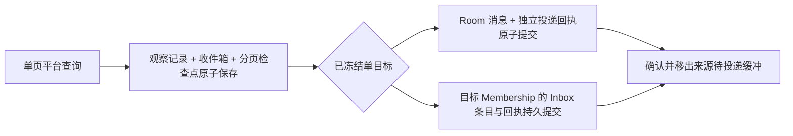

# 平台通知

通知把平台事实可靠送到 Room 或指定 Membership 的 AgentInbox，不授予工具或动作权限。当前支持 GitLab Events／Todos。R5 起，生产入口统一使用 schema 2 的稳定目标引用和对象／原生讨论跟进；Room 对话是正常办理入口，成员 UI 用于查看和纠正。

## 设置与使用

先在「设置 → 平台连接」保存并验证账号，再打开右侧「通知源 → GitLab」。两个页签独立保存、同步、显示错误和保留草稿；只有显式保存才生效，首次默认不开启。

| 维度 | 项目活动 | 我的待办 |
| --- | --- | --- |
| 目标 | 独立选择连接及项目 HTTPS 地址或 `group/project` | 所选连接的真实账号，稳定 user ID 经服务核验 |
| 范围 | 一个项目；每房间一个未退役订阅 | 所有可访问项目，或同实例的当前 Workspace 项目 |
| Workspace 依赖 | 无；“从 Workspace 预填”仅提供建议 | all 范围无；current 范围需有效且匹配的绑定 |
| 默认周期 | 可接收实例 5 秒，未打开或操作中 30 秒 | 可接收实例 30 秒，未打开或操作中 120 秒 |
| 过滤 | MR 开启/合并/关闭、评论、push、分支和忽略操作者 | mentioned、assigned、review_requested、other；MR 和工作项 |

活动项目保存后不跟随 Workspace 改变，Git 准备失败不影响其查询。待办 current 范围保存项目快照，项目变化后暂停并要求核对保存，不能静默改成 all。用户名仅展示，“我的”指所选连接账号。读取、接收和投递不修改远端待办状态。

两路来源均可在「投递到」选择房间公共消息或指定成员收件箱。已有订阅默认保持房间消息；选择收件箱时必须是当前房间的有效 Membership。保存仅影响之后首次接收的通知，旧积压保持已冻结的目标和配置版本，切换不重置基线、不回放已观察通知。

在「成员 → Agent 详情 → 收件箱」只读预览，支持刷新和固定快照的下一页，每页最多 25 条。查看不会确认消费或启动协作；成员暂停、预算耗尽仍可收件。移除成员会结清并冻结其 Inbox，文件保留；同名重新加入使用新 Membership，不继承旧收件箱。目标暂不可用、已移除或容量已满时，来源保留待投递项，设置中展示积压和原因，不改发房间、不自动启用成员。当前没有旧积压转交或清理入口。

GitLab 通知中的评论在房间消息和收件箱预览中按 Markdown 展示，已有通知也适用；原始存储及 Agent 输入继续保留转义和提及隔离。项目图片附件支持 `/uploads/<secret>/<filename>`、同实例的项目附件地址，以及 `{width=900 height=536}` 尺寸语法。图片接近可视区域时，浏览器请求 TeamX 的 `/v1/platform/attachments`；后端核对房间、已保存的消息／收件箱条目、订阅和当前连接账号，再携带 PAT 调用 GitLab 附件 API。PAT 不发送到浏览器；TeamX 页面下载仅暂存在内存，不新增落盘或持久缓存；每张最多 20 MiB，支持 PNG、JPEG、GIF、WebP。HTML、SVG 和外部站点图片不内嵌。附件 API 需要 GitLab 17.4 或以上；权限不足、附件删除或连接失效时显示加载失败入口。

Agent 的图片输入在固定当前回合的 Room／AgentInbox 范围内另行准备，并不依赖浏览器加载图片。只有显式声明图片模态且 ACP 握手支持图片的 Session 才接收图片字节；纯文本模式不下载，并提示图片未读。正文沿用原有限制，实际截断时显示“正文已截断，内容可能不完整”；只识别已保存文字中的完整图片引用，不补读完整评论或截断之外的图片。每轮扫描／图片数量／字节／像素／时间均有预算，缺失与超限会明确告知模型，不保证下一轮自动补齐。

材料准备不推进 Room 已读、Inbox 消费或 matters 状态，不授予工具操作权限。TeamX 只在有界内存中准备；提交后的图片由 DSH 按私有 Session 附件机制持久保存，因此不能将页面不缓存理解为整条模型链路不落盘。模型配置、可重复验收命令及当前边界见[图片验收手册](gitlab-image-acceptance.zh.md)。

## Agent 读取与跟进

已启用成员的 Room／Inbox 输入共用回合队列、Session 和预算，每回合固定最多 25 条通知。暂停或预算耗尽仍可接收，不启动模型。读取确认表示输入已交付，与业务完成、评论成功和 Todo 完成分别记录。

```sh
"$TEAMX_CLI" inbox read --limit 25
"$TEAMX_CLI" matters list --limit 25
"$TEAMX_CLI" matters list --object REF --cursor CURSOR
"$TEAMX_CLI" matters read --object REF --unit UNIT --turn CURRENT_TURN
"$TEAMX_CLI" matters sources --object REF --after SEQ --limit 25
"$TEAMX_CLI" matters source --seq SEQ --source SRC
"$TEAMX_CLI" matters --help
"$TEAMX_CLI" matters read --help
```

`inbox read` 返回原始事件、系统解析的来源／目标引用和去重对象摘要；可靠保存关联后才输出，完整输出后才确认。`--peek` 不确认消费。相同对象复用一个对象单元，发现讨论不批量建立待办；确需独立处理时才用 `matters ensure --seq SEQ --target REF --turn TURN` 从已核实原生讨论建立子单元。引用由系统生成，不接受语义事项 ID。旧 enrich/relate、拆分归并和手工身份报告入口已移除。

Agent 的 `matters read`／`inbox read` 将绑定的 `room_id`、`room_instance`、`agent_id`、`membership_id` 在顶层保留一次，省略 `unit`／`target` 或每条 Inbox entry 的重复身份及存储 schema `version`。完整问答／指令关系与全部动作业务记录保留；重复的内部快照通过 Agent --detail 入口补读，纯访问准入数据不对 Agent 披露，原生定位仍可从 source 读取。CLI 输出省略 `batch.receipt`，Agent 的 `read --json` 省略 `read_receipt`／`expires_at` 和内部 Room 存储 revision；分页水位与完整性字段保留。内部 HTTP 仍向 CLI 提供收据，输出成功后才确认；确认失败错误保留 receipt 和 turn／through，表示消费未确认或不确定。human 管理读取保持原结构。

系统解析已迁入内置 GitLab 适配器，通过当前成员已启用并选择的 GitLab 绑定直接读取 API，不依赖 `teamx-gitlab`、glab 或 Workspace；不自动借用订阅或其他成员账号。来源原生对象身份与讨论映射分层：对象已核实但讨论无权限、分页未完成或缺少映射时显示 `partial`，可使用对象引用，不能据此回复讨论。安全原因保留失败步骤与 HTTP 状态，并区分权限、账号不符、原生身份冲突、响应无效及分页不完整。解析和两类 MR 动作均已内部化，不需要工具二进制。按引用执行仍使用当前成员绑定，核验账号、项目、MR 和原生线程；受限写入每次只发送一次，讨论失败不降级。Room 保留授权、意图和回执，取消后仍保存原账号的已知写入结果，未知结果继续阻止另建请求补发。

普通重读、刷新和重启继续复用保存结果。失败来源可在当前有效 Agent 回合显式执行 `matters resolve --seq SEQ --source SOURCE_REF --turn TURN` 重新解析（准确参数见 `matters resolve --help`）；保留原 seq、source_ref、投递和 Inbox 消费状态，不重新投递、不重复建项。再次失败通过 `LastAttempt` 保留历史已核实身份。本次内部化沿用当前 v3 索引与 followups schema，无须再次重建 Room。

真实来源验收和原目录恢复分开记录：C 已用当前连接核实 10 条来源，并在隔离副本完成恢复；日常助手因模型 429 失败而无有效回合，原目录尚未重解析。不得用失败回合或手改 Agent 快照绕过准入。Issues REST 返回 Work Item 网页路径不会改变原生对象身份；独立评论也不会因此变成讨论回复目标。复现与恢复门槛见[验收手册](reference-followups-acceptance.zh.md#内部能力-c真实来源读取与恢复)。

失败来源在消费后仍出现在活跃列表，使用只读 `source_ref`；按需 `matters resolve --seq SEQ --source SRC --turn TURN` 显式重新解析。普通读取、恢复和新回合不自动轮询。目标已核实而后续查询失败时保留身份和失败原因，不能把部分／权限失败当成不存在。原生正文仍通过已配置工具按需读取，尚未登记通用 ReadTarget 正文分页。

`matters list` 默认返回活跃摘要，可用 `--include-completed` 读历史。每页最多 25 项／128 KiB，来源有独立分页；对象计数由对象及讨论单元派生。列表可选增补 `object_label`（带命名空间的已核实原生别名，如 `MergeRequest gitlab:rest:iid:42`）和 `object_url`（已核实对象 URL）；从保存的解析证据读取，不增加远端查询，不从来源 URL 猜测。原 `target_label`、稳定引用和所有定位字段保留；对象 URL 不表示讨论回复目标，缺少别名或 URL 时分别省略，不把 REST ID 当 IID。详情返回 `unit`（unit_version、状态、进展、问答、单次指令和全部动作）、规范 `target`，及按目标层级／原生类型过滤的 `registered_actions`（输入和重试合同）；实际绑定与权限仍在执行时核验。超限明确分页或拒绝，不裁剪未完成条件。Session 轮换后用相同入口恢复，权威记录不依赖私有上下文。

更新使用 `matters update --change JSON`：

```json
{"object_ref":"ref_…","unit_ref":"unit_…","unit_version":1,"turn_number":1,"status":"waiting_followup","summary":"已回复用法问题","next":"等待对方确认","evidence":"准确动作回执及远端结果"}
```

`matters update/notify/reply/instruct/instruction-status` 和 `policy update` 也支持 `--change-file PATH`；`actions execute` 支持 `--request-file PATH`。文件内容就是原内联参数的 JSON，不增加 HTTP envelope。`-` 表示 stdin，与对应的内联参数互斥（即使显式传入空字符串）；文件读取或 JSON 解析失败不会发送请求。三种输入沿用相同 JSON 解码、服务端请求体及业务字段大小限制，不增加动作重试。

```sh
"$TEAMX_CLI" matters update --change-file progress.json
"$TEAMX_CLI" actions execute --request-file action.json
"$TEAMX_CLI" matters update --change-file - <<'JSON'
{"object_ref":"ref_…","unit_ref":"unit_…","unit_version":1,"turn_number":1,"status":"in_progress","summary":"核实含引号的正文：\"准确内容\"\n下一行"}
JSON
```

示例引用和版本须替换为当前已核实值。引号包围的 heredoc 分隔符保留正文中的 `$`、反引号和反斜杠；stdin 仍须提供合法 JSON（字符串换行写为 `\n`）。

Agent 单元与摘要统一返回 unit_ref／unit_version（未解析摘要返回 source_ref／source_version）。跟进写操作返回 unit_ref、unit_version、status、changed、reused、requires_read 回执；changed 包含本次实际进展／问题答复／指令／动作变化，requires_read=true 时必须重读完整业务视图，不能把旧快照直接换版本继续判断。状态为 pending、in_progress、waiting_user、waiting_followup、completed、archived、unknown；等待和未知必须有下一步，完成必须有证据。未答问题、有效待落实指令或未知动作阻止办结。

`inbox read` 每条 entries[].source 直接带来源引用、解析结论与对象／目标引用，不再输出独立 sources 数组；各事件的正文、作者、归属、时间与序号分别保留。`matters read` 默认保留完整问答、撤销／落实指令及全部动作的准确目标、账号、正文、时间和结果，包括已完成和未知动作。重复执行快照由同参数加 `--detail` 补读；details 标明未包含的内容。source_page 是独立分页，沿 next_after 用 `matters sources` 续读直到 complete，再用 `matters source --seq SEQ --source SRC` 读取完整核实原生定位／别名、消息映射、账号和失败原因。内部访问准入快照不对 Agent 披露，原生值未知时不猜测。

## Room 问答与规则

规则覆盖且事实充分时直接办理，缺少关键决定时先完成独立工作，再用 `matters notify --change JSON` 保存准确单元、原生 message_refs、问题 text 和 proposed `{operation,body 或 constraints}`。问题保存后才公开发送，正文 @ 当前 Room 操作者；回执 question 表示已保存，publication=published 与 send_receipt 表示公开发送已确认；unconfirmed 表示未确认发送，published_link_pending 表示发送确认但本地关联待恢复，均沿用原问题与 ID 核对同一问题和 Room 回执，不重复提问。

用户正常回复即可。`matters read` 自动关联真实 human 的显式 reply_to；无引用但上下文明确时用 `matters reply --change JSON` 提交准确 question_ref、source_seq 和 basis，服务端复制真实原文。歧义只澄清关联，不默认使用最后一个问题。即时动作可直接引用答复，跨回合才用 `matters instruct` 保存准确单次指令，`instruction-status` 使用 instruction_ref／instruction_version 记录落实或真实用户撤销。一次答复不成为长期许可，也无需到 UI 再填写决定。

`policy read` 恢复缺失的有效规则正文；运行时每回合供给 policy_token、revision 和 current_turn，完整 effective 出现时替换旧集合（包括空集合），未出现时沿用该 token 正文。

`policy update --change JSON` 接受 `{type,id,revision,version,source_seq,turn_number,basis,body?,proposal_seq?}`：

- `save`：保存明确长期 human 指令，建立／修改生效规则或偏好；完整 body 为 `{kind,text,scope,expires_at?}`。
- `suggest`：同样提交完整 body，习惯推测只保存未生效建议；按需 `policy publish --id ID --version VERSION --turn TURN` 公开准确建议。
- `confirm`：只提交准确已保存版本、proposal_seq 和真实 human 答复，不接受 body；服务端恢复原建议，不能顺带修改正文或范围。本次任务的同意不能激活长期规则。
- `revoke`：只提交准确已保存版本和新的真实 human 来源，不接受 body／proposal_seq；服务端保留原正文与范围。

revision 是观察到的 policy revision，version 是记录版本（新记录为 0）；turn_number 使用 current_turn。旧 `{change,mode}` 合同明确拒绝，CLI 和服务须配套升级。偏好、允许动作、执行前提和例外统一写在自然语言 text 中，不再拆分字段，也不生成范围说明；偏好不填写目标范围。规则 scope 仅保留程序匹配的 provider、instance、account 或 account_id／tenant、project 或 no_containers，以及可选 object_type。管理页通过已验证连接补齐平台、实例和账号，项目可从已有项目选择或填写准确路径／ID，不支持 `*`。旧修订中的说明、动作、条件和例外在当前视图合入正文，原历史和来源保留。Agent 不提交 source_text，服务端读取真实消息与作者。完整字段见 `policy update --help`。偏好不授予动作权限，最新明确限制优先；修改／撤销刷新 token，保存未知需核对，不宣称已记住。

Agent `policy update` 在原 effective、revision、current_turn、policy_token 外增补 `record`：实际持久保存的准确 ID、version、status、text、范围和真实来源，包括 suggested/revoked。默认投影将相同 human 原文保留一次，另存 Agent 解释、reply_to／时间和建议确认关系；完整历史证据可通过 `policy read --id ID --detail` 补读。有效视图始终完整替换，包括空集合；本版更新回执也保留完整 effective，避免依赖调用端缓存。新建议可直接用 `record.id`／`record.version` 调用 publish，无需额外读取；重复请求返回原请求保存的记录，同时返回当前策略上下文，因此 record 可能不是当前版本，也不代表仍生效。保存失败或结果未知不返回成功记录；当前非生效版本仍可用 `policy read --id ID` 恢复。管理更新／读取保留原结构；Agent 回合供给、read、update 和 policy_changed 使用同一有效规则投影，token 仍按内部权威正文计算。

`matters --help`、`policy --help` 等入口提供命令目录，各子命令用 `--help` 查看用途、参数、返回重点、示例与约束。错误保留原 code／HTTP 状态，增加安全 message，可附 field、expected_version、actual_version 和 hint；版本冲突须重读并重新判断，不会自动替换版本或重试写入。

成员「偏好与规则」视图默认只展示偏好／规则，支持查看、修改和撤销。Agent 用于持续办理的「跟进记录」默认收起，展开才读取，核查时再逐条查看处理进展、相关通知和动作回执；原始通知和技术信息继续按需展开。待处理表示 Agent 尚未办结，需要用户答复的问题明确标注「待你答复」。Room 消息支持就地回复；UI 不作为正常办理的前置批准步骤，查看记录不会启动 Agent、确认消费或重新解析来源。

## 按引用执行

```json
{"object_ref":"ref_…","unit_ref":"unit_…","unit_version":3,"turn_number":1,"id":"stable-attempt-1","policy_token":"current-token","authority":{"type":"human_reply","room_seq":42,"question_ref":"question_…","reason":"该真实答复覆盖本次准确动作"},"operation":"discussion.reply","input":{"body":"准确回复正文"}}
```

使用一次 `actions execute --request JSON`。authority 类型三选一：`rule {type,id,version,reason}`、`instruction {type,id,version,reason,constraints?}`、`human_reply {type,room_seq,reason,question_ref?,message_refs?,constraints?}`。target_ref 由已校验的单元唯一恢复，execute 不再接受该字段；对象／讨论层级和账号仍严格校验。服务端恢复目标和账号，核对问题／消息范围、当前 token、工具绑定与实际能力，先保存意图再调用适配器。不接受 Agent 提交原生项目／MR／讨论 ID。

目前登记 MR `object.comment`（普通评论）和 `discussion.reply`（已核实讨论），复用 Inbox 来源建立的跟进；无来源任务不伪造通知序号。讨论回复不降级普通评论。普通评论暂时故障最多两次服务端尝试，讨论回复一次；响应丢失可能重复。回执保存实际目标／账号、结果原生 ID、attempts 和 possible_duplicate。policy_changed 返回完整有效视图，需要重新判断，不能只替换 token。

同 ID／内容读取已有回执；unknown 不因换 ID、回合、Session 或重启而自动补发。只读核实远端并报告，无关工作可以继续，依赖未知结果的业务不能办结。重要结果使用稳定 ID 的 send 公开并将依据写入单元，常规结果保留私有。未适配能力继续按真实授权使用 tools run，不继承评论重试策略。

## schema 切换

业务只读写 `agents/<membership>/followups/`。旧 main 事项、语义关系图、独立决定和旧动作模型及其读取／消费分支已删除；不扫描、迁移或接续旧记录。目录索引仅支持 v3，不接受旧归属／激活字段。请使用新数据目录并重新创建 Room；旧目录由用户自行处置，服务不自动删除。当前 schema 缺失、未知版本、身份冲突及保存结果未知仍明确拒绝，不能通过补建空记录掩盖损坏。

## 公共运行与可靠投递

[notification.Manager](../internal/platform/notification/manager.go) 管理任务、加载、原子保存与投递，[Source / State / Runner](../internal/platform/notification/source.go)提供来源 codec、具体进度与单步查询。来源状态保存在：

```text
<room>/notifications/<provider>.<channel>.<subscription_id>.json
```

公共 envelope 是 `{provider, channel, schema, state}`。启动严格核对 schema、文件名、房间与订阅身份，缺失文件不默认开启；旧通知路径和原格式不再兼容。查询资源独立于成员目录，由服务拥有。



远端页处理成功必须先保存，再推进下一页或缓存。消息提交后、inbox ack 前崩溃时，稳定投递 ID 与对应目标的持久回执阻止重复接收；清空公共历史不清除同步进度或回执。向订阅所属且可接收的运行实例投递，与页面是否查看无关；未打开或正在进行生命周期操作的房间继续采集并暂存，待目标可接收时投递。

公共来源键是 provider + channel + subscription ID；来源 item key 按不透明字符串处理。集成作者只陈述对象、操作者、变化、原因和链接，不生成建议、指派或 @ 提及；公开发送接口不能伪造 integration。点击明确来源的消息作者打开对应页签；缺少/未知 channel 不推断为活动消息。

## Events：快查与完整窗口

最新页固定读取 20 条，整页检查，不因遇到已知 ID 或最大 ID 提前结束；去重键是实例 + 项目数字 ID + 事件 ID。未支持类型保留身份和跳过原因，不虚构分支、对象或 SHA。

启动、重连、实例打开和定时检查会触发完整补查。窗口从水位向前重叠 5 分钟且不早于基线，终点固定；Go 适配向外扩展 UTC 日期后按精确 `[start,end)` 本地过滤。只有最后一页提交成功才能推进完整水位。offset 页码不是稳定游标，失败、重启或长时间挂起后从第一页重扫；不能只看最新页证明追平。

ETag 仅用于已验证支持条件请求的快速页，缓存与页面同次落盘，首次任务检查使用无条件请求；`304` 不推进完整水位，也不取消补查。没有 ETag 时继续普通查询。

算法见 [events_poll.go](../internal/platform/gitlab/events_poll.go)、[events.go](../internal/platform/gitlab/events.go)。重叠窗口只能覆盖有限延迟，不保证任意迟到活动或固定入房时延。水位落后超过 24 小时标记 `retention_unverified`，并非推断平台的真实保留期限。

## Todos：个人身份与双状态扫描

连接身份绑定实际解析凭据、generation、credential version 和私有指纹，用户名不能代替稳定 user ID。每轮分别从第一页扫描 pending 和 done，每页最多 100 项；两种状态全部完成才更新 `last_full`，不能将待办 ID 当游标，也不能按创建时间或已知 ID 提前结束。

重启、显式同步、请求失败和长时间挂起会重新扫描，保留已有观察与收件箱。待办去重键为实例 + 接收 user ID + todo ID，同一条 pending → done → pending 仍只投递一次；同对象的 Events 与 Todos 保留独立回执，分别按自己的路由投递。

片段预算耗尽保留检查点并标记 `scan_incomplete`，不假报完整成功。不可用对象、未知类型和过滤项保留跳过原因；修改过滤不回放已观察项。实现见 [todos_poll.go](../internal/platform/gitlab/todos_poll.go)、[todos_state.go](../internal/platform/gitlab/todos_state.go)。

## 退避、容量与身份变更

每订阅串行查询，网络期间不占目录锁。每次请求及结果提交前重新检查房间、订阅版本、连接和范围，丢弃迟到结果。默认扫描片段为 20 页、16 MiB、30 秒；每订阅最多 100000 观察记录、10000 待投递项、64 MiB 快照，达到上限暂停，不驱逐去重记录或静默丢页。

故障指数退避并遵守服务端等待下限；手动同步、开关和重启不能绕过 Retry-After。401/403 暂停后需显式操作恢复。同账号换凭据需结清旧查询并重新核验；换连接/实例/账号，以及 Events 换项目时，退役旧订阅并建立新 ID 和基线，旧收件箱不转移到新身份。

停用先持久保存新版本，再取消并等待查询。关闭、删房和服务退出均需结清任务，超时保留所有权，迟到结果不得重新创建房间。工具停用不关闭通知，通知停用不撤销工具。

## 接口与验证

通知管理仍使用 `GET /v1/platform/notifications`、`POST /v1/platform/notifications/configure`、`/sync`。human Inbox 预览使用 `/v1/member/inbox`，固定快照，不消费、不触发模型。

业务接口沿用完整 ServiceInfo／Caller；Agent 仅访问自身 Membership，human 管理读取显式选择 agent_id／membership_id：

| 路径（POST） | 请求及结果 |
| --- | --- |
| `/v1/inbox/read`、`/confirm` | 原始事件＋来源／去重摘要；确认携带 turn_number／read_receipt |
| `/v1/matters/list`、`/read`、`/sources`、`/source` | followup 包含 object_ref、unit_ref、cursor、include_completed、seq／source_ref；limit／after 在外层。read 返回 unit／target，Agent 读带 turn_number 自动关联回复 |
| `/v1/matters/update`、`/instruction-status` | 分别使用 progress、instruction_status；后者以 instruction_ref／instruction_version 定位，返回业务变化回执 |
| `/v1/matters/resolve`、`/ensure` | followup 指定准确来源或已核实讨论；Agent 当前回合限定 |
| `/v1/matters/notify`、`/reply`、`/instruct` | 分别使用 question、followup_reply、instruction；均携带准确单元合同 |
| `/v1/policy/read`、`/update`、`/publish` | Agent update 的 conversation_policy 使用 type 分支合同；human update 使用 policy 管理合同；publish 使用 followup.id／version 与外层 turn_number |
| `/v1/actions/execute` | action_request 使用引用动作合同，账号、目标与结果由服务端核验 |

旧事项图和 decisions 生产接口已移除。业务响应禁止缓存，所有修改检查成员归属、回合和预期版本。Store 继续原子保存和结果未知写入冻结。定向验证：`go test -race ./internal/room -run '^TestReferenceEntry|^TestReferenceConversation|^TestReferenceAction' -count=1 -timeout=3m`；前端使用 `node --test internal/room/web*_test.mjs`。

组件和协议证据见[实施记录](PLATFORM-REFERENCE-AND-FOLLOWUP-REFACTOR-PLAN.zh.md)。R6 已新增非 GitLab 贯通及新协议的独立真实验收夹具；MR 普通评论通过并发生一次已授权写入，真实讨论、DSH 全闭环和实际浏览器仍未通过，详见[验收手册](reference-followups-acceptance.zh.md)。此前 AN 阶段真实 GitLab／DSH 记录保留在[原计划](ASSISTANT-NOTIFICATION-INBOX-PLAN.zh.md)，它们验证旧合同，不能用旧命令补发或当作新合同通过。
