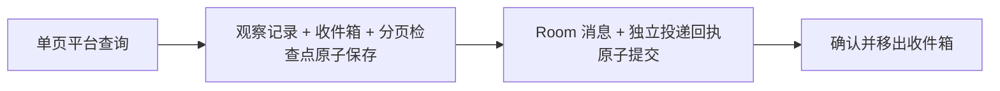

# 平台通知

通知把平台事实可靠送进 Room，不创建 Agent、Membership 或私有 Session，也不自动授予工具权限。当前支持 GitLab 项目活动（`gitlab/events`）和个人待办（`gitlab/todos`）。

## 设置与使用

先在「设置 → 平台连接」保存并验证账号，再打开右侧「通知源 → GitLab」。两个页签独立保存、同步、显示错误和保留草稿；只有显式保存才生效，首次默认不开启。

| 维度 | 项目活动 | 我的待办 |
| --- | --- | --- |
| 目标 | 独立选择连接及项目 HTTPS 地址或 `group/project` | 所选连接的真实账号，稳定 user ID 经服务核验 |
| 范围 | 一个项目；每房间一个未退役订阅 | 所有可访问项目，或同实例的当前 Workspace 项目 |
| Workspace 依赖 | 无；“从 Workspace 预填”仅提供建议 | all 范围无；current 范围需有效且匹配的绑定 |
| 默认周期 | 可接收实例 5 秒，未打开或操作中 30 秒 | 可接收实例 30 秒，未打开或操作中 120 秒 |
| 过滤 | MR 开启/合并/关闭、评论、push、分支和忽略操作者 | mentioned、assigned、review_requested、other；MR 和工作项 |

活动项目保存后不跟随 Workspace 改变，Git 准备失败不影响其查询。待办 current 范围保存项目快照，项目变化后暂停并要求核对保存，不能静默改成 all。用户名仅展示，“我的”指所选连接账号；接收到的内容成为房间公共消息。读取、接收和投递不修改远端待办状态。

首次开启固定基线，不导入基线前历史。普通开关、重启、过滤修改和同账号凭据轮换不重建基线。Events 空过滤列表表示不限；Todos 未提供过滤使用默认全选，显式空数组表示不接收该维度。过滤按事件/待办创建时间选择历史修订，已接收收件项不因后续修改删除。

每次写请求带来源、房间实例、订阅 ID 和预期版本；立即同步只使用已保存配置。有草稿时先保存；响应丢失先读状态，不自动重发。切房、换账号、旧轮询和迟到写响应均不得覆盖新视图。

GitLab 通知中的评论在房间消息和收件箱预览中按 Markdown 展示，已有通知也适用；原始存储及 Agent 输入继续保留转义和提及隔离。项目图片附件支持 `/uploads/<secret>/<filename>`、同实例的项目附件地址，以及 `{width=900 height=536}` 尺寸语法。图片接近可视区域时，浏览器请求 TeamX 的 `/v1/platform/attachments`；后端核对房间、已保存的消息／收件箱条目、订阅和当前连接账号，再携带 PAT 调用 GitLab 附件 API。PAT 不发送到浏览器，图片仅暂存在内存，不落盘、不持久缓存；每张最多 20 MiB，支持 PNG、JPEG、GIF、WebP。HTML、SVG 和外部站点图片不内嵌。附件 API 需要 GitLab 17.4 或以上；权限不足、附件删除或连接失效时显示加载失败入口。

## 公共运行与可靠投递

[notification.Manager](../internal/platform/notification/manager.go) 管理任务、加载、原子保存与投递，[Source / State / Runner](../internal/platform/notification/source.go)提供来源 codec、具体进度与单步查询。来源状态保存在：

```text
<room>/notifications/<provider>.<channel>.<subscription_id>.json
```

公共 envelope 是 `{provider, channel, schema, state}`。启动严格核对 schema、文件名、房间与订阅身份，缺失文件不默认开启；旧通知路径和原格式不再兼容。查询资源独立于成员目录，由服务拥有。



远端页处理成功必须先保存，再推进下一页或缓存。消息提交后、inbox ack 前崩溃时，稳定投递 ID 与 Room 独立回执阻止重复消息；清空公共历史不清除同步进度或回执。向订阅所属且可接收的运行实例投递，与页面是否查看无关；未打开或正在进行生命周期操作的房间继续采集并暂存，待目标可接收时投递。

公共来源键是 provider + channel + subscription ID；来源 item key 按不透明字符串处理。集成作者只陈述对象、操作者、变化、原因和链接，不生成建议、指派或 @ 提及；公开发送接口不能伪造 integration。点击明确来源的消息作者打开对应页签；缺少/未知 channel 不推断为活动消息。

## Events：快查与完整窗口

最新页固定读取 20 条，整页检查，不因遇到已知 ID 或最大 ID 提前结束；去重键是实例 + 项目数字 ID + 事件 ID。未支持类型保留身份和跳过原因，不虚构分支、对象或 SHA。

启动、重连、实例打开和定时检查会触发完整补查。窗口从水位向前重叠 5 分钟且不早于基线，终点固定；Go 适配向外扩展 UTC 日期后按精确 `[start,end)` 本地过滤。只有最后一页提交成功才能推进完整水位。offset 页码不是稳定游标，失败、重启或长时间挂起后从第一页重扫；不能只看最新页证明追平。

ETag 仅用于已验证支持条件请求的快速页，缓存与页面同次落盘，首次任务检查使用无条件请求；`304` 不推进完整水位，也不取消补查。没有 ETag 时继续普通查询。

算法见 [events_poll.go](../internal/platform/gitlab/events_poll.go)、[events.go](../internal/platform/gitlab/events.go)。重叠窗口只能覆盖有限延迟，不保证任意迟到活动或固定入房时延。水位落后超过 24 小时标记 `retention_unverified`，并非推断平台的真实保留期限。

## Todos：个人身份与双状态扫描

连接身份绑定实际解析凭据、generation、credential version 和私有指纹，用户名不能代替稳定 user ID。每轮分别从第一页扫描 pending 和 done，每页最多 100 项；两种状态全部完成才更新 `last_full`，不能将待办 ID 当游标，也不能按创建时间或已知 ID 提前结束。

重启、显式同步、请求失败和长时间挂起会重新扫描，保留已有观察与收件箱。待办去重键为实例 + 接收 user ID + todo ID，同一条 pending → done → pending 仍只投递一次；同对象的 Events 与 Todos 可以分别入房。

片段预算耗尽保留检查点并标记 `scan_incomplete`，不假报完整成功。不可用对象、未知类型和过滤项保留跳过原因；修改过滤不回放已观察项。实现见 [todos_poll.go](../internal/platform/gitlab/todos_poll.go)、[todos_state.go](../internal/platform/gitlab/todos_state.go)。

## 退避、容量与身份变更

每订阅串行查询，网络期间不占目录锁。每次请求及结果提交前重新检查房间、订阅版本、连接和范围，丢弃迟到结果。默认扫描片段为 20 页、16 MiB、30 秒；每订阅最多 100000 观察记录、10000 待投递项、64 MiB 快照，达到上限暂停，不驱逐去重记录或静默丢页。

故障指数退避并遵守服务端等待下限；手动同步、开关和重启不能绕过 Retry-After。401/403 暂停后需显式操作恢复。同账号换凭据需结清旧查询并重新核验；换连接/实例/账号，以及 Events 换项目时，退役旧订阅并建立新 ID 和基线，旧收件箱不转移到新身份。

停用先持久保存新版本，再取消并等待查询。关闭、删房和服务退出均需结清任务，超时保留所有权，迟到结果不得重新创建房间。工具停用不关闭通知，通知停用不撤销工具。

## 接口与验证

管理入口为 `GET /v1/platform/notifications`、`POST /v1/platform/notifications/configure` 和 `/sync`，显式携带 provider/channel、房间身份、订阅 ID 与版本；首次创建为无订阅 ID、版本 0。响应只含公开状态、诊断和配置，不返回凭据指纹或收件正文。结构见 [platform_notifications_http.go](../internal/room/platform_notifications_http.go)。

来源算法测试在 `internal/platform/gitlab`；Room 测试覆盖接纳、身份、投递和恢复。

## 真实验收

使用 `e2e` 标签、[已安装的 DSH 与模型环境](agent-runtime.zh.md#真实验收)和 `GITLAB_PAT`。输出与失败处理要求见[验证说明](../internal/room/README.zh.md#验证入口)。

```sh
go test -tags=e2e ./internal/room -run '^TestRealGitLabEventsDSH$' -count=1 -v -timeout 30m -args \
  -teamx-ge04-output /absolute/new-events-evidence \
  -teamx-ge04-repository https://gitlab.example/group/project.git

go test -tags=e2e ./internal/room -run '^TestRealGitLabTodosDSH$' -count=1 -v -timeout 135m -args \
  -teamx-gt04-output /absolute/new-todos-evidence \
  -teamx-gt04-repository https://gitlab.example/group/project.git
```

Events 由操作者按检查点创建两个新 MR，覆盖在线入房、停服补查、Agent 读取、去重及查询开销。Todos 按 `progress.json` 提示依次完成 `browser-unbound`、`browser-configure`、`live-review-request`、`offline-work-item-mention` 和 `browser-final`；核对真实账号、对象类型、原因、待办 ID、唯一回执和两类消息导航，不主动完成远端待办。夹具须同时匹配 marker、类型和原因，不能仅按标题；不要提前创建夹具或用 API 替代浏览器检查点。

`browser-configure` 要求保存两路订阅：项目活动开启 MR opened 且不忽略操作者；我的待办选 all、全部支持原因和类型、默认 30 秒/120 秒。浏览器检查后另存 `browser.json` 再建立对应 `.ready`，例如：

```json
{"driver":"manual-browser","unbound_entry":true,"configured_both":true,"todos_navigation":true,"events_navigation":true,"observations":"实际操作、观察时间及确认记录"}
```

也可记录真实自动化 driver；未实际观察不能填写通过。当前入口不支持旧检查点续跑参数，中断后不能靠重跑夹具处理结果未知的写入。
