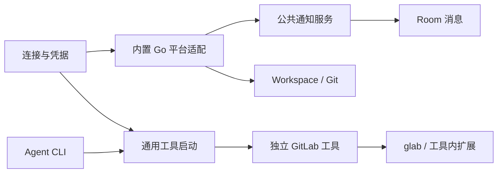

# 平台架构

平台连接、通知、Agent 工具与 Workspace 各自拥有配置和生命周期，按需共享连接。TeamX 内置适配使用 Go；面向 Agent 的平台操作由独立程序承担，复杂流程放在按需读取的 skill 中。

## 模块与依赖

| 模块 | 职责 |
| --- | --- |
| [platform/connection](../internal/platform/connection/) | 全局连接、账号核验、凭据解析与版本证据 |
| [platform/notification](../internal/platform/notification/) | 来源装配、任务生命周期、原子状态保存、收件箱与投递协调 |
| [platform/gitlab](../internal/platform/gitlab/) | 内置账号/项目核验、Events/Todos Go 查询、来源算法及 Workspace 必需的 GitLab 请求 |
| [platform/tool](../internal/platform/tool/) | 静态工具目录、程序定位、版本和环境、子进程及标准流、skill 读取 |
| [tools/gitlab](../tools/gitlab/README.zh.md) | 独立 GitLab Go 工具；原生命令调用固定 glab，缺口由自身 Go 扩展处理 |
| [room](../internal/room/) | 成员工具绑定、接纳与身份检查、查询作用域、最终消息提交和资源结清 |



公共连接、通知和工具模块不依赖具体平台或 Agent 工具；内置 GitLab 不依赖工具运行模块；独立 GitLab 工具不 import TeamX 内部包，也不回调平台业务 RPC。[依赖检查](../internal/platform/boundaries_test.go)覆盖传递依赖。

## 连接与身份

全局设置保存实例和 write-only 凭据，公开状态只包含引用、版本及账号摘要。全局连接的 PAT 记录与连接元数据原子保存在私有的 `platform-connections.json`；Workspace 房间凭据另存于 `credentials/`，均不属于普通公开快照。验证证据关联实际凭据、connection generation、credential version 和稳定账号 ID；不能先核验一个凭据再悄悄用另一个值执行。

工具、通知、Workspace 显式引用连接。删除连接检查各类引用；凭据轮换先阻断受影响的新执行、取消并等待旧任务，再重新核验。换实例或账号需显式重绑，不能继承旧账号的订阅或成员选择。凭据不得进入 URL、日志、提示词、普通 API 或 Session 配置快照。

## Agent 工具入口

```sh
"$TEAMX_CLI" tools list
"$TEAMX_CLI" tools run gitlab --help
"$TEAMX_CLI" tools skill gitlab
```

成员在详情的工具设置中显式启用工具并选择连接。绑定保存在房间 `tool-bindings.json`，关联 AgentID、MembershipID、工具和连接 generation；移除后重加的成员不继承同名旧成员绑定。每成员每工具选择一个连接，无账号工具可以不引用连接。

服务按完整房间身份找到所属实例，再核对 service epoch、实际成员、绑定版本和账号后，仅启动登记的独立程序，原样传递其参数与标准流。它不解释 GitLab 子命令、不维护项目白名单、逐操作授权或外部写入回执。工具沿用所选账号的有效权限；这不是限制平台权限的安全沙箱。旧 PC 阶段的 `platform tools list/execute`、`received_todos` 操作范围、确认令牌与 reconcile 收据协议已移除。

成员 CLI 使用 `POST /v1/tools/list`、`/run`、`/skill`；run 传输二进制 stdin 和分帧 stdout/stderr/退出码，HTTP 中断会取消并结清子进程。工具安装在服务机器上，由服务启动环境定位，Agent shell 的 PATH 不转发给服务。构建、路径与固定 glab 版本见[工具手册](../tools/gitlab/README.zh.md)。

停用绑定、换账号、切房、轮换、删房和退出先阻断新调用，再取消并等待相关进程。取消不能撤销已经发生的远端副作用；断线或超时后先核实远端，不自动重发写入。旧房间资源、Session 和历史操作文件不被服务升级自动改写，旧成员需显式选择连接，不能把旧只读权限自动扩大为完整账号权限。

## 内置适配与扩展

后台 Events/Todos、身份核验、项目核验与 Workspace 必需请求直接使用 Go HTTP，不通过 glab、独立工具或成员 Session，也不需要 Python 查询脚本。查询有时限和正文上限，拒绝重定向，保留安全的 HTTP 状态及等待提示，丢弃远端错误正文；分页与退避由来源算法管理。

连接 provider、通知 source 和工具 catalog 是独立的小型静态注册点。一个能力可以只有通知、只有工具，或不需要连接和 Workspace；不要求实现统一的大接口，不引入动态插件加载。具体进度与 schema 属于来源，公共层不把 GitLab 数字 ID、项目或 PAT 当作所有平台的合同。

接入新平台时，分别增加所需连接核验、通知来源或独立工具；优先复用成熟 CLI，缺口放进工具自身。GitHub 当前尚未实现，提案见 [GitHub 活动方案](GITHUB-EVENTS-PLAN.zh.md)。验证入口及当前待验项见[运行手册](../internal/room/README.zh.md#验证入口)。
