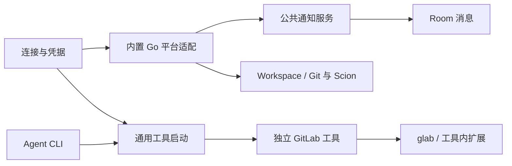

# 平台架构

具体平台表示一份明确账号接入；通知、成员工具与 Workspace 各自拥有配置和生命周期，直接引用平台。TeamX 内置适配使用 Go；Agent 的平台工具入口按类型分派到共用外部程序或已登记的内置能力，复杂流程放在按需读取的 skill 中。

## 模块与依赖

| 模块 | 职责 |
| --- | --- |
| [platform/reference.go](../internal/platform/reference.go)、[reference_capability.go](../internal/platform/reference_capability.go) | 通用原生目标／账号身份、访问上下文，以及可选的解析、分页读取、单次动作合同 |
| [platform/registry](../internal/platform/registry/) | 全局平台、账号核验、凭据解析与版本证据 |
| [platform/notification](../internal/platform/notification/) | 来源装配、任务生命周期、原子状态保存、收件箱与投递协调 |
| [platform/gitlab](../internal/platform/gitlab/) | 内置账号/项目核验、Events/Todos Go 查询、来源算法及 Workspace 必需的 GitLab 请求 |
| [platform/tool](../internal/platform/tool/) | 静态工具目录、程序定位、版本和环境、子进程及标准流、skill 读取 |
| [tools/gitlab](../tools/gitlab/README.zh.md) | 独立 GitLab Go 工具；原生命令调用固定 glab，缺口由自身 Go 扩展处理 |
| [platform/scion](../internal/platform/scion/)、[tools/scion](../tools/scion/README.zh.md) | Scion 受管 profile、原生 subject 核验与目的地址检查；独立封装调用固定 scn，保持原生 Review schema |
| [room](../internal/room/) | 成员工具绑定、接纳与身份检查、查询作用域、最终消息提交和资源结清 |



公共连接、通知和工具模块不依赖具体平台或 Agent 工具；内置 GitLab 不依赖工具运行模块；独立 GitLab 工具不 import TeamX 内部包，也不回调平台业务 RPC。[依赖检查](../internal/platform/boundaries_test.go)覆盖传递依赖。

## 通知准入与成员能力依据

通知适配器通过 [notification/capability.go](../internal/platform/notification/capability.go) 独立注册自动处理准入、历史消息投影和动作消息关联。平台不需要这些能力时可以不实现；GitLab 沿用已有 Inbox 合同。静态装配位于 [platform_notification_capabilities.go](../internal/room/platform_notification_capabilities.go)，Room／Inbox 核心不解释原生会话类型、账号命名空间或平台关系快照。

自动处理准入分别表达是否完成核验，以及完成后的 `allow / excluded` 决定。未核验不等于排除，也不能当作放行。适配器负责原生证据及其 codec，公共协调负责保存不透明证据、退避和顺序消费；已声明需要核验但缺少解析器或权限时，该 Inbox 自动处理等待，不绕过消费游标。排除记录保留供人查看，不创建新的事项；独立 Room 对话仍可运行。飞书本人自聊核验和旧消息包络解释位于 [notification_capability.go](../internal/platform/lark/notification_capability.go)，普通业务会话的本人发言继续作为 `context_only` 上下文。

动作的 `ActionSpec.binding_evidence` 声明是否使用已启用成员能力作为授权依据。空值保留规则／单次指令／human 消息合同；非空值要求服务端生成的同类 `CapabilityEvidence`，不接受 Agent 自选授权模式或提交证明。公共层核对操作者、成员、准确账号／目标、连接代次、凭据与能力版本，并统一保存意图、执行和结清回执；适配器负责原生目标关系，以及可选的 `AppliesTo` 限制。飞书本人投递登记 `self_delivery` 依据，其他平台可登记自己的依据、操作名和目标结构，无需修改动作账本。

成员绑定保存 `capability_evidence`，动作冻结 `capability_basis`。旧 `self_delivery` 字段仅在解码边界转换，不续期凭据或重新派发；既有飞书关系快照路径继续可读。扩展合同的测试使用非飞书适配器，覆盖未核验阻塞、排除／混合消费、独立操作与目标、缺失或失效证明、unknown 不补发及重新打开 Store。核心依赖约束见 [platform_boundaries_test.go](../internal/room/platform_boundaries_test.go)；组件证据不代替真实平台或浏览器验收。

## 连接与身份

全局连接的元数据、OAuth 应用及共享授权原子保存在私有的 `platform-connections.json`（版本 5）；飞书和 Scion 只保存 CLI profile 引用。一条连接就是一个具体平台，平台 ID 沿用原稳定 ID，不另建连接业务对象。[静态类型目录](../internal/platform/catalog.go)登记通知通道和工具实现类型；平台记录的 `tool_entry_id` 独立生成，改名保留、删除重建不复用。入口存在不授予成员权限，当前成员工具命令与绑定方式仍按下节执行。

GitLab 应用所有者仅用于应用管理与导入核验；账号授权按应用 ID 和原生用户 ID 唯一保存，平台通过 `credential_id` 引用准确授权。同一应用可保存多个用户的独立授权；P5 已接通兼容应用选择、实际新账号登录、固定账号重新授权／退出以及完整共同配置影响范围，详见 [平台配置验证](platform-architecture.zh.md#平台配置验证)。首次接入操作在账号核验后复用原通知和工具绑定数据，按固定 Room／成员持久化各部分结果与恢复版本；配置界面复用同一编排：成员「平台」Tab 入口固定完整身份；全局入口仅连接账号。账号、通知和工具分别报告结果，重启后可读取原操作继续。成员详情的「平台」Tab 按准确 Membership／平台列出通知与工具设置的并集，两个开关独立即时保存，详情固定接收者；Room 侧栏只管理直接投递到消息流的「房间通知」。通知开关不提交详情草稿或修改成员工具绑定；添加已有／新平台复用持久首次接入，保留已有选择，通知与工具分别恢复已完成结果。收件箱保留消息与来源导航。旧版本需停服执行显式离线升级，升级前保存私有原快照备份，操作和恢复方式见 [平台配置验证](platform-architecture.zh.md#平台配置验证)。

公开状态只包含引用、版本和账号摘要。GitLab 运行时仅支持 OAuth，Workspace 和工具复用连接，不再保存房间 PAT 或引用服务环境变量。每次远端请求或有界进程通过服务获取短期令牌许可，授权变化先取消并结清旧调用；正常刷新保持稳定授权证据和通知进度。

工具、通知、Workspace 显式引用连接。删除连接检查各类引用；凭据轮换先阻断受影响的新执行、取消并等待旧任务，再重新核验。换实例或账号需显式重绑，不能继承旧账号的订阅或成员选择。凭据不得进入 URL、日志、提示词、普通 API 或 Session 配置快照。

## Agent 工具入口

```sh
"$TEAMX_CLI" tools list
"$TEAMX_CLI" tools run ENTRY --help
"$TEAMX_CLI" tools skill ENTRY
```

`ENTRY` 使用 `tools list` 返回的准确入口，即使只有一个平台也不使用 `gitlab/lark/scion` 类型别名。列表显示入口、平台名称、类型、账号与当前可用能力；同成员可同时启用同类型的多个平台。成员设置分别启用各平台，无需填写程序路径。绑定保存在房间 `tool-bindings.json`，唯一范围为 RoomIdentity、MembershipID、工具类型、platform_id，并核对 AgentID 和平台 generation；移除后重加的成员不继承同名旧成员绑定。无账号工具保留独立入口。

服务按“入口 → 平台 → 当前成员绑定 → 类型实现”解析，核对完整房间身份、service epoch、实际成员、平台 generation、账号和凭据。GitLab、Scion 启动登记的共用独立程序，原样传递参数与标准流；飞书分派到有界内置读取和已开放的托管动作，不转发任意原生 CLI 命令。外部 GitLab 启动器不解释其子命令、不维护项目白名单或外部写入回执。工具沿用所选账号的有效权限；这不是限制平台权限的安全沙箱。旧 PC 阶段的 `platform tools list/execute`、`received_todos` 操作范围、确认令牌与 reconcile 收据协议已移除。

成员 CLI 使用 `POST /v1/tools/list`、`/run`、`/skill`；run 传输二进制 stdin 和分帧 stdout/stderr/退出码，HTTP 中断会取消并结清子进程。工具安装在服务机器上，由服务启动环境定位，Agent shell 的 PATH 不转发给服务。构建、路径与固定 glab 版本见[工具手册](../tools/gitlab/README.zh.md)。

缺少外部程序只移除依赖它的能力，保留成员启用意图。GitLab 内置 HTTP 读取／动作不依赖 glab；飞书读取依赖准确 profile 的 CLI，固定账号动作还依赖当前主机支持。每次发现与执行重新检查，修复依赖后恢复；不会借用另一平台。帮助和 skill 使用相同入口，skill 示例由服务端注入入口标识。

通知／跟进通过保存的订阅或访问证据恢复原平台；历史来源仅在原生接收账号和实例唯一匹配时可恢复，歧义拒绝。`actions resolve/execute --tool ENTRY` 可显式限定平台，入口与引用不一致时拒绝，不切换账号。飞书入口还支持 `tools run ENTRY read ...` 和 `tools run ENTRY actions resolve/execute --request JSON`，沿用现有授权、能力门槛、动作 ID 和回执。

停用绑定、换账号、切房、轮换、删房和退出先阻断新调用，再取消并等待相关进程。取消不能撤销已经发生的远端副作用；断线或超时后先核实远端，不自动重发写入。工具绑定由当前成员显式选择，通知和 Workspace 不赋予工具权限。

## 内置适配与扩展

GitLab 后台 Events/Todos、身份核验、项目核验与 Workspace 必需请求直接使用 Go HTTP，不通过 glab、独立工具或成员 Session，也不需要 Python 查询脚本。查询有时限和正文上限，拒绝重定向，保留安全的 HTTP 状态及等待提示，丢弃远端错误正文；分页与退避由来源算法管理。

连接 provider、通知 source 和工具 catalog 是独立的小型静态注册点。一个能力可以只有通知、只有工具，或不需要连接和 Workspace；不要求实现统一的大接口，不引入动态插件加载。具体进度与 schema 属于来源，公共层不把 GitLab 数字 ID、项目或 PAT 当作所有平台的合同。

### 引用能力边界（R1）

`IdentityScope` 区分 provider、规范实例与可选租户；`TargetIdentity` 保存有序容器层级、原生对象类型／命名空间 ID，以及可选讨论和消息身份。`AccountIdentity` 使用同样的范围和不透明字符串账号 ID，无项目、IID、用户名或数字 ID 要求。URL 仅是定位线索。规范化与原生字段校验由适配器负责，通用层不猜测别名；`TargetIdentity.Key()` 只比较规范身份，不是成员引用或访问令牌。`SourceRef` 可携带可选租户，既有 GitLab 来源保持空租户。

`AccessContext` 单独保存 Room／Membership、接收账号、执行账号、连接 generation 与连接／凭据版本，不包含凭据。`ReadCursor` 绑定目标身份、访问上下文和读取范围，适配器仍须核实游标原生 token；`ReadLimits` 明确约束项数、字节和正文。`TargetResolution` 分开标明对象、讨论、消息是否已核实，并区分 `resolved / partial / unavailable / unsupported / mismatch`；权限不足通过 `permission_denied` 原因码表达，不能当成能力不支持或空结果。

Room 在 [platform_references.go](../internal/room/platform_references.go) 静态装配独立可选的 `ResolveTarget`、`ReadTarget` 和 `ExecuteTargetAction`。动作描述声明操作、目标层级、输入 schema 和重试策略；每次适配调用只尝试一次，Room 后续负责授权、意图保存、重试与回执。通用能力不接收任意 shell、argv 或 API 路径。凭据需求用不透明种类声明，当前 GitLab 适配只声明 `gitlab:oauth`；其原生数字身份仍由 provider 解释，不进入通用层的账号合同。

GitLab 来源解析已按[内部能力方案 A／B](PLATFORM-INTERNAL-CAPABILITIES-PLAN.zh.md)迁入 [platform/gitlab/references.go](../internal/platform/gitlab/references.go)，直接通过 `ReadAPI`／`NewReadAPI` 返回通用 `TargetResolution`；原生对象、IID 别名、note／discussion 映射分别核实。对象可用但讨论读取失败时返回对象级 `partial`，只保存已核实层级。`__reference-resolve`、解析 wire DTO 和旧 `notifications resolve` 已移除；后台通知继续直接使用内置查询。动作也已迁入 [platform/gitlab/actions.go](../internal/platform/gitlab/actions.go)，通过受限 `NoteAPI` 执行 MR 评论／原生讨论回复；`__reference-action` 与动作 wire DTO 已删除。

C 的真实连接验证确认 Issues REST 的 `web_url` 可使用 `/-/work_items/IID`；解析器接受该网页路径，仍逐项核验 REST 原生 ID、IID、项目和实例，不转换 Work Item／GraphQL 身份。当前 10 条失败来源只读解析与隔离副本恢复通过；日常 Room 因失败 Session 无有效回合尚未恢复，详见[分层验收](reference-followups-acceptance.zh.md#内部能力-c真实来源读取与恢复)。

GitLab 目标正文 `Read` 分页尚未登记；R4 已登记 MR `object.comment` 与 `discussion.reply`，平台能力通过可选的只读 `Inspect` 核对当前目标／账号，再由 Room 保存意图并执行。非 GitLab 测试适配器仅证明无通知／无项目的字符串身份能使用同一能力装配和读取／动作合同，不代表生产平台接入。

### 稳定引用与对象跟进（R2）

新 schema 2 已接通系统解析、引用持久化及对象／原生讨论单元。完整规范目标和 Room／Membership 决定稳定引用，账号与凭据变化不重命名对象；每次使用引用仍需核验当前归属和能力。GitLab 装配从当前成员明确选择的工具绑定选取访问上下文，不借用通知或 Workspace 账号。内部解析和动作不要求工具二进制、glab、PATH 或 Workspace 可用；禁用绑定仍会阻止内部办理。已有可信原生对象 ID 可本地定位，其余直接有界 GET。公共 `platformCall` 登记同时管理 HTTP 与工具进程，覆盖连接变更、绑定变更、成员移除、Session 轮换、Room 关闭／删除和服务退出；HTTP body 处理及引用落盘前重新校验，旧响应不得建立新引用。通用跟进编排没有 GitLab 类型分支。

成员 `followups/` 按对象组织目标和可变单元，按原始 Inbox 序号另存事件解析／关联。所有路径确定，单记录原子保存；对象视图从单元派生，不增设跨文件总状态或第二份权威索引。默认只建立对象单元，发现讨论不批量建待办；需要独立跟进时才按原生讨论引用幂等建立子单元，不支持自定义语义 ID。

Inbox 接收与消费协议不变，关联先可靠保存才返回读取回执并允许确认。失败来源使用只读来源引用，消费／重启后仍能从活跃摘要中找到，并保留阻塞原因；恢复和普通重读不自动重试解析。摘要及来源每页最多 25 项、128 KiB，历史按需读取，超限返回分页或容量错误。当前分页针对持久单元和来源，不代表原生正文分页能力已实现。

生产 CLI／HTTP／动态指引／prompt／skill／UI 统一使用此 schema。用户选择重建后，旧事项图、独立决定和动作模型及其兼容读取均已移除。R2 的组件证据见[实施记录](PLATFORM-REFERENCE-AND-FOLLOWUP-REFACTOR-PLAN.zh.md#r2-实施记录2026-11-05)。

### Room 对话与规则积累（R3）

隔离新 schema 的问题、答复和单次指令保存在对应对象／原生讨论的单元快照。问题绑定准确目标、已核实消息与拟议动作，系统确定引用并复用 Room 持久 outbox；读取对应单元时自动关联 human 的显式回复，无回复引用时须有准确问题与关联解释。关联真实原文和恢复待办原子提交，清空公共历史、重建 Store 或 Session 不丢失已保存依据。关联本身不代表授权；当轮办理可直接读取准确依据，只有跨回合工作才另存单次指令。未答问题或有效待落实指令阻止提前办结。

长期规则以成员 `policy.json` 为唯一权威。表达习惯、负责人知识、处理约定与持续代办统一使用自然语言正文及可选有效期，不存类型或另一份业务范围。Agent 根据明确长期 human 指令直接建立、修改、撤销；推测习惯仅保存建议，确认须关联准确已公开版本及真实 human 答复，不能改变正文或有效期。修订保留真实用户、原文、独立解释和预期版本；保存成功才报告，修改／撤销刷新 token，结果未知先恢复核对。有效只表示进入上下文；Agent 对照所有限制判断本次操作授权，服务端核对生命周期与准确执行身份，不验证自然语言业务范围和授权。规则不跨 Room／Membership 自动传播，不启动监听或调度。文件版本保持 1，无旧数据兼容；由用户启用前清理旧 policy、事项／动作快照和 Session 数据。问题、指令、策略历史及字节都有上限，超限拒绝增长。

R5 生产入口使用同一服务，成员 UI 提供规则管理与跟进／来源／回执查看，普通办理通过 Room 对话；[R3 实施记录](PLATFORM-REFERENCE-AND-FOLLOWUP-REFACTOR-PLAN.zh.md#r3-实施记录2026-11-05)区分组件模拟办理与尚未完成的真实模型／平台／浏览器验证。

接入新平台时，分别增加所需连接核验、通知来源或独立工具；优先复用成熟 CLI，缺口放进工具自身。GitHub 当前尚未实现，提案见 [GitHub 活动方案](GITHUB-EVENTS-PLAN.zh.md)。验证入口及当前待验项见[运行手册](../internal/room/README.zh.md#验证入口)。

### 按引用动作（R4）

`followups_actions*.go` 从持久引用和事件证据恢复规范目标、已核实别名及接收账号，只接受引用、操作与正文。有效规则、有效单次指令或真实 human 直接／问题答复三选一，每次尝试前核验当前 token、有效性、回合、实际绑定及准确目标／账号；规则 reason 解释正文中的授权与条件，准确快照持久保存，业务适用范围由 Agent 判断。动作与问题／指令保存在同一有界原子单元，意图保存后才调用适配器；结果未知冻结自动补发，同 ID 仅返回记录，换回合、别名或新 ID 不绕过未知结果。动作成功不自动办结业务，未解决问题和其他未知动作仍进入活跃摘要。

`platform_gitlab_actions.go` 负责成员准入、连接账号转换及公共调用生命周期，内置 GitLab 包处理 GET 核验和单次受限 POST。读取须在返回后核验绑定；写入已知结果按原账号保存，取消不丢弃已核实事实。动作入口进入服务变更等待范围，关房／退出须等待回执结清后关闭 Store。MR 评论沿用最多两次及可能重复的合同，原生讨论回复只有一次且绝不降级；返回结果需核对准确 note、MR、账号和讨论成员关系。通用编排没有 GitLab 类型分支。没有已核实 IID 别名或能力不支持时拒绝写入；当前接收／执行账号相等的约束不放宽。

R5 已统一生产入口，GitLab 原生正文分页未登记。R6 的非 GitLab 测试适配器已贯通相同生产分发及持久链路；旧工具路径曾验收真实 MR 普通评论；当前内部路径的真实两类动作、真实 DSH 全闭环和实际浏览器仍待验收，见[分层验收手册](reference-followups-acceptance.zh.md)。隔离组件、独立进程协议和实际 manager 的工具任务结清证据见 [R4 记录](PLATFORM-REFERENCE-AND-FOLLOWUP-REFACTOR-PLAN.zh.md#r4-实施记录2026-11-05)。

规则范围可使用带 namespace 的 `account_id` 和准确 `tenant`，无父容器对象使用明确 `no_containers:true`；保留现有账号标签和容器范围表达。两类表达不能混填，省略不代表通配，原生账号／租户和有无容器在执行时逐项核对。这样无项目／用户名的平台也能通过相同规则授权链路，无需通用编排判断 provider。

### 生产入口与 schema 检测（R5）

`followups_entry.go` 与 `followups_cli.go` 沿用 inbox read、matters list/update、actions execute，新增按需 read、sources/source、resolve、ensure、notify/reply/instruct 及对话 policy update/publish。Agent 不再提交原生动作目标或 enrich/relate 图，human 管理保留长期规则编辑，详情查看问答和回执；动态指引覆盖冻结角色中的旧合同。新 Room 按需初始化 schema 2；启动校验当前 schema，不保留旧事项扫描、迁移或恢复分支。目录索引为 v3，仅保存完整 `owned_rooms`、`opens`、`shutdowns` 及 Workspace 操作；浏览器在本地保存查看选择，不再读取旧全局选择字段。当前 outbox 为 `followup_notice_receipts`，DSH 必须具备准确 `session.json` 引用，无引用的旧目录不推断恢复。服务不自动删除磁盘数据。完整使用合同见[通知手册](notifications.zh.md)。

## Scion 连接与工具（S2）

Scion 是独立 provider，不注册 GitLab MR、通知或内部动作适配器。profile 引用沿用连接快照 v4；`profile` 为服务私有 `scion-profiles` 下的 opaque ID，`executable` 为固定版本 `teamx-scion` 或原生 `scn` 的绝对路径。账号保留 `scion:subject` 字符串，不填入数字 `UserID`。

当前连接页面通过服务端自动检测已有受管 profile，以实际 `whoami` 结果展示账号；PAT 登录调用固定 CLI，经 stdin 传入秘密，成功后返回非秘密 profile 引用和账号。登录始终创建新 profile，不原地覆盖已有凭据；操作会话仅保存在服务内存，取消和服务退出等待进程结清。登录/检测只允许操作者，不向 Agent 工具开放；失败的新 profile 清理，PAT 不进入公共响应或连接快照。

连接验证和每次业务调用均使用隔离的原生 `whoami`；执行前将当前 origin 的凭据复制到本次私有目录，校验实际 subject 等于已绑定账号，同一副本供业务命令使用。源文件被替换不会让已接纳调用换号。PAT 路径不写回业务进程中的凭据更新；refresh-token 认证另行交付。

工具准备回调在现有 platform call 生命周期内、manager 锁之外执行。连接替换、重新验证、停用、成员变更、关房和退出复用原有取消与等待。Endpoint/Hub 与仓库 URL 的接收 origin 必须匹配当前连接；登录、配置、daemon、自更新由操作者维护。无凭据帮助仍要求成员显式绑定。配置与安装见 [Scion 工具说明](../tools/scion/README.zh.md)，实际验证及未验项见 [Scion 验证与待验项](scion.zh.md#验证与待验项)。


Scion Workspace 通过独立 `internal/workspace/scion` 适配器准备原生工作副本；共用管理仍只负责目录、操作与 Session 生命周期。仓库 kind 与平台 provider 分开校验，旧无 kind 快照不重写。Scion 平台桥接使用固定 CLI 验证 subject、canonical 仓库和已有分支，再以私有凭据副本 clone；账号和操作进程均受连接取消与结清管理，凭据不落入工作副本或 Session。回访与正常重开只检查本地结构和身份，日常工具绑定独立选择。当前实测与浏览器待验边界见 [Scion 验证与待验项](scion.zh.md#验证与待验项)。


### 平台公共模型与格式（P2.5）

公共 `platform.Platform` 表示唯一的平台账号接入；`registry` 保存私有记录、generation 和适配器认证引用，不另建 Connection 管理器。GitLab 的 `credential_id` 仍精确指向 OAuth 用户授权；飞书和 Scion 仍使用各自 CLI profile，公共类型不依赖 registry 或适配器。

通知、工具绑定、Workspace、访问及动作证据统一使用 `platform_id`、`platform_generation`、`platform_version`。全局管理 API 使用 `/v1/platforms` 及其子路径，集合字段为 `platforms`；新请求不接受旧连接字段。平台配置版本与授权／凭据版本继续分别核验。P2.5 沿用 P1 的稳定工具标识；P4 已接通路由，见 [平台配置验证](platform-architecture.zh.md#平台配置验证)。

停服转换入口为 `teamx platforms upgrade --rooms-dir ROOT`，详见 [平台格式升级说明](platform-architecture.zh.md#停服升级)。固定物理文件名 `platform-connections.json` 保留，格式版本升至 6；Room 文件仍由原业务 schema 管理，跨文件平台字段转换由版本 1 的 `platform-model-upgrade.json` 记录统一协调。

## 停服升级

先正常停止服务，备份完整服务根目录，包括私有凭据、Room、Inbox、动作、Session 和工作目录，再执行：

```sh
teamx platforms upgrade --rooms-dir /absolute/service/root
```

命令持有服务目录锁，不启动采集器、模型、CLI 认证或远端动作。公共平台字段转换以已完成既有账号授权和多平台通知升级的数据为输入；不支持的更早格式须先用对应旧程序升级并校验，不能手改版本号跳过。

物理文件名 `platform-connections.json` 保留。跨文件字段转换由 `platform-model-upgrade.json` 协调；后续平台格式仍按各自版本核验。升级只处理服务索引列出的配置、绑定、通知及事项／动作文件，保留业务正文、原生身份、版本数值和回执，不遍历仓库、资源或 DSH 目录，不转换符号链接。

恢复日志以 `0600` 保存变更文件的完整前后像，属于敏感备份。多文件提交不是单一事务：日志未完成时阻止服务启动，停服重跑相同命令核对原始或已提交内容，遇到第三种内容报冲突；成功后的重复升级不覆盖新业务状态。回退使用配套完整目录备份，不能只回退全局配置或用旧恢复日志覆盖升级后的新写入。

## 平台配置验证

平台配置、账号隔离、通知与工具开关、格式升级和中断恢复已有本地组件／integration 覆盖；前端测试使用模拟 API，不能代替真实平台或实际浏览器。日常命令见[测试说明](testing.zh.md)。

GitLab 双账号持续使用、共同应用变更与多账号远端撤销隔离，飞书账号／profile 实机隔离，以及真实平台整体验收仍待完成。GitLab 单连接的自然到期刷新与后端退出已有通过记录，重新登录恢复等缺口见 [OAuth 复跑手册](gitlab-oauth-g5-acceptance.zh.md)。同应用仍有其他活动授权时，不把本地退出视为远端撤销完成。
