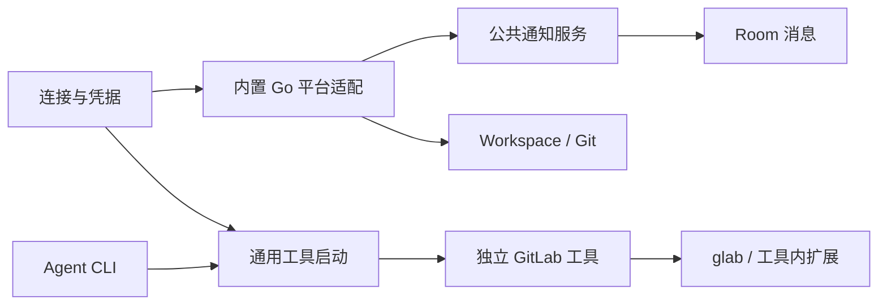

# 平台架构

平台连接、通知、Agent 工具与 Workspace 各自拥有配置和生命周期，按需共享连接。TeamX 内置适配使用 Go；面向 Agent 的平台操作由独立程序承担，复杂流程放在按需读取的 skill 中。

## 模块与依赖

| 模块 | 职责 |
| --- | --- |
| [platform/reference.go](../internal/platform/reference.go)、[reference_capability.go](../internal/platform/reference_capability.go) | 通用原生目标／账号身份、访问上下文，以及可选的解析、分页读取、单次动作合同 |
| [platform/connection](../internal/platform/connection/) | 全局连接、账号核验、凭据解析与版本证据 |
| [platform/notification](../internal/platform/notification/) | 来源装配、任务生命周期、原子状态保存、收件箱与投递协调 |
| [platform/gitlab](../internal/platform/gitlab/) | 内置账号/项目核验、Events/Todos Go 查询、来源算法及 Workspace 必需的 GitLab 请求 |
| [platform/tool](../internal/platform/tool/) | 静态工具目录、程序定位、版本和环境、子进程及标准流、skill 读取 |
| [tools/gitlab](../tools/gitlab/README.zh.md) | 独立 GitLab Go 工具；原生命令调用固定 glab，缺口由自身 Go 扩展处理 |
| [room](../internal/room/) | 成员工具绑定、接纳与身份检查、查询作用域、最终消息提交和资源结清 |



公共连接、通知和工具模块不依赖具体平台或 Agent 工具；内置 GitLab 不依赖工具运行模块；独立 GitLab 工具不 import TeamX 内部包，也不回调平台业务 RPC。[依赖检查](../internal/platform/boundaries_test.go)覆盖传递依赖。

## 连接与身份

全局设置保存实例和 write-only 凭据，公开状态只包含引用、版本及账号摘要。全局连接的 PAT 记录与连接元数据原子保存在私有的 `platform-connections.json`；Workspace 房间凭据另存于 `credentials/`，均不属于普通公开快照。验证证据关联实际凭据、connection generation、credential version 和稳定账号 ID；不能先核验一个凭据再悄悄用另一个值执行。

工具、通知、Workspace 显式引用连接。删除连接检查各类引用；凭据轮换先阻断受影响的新执行、取消并等待旧任务，再重新核验。换实例或账号需显式重绑，不能继承旧账号的订阅或成员选择。凭据不得进入 URL、日志、提示词、普通 API 或 Session 配置快照。

## Agent 工具入口

```sh
"$TEAMX_CLI" tools list
"$TEAMX_CLI" tools run gitlab --help
"$TEAMX_CLI" tools skill gitlab
```

成员在详情的工具设置中显式启用工具并选择连接。绑定保存在房间 `tool-bindings.json`，关联 AgentID、MembershipID、工具和连接 generation；移除后重加的成员不继承同名旧成员绑定。每成员每工具选择一个连接，无账号工具可以不引用连接。

服务按完整房间身份找到所属实例，再核对 service epoch、实际成员、绑定版本和账号后，仅启动登记的独立程序，原样传递其参数与标准流。它不解释 GitLab 子命令、不维护项目白名单、逐操作授权或外部写入回执。工具沿用所选账号的有效权限；这不是限制平台权限的安全沙箱。旧 PC 阶段的 `platform tools list/execute`、`received_todos` 操作范围、确认令牌与 reconcile 收据协议已移除。

成员 CLI 使用 `POST /v1/tools/list`、`/run`、`/skill`；run 传输二进制 stdin 和分帧 stdout/stderr/退出码，HTTP 中断会取消并结清子进程。工具安装在服务机器上，由服务启动环境定位，Agent shell 的 PATH 不转发给服务。构建、路径与固定 glab 版本见[工具手册](../tools/gitlab/README.zh.md)。

停用绑定、换账号、切房、轮换、删房和退出先阻断新调用，再取消并等待相关进程。取消不能撤销已经发生的远端副作用；断线或超时后先核实远端，不自动重发写入。工具绑定由当前成员显式选择，通知和 Workspace 不赋予工具权限。

## 内置适配与扩展

后台 Events/Todos、身份核验、项目核验与 Workspace 必需请求直接使用 Go HTTP，不通过 glab、独立工具或成员 Session，也不需要 Python 查询脚本。查询有时限和正文上限，拒绝重定向，保留安全的 HTTP 状态及等待提示，丢弃远端错误正文；分页与退避由来源算法管理。

连接 provider、通知 source 和工具 catalog 是独立的小型静态注册点。一个能力可以只有通知、只有工具，或不需要连接和 Workspace；不要求实现统一的大接口，不引入动态插件加载。具体进度与 schema 属于来源，公共层不把 GitLab 数字 ID、项目或 PAT 当作所有平台的合同。

### 引用能力边界（R1）

`IdentityScope` 区分 provider、规范实例与可选租户；`TargetIdentity` 保存有序容器层级、原生对象类型／命名空间 ID，以及可选讨论和消息身份。`AccountIdentity` 使用同样的范围和不透明字符串账号 ID，无项目、IID、用户名或数字 ID 要求。URL 仅是定位线索。规范化与原生字段校验由适配器负责，通用层不猜测别名；`TargetIdentity.Key()` 只比较规范身份，不是成员引用或访问令牌。`SourceRef` 可携带可选租户，既有 GitLab 来源保持空租户。

`AccessContext` 单独保存 Room／Membership、接收账号、执行账号、连接 generation 与连接／凭据版本，不包含凭据。`ReadCursor` 绑定目标身份、访问上下文和读取范围，适配器仍须核实游标原生 token；`ReadLimits` 明确约束项数、字节和正文。`TargetResolution` 分开标明对象、讨论、消息是否已核实，并区分 `resolved / partial / unavailable / unsupported / mismatch`；权限不足通过 `permission_denied` 原因码表达，不能当成能力不支持或空结果。

Room 在 [platform_references.go](../internal/room/platform_references.go) 静态装配独立可选的 `ResolveTarget`、`ReadTarget` 和 `ExecuteTargetAction`。动作描述声明操作、目标层级、输入 schema 和重试策略；每次适配调用只尝试一次，Room 后续负责授权、意图保存、重试与回执。通用能力不接收任意 shell、argv 或 API 路径。凭据需求用不透明种类声明，当前 GitLab 适配仍使用 PAT，现有连接核验／Workspace 的原生数字字段没有全量迁移。

GitLab 来源解析已按[内部能力方案 A／B](PLATFORM-INTERNAL-CAPABILITIES-PLAN.zh.md)迁入 [platform/gitlab/references.go](../internal/platform/gitlab/references.go)，直接通过 `ReadAPI`／`NewReadAPI` 返回通用 `TargetResolution`；原生对象、IID 别名、note／discussion 映射分别核实。对象可用但讨论读取失败时返回对象级 `partial`，只保存已核实层级。`__reference-resolve`、解析 wire DTO 和旧 `notifications resolve` 已移除；后台通知继续直接使用内置查询。动作也已迁入 [platform/gitlab/actions.go](../internal/platform/gitlab/actions.go)，通过受限 `NoteAPI` 执行 MR 评论／原生讨论回复；`__reference-action` 与动作 wire DTO 已删除。

C 的真实连接验证确认 Issues REST 的 `web_url` 可使用 `/-/work_items/IID`；解析器接受该网页路径，仍逐项核验 REST 原生 ID、IID、项目和实例，不转换 Work Item／GraphQL 身份。当前 10 条失败来源只读解析与隔离副本恢复通过；日常 Room 因失败 Session 无有效回合尚未恢复，详见[分层验收](reference-followups-acceptance.zh.md#内部能力-c真实来源读取与恢复)。

GitLab 目标正文 `Read` 分页尚未登记；R4 已登记 MR `object.comment` 与 `discussion.reply`，平台能力通过可选的只读 `Inspect` 核对当前目标／账号，再由 Room 保存意图并执行。非 GitLab 测试适配器仅证明无通知／无项目的字符串身份能使用同一能力装配和读取／动作合同，不代表生产平台接入。

### 稳定引用与对象跟进（R2）

新 schema 2 已接通系统解析、引用持久化及对象／原生讨论单元。完整规范目标和 Room／Membership 决定稳定引用，账号与凭据变化不重命名对象；每次使用引用仍需核验当前归属和能力。GitLab 装配从当前成员明确选择的工具绑定选取访问上下文，不借用通知或 Workspace 账号。内部解析和动作不要求工具二进制、glab、PATH 或 Workspace 可用；禁用绑定仍会阻止内部办理。已有可信原生对象 ID 可本地定位，其余直接有界 GET。公共 `platformCall` 登记同时管理 HTTP 与工具进程，覆盖连接变更、绑定变更、成员移除、Session 轮换、Room 关闭／删除和服务退出；HTTP body 处理及引用落盘前重新校验，旧响应不得建立新引用。通用跟进编排没有 GitLab 类型分支。

成员 `followups/` 按对象组织目标和可变单元，按原始 Inbox 序号另存事件解析／关联。所有路径确定，单记录原子保存；对象视图从单元派生，不增设跨文件总状态或第二份权威索引。默认只建立对象单元，发现讨论不批量建待办；需要独立跟进时才按原生讨论引用幂等建立子单元，不支持自定义语义 ID。

Inbox 接收与消费协议不变，关联先可靠保存才返回读取回执并允许确认。失败来源使用只读来源引用，消费／重启后仍能从活跃摘要中找到，并保留阻塞原因；恢复和普通重读不自动重试解析。摘要及来源每页最多 25 项、128 KiB，历史按需读取，超限返回分页或容量错误。当前分页针对持久单元和来源，不代表原生正文分页能力已实现。

生产 CLI／HTTP／动态指引／prompt／skill／UI 统一使用此 schema。用户选择重建后，旧事项图、独立决定和动作模型及其兼容读取均已移除。R2 的组件证据见[实施记录](PLATFORM-REFERENCE-AND-FOLLOWUP-REFACTOR-PLAN.zh.md#r2-实施记录2026-11-05)。

### Room 对话与规则积累（R3）

隔离新 schema 的问题、答复和单次指令保存在对应对象／原生讨论的单元快照。问题绑定准确目标、已核实消息与拟议动作，系统确定引用并复用 Room 持久 outbox；读取对应单元时自动关联 human 的显式回复，无回复引用时须有准确问题与关联解释。关联真实原文和恢复待办原子提交，清空公共历史、重建 Store 或 Session 不丢失已保存依据。关联本身不代表授权；当轮办理可直接读取准确依据，只有跨回合工作才另存单次指令。未答问题或有效待落实指令阻止提前办结。

长期规则仍以成员 `policy.json` 为唯一权威。偏好和规则用一段自然语言正文表达要求、前提与例外；规则另存程序核验所需的目标身份范围，不单独生成范围说明或拆分业务条件。生产对话服务允许 Agent 根据明确长期 human 指令直接建立、修改、撤销规则／偏好；推测习惯仅保存建议，确认必须关联已公开的准确建议版本与真实 human 答复。策略修订保留来源用户、原文、解释和预期版本，保存成功后才返回有效视图；撤销／修改刷新动作 token，结果未知冻结写入并要求重开核对。语义解释仍由 Agent 负责，组件校验不证明自然语言理解准确。问题、指令、策略历史及字节都有上限，超限拒绝增长，不静默丢弃依据。

R5 生产入口使用同一服务，成员 UI 提供规则管理与跟进／来源／回执查看，普通办理通过 Room 对话；[R3 实施记录](PLATFORM-REFERENCE-AND-FOLLOWUP-REFACTOR-PLAN.zh.md#r3-实施记录2026-11-05)区分组件模拟办理与尚未完成的真实模型／平台／浏览器验证。

接入新平台时，分别增加所需连接核验、通知来源或独立工具；优先复用成熟 CLI，缺口放进工具自身。GitHub 当前尚未实现，提案见 [GitHub 活动方案](GITHUB-EVENTS-PLAN.zh.md)。验证入口及当前待验项见[运行手册](../internal/room/README.zh.md#验证入口)。

### 按引用动作（R4）

`followups_actions*.go` 从持久引用和事件证据恢复规范目标、已核实别名及接收账号，只接受引用、操作与正文。有效规则、有效单次指令或真实 human 直接／问题答复三选一，每次尝试前核验当前 token、范围、有效性、回合和绑定。动作与问题／指令保存在同一有界原子单元，意图保存后才调用适配器；结果未知冻结自动补发，同 ID 仅返回记录，换回合、别名或新 ID 不绕过未知结果。动作成功不自动办结业务，未解决问题和其他未知动作仍进入活跃摘要。

`platform_gitlab_actions.go` 负责成员准入、连接账号转换及公共调用生命周期，内置 GitLab 包处理 GET 核验和单次受限 POST。读取须在返回后核验绑定；写入已知结果按原账号保存，取消不丢弃已核实事实。动作入口进入服务变更等待范围，关房／退出须等待回执结清后关闭 Store。MR 评论沿用最多两次及可能重复的合同，原生讨论回复只有一次且绝不降级；返回结果需核对准确 note、MR、账号和讨论成员关系。通用编排没有 GitLab 类型分支。没有已核实 IID 别名或能力不支持时拒绝写入；当前接收／执行账号相等的约束不放宽。

R5 已统一生产入口，GitLab 原生正文分页未登记。R6 的非 GitLab 测试适配器已贯通相同生产分发及持久链路；旧工具路径曾验收真实 MR 普通评论；当前内部路径的真实两类动作、真实 DSH 全闭环和实际浏览器仍待验收，见[分层验收手册](reference-followups-acceptance.zh.md)。隔离组件、独立进程协议和实际 manager 的工具任务结清证据见 [R4 记录](PLATFORM-REFERENCE-AND-FOLLOWUP-REFACTOR-PLAN.zh.md#r4-实施记录2026-11-05)。

规则范围可使用带 namespace 的 `account_id` 和准确 `tenant`，无父容器对象使用明确 `no_containers:true`；保留现有账号标签和容器范围表达。两类表达不能混填，省略不代表通配，原生账号／租户和有无容器在执行时逐项核对。这样无项目／用户名的平台也能通过相同规则授权链路，无需通用编排判断 provider。

### 生产入口与 schema 检测（R5）

`followups_entry.go` 与 `followups_cli.go` 沿用 inbox read、matters list/update、actions execute，新增按需 read、sources/source、resolve、ensure、notify/reply/instruct 及对话 policy update/publish。Agent 不再提交原生动作目标或 enrich/relate 图，human 管理保留偏好／规则编辑，详情查看问答和回执；动态指引覆盖冻结角色中的旧合同。新 Room 按需初始化 schema 2；启动校验当前 schema，不保留旧事项扫描、迁移或恢复分支。目录索引为 v3，仅保存完整 `owned_rooms`、`opens`、`shutdowns` 及 Workspace 操作；浏览器在本地保存查看选择，不再读取旧全局选择字段。当前 outbox 为 `followup_notice_receipts`，DSH 必须具备准确 `session.json` 引用，无引用的旧目录不推断恢复。服务不自动删除磁盘数据。完整使用合同见[通知手册](notifications.zh.md)。
