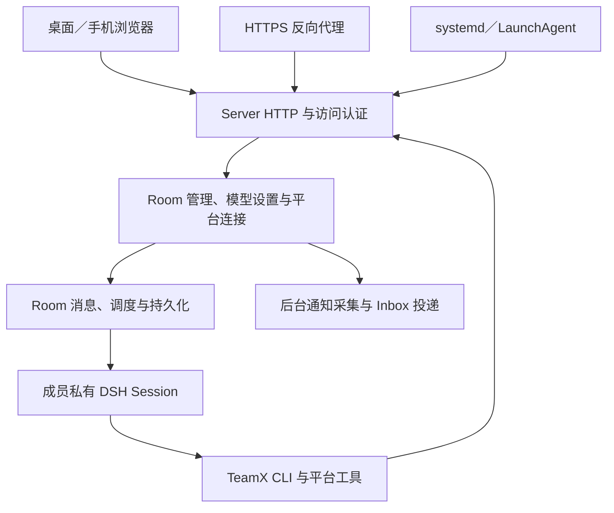

# Server 架构

TeamX 的执行主体是独立 Server。桌面和手机浏览器连接同一服务，复用嵌入 Go 程序的 Web 界面；Room、DSH、Workspace、模型凭据和平台连接均在服务机器上运行或保存。关闭页面只结束查看，已受理的协作与平台采集继续由 Server 管理。

本文面向理解实现与扩展系统的开发者，解释组件、身份、存储和生命周期。安装、运行与维护统一见[安装与运行](installation.zh.md)；产物构建见[打包指南](../packaging/README.zh.md)，发布流程见[正式发行指南](../packaging/releasing.zh.md)。

## 组件与职责



| 组件 | 职责与运行位置 |
| --- | --- |
| Web Client | 登录、对话、设置和状态展示；不持有平台 token，不执行 Agent |
| Server | 认证和请求身份、多个 Room 的生命周期、模型操作、平台授权与通知后台任务 |
| Room／Session | 消息、成员、调度、取消、结清与恢复；详见 [Room 架构](room-architecture.zh.md)和 [Agent 运行时](agent-runtime.zh.md) |
| 系统服务管理器 | 启停、开机／登录启动、故障重试和日志；业务降级在 Server 中处理 |
| HTTPS 反向代理 | 远程 HTTPS 入口、证书及续期，由部署者独立配置 |

一个 Server 实例对应一个私有 home 和固定所有者。多个浏览器登录后操作同一份业务状态，不是多用户租户系统。实例身份持久保存，`ServiceEpoch` 每次服务启动变化；Room 和成员另有自己的代际身份，不能把旧请求换成新身份重发。

## 安装根、home 与账号 HOME

常驻安装将程序版本与私有数据分开：

```text
<server-root>/
  installation.json       # 固定实例身份和目录绑定
  service.json            # 系统服务与运行账号登记
  current -> releases/<build-id>
  releases/<build-id>/    # 每版完整归档：bin、Node／DSH、资源和清单

<home>/
  config.toml
  auth/                   # 管理 token
  model-credentials/      # 托管模型 Key 及历史版本
  model-operations/       # 模型切换与恢复进度
  model-validations/
  model-migration-backup/
  teams/                  # 用户团队模板
  data/                   # Room、Session、Inbox、Workspace 等
```

home 与安装根互不重叠，受管 data 也不能放进安装根。home／data 锁防止两个 Server 同时写入，部署命令另有安装锁。具体默认路径与账号要求见[安装指南](installation.zh.md#常驻安装standard)。

TeamX home 不等于操作系统账号的 `HOME`。服务保留部署账号真实 HOME；官方 CLI 配置、加密后端或 Keychain 属于该账号环境，不能认为备份 TeamX home 已覆盖平台凭据。服务使用固定最小环境，不加载 shell 配置，不继承终端中 export 的模型 Key 或代理；平台授权应由实际部署账号执行。

`current` 是下一次启动的版本选择器。启动时将托管 DSH 解析到真实 release 路径，再交给 Room 冻结；已有 Room／Session 继续依赖原运行时。升级保留旧版本，保证执行快照引用的依赖仍可用。归档不是单个 Go binary，而是包含 Node／DSH、工具、Web 与模板的版本闭包。

## 访问与身份边界

HTTP／CLI 边界将已验证的身份映射到现有 `Caller`；Room 内部继续按原身份、成员和生命周期规则判断请求。管理 token 对应本实例同一所有者；浏览器用 token 换取仅保存在服务内存的 HttpOnly 会话 Cookie，重启与 token 轮换会撤销会话，不引入持久用户账号系统。

DSH Session 使用绑定 Room、成员和服务代际的独立执行凭据，不继承管理 token，也不能管理 Server 或模型设置。本机免登录仍校验来源和固定 human 身份，不取消 Agent 身份检查。

`local`、`lan`、`proxy` 分别限定本机、可信局域网和规范 HTTPS 入口。远程模式强制登录，受管常驻安装在所有模式下均要求登录。代理请求须匹配规范 origin 和可信代理；内部 Agent 始终使用实际 loopback endpoint。访问模式只影响服务边界，不改变成员授权。

飞书授权由 Server 持有官方 Device Flow，浏览器只展示验证入口并查询原操作。GitLab 使用原浏览器 Cookie、state 和 PKCE 绑定回调；其他已登录设备可以查看共享结果，不能接管原授权绑定。页面关闭与显式取消分别处理，外部授权不转移到 Room 的私有模型上下文中。

## 生命周期与恢复

Server 生命周期接受 context 取消，前台入口适配终端信号，常驻入口由系统服务管理器监管。正常停止先停止受理和调度，再结清 Room、工具及数据写入；浏览器生命周期不参与该过程。系统服务的有界故障重试不替代业务恢复，平台或模型降级不作为反复重启的理由。

缺少可用模型时进入 `setup_required`，只运行访问与模型设置服务，不启动 Room、平台 worker 或业务工具。网页真实验证成功后进入业务服务；已有有效模型不在每次启动时联网重验。公开 health 与端口连通只表示有限状态，认证后的状态检查才核对实例与业务恢复情况。

在线模型控制器区分配置提交与逐成员实际生效，等待活动回合结束后复用 Session rotation。服务重启后按持久化操作和执行快照恢复，不重新发起已完成轮换，也不自动重放未知结果的验证或平台动作。业务恢复继续使用原 Room、Session 与平台生命周期规则。

部署升级按“校验发布 → 停旧 → 独占数据 → 一致备份 → 切换 current → 启动与认证检查”执行。备份覆盖整个 home、全部 releases 和安装登记；失败保留备份与新选择，不自动回退 binary。恢复要求同一登记、账号和绝对路径，平台官方凭据和外部依赖另有边界。具体操作及限制见[备份与升级](installation.zh.md#备份与升级)。

## 分发与当前边界

源码构建、归档前台运行与系统服务安装复用同一服务核心。安装命令消费匹配本机的 standard 归档，部署材料随版本闭包交付；Web 由同一 Server 提供，没有单独的浏览器客户端安装包。正式发行使用已验收的同一归档，外部资格绑定归档摘要，包内 manifest 保留构建时状态。

当前仍是开发预览，真实设备、平台与持续观察等正式出口以[发行验收记录](implementation/server-release-acceptance.zh.md)为准。Electron 轻量客户端、桌面一体安装、手机 App 和原生通知保留在[后续 W7–W10](DESKTOP-APPLICATION-ANALYSIS-AND-PLAN.zh.md#14-保留的后续阶段w7w10)，不作为当前 Web 实现的依赖。

## 代码阅读入口

| 位置 | 内容 |
| --- | --- |
| [serve.go](../internal/room/serve.go)／[server_layout.go](../internal/room/server_layout.go) | 可取消服务生命周期、home 独占、版本选择和安装身份 |
| [server_access.go](../internal/room/server_access.go)／[access_settings.go](../internal/room/access_settings.go) | 所有者认证、浏览器会话、执行凭据与访问模式 |
| [server_setup.go](../internal/room/server_setup.go) | 受限模型设置与进入业务服务 |
| [service_cli.go](../internal/room/service_cli.go)／[service_manager.go](../internal/room/service_manager.go) | 部署命令、系统服务、最小账号环境与状态核对 |
| [service_archive.go](../internal/room/service_archive.go)／[service_backup.go](../internal/room/service_backup.go) | 归档校验、版本发布和一致备份恢复 |
| [package.mjs](../scripts/package.mjs) | 固定依赖、随包白名单与归档构建 |

设计演进见[原方案](DESKTOP-APPLICATION-ANALYSIS-AND-PLAN.zh.md)，最终验证与待验项见[发行验收记录](implementation/server-release-acceptance.zh.md)；日常操作统一使用[安装与运行](installation.zh.md)。
