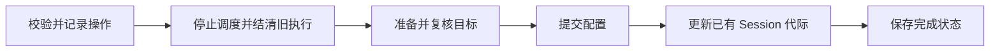

# Workspace

Workspace 是成员实际工作的本地目录，Git 仓库和平台绑定都是可选能力。房间创建只准备普通目录；需要代码时再通过输入框下方的 Workspace 入口显式应用。平台 API 工具、通知与 Workspace 分别配置。

## 配置与准备

生效配置保存在 `room-config.json`，带 `workspace_version`。默认根目录为房间内 `workspaces`，每个成员使用 `<root>/<membership_id>/`；成员独立 clone，不能把相同仓库视作共享工作树。

根路径只接受房间内相对目录，拒绝越界、符号链接及与管理数据重叠。团队模板的仓库和平台字段只提供预填建议，不在创建时自动 clone 或绑定。具体模型与校验见 [workspace_config.go](../internal/room/workspace_config.go)。

| 配置 | 准备内容 |
| --- | --- |
| 普通目录 | 创建或核对各成员目录 |
| 仅 Git | 使用 HTTPS 仓库 URL，首次 clone 并按需 checkout |
| GitLab 绑定 | 从仓库 URL 派生实例与项目，核验目标与账号，准备 Git 作者和限定仓库路径的认证 |

GitLab 绑定只引用全局 OAuth 连接。URL 不接受内嵌账号、密码、查询参数或 fragment。短期令牌不进入 remote URL、命令参数、成员环境或响应；网络 Git 使用 `teamx workspace-git fetch/push/ls-remote`，由服务取得有界令牌许可并等待进程结束。Git 读写需要 `write_repository`，本地 diff／commit 仍直接使用 Git。

已有仓库、目录和项目只读，不能通过设置换仓库；同仓库可补 GitLab 或替换认证。普通根路径调整仅适用于未关联仓库的房间。首次绑定使用新的受管目录，保留旧普通目录及产物。

回访已有绑定只做本地目录、origin 和配置核对，不自动 fetch、checkout、reset、clean 或查询远端。clone 失败保留 `.clone-pending` 等现场，重试不得覆盖半成品或脏文件。实现见 [workspace.go](../internal/room/workspace.go)。

## 应用与恢复



操作由服务持有，使用稳定操作 ID、原配置版本、冻结目标及提交进度。已有 Session 先结清再轮换；从未启动的成员不做空轮换。新 Session 按需创建，成功不重发草稿，也不自动重放失败、中断或排队旧工作。

配置、操作与 Session 引用跨文件无原子事务。失败或中断保留证据并阻止执行；显式重试核对当前配置是否为原状态或完整目标，再按原目标恢复。已准备阶段只做本地复核，不重新 clone 或查询平台。替换结果不确定时冻结存储，关闭并重新打开后核查。

操作期间公共历史与状态可观察，成员执行及冲突管理操作被阻断。完成后成员服务 epoch 变化；客户端刷新身份，不能用旧身份继续写入。计时记录中的 `sessions` 是引用更新与组装耗时，不等于真实模型或 ACP 新建耗时。

## 管理接口

| 接口 | 身份与行为 |
| --- | --- |
| `GET /v1/workspace` | 目录 `service_epoch`、`caller_id`、RoomID/RoomInstance，可带 `operation_id`；返回配置、成员路径、操作状态及建议值 |
| `POST /v1/workspace/apply` | human caller、目录/房间身份、32 位小写十六进制 `operation_id`、`expected_version`、`target`；连接引用另带 `connection_version` |
| `POST /v1/workspace/retry` | 同样的管理身份及原操作 ID；拒绝新目标或凭据字段 |

同 ID 同参数返回已有操作，不重新执行；参数不同则冲突。操作只保存平台连接引用；`credential_status=configured` 表示当前授权证据可解析，不证明远端权限仍有效。请求结构与实际阶段见 [workspace_management.go](../internal/room/workspace_management.go)、[workspace_records.go](../internal/room/workspace_records.go)。

## 页面与凭据

页面展示当前目录、各成员路径、配置版本和初始化进度。轮询不覆盖同版本编辑，切房和迟到响应按房间实例隔离。页面不接收凭据，只选择已有 OAuth 连接。浏览器仅保存按房间和操作者隔离的原操作 ID。

响应超时先查原操作，不自动重发。失败时只能显式重试原目标；查不到收据不证明原操作从未提交，需核查后主动放弃未确认状态、重新填写并使用新 ID。连接轮换、引用保护与工具进程结清见[平台架构](platform-architecture.zh.md)。

当前受管房间要求完整 runtime 与 Workspace 快照，不再提供旧运行时或 Workspace 迁移命令。使用方法见[根 README](../README.md)。

## 真实验收

[TestRealWorkspaceGitLabDSH](../internal/room/workspace_real_test.go) 使用[已安装的 DSH 与模型环境](agent-runtime.zh.md#真实验收)，通过 `TEAMX_REAL_OAUTH_SNAPSHOT` 指定已登录的私有 OAuth 连接快照（`write_repository` 已授权）：

```sh
TEAMX_REAL_OAUTH_SNAPSHOT=/absolute/platform-connections.json \
 go test ./internal/room -run '^TestRealWorkspaceGitLabDSH$' -count=1 -v -timeout 20m -args \
  -teamx-workspace-real-output /absolute/new-workspace-evidence \
  -teamx-workspace-repository https://gitlab.example/group/project.git \
  -teamx-management-env-file /absolute/credentials.env \
  -teamx-management-base-url https://model.example/v1
```

输出与失败处理要求见[验证说明](../internal/room/README.zh.md#验证入口)。默认 DOM 驱动连接生产 HTTP，不算实际浏览器；追加 `-teamx-workspace-browser` 才等待人工页面创建、讨论和绑定，再核对后端结果。该场景不写远端，只读与 clone 不证明 push、MR 或评论通过。

当前仍需补验 Go Workspace / Git 请求链的真实 HTTPS clone/fetch/push/askpass、准确 SHA checkout，以及 Workspace 的实际浏览器闭环。离线 bare Git 测试不能替代目标实例验证。
